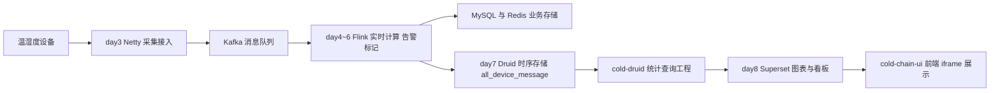

# 数据可视化收官：维度指标复盘与冷链监控平台八天链路闭环

总结课最容易被划过去，恰恰它最值钱：day8 一天的内容横跨概念（维度指标）、方法论（五步出图）、工具（Superset）三层，加上平台前七天的积累，正好在这天收束成一条完整链路。把总结做扎实，面试里讲项目时才有「从设备到图表」的全景话术。

## 先给结论

- 维度是衡量事物的分类（地区、时间），指标是衡量分类的可量化属性（人口、告警条数），这套语言是和产品、业务人员沟通的通用语。
- 数据可视化分科学可视化、信息可视化、可视分析学三类；目标一句话：把不容易理解的数据用容易理解的形式表达，千言万语不如一图。
- 做可视化的五步：定义问题、确定数据与数据结构、确定维度字段、确定图表类型、确定图表交互。
- 常见坑集中在四点：图表误用、PC 与移动端工具选型、两端接口口径差异、数据量超出前端处理能力。
- Superset 闭环走完：Docker 安装、Druid 数据源、温度预警折线图与湿度预警柱状图、iframe 嵌回 Vue 看板，冷链监控平台八天形成「接入、计算、存储、统计、可视化」的完整链路。

## 一、概念层：维度、指标与可视化的目标

维度与指标这对概念，把业务语言和图表配置接在了一起。维度是衡量一个事物的分类角度，比如地区、时间、仓库；指标是衡量这个分类下具体数量的可量化属性，比如人口、GDP、告警条数。产品人员说「按仓库看每小时温度预警」，翻译过来就是维度仓库加时间粒度小时，指标告警计数。沟通对齐了维度与指标，图表配置就不会返工。

可视化的分类按对象分成三支：科学可视化面向科学计算数据，信息可视化面向抽象的业务信息，可视分析学把分析与可视化揉在一起。三类对应的场景、工具与开发框架有差别，冷链平台做的是典型的信息可视化与可视分析。目标则一致：数据本身不容易被理解，可视化把它变成容易感受的形式，一图胜千言。

## 二、过程层：五步把问题变成图

可视化有一套标准过程，画成流程就是从数据出发，经过过滤、视觉映射、渲染，最终以交互式视图呈现给用户，用户再通过界面控件反过来控制视图。落到工程操作是五步：

1. 定义要解决的问题，比如某仓库销售额在涨还是跌，或某仓库温度告警是不是变多；
2. 确定要展示的数据与数据结构；
3. 确定数据的维度字段；
4. 确定图表类型；
5. 确定图表交互。

定义问题排第一步不是偶然：分析可以从趋势、对比、分布、流程、时间、关联性等角度切入，角度没定，后面四步全是猜测。冷链平台正好是五步的完整样本：问题是按仓库看每小时温度预警，数据是 Druid 的 all_device_message，维度是仓库名与小时粒度，图表类型是折线图与柱状图，交互是前端 iframe 加载 Superset 的 explore 页。

## 三、问题层：图表误用、端选型与数据量

**第一坑，图表误用。** 两个典型例子：全国人口占比这类分类过多的数据用饼图，几十个扇区根本读不出大小，改横向柱状图按数值排序；分类对比的数据用折线图，折线暗示连续趋势，分类之间没有先后关系，应改柱状图。选型的判断标准始终是数据结构与要回答的问题，不是个人审美。

**第二坑，端与工具选型。** 图表库层面，G2 面向 PC 端，图表类型与交互丰富；F2 面向移动端，为小屏与性能做了裁剪。选型建议：BI 分析系统、联动分析、PC 端报表选 G2；移动 App 内的图表、移动端报表系统选 F2。生态封装上，BizCharts 沉淀了电商业务线的可视化规范，viser 同时支持 Vue、React、Angular。另有一个容易忽略的点：PC 端与移动端的图表展现差异会传导到后台，两端提供的 API 接口口径可能不一样，接口设计时就要分开考虑。

**第三坑，数据量。** 前端可视化只适合小规模数据，几万个点画到浏览器里交互就崩了。数据量特别大时，要么在后端聚合好再吐给前端（Superset 的数据集与指标正是这个思路），要么换流式渲染、抽样等专门的方案。

## 四、工具层：Superset 闭环与八天链路

Superset 这一环的完整动作链：Docker 安装（宿主机 7088 映射容器 8088，admin/admin123 登录），接入 Apache Druid 数据源 all_device_message（Druid Broker 走 8082），配置温度预警折线图与湿度预警柱状图，拷贝 iframe 嵌入 cold-chain-ui 的工作台与统计报表页。两张图的口径回顾（示例按本课写法补全）：

```sql
-- 温度预警折线图：仓库维度、每小时
SELECT TIME_FLOOR(__time, 'PT1H') AS hour_bucket,
       housename, COUNT(*) AS alert_count
FROM all_device_message
WHERE temalert <> 0
GROUP BY TIME_FLOOR(__time, 'PT1H'), housename;

-- 湿度预警柱状图：仓库维度、按天
SELECT TIME_FLOOR(__time, 'P1D') AS day_bucket,
       housename, COUNT(*) AS alert_count
FROM all_device_message
WHERE humalert <> 0
GROUP BY TIME_FLOOR(__time, 'P1D'), housename;
```

Superset 最大的好处到这里可以下结论：不写业务代码就能产出专业化图表，维度指标的调整即改即生效。

把八天串起来，冷链监控平台的链路闭环是这张图：



关键路径是数据的五次变身：设备原始报文经 Netty 进入 Kafka（接入），Flink 流计算打上 temalert、humalert 等告警标记（计算），结果分别落 MySQL、Redis 与 Druid（存储），Druid 侧由 cold-druid 工程提供统计查询（统计），Superset 把查询变成看板（可视化）。day1 的行业背景与架构设计、day2 的 Spring Boot 加 Eureka 加 Gateway 微服务骨架，是这条链的地基。八天走完，「用什么数据、算什么指标、存到哪、怎么查、怎么展示」每一环都有实物，这套链路搬上简历时，每一环都能展开讲三分钟。

## 常见误区

- **把总结课当目录朗读。** 错例：只记住「讲了维度指标、讲了 Superset」，链路串不起来。正解：用八天链路图自测，每一环说出用什么组件、解决什么问题。
- **维度指标背定义不带例子。** 错例：只会说「维度是分类」。正解：配一对具体例子，维度仓库加时间、指标告警计数，张口就能落到项目。
- **图表选型凭感觉。** 错例：分类对比用折线图、分类过多用饼图。正解：折线看趋势、柱状看对比、饼图看占比，分类过多先排序再改横向柱状。
- **数据量问题留给前端硬扛。** 错例：把几十万条明细直接画图。正解：后端聚合出指标再渲染，数据集层定义口径正是 Superset 的做法。

## 面试可能被问到的问题

1. 面试官追问：「说说维度和指标的区别，举例说明。」
   答：维度是看待数据的分类角度，比如地区、时间、仓库；指标是在该分类下可量化的属性，比如人口、告警条数。「按仓库看每小时温度预警」里仓库与小时是维度，预警计数是指标。维度决定分组，指标决定组内聚合。
2. 面试官追问：「数据可视化的实施步骤是什么？」
   答：五步：定义要解决的问题，确定数据与数据结构，确定维度字段，确定图表类型，确定图表交互。核心在第一步，分析角度（趋势、对比、分布等）定了，后面才有唯一解。
3. 面试官追问：「图表误用有哪些典型情况？」
   答：分类过多的占比数据用饼图，扇区挤在一起读不出差异，应改横向柱状图；分类对比用折线图，暗示了不存在的连续趋势，应改柱状图。判断依据是数据结构与分析目的，而不是美观偏好。
4. 面试官追问：「PC 端与移动端的可视化选型有什么不同？」
   答：G2 面向 PC，图表类型与交互丰富，适合 BI 分析与联动系统；F2 面向移动端，为小屏与性能裁剪，适合移动 App 与移动报表。两端差异还会传导到后台接口，两端图表的 API 口径可能不同，设计时分开定义。
5. 面试官追问：「用一分钟讲清冷链监控平台的数据链路。」
   答：设备报文经 Netty 接入进 Kafka，Flink 流计算合并设备信息并打上温湿度告警标记，结果落 MySQL、Redis 与 Druid 时序库；Druid 侧用 cold-druid 工程做 JDBC 统计查询，Superset 基于 all_device_message 配置告警图表，iframe 嵌回 Vue 前端看板，形成接入、计算、存储、统计、可视化的完整闭环。

## 配套资料

- 代码：`materials/code/06/day8 数据可视化/`，本课无配套源码包，总结口径与统计 SQL 为按本课写法补全。
- 代码：`materials/code/06/day7 统计分析/`，cold-druid 真实工程，all_device_message 查询口径与字段定义以该工程为准。
- 代码：`materials/code/06/项目代码/`，cold-chain-monitor 后端与 cold-chain-ui 前端的最终工程，八天链路各环节的实物代码都在其中。
- 说明：包名统一改写为 com.study.coldchain；引用路径截至 day 目录层级。
