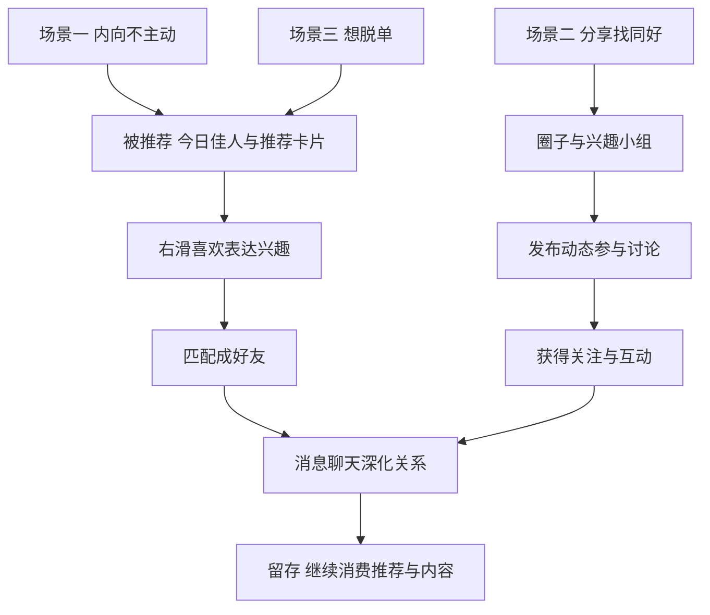

# 三个用户场景看懂探花交友：把用户画像推演成一条使用旅程

市场分析回答了赛道有多大、用户是谁，产品动手之前还差最后一层抽象：用户在什么处境下打开 App，那一刻想被满足什么。人群画像是静态标签，使用场景是把标签放进真实生活里推演一遍；功能清单、接口设计乃至表结构字段，都应该从这个推演里长出来，而不是拍脑袋列出来的。课程文档给出了三个典型场景，分别压中破冰、分享、脱单三种诉求，与目标用户群体里的四类画像一一呼应。

## 先给结论

- 三个使用场景与关键词：场景一「内向、社交障碍、不主动」，场景二「分享、互动、娱乐」，场景三「脱单」。
- 场景一对应沟通弱势群体：不敢主动搭讪，需要低门槛的破冰方式，落点是推荐匹配加一次滑动的轻交互。
- 场景二对应分享与兴趣诉求：不愿在熟人圈暴露太多自我，需要按兴趣聚集的平台，落点是圈子、动态与兴趣小组。
- 场景三对应脱单刚需：直接发消息容易尬聊，需要推荐匹配加日常动态展示，落点是匹配、动态与消息。
- 三条场景收束成同一条使用旅程：进入、被推荐、轻交互表态、建立连接、深度互动、留存。

## 三个场景：三段故事压中三种诉求

**场景一：内向、社交障碍、不主动。** 大二学生陈叶品学兼优，却在聚会里总被同学认为高冷。她不是不想聊，只是找不到时机插不上话，在各类群体社交场合难以融入人群，课程文档把这句划了重点，它就是整个场景的痛点。她看到室友在玩一款陌生人交友软件，开始尝试在软件里建立一个内向但真实的自己，却发现很多陌生人不愿意长聊，聊久了无话可说，缺乏话题，自己慢慢变成好友列表里的一个摆设。换到探花交友之后，从每天匹配开始，认识了几个有共同爱好的朋友，社交状态才慢慢好转。诉求浓缩成一句：不敢主动搭讪，希望以低门槛的方式开始与陌生人的互动。

**场景二：分享、互动、娱乐。** 职场新人陈莹兴趣广泛，看书、听音乐、创作、拍照都喜欢。毕业之后认识新朋友、约人出去玩的机会越来越少，朋友圈里的大家都过着两点一线的生活，这句同样被文档划了重点。她喜欢晒生活、说趣闻、发心情，但熟人朋友圈是个大杂烩，长辈同事都在，她不想暴露太多自我。换到探花的圈子之后，她把不愿发到朋友圈的内容发进来，所想所写所拍都有人回应，懂的人主动聚集过来讨论，还加入了兴趣小组，既找到了属于自己的社交圈子，也有了一个随时随地分享点滴的平台。

**场景三：脱单。** 宋顿是典型的直男样本，谈过几次恋爱都迅速失败，长相、身家、谈吐都一般，自嘲是街上的一抓一大把的类型，但一直想做脱单的尝试。他下载过市面上几乎所有的社交产品，配上修过的自拍、时常更新动态，依然没几个聊得来的异性朋友；自己复盘原因：每次图一时心情，聊一段时间就失去兴趣，加上害羞容易尬聊。在朋友介绍下用了探花，因为不需要背负主动搭讪的思想压力，几天匹配之后找到了合适的朋友，每天发日常内容获得更多关注，自信心和聊天技巧都在成长。

三段故事不是文学描写，每一段都能拆出结构化的关键词与诉求，并直接映射到功能：

```text
场景一  关键词：内向、社交障碍、不主动  诉求：低门槛破冰      落点：今日佳人、推荐卡片、滑动匹配
场景二  关键词：分享、互动、娱乐        诉求：兴趣聚集与表达  落点：圈子动态、兴趣小组、小视频
场景三  关键词：脱单                    诉求：找到合适的人    落点：推荐匹配、动态展示、消息聊天
```

## 从场景到旅程：三条入口一条主线

把三个场景放进同一张图，能看到它们最终收敛到一条主线上：



解读这张图的关键在于收敛：无论用户从哪个场景进来，动作都会落到「先被系统推荐或内容吸引，再用一次滑动、一条评论这类轻交互完成破冰，关系建立之后才进入消息与圈子的深度互动」。轻交互之前的所有成本由推荐与内容系统承担，这正是探花这类推荐制产品与普通聊天软件的分界线。

## 场景怎么落到接口与数据

场景不能停留在故事层面，后端工程师要把它翻译成接口与表结构。以场景一的推荐卡片为例，页面上展示的昵称、年龄、学历、标签、缘分值，对应一个典型的推荐结果接口，下面是按今日佳人与推荐列表画面字段补全的示例响应：

```json
{
  "userId": 3,
  "nickName": "示例用户",
  "age": 26,
  "edu": "本科",
  "tags": ["年龄相仿", "单身"],
  "fateValue": 98
}
```

fateValue 即缘分值，由推荐计算产出，不是随机数；tags 来自用户资料，既用于卡片展示，也充当匹配结果的解释，让用户明白为什么把这个人推荐给自己。

场景二的兴趣聚集落在资料表的 tags 字段上。tb_user_info 的 tags 以逗号分隔存多个标签，按兴趣找人时可以直接利用它做筛选，下面是一条按标签找同好的示例查询：

```sql
-- 按兴趣标签找同好（示例，按本课写法补全）
SELECT user_id, nick_name, tags
FROM tb_user_info
WHERE FIND_IN_SET('摄影', tags)
  AND user_id <> 3
LIMIT 20;
```

两条链路合起来就是场景到系统的映射：场景一压在推荐计算与卡片接口上，场景二压在资料标签与圈子存储上，场景三压在匹配与消息上。评审功能清单时可以用场景当验收标准，每个入口都应该能在某个场景的某句诉求里找到出处。

## 常见误区

- **把场景当故事读。** 错例：看完只记住三个人名。正解：每个场景提炼关键词与诉求，映射到功能落点；映射不上的功能要回头质疑它的需求来源。
- **三条场景各写各的。** 错例：为每类用户设计互不相干的流程。正解：三条入口收敛到同一条使用旅程，破冰、连接、互动、留存是陌生人社交产品的共同骨架。
- **忽略隐私诉求。** 错例：把用户动态推给所有关系链。正解：场景二的核心是熟人圈与陌生人圈的隔离，用户正因为不想暴露自我才换平台，这个边界本身就是产品设计的一部分。
- **把缘分值实现成随机数。** 错例：接口里用随机数糊弄。正解：缘分值由推荐侧计算产出，推荐相关能力在后续课程用 Spark 与 MLlib 落地，卡片接口只负责展示。

## 面试可能被问到的问题

1. 面试官追问：「你们的用户使用场景是怎么得出来的，在项目里怎么用？」
   答：从目标用户画像推演出三个典型场景，关键词分别是内向社交障碍不主动、分享互动娱乐、脱单。每个场景拆出诉求再映射到功能：破冰对应推荐与滑动匹配，分享对应圈子与兴趣小组，脱单对应匹配加动态加消息。场景是需求评审的验收标准，每个功能都要能回答它服务于哪个场景的哪句诉求。
2. 面试官追问：「场景一里的用户在上一款产品为什么失败，探花靠什么留住他？」
   答：失败在缺乏话题与匹配质量，用户变成好友列表的摆设。探花的解法是推荐制加轻交互：把候选送到面前，把破冰成本降到一次滑动，用共同爱好做匹配解释，先保证聊得起来，再靠圈子与内容维持关系，避免再次沦为摆设。
3. 面试官追问：「场景二反映了用户什么心理，产品设计上怎么呼应？」
   答：熟人社交圈有表演压力，用户不想把所有自我暴露给所有关系链。产品上把内容表达迁移到按兴趣聚集的陌生人圈子，配合兴趣小组让分享回到同好之间，这也决定了圈子模块要有独立的可见性与互动设计，而不是复制熟人动态流。
4. 面试官追问：「使用旅程和用户场景是什么关系？」
   答：场景是横向切片，描述某一类用户的处境与诉求；旅程是纵向主线，描述用户从进入产品到留存的完整路径。三条场景最终收敛到同一条旅程：被推荐、轻交互表态、建立连接、深度互动、留存。旅程图用来对齐团队对产品主链路的认知，场景用来解释主链路上每个环节为什么存在。

## 配套资料

- 代码：`materials/code/07/day01 探花交友-项目搭建以及登录完善个人信息/`，内含 `day01/资料/探花交友移动端原型V1.2/`（交友、圈子、消息、小视频等页面原型，功能落点以原型为准）与 `day01/学习目标.md`。
- 讲义：`materials/docs/07/` 不存在，本阶段无讲义文本，课程文档（1.4 使用场景）的内容以画面线抄录为准。
- 说明：推荐卡片 JSON 与标签查询 SQL 为按本课写法补全的示例；包名按画面线去品牌改写为 com.study.tanhua 一类中性包名；引用路径截至 day 目录层级。
