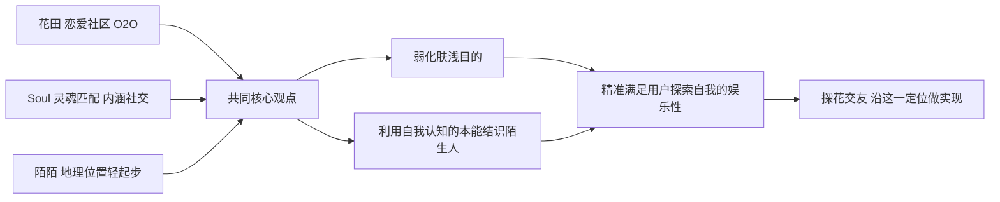
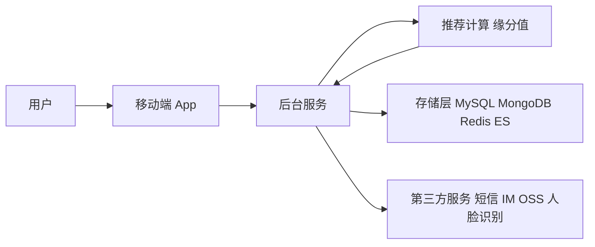
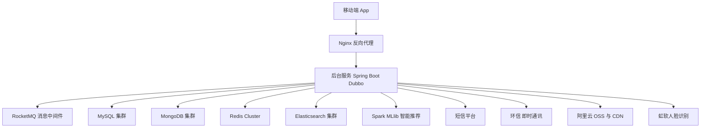

# 探花交友项目介绍合辑：竞品分析、产品全景与技术方案推导链

## 先给结论

- 本系列是探花交友项目的开篇合辑，共三篇：先看竞品立定位，再看产品立功能面，最后看技术方案立架构，回答的是「这是个什么项目、为什么这么设计」。
- 竞品篇选了兴趣社交方向的三款代表：花田做高效恋爱社区走 O2O 闭环，Soul 做灵魂匹配走匿名社交，陌陌做地理位置社交走附近的人。
- 三款竞品风格各异，共同的核心观点却只有一个：弱化肤浅目的，利用人类自我认知的本能结识陌生人，精准满足用户「探索自我」的娱乐性；探花的定位沿这个共识出发。
- 产品篇给出全景：移动端 App 加后台服务的完整闭环，首页四大入口与底部五个功能域，今日佳人按缘分值做匹配，智能推荐由大数据侧支撑，是产品的核心卖点。
- 数据底座是 mytanhua 库的两张核心表：tb_user 管认证窄表，tb_user_info 管资料宽表，按 user_id 一对一关联；头像存对象存储返回的 URL 而非文件本体。
- 技术篇的原则是把每个选型讲到业务：前端 Flutter 一套代码双端编译且后台不学前端；后端 Spring Boot 全家桶加 Dubbo 微服务；数据层 MySQL、MongoDB、Redis Cluster、Elasticsearch 四件集群分工。
- 第三方服务四件套：短信平台、环信即时通讯、阿里云 OSS 与 CDN、虹软人脸识别；RocketMQ 承担服务间异步消息；推荐侧 Spark 加 MLlib 从入门开始讲。
- 五大解决方案值得记牢：Elasticsearch geo 做附近的人、Spark 加 MLlib 做智能推荐、MongoDB 做海量数据存储、分布式文件系统存小视频、虹软开放平台做人脸识别。
- 架构里的高可用形态要留意：MySQL、MongoDB、Redis、ES 全是集群形态，Redis Cluster 明确为了缓存高可用，单机部署只够开发自测。
- 阅读顺序建议按篇序走：先懂竞品与定位，功能面与技术方案才有着力点，直接翻技术篇容易把组件背成清单。
- 三篇连读的收获是一条产品到技术的推导链：竞品共识定产品定位，功能面定接口边界，数据形态定存储选型，差异化清单定技术投入点。

## 第1部分：探花交友的竞品分析：花田、Soul、陌陌与它们共同的核心观点

立项之前绕不开一个问题：市面上已有的同类产品长什么样，我们打算和它们比什么。竞品分析在后端工程师眼里不是产品作业里的形式环节，它直接决定功能的边界与技术的投入方向：竞品靠什么留住用户，我们就要在对应的技术点上压多少筹码。这一篇把课程选定的三款竞品拆开看，再收拢出它们的共同观点，落到探花交友自己的定位上。

### 竞品怎么选

选择本身有方法论。市面上的兴趣社交产品非常多，全部罗列没有意义，课程的做法是根据市场调研与分析，从产品细分领域和对应的产品定位出发，在社交范围内选兴趣社交 App 作为竞品分析案例，再从里面挑三个定位彼此错开的样本：一个做恋爱社区，一个做灵魂社交，一个做地理位置社交。三个方向合起来基本覆盖陌生人社交的主要形态，比较起来才有代表性。

### 三款竞品的定位与特色

把课程文档里的竞品表格整理成一张对比表：

| 竞品 | slogan | 产品定位 | 产品特色 |
|---|---|---|---|
| 花田 | 你的爱情在花田 | 国内最高效的恋爱交友社区 | 智能匹配、缘分电话厅、恋爱研究所等 |
| Soul | 跟随灵魂找到你 | 匹配需求是灵魂的社交，寻找属于自己的 soulmate | 灵魂自测游戏、3D 星球邂逅、匿名私密 blog |
| 陌陌 | 很高兴认识你 | 基于地理位置的移动社交工具 | 附近的人、免费发送文字消息、多人交友快聊、直播短视频、视频交友、附近兴趣小组 |

逐个拆开看它们的打法。**花田围绕「高效恋爱」做服务闭环。** 定位里「最高效」三个字是承诺：用户目标是明确的恋爱关系，产品特色全部服务这个目标，课程把它的打法概括为线上与线下结合的产品服务，也就是 O2O，线上匹配建立连接，线下活动把关系落进现实。**Soul 围绕「灵魂匹配」做内涵社交。** 它弱化照片与外形，靠平台内部的算法做匹配，帮用户找到更相似或者更感兴趣的好友；灵魂自测、3D 星球邂逅、匿名私密 blog 这些特色都在制造「先了解内在再认识人」的体验，属于弱社交里的深度方向。**陌陌围绕「地理位置」做轻起步。** 作为基于地理位置的移动社交工具，最经典的动作是查看附近的人、免费发送文字消息，后来扩展出多人交友快聊、直播、短视频、视频交友，还可以创建和加入附近的兴趣小组；地理距离近天然降低见面与信任成本，关系起步最轻。

### 共同的核心观点与我们的差异化

三款产品长得完全不同，把特色列完之后往上收一层，会发现一条共同的内核：



课程文档的原话是：三款产品各有特点，但都有一个核心观点，就是弱化肤浅的目的，利用人类自带的自我认知的本能来结识陌生人，总结而言，精准满足用户「探索自我」的娱乐性。这句话值得多读两遍：用户在陌生人社交产品里未必只是「找对象」，很大一部分动机是借结识陌生人这个动作认识自己、验证自己，产品要给这个动机留出娱乐化的出口。探花交友会基于这样的定位去实现产品，这也解释了后面功能设计里为什么有测灵魂这类玩法、为什么推荐结果要附带缘分值这类解释。

把探花自己的差异化落成能力清单，与三款竞品对照着看：

```yaml
# 探花交友差异化能力清单（按本课写法整理）
position: 沿用满足探索自我娱乐性的定位
differentiation:
  match:  智能推荐匹配为核心，缘分值量化匹配质量
  nearby: 搜附近，地理位置维度找人
  circle: 圈子动态与兴趣小组，内容承载分享与聚集
  trust:  真人头像人脸识别，建立安全感
  im:     在线即时通讯，匹配后实时沟通
```

四个差异点分别回应三款竞品的强项：推荐匹配对齐花田的智能匹配但更靠算法重投入，搜附近吸收陌陌的地理优势，圈子对应兴趣聚集，真人认证解决陌生人赛道共有的信任短板。

### 竞品分析怎么沉淀成过程

竞品分析是一次性动作还是持续动作，取决于有没有把过程固化下来。按课程的分析路径可以整理出一个最小骨架：

```text
竞品分析的最小骨架（按本课分析过程整理）
1 选样本：按细分领域与定位挑选，让样本彼此错开、覆盖主要形态
2 拆要素：slogan、产品定位、产品特色逐项记录
3 找共性：向上收一层，提炼所有竞品共同遵循的核心观点
4 定差异：决定自己的定位、功能边界与技术投入点
```

第 3 步最容易被跳过，也最值钱：只有提炼出「探索自我的娱乐性」这个共性，才能解释为什么有些功能别人有我们也必须有，有些功能别人没有而我们值得加。

## 第2部分：探花交友项目全景：产品形态、用户端功能面与两张核心表

背景与市场、人群场景、竞品都看完，该落到项目本身了。这一篇回答三个问题：产品以什么形态存在，用户在 App 里到底能做什么，后台用哪些组成部分与数据表把这些功能接住。看懂这三个问题，后面十天的每一行代码都知道自己挂在产品的哪个位置上。

### 产品形态：App 加后台的完整闭环

探花交友的用户侧是一个移动端 App，平台能力在课程文档里概括为四件事：可以搜索附近的人，可以查看好友的动态，平台通过大数据计算做智能推荐、让用户更友好地匹配到好友，还提供类似 QQ 与微信的在线即时通讯、与好友实时沟通。四件事对应四个技术投入点：搜附近要地理位置检索，动态要半结构化内容存储，智能推荐要大数据计算，即时通讯要 IM 服务，产品的每一句话背后都有组件在接。



这张图在讲产品形态的闭环：App 只负责交互，所有能力由后台服务提供；推荐计算把缘分值算出来交回服务，服务把数据交给存储层，把不自建的能力交给第三方。后台是整个形态的中枢，也是这门课要写的东西。

### 用户端功能面：从首页到个人中心

打开 App 后最先接触的是首页。按课程演示的画面，首页顶部有四个玩法入口，中部是今日佳人与推荐列表，底部导航把五个功能域组织起来：

```text
探花交友移动端功能面（按原型与画面整理）
首页
├─ 探花        推荐匹配主入口
├─ 搜附近      按地理位置找人
├─ 桃花传音    语音互动玩法
├─ 测灵魂      趣味测试玩法
├─ 今日佳人    按缘分值匹配出的当日最佳
└─ 推荐列表    候选卡片：头像 昵称 年龄 学历 标签 缘分值
底部导航
├─ 交友        推荐与匹配主战场
├─ 圈子        好友动态的发布与浏览
├─ 消息        私信与通知
├─ 视频        小视频
└─ 我的        个人资料与设置
```

**今日佳人与推荐列表是首页的主角。** 今日佳人卡片展示头像、昵称、年龄、学历，以及单身、年龄相仿这类标签，最醒目的是缘分值，课程演示里给出了 98 这样的高分；下方的推荐列表卡片结构一致，缘分值按匹配度递减。缘分值是匹配质量的量化表达：平台按缘分值做匹配，匹配得越准，用户对产品的喜爱度越高，这个值由推荐计算给出，不是运营随手填的数字。

**圈子承载好友动态。** 好友动态页展示配图、文字内容与互动按钮，是用户晒生活、找同好的地方，对应使用场景二里「把不愿发熟人圈的内容发到陌生人圈子」的诉求；动态是内容，互动是关系，两者都在这一页发生。

**四个玩法入口各有分工。** 探花是主入口，指向推荐匹配；搜附近满足地理维度的找人刚需；桃花传音与测灵魂属于轻娱乐玩法，给「探索自我」的娱乐性提供出口，也为破冰制造话题。

### 项目组成与数据底座

整个项目的组成可以概括为五块：移动端安装包（课程直接提供，不需要写前端）、后台服务（接口与业务逻辑）、推荐计算（大数据侧）、第三方服务（短信、IM、对象存储、人脸识别）、存储层。多服务不是口号：课程后期的部署配置里，Nginx 把 `/user/`、`/es/` 等不同路径反向代理到不同端口的服务，说明用户服务与位置检索服务是分开部署的，真实配置见配套资料里的 nginx.conf。

数据底座看 mytanhua 库。day01 资料包里带真实的建表脚本 mytanhua.sql，两张核心表把账号与资料的职责分界写在明面上。账号表管认证：

```sql
CREATE TABLE `tb_user` (
  `id`       bigint(20)  NOT NULL AUTO_INCREMENT,
  `mobile`   varchar(11) DEFAULT NULL COMMENT '手机号',
  `password` varchar(32) DEFAULT NULL COMMENT '密码，需要加密',
  `created`  datetime    DEFAULT NULL,
  `updated`  datetime    DEFAULT NULL,
  PRIMARY KEY (`id`),
  KEY `mobile` (`mobile`) USING BTREE
) ENGINE=InnoDB AUTO_INCREMENT=5 DEFAULT CHARSET=utf8 COMMENT='用户表';
```

资料表管展示，字段多，这里摘取关键列：

```sql
CREATE TABLE `tb_user_info` (
  `id`        bigint(20)  NOT NULL AUTO_INCREMENT,
  `user_id`   bigint(20)  NOT NULL COMMENT '用户id',
  `nick_name` varchar(50) DEFAULT NULL COMMENT '昵称',
  `logo`      varchar(100) DEFAULT NULL COMMENT '用户头像',
  `tags`      varchar(50) DEFAULT NULL COMMENT '用户标签：多个用逗号分隔',
  `sex`       tinyint(1)  DEFAULT '3' COMMENT '性别，1-男，2-女，3-未知',
  `age`       int(11)     DEFAULT NULL COMMENT '用户年龄',
  `edu`       varchar(20) DEFAULT NULL COMMENT '学历',
  `city`      varchar(20) DEFAULT NULL COMMENT '居住城市',
  `cover_pic` varchar(50) DEFAULT NULL COMMENT '封面图片',
  -- industry、income、marriage、birthday、created、updated 等字段有删节
  PRIMARY KEY (`id`),
  KEY `user_id` (`user_id`)
) ENGINE=InnoDB DEFAULT CHARSET=utf8 COMMENT='用户信息表';
```

完整脚本见配套资料。两张表的分工与首页功能能一一对上：首页卡片上的昵称、年龄、学历来自 tb_user_info，其中 edu 学历、cover_pic 封面图片这类字段就是为交友展示服务的；tags 逗号分隔存多个标签，卡片上的单身、年龄相仿这类标签与推荐解释都从这里来；logo 存的是头像 URL 而不是文件本身，图片本体在对象存储里。样例数据里 city 的取值形如「北京市-北京城区-东城区」，是三级地址格式，为后续按城市与位置检索留了余地。tb_user 只留认证四件事，mobile 上建普通索引支撑登录查询，password 存 32 位加密值。

存储层不止 MySQL。账号资料这类结构化数据在 MySQL，动态评论这类海量半结构化数据在 MongoDB，验证码与热数据在 Redis，附近的人这类位置检索在 Elasticsearch，各自的分工在技术架构一课展开。看懂分工的钥匙还是产品功能：每一个首页入口背后都站着一个存储组件。

## 第3部分：探花交友的技术方案：把每个选型讲到「它替哪块业务扛活」

项目介绍的最后一步是技术方案。这一课的选型清单一长串：Spring Boot、Dubbo、Redis、MongoDB、Elasticsearch、RocketMQ、Spark、环信、OSS，工程师最怕的就是把清单背完却说不清每样东西解决什么问题。这一篇按课程文档的顺序把四个问题讲透：前端为什么可以不学，后端每样技术替哪块业务扛活，整体架构怎么分层部署，解决方案与亮点清单怎么转成简历语言。

### 前端方案：为什么可以不学前端

课程文档把 Flutter 列为前端最亮的技术：它是谷歌的移动 UI 框架，可以快速在 iOS 和 Android 上构建高质量的原生用户界面，能与现有代码一起工作，完全免费开源，最终编译成原生安装包，安卓平台编译产物就是 APK。画面线里的前端技术栈为 flutter + android + 环信 SDK + redux + shared_preferences + connectivity + iconfont + webview + sqlite，覆盖了状态管理、本地存储、网络检测、内嵌页面等移动开发常用件。

对后端工程师的结论是：学习过程中不涉及前端技术的学习与使用，直接使用前端提供的安装包，通过接口和前端对接。这不是偷懒，而是分工使然，它带来一个工程上的硬要求：接口即契约，请求路径、参数、返回结构必须在后台侧定清楚，前端只认接口不认人。后面十几天写的每一个 Controller 都是在履行这份契约。

### 后端技术栈：每样解决什么

按「技术、解决什么、学习方式」把清单摊开：

| 技术 | 在项目里解决什么 | 学习方式 |
|---|---|---|
| Spring Boot、SpringMVC、MyBatis、MyBatis-Plus、Dubbo | 后端主架构与微服务框架 | 已有基础，直接使用 |
| Elasticsearch geo | 附近的人，地理位置查询 | 后续天落地 |
| MongoDB | 动态、评论等海量数据存储 | 直接使用，需要 MongoDB 基础 |
| Redis | 数据缓存，集群保证高可用 | 直接使用 |
| CDN | 加速静态文件与小视频加载 | 直接使用 |
| Spark + MLlib | 智能推荐 | 从入门开始讲 |
| RocketMQ | 消息中间件，传递消息 | 直接使用 |
| 环信 | 即时通讯接口服务 | 对接 |
| 短信平台、阿里云 OSS 与 CDN、虹软开放平台 | 验证码下发、对象存储与静态加速、人脸识别 | 对接 |
| 分布式文件系统 | 小视频数据存储 | 直接使用 |

三行值得多看一眼。**MongoDB 那一行的前提是数据形态。** 交友业务数据量大，动态、评论这类内容是文档型半结构化数据，传统 MySQL 不足以支撑，所以海量内容走 MongoDB。**Spark + MLlib 那一行的待遇不同。** 它是产品的核心卖点，课程安排从入门讲起，其余组件都是按会用标准直接上。**第三方服务那几行的共同逻辑是不自建。** 发短信、IM 长连接、对象存储、人脸识别都有成熟服务，自建的成本远高于对接，工程上只做封装与调用。

### 技术架构：分层与真实部署

把上面的清单立起来就是课程文档里的基础架构图：



读图顺序自下而上：MySQL、MongoDB、Redis、ES 四个集群是底层存储，前两者落持久化数据，Redis 存缓存数据，ES 承担地理位置等搜索服务；往上一层 RocketMQ 在服务之间传递消息，把同步链路里可以异步的部分剥出去；最上层是移动端前端；左侧第三方服务解决不自建的能力，右侧 Spark MLlib 智能推荐是项目核心功能。课程文档明确 Redis 用集群形态，为的是缓存数据的高可用。

多服务拆分在课程资料里有真实证据。day11 附带的 nginx.conf 把不同路径反向代理到不同端口的服务：

```nginx
location /user/ {
    client_max_body_size  300m;
    proxy_pass   http://127.0.0.1:18080;
}
location /es/ {
    client_max_body_size  300m;
    proxy_pass   http://127.0.0.1:18082;
}
location / {
    client_max_body_size  300m;
    proxy_pass   http://127.0.0.1:18081;
}
```

`/user/` 走主用户服务，`/es/` 走位置检索服务，其余请求走默认服务，Nginx 是统一入口。这段配置印证了架构图里的服务拆分：能力边界不同就分开部署，接口消费方不需要关心后面有几个进程。摘录有删节，完整文件见配套资料。

服务内部怎么组织依赖，可以按本课写法补一份关键配置示例：

```yaml
# application.yml 关键片段示例（按本课写法补全，非课程原始文件）
spring:
  data:
    mongodb:
      uri: mongodb://127.0.0.1:27017/tanhua
  redis:
    cluster:
      nodes:
        - 127.0.0.1:6379
        - 127.0.0.1:6380
        - 127.0.0.1:6381
dubbo:
  application:
    name: tanhua-service
  registry:
    address: zookeeper://127.0.0.1:2181
```

MongoDB 与 Redis Cluster 的连接串、Dubbo 的应用名与注册中心地址是这类工程最先碰到的三处配置，样例用占位地址，实际部署时替换成集群节点。

### 解决方案与技术亮点

课程文档把方案拆成两份清单。1.9 技术解决方案五条：使用 Elasticsearch geo 实现附近的人；使用 Spark + MLlib 实现智能推荐；使用 MongoDB 进行海量数据存储；采用分布式文件系统存储小视频数据；使用虹软开放平台进行人脸识别。1.10 技术亮点十条，把两条清单归并成一张速查表：

```yaml
# 技术亮点速查（按课程文档 1.10 整理）
search: Elasticsearch geo 地理位置查询
mq:     RocketMQ 消息服务中间件
store:  MongoDB 海量数据存储
reco:   Spark + MLlib 智能推荐
im:     环信服务实现即时通讯
video:  分布式文件系统存储小视频数据
cdn:    CDN 加速静态资源以及小视频加载
rpc:    Apache Dubbo 作为微服务架构技术
main:   Spring Boot + MyBatis 实现系统主架构
cache:  Redis 集群实现缓存数据高可用
```

两份清单合起来读才有用：解决方案回答「这类业务问题用什么解」，技术亮点回答「简历与面试里怎么一句话报出来」。每一条都要能挂回业务场景，比如 RocketMQ 挂在动态发布后的异步通知、推荐计算完成后的结果回传这类异步环节；CDN 挂在小视频与头像这类静态资源的加载提速上。只会背清单不会挂场景，面试一追就穿。

## 常见误区

- **把竞品分析做成功能抄写。** 错例：罗列竞品功能清单，然后照单全收。正解：先比定位再比功能，花田的 O2O 与 Soul 的匿名社交有完全不同的前提，照抄功能而不带定位等于抄错题。

- **只看差异不看共性。** 错例：三款竞品各写一段评语就结束。正解：共同核心观点（满足探索自我的娱乐性）才是行业共识，新产品的定位应该建立在共识之上再做差异。

- **竞品强就跟着做全。** 错例：看到陌陌有直播短视频就全上。正解：差异化清单要与技术投入对齐，探花把筹码压在推荐与信任上，其余借第三方服务轻量实现。

- **竞品分析做完就归档。** 错例：文档写完再不更新。正解：竞品的定位与特色会随版本变化，分析结论要跟着市场与版本滚动维护，否则很快失效。

- **把项目理解成单体服务。** 错例：一个工程包揽所有接口。正解：项目按能力拆分，位置检索等服务独立部署，Nginx 按路径分发到不同端口，后期接入推荐侧后边界更明显。

- **把功能当成单点接口。** 错例：今日佳人就一个查询。正解：一张卡片跨推荐计算、资料查询、存储与展示多个环节，缘分值来自推荐侧而非业务库。

- **账号与资料挤在一张表。** 错例：把昵称头像学历都塞进 tb_user。正解：认证窄表加资料宽表，按 user_id 一对一关联，登录高频读窄表，资料页才读宽表，演化互不拖累。

- **忽略多存储分工。** 错例：所有数据都往 MySQL 塞。正解：结构化、半结构化、缓存、位置检索四类数据形态不同，分别交给 MySQL、MongoDB、Redis、Elasticsearch。

- **把「不学前端」理解成前端不重要。** 错例：接口返回结构随手定，联调时反复改。正解：前端安装包只认契约，后台必须在开发前把接口路径、参数、返回结构定稳。

- **组件背成清单，绑不上业务。** 错例：说出十个组件却答不上 MongoDB 存什么。正解：每个组件绑定一个业务对象记忆：MongoDB 存动态评论，ES 存位置检索，Redis 存验证码与热数据。

- **把 MySQL 换 MongoDB 说成绝对替代。** 错例：认为 MySQL 不能用了。正解：账号资料这类强结构数据仍在 MySQL，海量文档型内容才走 MongoDB，按数据形态选型而不是按新旧。

- **忽略高可用形态。** 错例：搭个单机 Redis 就当学完。正解：架构图里 MySQL、MongoDB、Redis、ES 全是集群形态，Redis Cluster 明确为了缓存高可用，单机部署只够开发自测。

## 面试可能被问到的问题

1. 面试官追问：「你们做竞品分析时样本是怎么选的？」
   答：根据市场调研与分析，从产品细分领域和对应的产品定位出发，在社交范围内选兴趣社交 App 作为案例，选了定位彼此错开的三款：做恋爱社区的花田、做灵魂社交的 Soul、做地理位置社交的陌陌，三个方向覆盖陌生人社交的主要形态。

2. 面试官追问：「三款竞品的核心差异是什么？」
   答：花田定位高效恋爱交友社区，打法是线上匹配加线下活动的 O2O 闭环；Soul 弱化外形，用内部算法按灵魂内涵匹配，特色有灵魂自测、3D 星球邂逅、匿名私密 blog；陌陌基于地理位置，从附近的人、免费文字消息起步，扩展出直播短视频与兴趣小组。三者分别代表关系目标导向、内涵导向、位置导向三种形态。

3. 面试官追问：「三款竞品有什么共同点，对你们产品有什么影响？」
   答：共同核心观点是弱化肤浅目的，利用人类自带的自我认知本能来结识陌生人，精准满足用户探索自我的娱乐性。这意味着用户动机不止找对象，还包括认识自己，所以探花的定位沿用这一点，功能上保留测灵魂这类玩法，推荐结果附带缘分值做解释。

4. 面试官追问：「探花与陌陌这类成熟产品的差异化在哪？」
   答：陌陌以地理位置与轻互动见长，探花吸收搜附近这个维度，但把核心筹码压在智能推荐匹配上，用 Spark 与 MLlib 做推荐、缘分值量化匹配质量，同时用真人头像人脸识别解决信任短板，用圈子与兴趣小组承接内容聚集，IM 借第三方服务实现。

5. 面试官追问：「竞品分析对后端技术选型有什么实际影响？」
   答：竞品的留客点决定技术投入点。差异化清单里推荐是核心，就要准备 Spark 与 MLlib 的计算能力；搜附近要求地理检索，对应 Elasticsearch geo；真人认证对应人脸识别服务；动态与评论量大要求 MongoDB 这类海量存储。功能定位每差一项，技术栈就会跟着变。

6. 面试官追问：「一句话介绍探花交友的项目组成。」
   答：移动端 App 加后台服务的完整闭环：App 用现成安装包，后台服务承担接口与业务，推荐计算由大数据侧负责缘分值，第三方服务承接短信、IM、对象存储与人脸识别，存储层由 MySQL、MongoDB、Redis、Elasticsearch 按数据形态分工。

7. 面试官追问：「首页有哪些入口，各自背后是什么能力？」
   答：探花是推荐匹配主入口，搜附近走地理位置检索，桃花传音与测灵魂是轻娱乐玩法；中部今日佳人按缘分值匹配，推荐列表给出候选卡片；底部导航分交友、圈子、消息、视频、我的五个功能域。

8. 面试官追问：「今日佳人的缘分值是怎么来的？」
   答：缘分值由推荐计算产出，平台按缘分值做匹配，匹配越准用户越喜爱。它不是业务库里存的随机数，后续课程用 Spark 与 MLlib 实现推荐计算，接口只负责把结果展示在卡片上。

9. 面试官追问：「tb_user 和 tb_user_info 为什么拆成两张表？」
   答：职责与变更频率不同。tb_user 只服务认证，字段少而稳定，mobile 建索引支撑登录；tb_user_info 承载昵称、头像、学历、城市、标签等展示资料，字段多且随产品演化频繁调整。按 user_id 一对一关联，登录读窄表、资料页读宽表，互不拖累。

10. 面试官追问：「为什么头像字段存 URL 而不存文件？」
   答：文件本体放对象存储，库里只存 OSS 返回的 URL，应用服务器不背文件服务的负担，扩展与备份交给对象存储。这要求上传链路配套：上传后拿到 URL 再写进 tb_user_info 的 logo 字段。

11. 面试官追问：「为什么前端选 Flutter，而后端同学可以完全不管前端？」
   答：Flutter 是谷歌的移动 UI 框架，一套代码在 iOS 与 Android 构建高质量原生界面，编译成原生安装包。课程直接提供前端安装包，后端通过接口对接即可，这要求后台把接口契约定稳：路径、参数、返回结构都以前端可依赖的方式固化。

12. 面试官追问：「为什么要用 MongoDB，MySQL 不行吗？」
   答：交友业务数据量大，动态、评论这类内容是文档型半结构化数据，字段灵活、增长快，MongoDB 更合适；账号资料这类强结构化数据仍然在 MySQL。选型按数据形态与规模决定，不是整体替换关系。

13. 面试官追问：「RocketMQ 在这个项目里承担什么角色？」
   答：作为消息中间件在服务之间传递消息，把同步链路里可以异步的部分剥出去，比如动态发布后的通知、推荐计算结果的异步回传这类场景。它让主链路保持轻快，也让消费方可以按自己的节奏处理。

14. 面试官追问：「Redis 为什么要用集群？」
   答：架构目标是缓存数据的高可用：单机故障会导致验证码、热数据等能力整体不可用。Redis Cluster 通过分片与主从复制同时解决容量与可用性问题，这也是课程技术亮点里单列的一条。

15. 面试官追问：「即时通讯为什么不自己实现？」
   答：IM 的难点在长连接管理、消息可靠投递、离线消息与多端同步，自建成本高且不是本项目的核心差异点。接入环信这类即时通讯接口服务，后台只做账号体系对接与业务消息扩展，把研发力量留给推荐与检索这些核心竞争力。

16. 面试官追问：「推荐计算和业务服务怎么协作？」
   答：业务服务负责采集行为与展示结果，Spark + MLlib 在大数据侧训练与计算，产出缘分值与推荐列表；中间通过消息与存储衔接，业务接口只读结果。推荐是异步链路，失败或延迟不影响登录浏览主流程。

## 配套资料

- 代码：`materials/code/07/day01 探花交友-项目搭建以及登录完善个人信息/`，内含 `day01/资料/探花交友移动端原型V1.2/`（交友、圈子等页面原型，可对照竞品功能看差异）与 `day01/学习目标.md`。

- 讲义：`materials/docs/07/` 不存在，本阶段无讲义文本，课程文档（1.5 竞争对手分析）的内容以画面线抄录为准。

- 说明：差异化能力清单与分析骨架为按本课写法整理的示例；包名按画面线去品牌改写为 com.study.tanhua 一类中性包名；引用路径截至 day 目录层级。

- 代码：`materials/code/07/day01 探花交友-项目搭建以及登录完善个人信息/`，内含 `day01/代码/mytanhua.sql`（tb_user、tb_user_info 真实建表脚本）、`day01/资料/探花交友移动端原型V1.2/`（登录页、交友、圈子、小视频、消息、我的等页面原型）与 `day01/学习目标.md`。

- 配置：`materials/code/07/day11 探花交友-我的中心/`，内含 `day11/代码/nginx.conf`（多服务反向代理的真实部署配置，可印证服务拆分）。

- 讲义：`materials/docs/07/` 不存在，本阶段无讲义文本，课程文档（1.6 项目简介）的内容以画面线抄录为准。

- 说明：tb_user_info 的建表语句有字段删节，完整脚本以上述 mytanhua.sql 为准；功能面结构为按原型与画面整理；包名按画面线去品牌改写为 com.study.tanhua 一类中性包名；引用路径截至 day 目录层级。

- 说明：application.yml 片段为按本课写法补全的示例（非课程原始文件）；nginx.conf 摘录有删节；包名按画面线去品牌改写为 com.study.tanhua 一类中性包名；引用路径截至 day 目录层级。
