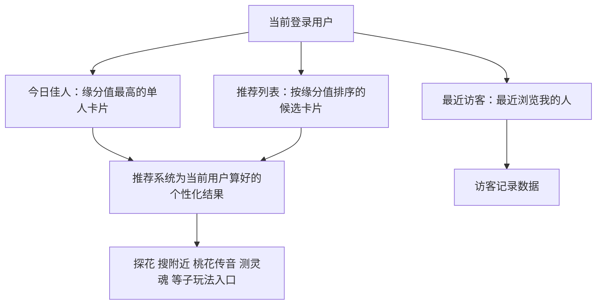
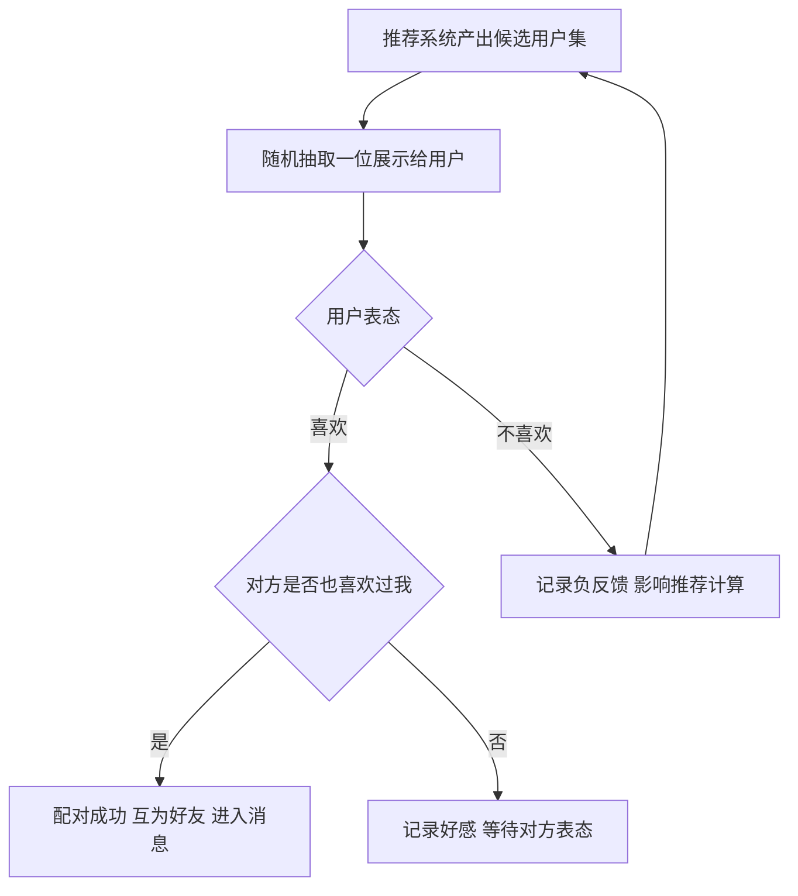

# 交友域全貌：今日佳人、探花匹配与缘分值背后的推荐数据底座

登录解决的是「你是谁」，交友域解决的是「你看到谁」。探花交友的首页是整个产品的主战场：今日佳人、推荐列表、最近访客三块内容全部由缘分值驱动，往下还有探花、搜附近、桃花传音、测灵魂一组子玩法。功能介绍这部分视频把每个玩法的产品规则讲了一遍，规则背后各自连着一条技术链路，值得逐一拆开看。

对后台工程师来说，这一篇的关键不是记住玩法，而是看清每个玩法喂给推荐系统什么数据、又从推荐系统拿走什么结果。玩法是壳，数据流才是之后十几天要真正实现的东西。

## 先给结论

- 首页三件套：今日佳人展示缘分值最高的单人卡片，推荐列表按缘分值排序，最近访客展示最近浏览我的人；三块都是个性化的，每个用户看到的并不一样。
- 探花是核心匹配玩法：后台推荐一批候选，随机展示其中一位，用户点喜欢或不喜欢，双方互相喜欢即配对成功；每天限量不超过 100 个，开通会员可增加限额。
- 不喜欢不是无效操作：负反馈会写回推荐系统，直接影响后续的推荐计算。
- 搜附近按地理位置在 10 公里范围内检索并支持条件筛选；桃花传音类似漂流瓶，录一段音频丢出去，接到的陌生人可以表态是否喜欢。
- 测灵魂用答题给用户分类，初级、中级、高级逐级解锁，分类结果直接参与推荐；缘分值是把资料、答题、行为、位置这些信号合成的最终分数。

## 一、首页三件套：缘分值驱动的门面

打开 App 落在交友首页，自上而下是三个模块。**今日佳人**是一张单人卡片，头像、昵称、年龄、学历一目了然，它的人选规则是按缘分值匹配，把缘分值最高的那一位展现出来。**推荐**是一串候选卡片流，按缘分值排序，由后台的推荐系统计算后展现。**最近访客**展示最近来看过我的用户，排在页面上方。

这三个模块有个共同点：每个人的首页都不一样。今日佳人尤其明显，A 用户看到的佳人和 B 用户看到的佳人大概率不是同一个人，因为缘分值是「你和 TA 之间」的分数，不是某个用户的绝对颜值排名。这就决定了缘分值必须按登录用户分别计算，首页接口拿到的永远是「为我算好的结果」。



顺带一提底部导航。原型底部是交友、圈子、消息、直播、我的五个入口，直播位只在原型里预留，课程不展开；交友页里的探花、搜附近、桃花传音、测灵魂以子页面的形式挂在这条导航之上。结构上记住一条主线：首页展示个性化结果，子玩法负责产生新的互动数据，互动数据再回头喂给推荐，形成闭环。

## 二、探花：喜欢与匹配的闭环

探花的玩法规则是这样的：后台先为当前用户推荐一批候选用户，展示时从这批结果里随机取一位推到卡片上；用户看完资料后表态，点喜欢或不喜欢。如果点了喜欢且对方之前也喜欢过我，双方配对成功，互为好友，后续可以进入消息和圈子互动；如果对方还没表态，这次喜欢先被记录下来，等对方哪天也刷到我并点喜欢时，配对触发。点不喜欢同样有归宿：这条负反馈会进入推荐系统，影响之后给这个用户的推荐计算。



限量规则也要留意：每天探花限量不超过 100 个，开通会员可以增加限额。站在产品角度，限量维持了候选的稀缺感，也为会员体系留了商业化口子；站在技术角度，每日限额意味着表态行为是有量的，负反馈数据的生产速度可控，推荐侧更新画像的压力不大。

day01 没有配套源码，配对判断的核心逻辑给一段按本课写法补全的示意：

```java
package com.study.tanhua.friend;

// 探花表态与配对判断（示例，按本课写法补全；候选集来自推荐系统）
public class ExploreService {

    // 用户对推荐卡片表态：like 为喜欢，dislike 为不喜欢，两种表态都会写回推荐系统
    public MatchResult decide(Long userId, Long targetId, boolean like) {
        recommendClient.feedback(userId, targetId, like);
        if (like && recommendClient.likedBack(targetId, userId)) {
            friendService.makeFriends(userId, targetId);   // 双向喜欢，配对成功
            return MatchResult.paired();
        }
        return MatchResult.waiting();
    }
}
```

这段示意里最值得咀嚼的是 `feedback` 调用放在配对判断之前：无论结果如何，表态本身先落库并通知推荐侧。匹配是给用户看的成功路径，数据回写才是给推荐系统看的全部路径。

## 三、搜附近、桃花传音与测灵魂

**搜附近**解决的是「地理就近」。以用户当前所在位置为圆心，检索 10 公里范围内的其他用户，页面上方提供筛选按钮，可以按条件进一步过滤。10 公里是暂定的查询范围，之后实现时用 Elasticsearch 的 geo 能力做地理位置检索，课程后半段会专门落地这个功能。

**桃花传音**解决的是「低成本搭讪」。玩法接近 QQ 时代的漂流瓶，只是瓶子里的纸条换成了一段音频：用户自己录一段话点击发送，相当于把音频丢出去，陌生的接收方听到后可以表态是否喜欢；反过来用户自己也会接到别人丢出的音频。音频比文字多了一层声音的魅力，匿名又降低了发起门槛，这是社交产品里经典的破冰设计。

**测灵魂**解决的是「归堆」。平台维护一套题库，给用户出一系列题目做分类，比如这样一道题：假如你在房间墙壁上发现一个小孔，你希望从小孔中看到什么场景？选项一是正在拥抱的一对恋人，选项二是一家人正其乐融融地吃晚饭。两个选择把用户分进不同的类型，类型不同，推荐走向就不同。题目按初级、中级、高级分层，答完一个层级解锁下一层。后台维护题库和分类规则，答题结果作为用户的分类标签直接参与推荐计算，所以测灵魂表面是趣味测试，实际是让用户自己完成一次画像标注。

## 四、推荐的数据基础与缘分值

把前面所有玩法收拢到一条数据主线上：缘分值。它是把多维信号加权合成的分数，今日佳人选它最高的，推荐列表按它排序，探花的候选集也由它圈定。信号大致来自四路：

- 注册资料：tb_user_info 里的性别、年龄、城市、兴趣标签，这是冷启动阶段唯一可用的信号；
- 测灵魂分类：用户答题得到的类型标签，刻画性格与偏好；
- 行为流水：喜欢、不喜欢、浏览、访客记录，其中不喜欢是最强的负样本；
- 地理位置：搜附近用到的经纬度，距离越近缘分值的贡献通常越高。

```java
package com.study.tanhua.recommend;

// 缘分值合成示意（示例，按本课写法补全；真实计算在推荐系统中离线完成）
public class FateScoreCalculator {

    // 距离、年龄差、标签重合度、答题分类与互动行为加权求和
    public double score(UserContext me, UserContext other) {
        double distanceScore = distanceWeight(me.getCity(), other.getCity());
        double ageScore      = ageWeight(Math.abs(me.getAge() - other.getAge()));
        double tagScore      = tagOverlap(me.getTags(), other.getTags());
        double soulScore     = soulMatch(me.getSoulType(), other.getSoulType());
        double behaviorScore = behaviorWeight(other, me);
        return distanceScore * 0.3 + ageScore * 0.2 + tagScore * 0.2
                + soulScore * 0.2 + behaviorScore * 0.1;
    }
}
```

权重只是示意，重点在于理解形态：候选召回先按粗条件缩小范围，再用缘分值打分排序，最后把结果存起来供首页和探花消费。计算形态是离线批处理，课程从 day06 起用 Spark 与 Spark MLlib 完成这一步，请求进来时读的是算好的结果，而不是现场算分。推荐卡片返回给前端的数据结构大致是：

```json
{
  "userId": 3,
  "nickname": "示例昵称",
  "avatar": "https://oss.example.com/avatar/3.jpg",
  "age": 24,
  "education": "本科",
  "marriage": "未婚",
  "fateValue": 92,
  "actions": ["like", "dislike"]
}
```

字段里的 fateValue 就是缘分值，actions 对应探花卡片上的两个表态按钮。看到这里，功能介绍与后面推荐章节的关系就通了：这一篇定义了「要什么数据」，推荐章节回答「数据怎么算」。

## 常见误区

- **把今日佳人当成全站排行榜。** 错例：认为是全平台评分最高的用户。正解：缘分值是两两之间的分数，今日佳人是「对我而言」缘分值最高的那个人，天然个性化。
- **把探花候选池当成全员随机。** 错例：从全量用户里随机抽。正解：候选来自推荐系统按缘分值圈定的候选集，随机只发生在展示环节，从候选里随机取一位。
- **把不喜欢当无效点击。** 错例：只处理喜欢，忽略不喜欢。正解：不喜欢是负反馈样本，写回推荐系统后长期影响该用户的推荐结果，乱点会持续污染自己的首页。
- **把缘分值当实时计算。** 错例：首页请求时现算全部分数。正解：离线批量计算后存储，线上只读结果；实时化的成本高且多数场景不需要。

## 面试可能被问到的问题

1. 面试官追问：「今日佳人是怎么选出来的？」
   答：为当前登录用户在推荐系统算好的缘分值结果里取最高分的用户，返回其资料组成单人卡片。因为缘分值是按用户对分别计算的，每个用户看到的今日佳人不同，这也是首页必须走个性化推荐而不是公共配置的原因。
2. 面试官追问：「探花的匹配逻辑是什么？」
   答：推荐系统先给当前用户圈定候选集，展示时随机取一位；用户点喜欢后，查询对方是否也喜欢过我，双向喜欢则配对成功建立好友关系，单向则记录好感等待；点不喜欢则写回负反馈影响推荐。每日表态限量 100 个，会员可加量。
3. 面试官追问：「不喜欢的信号在系统里有什么用？」
   答：它是最强的负样本。推荐系统据此调低该候选对当前用户的缘分值贡献，并在后续召回中降权，让首页和探花尽量避开同类候选。正负反馈一起构成用户兴趣画像的反馈闭环。
4. 面试官追问：「测灵魂和推荐是什么关系？」
   答：测灵魂本质是让用户通过答题完成自我分类，后台维护题库并把答题结果转成分类标签；这些标签作为推荐的特征输入，参与缘分值计算和候选召回。分层解锁保证了数据随使用逐步丰富。
5. 面试官追问：「缘分值你会怎么设计？为什么离线算？」
   答：把资料相似度、年龄差、距离、答题分类一致性和互动行为加权合成一个分数，先召回后打分再存储。离线算是因为全量用户对的组合是平方级规模，实时算不现实；首页与探花读的都是预计算结果，行为反馈通过下一轮批处理逐步生效。

## 配套资料

- 原型：`materials/code/07/day01 探花交友-项目搭建以及登录完善个人信息/day01/资料/探花交友移动端原型V1.2/`，其中交友.html 对应首页三件套与探花、搜附近、桃花传音、测灵魂各子页面。
- 讲义：`materials/docs/07/` 不存在，本阶段无讲义文本，内容以画面线为准。
- 说明：day01 资料包无 Java 源码，配对判断与缘分值合成为按本课写法补全的示例；包名按规范改写为 `com.study.tanhua`；JSON 结构为示意，站点用 example.com 占位。
