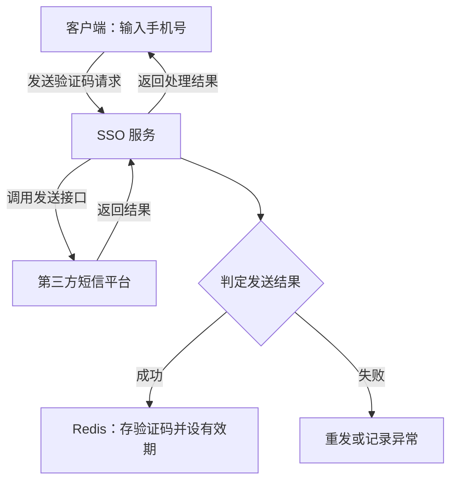
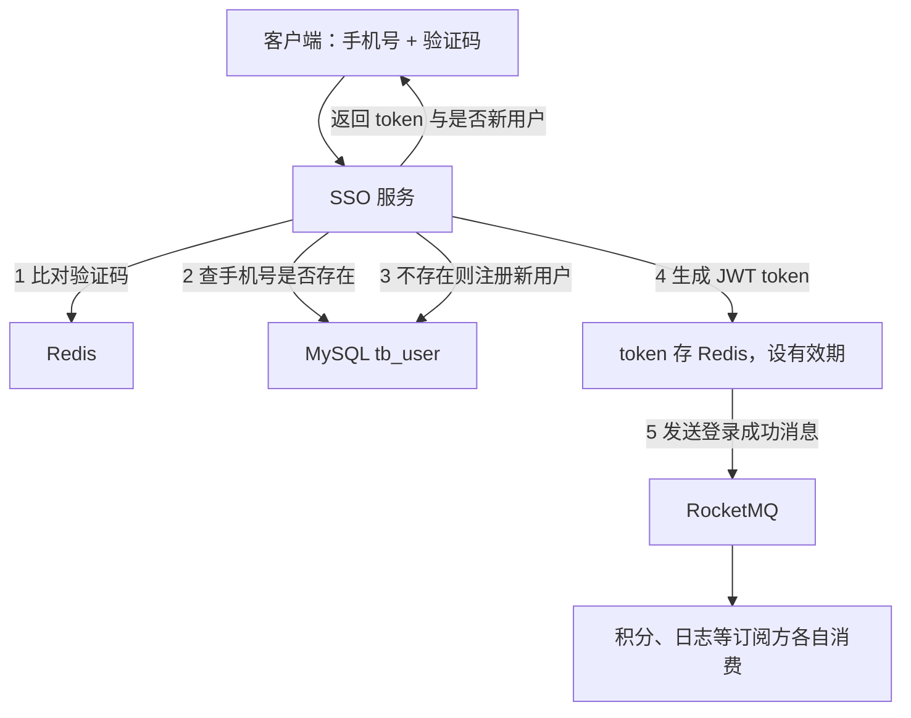

# 动手写代码前的实现分析：登录相关四个接口的流程与契约

环境侧三篇走完，工程、中间件、模拟器全部就位。真正写代码之前，先把 day01 要做的接口从整体上过一遍：一共四个接口服务，各自的数据流向长什么样、哪里有设计决策要做。这一步不是走过场，登录链路横跨客户端、SSO、第三方短信平台、Redis、MySQL、RocketMQ 六方，链路想清楚了，后面的实现只是把分析翻译成代码。

## 先给结论

- day01 要交付四个接口：发送手机验证码、校验用户登录、完善个人信息、校验 token 是否有效。
- 短信走第三方平台（本课选云之讯），平台响应判定发送成功后，验证码才落 Redis 并设有效期。
- 登录链路五步：Redis 校验验证码、查库判新用户、按 JWT 规范生成 token 存 Redis 带有效期、发 RocketMQ 登录成功消息、响应 token 与新用户标识。
- 新用户标识必须随登录响应一起返回，前端靠它决定是否跳完善信息页，漏了它链路就断了。
- 校验 token 的接口是后续拦截器与网关鉴权的基础能力，本质是查 Redis 里 token 是否还有效。

## 一、四个接口各自的职责

day01 的业务范围是「登录与完善个人信息」，拆成四个接口后职责边界如下：

| 接口 | 做什么 | 关键点 |
|---|---|---|
| 发送手机验证码 | 调第三方短信平台，向指定手机号发验证码 | 发送成功才存 Redis，必须设有效期 |
| 校验用户登录 | 手机号加验证码换取 token | JWT 规范签发、新用户标识、发登录成功消息 |
| 完善个人信息 | 首次登录后补充头像、昵称等资料 | 头像上传、资料自检，day01 立框架 |
| 校验 token | 检查当前登录状态是否有效 | 查 Redis 中 token 是否过期 |

对应到移动端页面，前两个接口服务登录页，第三个接口服务首次登录后的信息完善页，原型在资料包里都有真实页面可对照。第四个接口不直接对应用户操作，它服务于所有需要确认登录态的场景，比如 App 冷启动时恢复会话。

## 二、发送验证码：第三方平台怎么选

验证码短信自己发不了，要调第三方短信平台的接口。可选平台很多，选型的考量其实是门槛：本课选云之讯，理由有二。其一，注册账号即送 10 元话费，每条短信 0.05 元，折合约 200 条测试短信，开发期足够用；其二，不做实名认证也能发测试短信，而不少平台必须实名后才放通接口。综合评估下来它对学习场景最友好。换任何一家平台都不影响设计，发短信这个动作在 SSO 侧收口成一个调用点，平台差异被隔离在工具类里。



这张图的关键分叉在「判定发送结果」：只有短信平台明确返回成功，验证码才写入 Redis，否则客户端拿到的验证码会与 Redis 里的不一致，登录必然失败。失败分支要做重发或异常记录，同时守住平台侧的发送频率限制，防止接口被刷。

## 三、校验登录：一条链路串起五个组件

登录是 day01 最复杂的一条链路，把画面上的流程图画成节点关系如下：



**第一，验证码校验在 Redis 一侧完成。** 取出该手机号存储的验证码与请求比对，一致才继续，这一步挡住了伪造验证码的请求。

**第二，用户判定查 MySQL。** 按手机号查 tb_user 表，不存在就注册一个新用户落库，这一步同时确定了「是否新用户」的答案，后面响应要用。

**第三，token 按 JWT 规范签发。** 签出的 token 存入 Redis 并设有效期，服务端因此保留主动失效的能力，这一点与纯 JWT 自验签方案的区别会在下面误区里展开。

**第四，登录成功消息发 RocketMQ。** 记录登录时间、登录 IP、发放奖励积分这些后续动作全部改成订阅这条消息，登录接口发完消息立即返回，下游的快慢与故障都不阻塞用户进入首页。工程骨架篇引入 RocketMQ 依赖时埋的就是这个伏笔。

**第五，响应带上两个东西：token 与是否新用户。** 前端拿到新用户标识为真，就路由到完善信息页；为假，直接进首页。这是接口设计里容易被忽略的契约点，漏掉它前端就只能再发一次请求查询，徒增一次往返。

## 四、请求响应契约

路径与字段名以开发时的统一约定为准，下面按课程 REST 风格整理契约示例。发送验证码的响应：

```json
{
  "code": 200,
  "message": "OK"
}
```

登录的响应，token 与新用户标识必须同时出现：

```json
{
  "code": 200,
  "message": "OK",
  "data": {
    "token": "eyJhbGciOiJIUzI1NiJ9.eyJ1aWQiOjF9.xxxx",
    "isNew": true
  }
}
```

Redis 侧两个 key 的设计也属于契约的一部分，按本课写法补全示例：

```bash
# 验证码：手机号维度，5 分钟过期
SET code:13800138000 8642 EX 300
# token：token 字符串维度，值放用户 ID，有效期与 JWT 同步
SET token:eyJhbGciOiJIUzI1NiJ9.xxxx 1 EX 604800
```

key 设计的原则有两条：维度清晰，看名字就知道存的是谁的验证码、哪个 token；全部能设 TTL，到期自动清理，不给运维留手工删数据的负担。token 存的是用户 ID，后续任何一次校验 token 都能从 Redis 反查出操作者是谁。

## 五、开发步骤与自测路线

分析落成代码的顺序建议这样排：

1. 表与实体就绪：mytanhua.sql 已导入 tb_user 与 tb_user_info，实体类与 Mapper 按 MyBatis-Plus 的套路生成。
2. 接口骨架：SSO 模块里先把四个接口的 Controller 方法与统一响应包装立起来，跑通空实现。
3. 验证码链路：接第三方平台工具类，打通「发送成功落 Redis」的完整路径。
4. 登录链路：补验证码校验、用户判定、token 签发与存储、消息发送，换正式版 APK 走通登录。
5. 完善信息：头像上传依赖对象存储、资料自检涉及人脸识别，属于 day01 的掌握点，本接口先立框架，具体实现随后展开。
6. token 校验：最后实现，它是为后续拦截器与网关统一鉴权打底的能力。

自测路线是两级验证：每个接口先在 Postman 或 curl 层面打通请求响应契约，再回模拟器换 APK 走 UI 链路，两边结论一致才算过。模拟器的环境已经在前一篇备好，test 版 APK 验证请求能不能到达服务端，正式版验证完整登录流程。

## 常见误区

- **验证码存 Redis 不设过期。** 错例：code key 常驻内存，验证码长期有效，接口可被反复试。正解：SET 时必须带 EX，5 分钟量级的短有效期，过期即失效。
- **登录接口把后续动作同步做完。** 错例：在登录方法里串行调积分服务、写日志表，接口耗时叠加下游故障。正解：登录只发 RocketMQ 消息，订阅方各自消费，互不阻塞。
- **登录响应漏掉新用户标识。** 错例：只返回 token，前端无法判断要不要跳完善信息页。正解：token 与 isNew 一起返回，这一字段在用户判定查库那一刻就已确定。
- **token 只留在客户端不落 Redis。** 错例：JWT 自验签即可，省一次存储。正解：落 Redis 才能主动失效与踢人下线，纯客户端持有的 token 在有效期内无法作废。

## 面试可能被问到的问题

1. 面试官追问：「验证码为什么存 Redis 而不是 MySQL？」
   答：验证码是短生命周期、高频读写的临时数据，Redis 的内存读写与 TTL 过期机制天然匹配；存 MySQL 需要自己维护过期删除，读写压力也白白落到磁盘库上。手机号维度设计 key，比对一次、校验通过即失效，用法也贴合 Redis 的原子操作。
2. 面试官追问：「JWT 本身能自验签，为什么登录后还要把 token 存 Redis？」
   答：JWT 自验签解决的是「token 没被篡改」，解决不了「主动作废」。落 Redis 之后，登出、改密、风控踢人都能直接删 key 让 token 立即失效，还能顺手做续期与在线状态管理。代价是多一次存储与查询，换取对会话的控制力。
3. 面试官追问：「是否新用户是在哪一步确定的？为什么必须随登录响应返回？」
   答：在校验登录查手机号那一刻确定，查不到就注册新用户，同时记下标识。它随响应返回是为了让前端一次往返就完成路由决策，决定进完善信息页还是首页；拆成单独接口会多一次请求，还可能出现登录成功与查询结果之间的状态不一致。
4. 面试官追问：「登录成功消息发送失败怎么办？」
   答：看业务容忍度。积分、日志这类可补偿场景，常见做法是本地先落一条待发送记录再发消息，失败重试或定时补偿；发送失败不应回滚登录本身，因为登录已经成功，消息属于后续增强动作。关键在于把「主流程成功」与「通知下游成功」分开对待。
5. 面试官追问：「校验 token 的接口和拦截器是什么关系？」
   答：校验接口提供「检查登录态」的能力，返回有效或失效；拦截器、网关鉴权则是把这个能力编织进请求链路的机制，请求进来时统一校验，无效直接拦截。能力与机制分离，校验逻辑写一份，Web 层与网关层都能复用。

## 配套资料

- 数据库：`materials/code/07/day01 探花交友-项目搭建以及登录完善个人信息/day01/代码/mytanhua.sql`，tb_user 与 tb_user_info 的真实建表脚本与种子数据，登录链路的查库与注册都落在 tb_user 上。
- 原型：`materials/code/07/day01 探花交友-项目搭建以及登录完善个人信息/day01/资料/探花交友移动端原型V1.2/登录页.html`，同目录下 `首次登录信息完善.html`，接口对应的移动端页面以此为准。
- 学习目标：`materials/code/07/day01 探花交友-项目搭建以及登录完善个人信息/day01/学习目标.md`
- 说明：day01 资料包无工程源码，接口契约、响应示例与 Redis key 设计为按本课写法补全的示例，流程图按课程画面整理。
