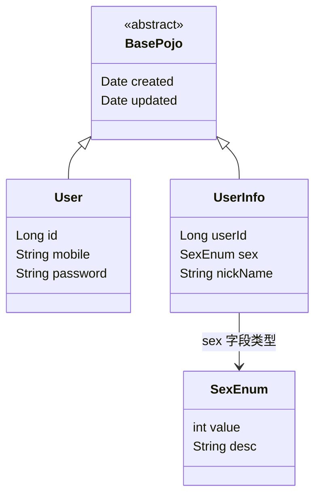

# 探花交友的基础代码骨架：SexEnum、BasePojo 与 MyBatis-Plus 自动填充

库表建好、配置写完，接下来这批代码在任何接口文档里都找不到，它们是后面每一个功能都要踩的地基：性别枚举、实体公共父类、两个实体、自动填充处理器、一个 Mapper 和启动类。这层骨架写得顺手，后面每天的业务代码就只剩「往哪个包里放」的问题；写得含糊，开发到一半就会回来补课。值得花时间把每一块的为什么想透。

## 先给结论

- 包结构一次定型：`enums` 放枚举、`pojo` 放实体、`handler` 放填充处理器、`mapper` 放数据访问接口，启动类用 `@MapperScan` 锁定 mapper 包。
- `SexEnum` 实现 MyBatis-Plus 的 `IEnum<Integer>`：数据库存数值，Java 代码用枚举，`getValue()` 决定写入数据库的值。
- `BasePojo` 是抽象父类，收拢所有表都有的 `created` 与 `updated`，用 `@TableField(fill = ...)` 声明填充时机。
- `@TableField(fill)` 只是声明，填充逻辑必须自己写：`@Component` 注册一个实现 `MetaObjectHandler` 的处理器，插入填两个字段，更新只填 `updated`，且更新场景不做判空，直接覆盖为当前时间。
- 实体类不写表名注解，靠全局 `table-prefix=tb_` 拼出 `tb_user`；`UserMapper` 继承 `BaseMapper<User>` 就拥有全套单表 CRUD。

## 一、性别枚举：数据库存数值，代码用枚举

`tb_user_info` 的 sex 字段是 tinyint，1 男、2 女、3 未知。如果实体里也用 Integer，代码里很快会出现一堆不知所云的 `setSex(2)`。枚举把语义还回来，同时要解决一个问题：框架怎么知道枚举和数值怎么互转。MyBatis-Plus 的答案是 `IEnum` 接口：

```java
package com.study.tanhua.sso.enums;

import com.baomidou.mybatisplus.core.enums.IEnum;

public enum SexEnum implements IEnum<Integer> {
    MAN(1, "男"),
    WOMAN(2, "女"),
    UNKNOWN(3, "未知");

    private int value;
    private String desc;

    SexEnum(int value, String desc) {
        this.value = value;
        this.desc = desc;
    }

    @Override
    public Integer getValue() {
        return this.value;
    }

    @Override
    public String toString() {
        return this.desc;
    }
}
```

两个方法各管一头：`getValue()` 是写库时的转换依据，存进去的是 1、2、3；`toString()` 是展示时的形态，打日志、序列化时看到的是「男」「女」「未知」。配合上一节配置里的 `type-enums-package`，框架扫描到这个包就知道哪些枚举要参与转换。取值有限、含义固定的字段（性别、状态、类型）都适合这一套，散落的魔法数字是后期维护的隐形税。

## 二、BasePojo：把 created 与 updated 收进父类

两张表都有 created 和 updated，后面每天的表大概率还会带这两个字段。重复字段就该上提，MyBatis-Plus 靠注解声明填充时机：

```java
package com.study.tanhua.sso.pojo;

import com.baomidou.mybatisplus.annotation.FieldFill;
import com.baomidou.mybatisplus.annotation.TableField;
import java.util.Date;

public abstract class BasePojo {
    @TableField(fill = FieldFill.INSERT) // 插入时自动填充
    private Date created;
    @TableField(fill = FieldFill.INSERT_UPDATE) // 插入和更新时都自动填充
    private Date updated;
}
```

声明成 abstract 有两层含义：它不对应任何表，永远不会被单独实例化去查询；子类强制继承这套审计字段，想漏都漏不掉。`FieldFill.INSERT` 表示只介入插入，`INSERT_UPDATE` 表示插入和更新都介入，updated 选后者，因为它表达的是「最后一次变动时间」。

## 三、User 与 UserInfo：三个 Lombok 注解与一个细节

实体写起来很快，User 一共三个业务字段：

```java
package com.study.tanhua.sso.pojo;

import com.fasterxml.jackson.annotation.JsonIgnore;
import lombok.AllArgsConstructor;
import lombok.Data;
import lombok.NoArgsConstructor;

@Data
@NoArgsConstructor
@AllArgsConstructor
public class User extends BasePojo {
    private Long id;             // 用户id
    private String mobile;       // 手机号
    @JsonIgnore                  // json 序列化时忽略
    private String password;     // 密码
}
```

类上没有表名注解，因为全局配置已经给了 `table-prefix=tb_`，框架拿类名 User 拼上前缀就找到 `tb_user`。三个 Lombok 注解分工明确：`@Data` 生成 getter、setter、equals、hashCode、toString；`@NoArgsConstructor` 与 `@AllArgsConstructor` 补出无参和全参构造器，框架反序列化要无参，手工构造对象用全参。类名一改、字段一加，这些方法自动跟上，这就是引入 Lombok 的全部理由。

UserInfo 字段多，挑关键的看：

```java
@Data
@NoArgsConstructor
@AllArgsConstructor
public class UserInfo extends BasePojo {
    private Long id;
    private Long userId;      // 用户id，与 tb_user 关联
    private String nickName;  // 昵称
    private String logo;      // 用户头像
    private String tags;      // 用户标签，多个用逗号分隔
    private SexEnum sex;      // 性别，用枚举承接
    private Integer age;      // 年龄
    private String edu;       // 学历
    private String city;      // 居住城市
    private String birthday;  // 生日
    private String coverPic;  // 封面图片
    private String industry;  // 行业
    private String income;    // 收入
    private String marriage;  // 婚姻状态
}
```

字段名与库列名的对应靠驼峰转下划线：nickName 对 nick_name，coverPic 对 cover_pic，这是 MyBatis-Plus 的默认映射规则，不需要逐个注解。sex 的类型是 SexEnum，转库时走第一节那套 `getValue()`。userId 用 Long 对应库里的 bigint。password 上那个 `@JsonIgnore` 值得单独记一笔：用户对象一旦序列化成 JSON 返回前端，password 会被一并带出去，注解把这根线掐断，敏感字段不出服务端。



继承关系图把骨架收拢成一句话：公共时间字段在 BasePojo，业务字段在两个实体里，枚举挂在 UserInfo 的 sex 上。

## 四、自动填充：声明之后还要有人干活

加了 `@TableField(fill = ...)` 并不等于自动生效，MyBatis-Plus 只是留了一个钩子，钩子里做什么由使用者实现。处理器放在 `handler` 包，交给 Spring 管理：

```java
package com.study.tanhua.sso.handler;

import com.baomidou.mybatisplus.core.handlers.MetaObjectHandler;
import org.apache.ibatis.reflection.MetaObject;
import org.springframework.stereotype.Component;
import java.util.Date;

@Component
public class MyMetaObjectHandler implements MetaObjectHandler {

    @Override
    public void insertFill(MetaObject metaObject) {
        Object created = getFieldValByName("created", metaObject);
        if (null == created) {
            // 插入时 created 为空才填充
            setFieldValByName("created", new Date(), metaObject);
        }
        Object updated = getFieldValByName("updated", metaObject);
        if (null == updated) {
            setFieldValByName("updated", new Date(), metaObject);
        }
    }

    @Override
    public void updateFill(MetaObject metaObject) {
        // 更新时不判空，直接覆盖为当前时间
        setFieldValByName("updated", new Date(), metaObject);
    }
}
```

`MetaObject` 是 MyBatis 对对象的反射包装，`getFieldValByName` 与 `setFieldValByName` 就是借它读写属性。插入逻辑先取现值、为空才填，这样调用方显式指定的时间不会被覆盖。更新逻辑是课程里现场修正过的地方：初版照抄了插入的判空写法，问题是更新操作里 updated 的语义就是「现在改的」，无论如何都该刷新成当前时间；判空之后，实体带着旧 updated 过来，旧时间反而被保留，审计字段失真。所以更新分支删掉判断，直接 set。这两个方法在 SQL 组装阶段被回调，insert 语句里的 created、updated 值就来自这里，业务代码从此不用再碰时间字段。

## 五、Mapper 与启动类：把包扫描串起来

数据访问层薄到只有一行：

```java
package com.study.tanhua.sso.mapper;

import com.baomidou.mybatisplus.core.mapper.BaseMapper;
import com.study.tanhua.sso.pojo.User;

public interface UserMapper extends BaseMapper<User> {
}
```

`BaseMapper<User>` 里预置了单表操作的全家桶：`insert`、`deleteById`、`deleteBatchIds`、`updateById`、`update`、`selectById`、`selectBatchIds` 等方法都有默认实现，泛型 User 告诉它表对应哪个实体。空接口继承即得，需要自定义 SQL 时再往接口里加方法。

启动类做两件事：声明自己是 Spring Boot 应用，把 mapper 包纳入扫描：

```java
package com.study.tanhua.sso;

import org.mybatis.spring.annotation.MapperScan;
import org.springframework.boot.SpringApplication;
import org.springframework.boot.autoconfigure.SpringBootApplication;

@MapperScan("com.study.tanhua.sso.mapper") // 设置 mapper 接口的扫描包
@SpringBootApplication
public class MyApplication {
    public static void main(String[] args) {
        SpringApplication.run(MyApplication.class, args);
    }
}
```

`@MapperScan` 的包路径写错一个字符，后果是 Mapper 接口不生成代理对象，注入时直接报找不到 bean，启动类是这条链路的总开关。到此基础代码齐了：枚举、父类、实体、处理器、Mapper、启动类，配合配置文件构成一个能跑的最小系统。vo 与 controller 层在编写接口服务时补上，那才是第一条对外链路。

## 常见误区

- **以为 `@TableField(fill = ...)` 加了就生效。** 错例：注解打上去，插入后 created 仍是 null。正解：fill 只是声明填充时机，必须存在一个实现 `MetaObjectHandler` 的 Bean 注册进容器，钩子才会被调用。
- **更新填充照抄插入的判空逻辑。** 错例：updateFill 里先取旧值判空再填，结果实体带旧时间过来时字段不刷新。正解：更新场景直接覆盖为当前时间，updated 的语义就是最后变动时刻。
- **枚举没实现 IEnum 或漏配扫描包。** 错例：SexEnum 不实现 `IEnum<Integer>`，或 `type-enums-package` 没指到对应包，入库时报类型转换错误或存成了枚举名字符串。正解：接口实现与包扫描两处都要到位。
- **Mapper 扫描包写错或漏写。** 错例：`@MapperScan` 指到 pojo 包，运行时注入 UserMapper 报找不到 bean。正解：扫描包必须是 Mapper 接口所在包，全限定名逐一核对。

## 面试可能被问到的问题

1. 面试官追问：「MyBatis-Plus 的自动填充是怎么实现的？」
   答：实体字段用 `@TableField(fill)` 声明介入时机，容器里注册一个实现 `MetaObjectHandler` 的处理器，框架在组装 insert 或 update 语句时回调 `insertFill` 与 `updateFill`，通过 `MetaObject` 反射读写属性完成赋值。它是 SQL 层的钩子，不依赖数据库默认值。
2. 面试官追问：「枚举和数据库数值互转有哪几种做法？」
   答：MyBatis-Plus 里常用两种，实现 `IEnum` 接口在 `getValue` 里给出入库值，或用 `@EnumValue` 标注参与存储的成员。配合 `type-enums-package` 扫描后，写入取枚举的存储值，读取按值反解成枚举实例。
3. 面试官追问：「BasePojo 设计成抽象类有什么好处？」
   答：审计字段只有一份定义，新增实体继承即可，不会出现有的表带时间字段有的不带的不一致；抽象类不可实例化，避免它被误当成业务实体去查询。这也是模板方法思想的简化形态，把不变的部分上提，变化的部分留给子类。
4. 面试官追问：「继承 BaseMapper 之后能获得哪些能力？复杂查询怎么办？」
   答：单表 CRUD 与按 id、按 id 批量的增删改查开箱即用，条件构造器 Wrapper 能拼出大部分 where 组合。涉及多表 join、复杂统计时仍写 XML 或注解 SQL，Mapper 接口里自定义方法，两套并存互不影响。
5. 面试官追问：「@MapperScan 和在接口上标 @Mapper 有什么区别？」
   答：作用都是让框架为 Mapper 接口生成代理并注册成 Bean。@MapperScan 按包批量扫描，模块多时一处配置管全部；@Mapper 逐个标注，接口少时直观。混用也可以，工程上通常选定一种，避免排查时两处都要看。
6. 面试官追问：「实体类为什么不写表名注解也能映射到表？」
   答：MyBatis-Plus 默认按类名驼峰转下划线生成表名，全局配置 `table-prefix=tb_` 后再统一补前缀。类名 User 与前缀拼出 tb_user。这种约定式映射减少了样板注解，代价是表名与类名的对应规则必须全局一致。

## 配套资料

- 数据库：`materials/code/07/day01 探花交友-项目搭建以及登录完善个人信息/day01/代码/mytanhua.sql`，tb_user 与 tb_user_info 的真实建表脚本，实体字段与库列名逐一对应。
- 讲义：`materials/docs/07/` 不存在，本阶段无讲义文本，代码以课程画面为准。
- 说明：day01 资料包无工程源码，枚举、实体、填充处理器与启动类均按课程画面逐行整理；包名按规范改写为 `com.study.tanhua`；UserInfo 的 userId 按库中 bigint 类型定为 Long。
