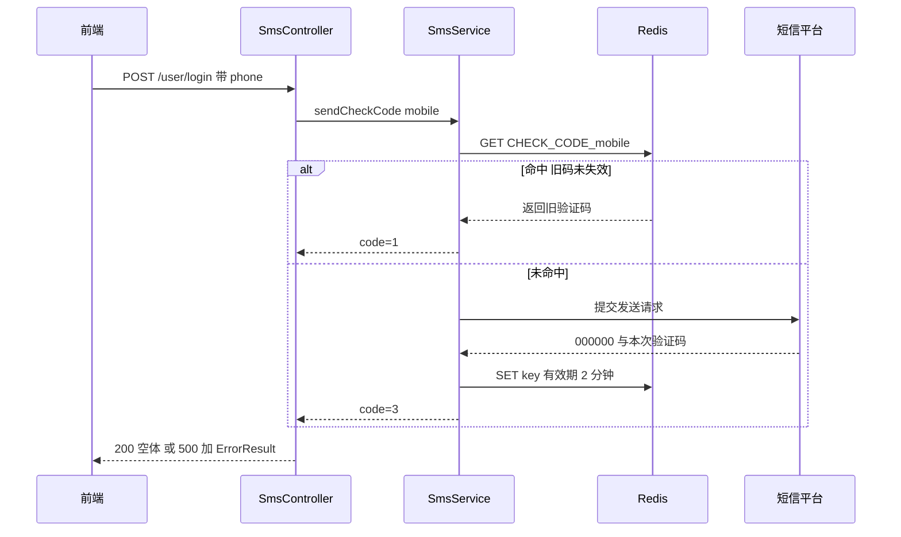

# 探花交友的发送验证码接口：mock 契约、Redis 存码与 Controller 翻译层

`SmsService` 已经能把真实短信发到手机，但它只是服务端的内部能力，前端要的是一个 HTTP 接口。前后端并行开发时，接口长什么样不能靠口头约定，双方都以 mock 平台上的接口文档为准，先定契约再各写各的。这一节把契约内容、错误响应对象、服务层的存码逻辑、Controller 的状态码翻译依次补齐，登录链路的第一条对外接口就此成型。

## 先给结论

- 契约内容：`POST /user/login`，请求体为 JSON 且只带 `phone` 字段；发送成功响应 HTTP 200、无响应体；失败响应 500，响应体为 `errCode` 与 `errMsg` 两个字段。
- 接口路径里的 `login` 是前端契约里定下的名字，语义上做的是发送验证码，跟契约走，不为名字纠结。
- 服务层 `sendCheckCode` 定义四种结果码：1 表示上一次的验证码未失效直接复用，2 表示平台发送失败，3 表示成功并把验证码写入 Redis，4 表示过程异常。
- Redis 键形如 `CHECK_CODE_13800138000`，有效期两分钟，同一手机号在有效期内不会重复发码，限频顺带实现。
- Controller 把结果码翻译成 HTTP 语义：3 映射 200 空体，其余映射 500 加 `ErrorResult`，默认错误码 `000000` 配「短信发送失败」，结果码 1 用 `000001` 并透传服务层的提示语；`ErrorResult` 必须同时加 `@Data` 与 `@Builder`，只加 `@Builder` 生成不了 getter，序列化会直接出问题。

## 一、契约先行：mock 接口文档定下什么

mock 接口文档是前后端的共同图纸，逐条读下来是这样：请求方法 POST，地址 `/user/login`，请求参数类型 `application/json`，参数只有一个手机号，字段名 `phone`；响应部分，成功时状态码 200 且响应体为空，失败时状态码 500，响应体要带自定义的 `errCode` 与 `errMsg`。这份契约决定了接下来所有代码的形状，尤其是「成功无响应体、失败带错误对象」这个不对称设计，让 Controller 的返回值必须用能同时表达状态码和响应体的类型。



时序图里藏着两个决策点：Redis 命中时不再碰短信平台，既省钱又限频；失败路径全部收口到 500 加错误对象，前端只需要按 HTTP 状态码分支。

## 二、ErrorResult：错误响应的载体

先建 `vo` 包，专门放面向视图层（也就是响应给前端）的对象。错误响应只需要两个字段：

```java
package com.study.tanhua.sso.vo;

import lombok.Builder;
import lombok.Data;

@Data
@Builder
public class ErrorResult {
    private String errCode; // 错误码
    private String errMsg;  // 错误信息
}
```

`@Builder` 提供链式构造，`ErrorResult.builder().errCode("000000").errMsg("短信发送失败").build()` 一行成型。课程里现场补过一次课：先只加了 `@Builder`，结果对象没有 getter，框架序列化时读不到字段，响应出来是空的，`@Data` 必须补上。Lombok 注解之间不是替代关系，`@Builder` 管构造，`@Data` 管访问器与序列化所需的方法，两个都要。

## 三、服务层：sendCheckCode 把发送与存码接起来

`SmsService` 在原有 `sendSms` 之上加一个面向业务的方法，注入 `RedisTemplate` 与日志对象：

```java
@Autowired
private RedisTemplate redisTemplate;

private static final Logger LOGGER = LoggerFactory.getLogger(SmsService.class);

public Map<String, Object> sendCheckCode(String mobile) {
    Map<String, Object> result = new HashMap<>(2);
    try {
        String redisKey = "CHECK_CODE_" + mobile;
        String value = this.redisTemplate.opsForValue().get(redisKey);
        if (StringUtils.isNotEmpty(value)) {
            // 上一次发送的验证码还未失效，直接复用
            result.put("code", 1);
            result.put("msg", "上一次发送的验证码还未失效");
            return result;
        }
        String code = this.sendSms(mobile);
        if (null == code) {
            result.put("code", 2);
            result.put("msg", "发送短信验证码失败");
            return result;
        }
        // 发送成功，验证码写入 Redis，两分钟后失效
        result.put("code", 3);
        result.put("msg", "ok");
        this.redisTemplate.opsForValue().set(redisKey, code, Duration.ofMinutes(2));
        return result;
    } catch (Exception e) {
        LOGGER.error("发送验证码出错！" + mobile, e);
        result.put("code", 4);
        result.put("msg", "发送验证码出现异常");
        return result;
    }
}
```

返回值是 Map 而不是自定义对象，key 固定为 code 与 msg，code 是业务结果码，与 HTTP 状态码彻底分离。四条路径都收敛在一个方法里：Redis 命中说明上一次的码还能用，不重发不扣费，直接把现状报告给上层；`sendSms` 返回 null 说明平台侧没成功；异常走日志加结果码 4，异常对象完整记录进日志方便回溯；只有发送成功才往 Redis 写入，`set` 的第三个参数把过期时间一次声明，两分钟后键自动消失。方法的返回没有抛出任何受检异常，Controller 不需要 try-catch，这是把异常消化在服务层的取舍。

限频的机制就在这个方法里：验证码的有效期就是重发间隔，同一个手机号两分钟内第二次请求必然命中旧键，返回结果码 1。这比单独维护一个「上次发送时间」的键简洁，一个键同时承担了存码、限频、自动过期三件事。

## 四、Controller：把结果码翻译成 HTTP 语义

```java
package com.study.tanhua.sso.controller;

import com.study.tanhua.sso.service.SmsService;
import com.study.tanhua.sso.vo.ErrorResult;
import org.springframework.beans.factory.annotation.Autowired;
import org.springframework.http.HttpStatus;
import org.springframework.http.ResponseEntity;
import org.springframework.web.bind.annotation.*;
import java.util.Map;

@RequestMapping("user")
@RestController
public class SmsController {

    @Autowired
    private SmsService smsService;

    @PostMapping("login")
    public ResponseEntity<Object> sendCheckCode(@RequestBody Map<String, Object> param) {
        String phone = String.valueOf(param.get("phone"));
        Map<String, Object> sendCheckCode = this.smsService.sendCheckCode(phone);
        int code = (int) sendCheckCode.get("code");
        if (code == 3) {
            // 发送成功，响应 200 且无响应体
            return ResponseEntity.ok().build();
        }
        if (code == 1) {
            // 上一次发送的验证码还未失效，透传服务层提示
            return ResponseEntity.status(HttpStatus.INTERNAL_SERVER_ERROR)
                    .body(ErrorResult.builder()
                            .errCode("000001")
                            .errMsg(String.valueOf(sendCheckCode.get("msg")))
                            .build());
        }
        // 其余情况按默认失败处理
        return ResponseEntity.status(HttpStatus.INTERNAL_SERVER_ERROR)
                .body(ErrorResult.builder()
                        .errCode("000000")
                        .errMsg("短信发送失败")
                        .build());
    }
}
```

类上 `@RequestMapping("user")` 加方法上 `@PostMapping("login")` 拼出契约里的 `/user/login`。方法名里没有 login，类的名字也不叫 UserController，接口的命名完全由契约倒推，这也是 mock 先行的含义：前端已经按文档开发，后端的名字自由度只存在于代码内部。参数用 `@RequestBody Map<String, Object>` 接，JSON 被反序列化成 Map，取 phone 时用 `String.valueOf` 转成字符串。

返回类型 `ResponseEntity<Object>` 是本节的关键选型：它把 HTTP 状态码和响应体打包在一起，`ResponseEntity.ok().build()` 就是 200 无体，`status(HttpStatus.INTERNAL_SERVER_ERROR).body(...)` 就是 500 带错误对象，契约的不对称设计在这里得以原样落地。结果码到 HTTP 语义的映射规则值得记：只有 3 算成功，1 虽然不重新发码但也归入失败，因为对前端而言这次请求没有产生新的验证码，提示语透传服务层的 msg，用户看到的是「上一次发送的验证码还未失效」，而 `errCode` 用 `000001` 与默认失败 `000000` 区分开，前端可以据此做不同的提示样式。

有一处课程实现刻意留下的缺口：phone 取出来后既没判空也没校验格式，空指针或不合法号码会一路走到服务层甚至平台侧。工程上应在 Controller 入口先做 `StringUtils.isBlank` 判断加手机号正则，不合法直接返回参数错误，这层防御的成本极低，收益是后面所有环节都面对干净入参。

## 五、启动与验证：接口、手机与 Redis 三方核对

启动类运行起来，服务监听 18080 端口。按课程环境的做法验证一遍（命令为按本课写法补全的示例）：

```bash
curl -X POST http://127.0.0.1:18080/user/login \
  -H "Content-Type: application/json" \
  -d "{\"phone\":\"13800138000\"}"

redis-cli -c
GET CHECK_CODE_13800138000
TTL CHECK_CODE_13800138000
```

请求返回 200，手机收到短信；进 Redis 用契约里的键规则查 `CHECK_CODE_手机号`，能看到本次的 6 位码，`TTL` 返回一个小于 120 的秒数并持续递减。两分钟内再发一次，得到 500 与 `errCode` 为 `000001` 的错误对象，提示上一次的验证码还未失效，键也确认没有被覆盖。三方核对都对上，这条接口才算真正闭环。注意一点：直接用 Spring Boot 默认注入的 `RedisTemplate` 存字符串，键和值会带序列化包装，`redis-cli` 里读到的不是纯文本，需要配置字符串序列化器或改用 `StringRedisTemplate` 才能按上面的命令直读，工程化时建议一并调整。

## 常见误区

- **ErrorResult 只加 `@Builder`。** 错例：链式构造用得很顺，序列化响应体时字段全丢。正解：`@Builder` 只生成构造器，`@Data` 生成 getter 与序列化所需方法，两者并用。
- **结果码直接当 HTTP 状态码返回。** 错例：响应 200，body 里塞 `code=1` 让前端自己判断。正解：契约规定成功 200 无体、失败 500 带错误对象，业务结果码与传输层状态码各司其职，Controller 负责翻译。
- **Controller 里 catch 异常再手工组响应。** 错例：与服务层重复的 try-catch，异常信息不一致。正解：服务层把异常消化成结果码并记日志，Controller 只做码到状态码的映射，单一出口。
- **入参不校验就下发。** 错例：phone 为空或格式非法时仍调用短信平台，浪费费用还可能触发平台报错。正解：Controller 入口做判空与手机号正则校验，不合法直接拒绝。

## 面试可能被问到的问题

1. 面试官追问：「发验证码的接口为什么叫 login？」
   答：接口契约由 mock 文档先行定义，前端按文档开发，路径是前后端共享的标识，不能单方面改。语义与命名不一致时，可以在代码内部用准确的方法名表达语义，对外路径跟契约走；新项目则应在评审阶段把命名谈清楚。
2. 面试官追问：「ResponseEntity 和自定义统一返回对象各适合什么场景？」
   答：ResponseEntity 直接暴露状态码与响应体，适合需要精确控制 HTTP 语义的接口，比如本课成功无体、失败 500 的契约。统一返回对象把业务码放 body，适合前后端约定固定 200、靠 body 区分成败的风格。关键是全项目统一，不要两套混用。
3. 面试官追问：「验证码的限频是怎么在这个设计里实现的？」
   答：发送成功才写 Redis 键，有效期两分钟，同一手机号有效期内再次请求必然命中旧键，走复用分支不重发。一个键同时承担存码、限频与自动过期，不需要额外的时间戳键。更完整的方案再加每日上限与图形验证码。
4. 面试官追问：「结果码 1 复用旧码，为什么也算失败返回 500？」
   答：对前端来说，这次请求没有产生新验证码，用户期待的操作没有完成，所以归入失败分支，但提示语透传「上一次发送的验证码还未失效」，用户无需重发即可继续登录。这是契约设计的取舍，也可以设计成 200 加特定业务码，只要前后端一致即可。
5. 面试官追问：「@Builder 和 @Data 分别生成什么，能否只用一个？」
   答：@Builder 生成链式建造者，解决复杂对象构造；@Data 生成 getter、setter、equals、hashCode、toString。响应对象需要被序列化，必须有访问器，所以 @Data 不可省；@Builder 只是构造便利，二者互补而不是替代。
6. 面试官追问：「验证码存 Redis 时键怎么设计，序列化要注意什么？」
   答：键用业务前缀加手机号，如 CHECK_CODE_13800138000，前缀便于识别与批量清理；值是 6 位码字符串，写入带 TTL。Spring Boot 默认 RedisTemplate 的序列化是 JDK 序列化，redis-cli 里读出来是字节串，键值都应配置字符串序列化器或使用 StringRedisTemplate，便于排查与跨系统核对。

## 配套资料

- 学习目标：`materials/code/07/day01 探花交友-项目搭建以及登录完善个人信息/day01/学习目标.md`，掌握发送短信验证码与独立完成登录功能是 day01 的目标项。
- 讲义：`materials/docs/07/` 不存在，本阶段无讲义文本，接口契约以课程画面中的 mock 接口文档为准，文档平台地址不在博客中引用。
- 说明：day01 资料包无工程源码，ErrorResult、sendCheckCode 与 SmsController 按课程画面逐行整理，画面中被截断的分支按上下文补全；包名改写为 `com.study.tanhua`；第五节验证命令为按课程环境补全的示例。
