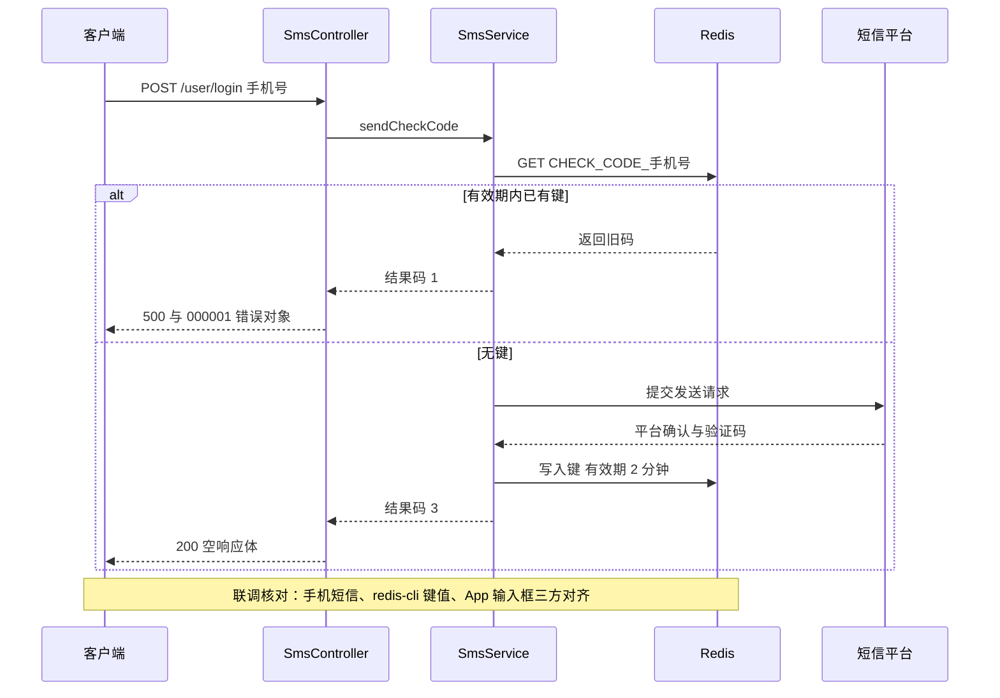

# 探花交友发码接口的前端联调：断点自测、Redis 核对与模拟器 App 配置

发码接口写完、服务能启动，离「能用」还差三步验证。最常见的窘境是：后端用 REST 工具怎么测都通，模拟器里的 App 一点「获取验证码」却毫无反应，断点也不进，分不清问题出在前端配置、网络还是服务端逻辑。这一节按固定顺序把三层验证走完：REST 工具打断点自测、进 Redis 核对键值、换完整版 App 配置真实联调，每一步都有明确的判定标准。

## 先给结论

- 联调顺序固定为三段：REST 工具打断点验证服务端逻辑，redis-cli 核对验证码键值与有效期，模拟器 App 走真实 UI 完成闭环，前一段不通不进下一段。
- 打断点必须用 Debug 模式启动 `MyApplication`，普通 Run 模式断点不生效，这是联调前最容易白忙一场的坑。
- App 端有「修改服务 API 地址」的入口，联调真实后端要填宿主机地址加 18080 端口，模拟器里的 `localhost` 指向模拟器自己而不是开发机。
- Redis 键 `CHECK_CODE_手机号` 在有效期内命中即复用不重发；想验证真实重发链路，先 `DEL` 删键再触发，两次手机收到的码不同即为证明。
- 首次请求偏慢是 Redis 首次建连与序列化器初始化的正常现象，只有持续失败才需要按结果码分层排查。

## 一、Debug 启动与断点自测

服务以 Debug 方式启动，启动类带着 mapper 扫描配置：

```java
package com.study.tanhua.sso;

import org.mybatis.spring.annotation.MapperScan;
import org.springframework.boot.SpringApplication;
import org.springframework.boot.autoconfigure.SpringBootApplication;

@MapperScan("com.study.tanhua.sso.mapper") // 设置mapper接口的扫描包
@SpringBootApplication
public class MyApplication {

    public static void main(String[] args) {
        SpringApplication.run(MyApplication.class, args);
    }
}
```

启动日志里 Tomcat 监听 18080 后，打开 REST 客户端工具（课程用的是 Advanced REST Client）向契约地址发请求：

```bash
curl -X POST http://127.0.0.1:18080/user/login \
  -H "Content-Type: application/json" \
  -d "{\"phone\":\"13800138000\"}"
```

在 `SmsController` 的 `sendCheckCode` 方法内打断点，请求发出后断点应立即进入。单步往下走，重点看三处：参数窗口里 phone 与请求体一致；进入服务层后第一次触碰 Redis 会明显停顿，那是建连与初始化的开销；发送分支走完，变量窗口里结果码 `code` 等于 3。此时手机应收到短信，课程实测收到的验证码是 209951，响应状态码 200、响应体为空，与契约完全一致。

调试中若在变量窗口看到结果码是 1，说明上一次的验证码还没过期，走了复用分支；看到 2 则是短信平台侧发送失败，要去核对平台配置与网络，而不是怀疑代码。

整条链路与核对点画出来是这样：



图里两条分支就是联调时要分别触发的场景：删键走 else 分支验证真实发送，等两分钟内连点走 if 分支验证复用与限频。

## 二、进 Redis 核对键值，删键再验真实重发

服务端说成功还不算，键值要亲自看。课程环境的 Redis 部署在 Linux 上，连进去按契约的键规则查：

```bash
redis-cli -c
GET CHECK_CODE_13800138000
TTL CHECK_CODE_13800138000
DEL CHECK_CODE_13800138000
```

`GET` 返回的值应与手机短信里的 209951 一致，`TTL` 是一个小于 120 并持续递减的秒数，说明两分钟有效期在走。这里能直接读出纯文本，前提是键值都以字符串序列化写入；若读到的是十六进制字节串，说明序列化器没配，回到 `RedisTemplate` 的序列化配置解决。

删掉键之后立刻在客户端再点一次发送，这次手机收到的是全新的 563488，与上一枚不同，Redis 里对应键的值也随之更新。这一步的证明力在于：复用分支和真实发送分支的边界被实际触发了，而不是靠读代码推断。两分钟内不删键连发两次，得到的是 500 加 `errCode` 为 `000001` 的错误对象，提示上一次的验证码还未失效，这是设计行为不是故障。

## 三、模拟器 App：换完整版、改服务地址、走真实 UI

REST 工具只验证了服务端，前端体验要靠模拟器里的 App。之前装的测试版 apk 功能残缺，先在模拟器里把旧的探花应用拖到卸载区删掉，再把功能完整的 apk 拖进模拟器安装。

装好后打开 App，首页顶部有一个修改服务 API 地址的按钮，这是联调的关键入口：如果后端还没写，填 mock 平台的地址可以让 App 走假数据先验 UI；要联调真实后端，就填开发机的地址，保存后生效。这里有个网络事实必须清楚：模拟器是一个独立的虚拟设备，它内部的 `localhost` 指向模拟器自身，访问宿主机上的 18080 服务要填宿主机的局域网 IP，或模拟器提供的宿主机映射地址，填 `127.0.0.1` 请求永远到不了后端。

回到「登录注册」入口，输入手机号点击「获取验证码」，保持 Debug 断点开启，能看到请求真实到达了 `SmsController`，断点进入、服务层发码、手机收信一气呵成，随后 App 页面切出「请输入验证码」的输入框。至此闭环的判定标准全部满足：断点进了、手机收码了、Redis 有键了、App 出输入框了，四点对齐，发码链路才算真正交付。

## 四、联调报错的分层定位

**第一，请求根本没到服务端。** 现象是断点不进、后端访问日志无记录，检查三点：App 里的服务地址是否保存生效、端口是否 18080、模拟器到宿主机的网络是否可达，模拟器网络隔离是这一层的头号原因。

**第二，请求到了但响应 500。** 进断点看结果码分类处理：1 是复用属正常；2 是平台发送失败，查短信平台配置、签名模板与账户状态；4 是服务端异常，看日志里的异常栈。

**第三，服务端成功但手机没收到。** 服务层已拿到平台确认，问题通常在运营商链路或手机号填写，先确认调试用的真实手机号能正常收短信。

**第四，Redis 里查不到键或值不可读。** 核对键名拼写是否为 `CHECK_CODE_手机号`，值读出乱码则检查字符串序列化配置，别把序列化包装误判成没写入。

## 常见误区

- **用 Run 模式启动再打断点。** 错例：服务起来了，断点永远不进，误以为代码没被执行。正解：联调调试一律 Debug 启动，断点才挂在请求线程上。
- **App 里把服务地址填成 `localhost` 或 `127.0.0.1`。** 错例：模拟器请求打到自己身上，连接拒绝。正解：填宿主机局域网 IP 或模拟器提供的宿主机映射地址。
- **把结果码 1 的复用提示当成发送失败。** 错例：两分钟内连续点击，收到「上一次发送的验证码还未失效」就到处找 bug。正解：这正是限频设计在工作，用户凭上一次的码仍可登录。
- **不删键就测「重发」逻辑。** 错例：有效期内反复点获取验证码，手机再也不来新短信，怀疑平台限流。正解：命中复用分支本来就不会重发，先 `DEL` 键再触发才是真实发送路径。

## 面试可能被问到的问题

1. 面试官追问：「前后端联调一条验证码链路，你会怎么设计验证顺序？」
   答：按依赖方向从内到外。先用 REST 工具直打服务端接口并打断点，确认业务逻辑与响应契约正确；再进存储层核对键值与过期时间；最后换真实客户端走 UI。每层都有判定标准，出问题时能立刻定位在哪一层，避免两边来回甩锅。
2. 面试官追问：「安卓模拟器访问宿主机上的服务为什么会失败？」
   答：模拟器是独立虚拟设备，有自己的网络栈，localhost 指向它自己。要访问宿主机需用宿主机在局域网的 IP，或模拟器平台提供的宿主机映射地址。容器内访问宿主机是同类问题，同样不能想当然用回环地址。
3. 面试官追问：「怎么证明验证码的重发是被限频挡住而不是丢了？」
   答：看 Redis 键与结果码。有效期内键存在，服务返回结果码 1 加特定 errCode，说明走了复用分支；删除键后再触发能收到新码，说明真实发送路径完好。键的存在性是判断依据，短信没到只是表象。
4. 面试官追问：「联调时挂断点会不会影响前端？」
   答：会。断点挂起的是处理该请求的线程，前端在等待期内可能触发超时重试或提示失败，而断点恢复后服务端其实成功了。联调时要么缩短断点停留时间，要么关掉前端超时提示，测异常分支时再利用断点制造延迟。
5. 面试官追问：「Redis 里读验证码读到乱码，是什么问题？」
   答：Spring 的 RedisTemplate 默认用 JDK 序列化，写入的键和值都带序列化包装，redis-cli 里呈现为字节串。应配置字符串序列化器或改用 StringRedisTemplate，让键值以纯文本存储，方便排查与跨端核对。
6. 面试官追问：「为什么首次请求特别慢，后续就快了？」
   答：首次请求触发连接池建立、序列化器初始化等一次性开销，连接建立后复用池化连接，耗时就降到正常水平。若每次请求都慢，要排查连接池配置是否失效或每次都在新建连接。

## 配套资料

- 学习目标：`materials/code/07/day01 探花交友-项目搭建以及登录完善个人信息/day01/学习目标.md`，独立完成登录功能是 day01 的目标项，本节的联调是它的第一步。
- 原型：`materials/code/07/day01 探花交友-项目搭建以及登录完善个人信息/day01/资料/` 下的移动端原型包，含「登录页」等页面，App 端联调的界面与交互以此为准。
- 说明：day01 资料包无工程源码，启动类与 Controller 以课程画面为准整理，包名统一改写为 `com.study.tanhua`；验证命令为按课程环境补全的示例，短信平台实名信息不在博客中引用。
