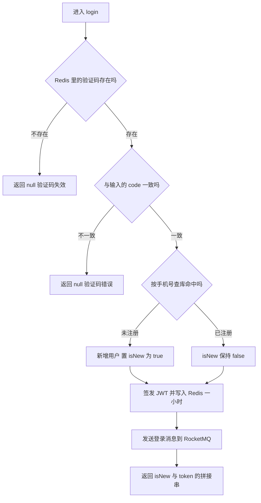

# 登录逻辑 UserService：验证码校验、查建用户与 token 的生成存储

> 🔒 安全提示：文中示例的口令/密钥均为课程教学环境演示口径，生产环境的安全要求见《安全与合规须知》。

发码接口与 JWT 都就位了，登录就是把它们接起来的那段业务：前端提交手机号与验证码，服务端校验通过后签发 token。契约上还有一个容易忽略的字段 isNew，标记本次是否为新用户，App 端要靠它决定进主页还是进资料完善页。这一节逐行走完 `UserService.login`，它是 day01 业务密度最高的一个方法。

## 先给结论

- 校验顺序固定：先比对 Redis 中的验证码，失效与输错都直接返回 null；再按手机号查库，未注册则自动注册，注册即登录。
- `isNew` 默认 false，只有走到注册分支才置 true，最终以 `isNew|token` 的竖杠拼接串返回，拆分交给 Controller。
- token 用 jjwt 签发，claims 放 mobile 与 id；MyBatis-Plus 的 `insert` 会把自增主键回写到实体对象，刚注册的用户也能立刻拿到 id。
- token 存入 Redis，键为 `TOKEN_ + token`，值是用户对象的 JSON，有效期一小时，存储失败按登录失败处理。
- 登录成功后向 RocketMQ 发一条含 id、mobile、登录时间的消息，独立 try-catch 包裹，消息失败只记日志不影响登录。

## 一、契约与依赖骨架

mock 接口文档对登录的定义是：请求参数为手机号与验证码两个字段，校验成功返回 200，响应体包含 token 与 isNew 两项，token 就是前面快速入门里那种 JWT 格式的字符串，isNew 是布尔类型，表示是否新用户；失败返回 500。服务层据此给出方法签名：`String login(String mobile, String code)`，成功返回结果串，失败返回 null。

方法需要的依赖在类里一次备齐：

```java
@Service
public class UserService {

    @Autowired
    private UserMapper userMapper;

    @Autowired
    private RedisTemplate<String, String> redisTemplate;

    @Autowired
    private RocketMQTemplate rocketMQTemplate;

    @Value("${jwt.secret}")
    private String secret;

    private static final ObjectMapper MAPPER = new ObjectMapper();

    private static final Logger LOGGER = LoggerFactory.getLogger(UserService.class);

    // login 方法见下文
}
```

四样注入对应四件武器：`UserMapper` 查库与注册，`RedisTemplate` 校验码与存 token，`RocketMQTemplate` 发登录消息，`@Value` 从配置读 JWT 签名密钥。静态 `ObjectMapper` 做用户对象到 JSON 的序列化，单例复用避免每次新建。

方法的完整判断路径如下：



两条失败路径在图的上半部分短路返回，注册与登录在下半部分汇合到同一套 token 逻辑，这是「注册即登录」的意思：新用户不需要单独的注册接口。

## 二、验证码校验：与发码侧共用一把钥匙

```java
public String login(String mobile, String code) {
    // 校验验证码是否正确
    String redisKey = "CHECK_CODE_" + mobile;
    String value = this.redisTemplate.opsForValue().get(redisKey);
    if (StringUtils.isEmpty(value)) {
        // 验证码失效
        return null;
    }
    if (!StringUtils.equals(value, code)) {
        // 验证码输入错误
        return null;
    }
    // 后续逻辑见下文
}
```

键规则 `CHECK_CODE_手机号` 与发码侧完全一致，两端靠同一个拼接约定对齐，任何一侧改动键名，登录立刻全线失效，这是第一个要守住的一致性。两个分支对应两种失败：键不存在说明两分钟有效期已过，验证码失效；键存在但 `equals` 不匹配说明用户输错了。两者都不抛异常、不区分错误细节，统一返回 null，把「怎么提示」留给 Controller。

## 三、查库与自动注册：insert 的主键回写

```java
// 校验该手机号是否已注册，未注册则自动注册
QueryWrapper<User> queryWrapper = new QueryWrapper<>();
queryWrapper.eq("mobile", mobile);
User user = this.userMapper.selectOne(queryWrapper);
boolean isNew = false; // 默认已注册
if (null == user) {
    // 该手机号未注册
    isNew = true;
    user = new User();
    user.setMobile(mobile);
    // 默认密码，验证码登录场景仅作占位
    user.setPassword(DigestUtils.md5Hex("123456"));
    this.userMapper.insert(user); // 新增后自增 id 回写到 user 对象
}
```

`QueryWrapper.eq("mobile", mobile)` 对应 `tb_user` 表按手机号查询，查到就走老用户路径；查到 null 则现场建号：手机号写入，密码用 commons-codec 的 `DigestUtils.md5Hex` 设置一个默认值 123456，然后 `insert` 落库。默认密码在这个项目里是占位符，用户全程无感知，资料包 `mytanhua.sql` 里预置用户的 password 字段正是 123456 的 MD5 值 `e10adc3949ba59abbe56e057f20f883e`，两边的口径是配套的。

`isNew` 的声明位置有讲究：它必须在注册判断之前初始化为 false，注册分支里才置 true，这样无论走哪条路，到方法末尾它都携带正确语义。而 `insert` 之后能立刻调用 `user.getId()`，靠的是 MyBatis-Plus 的主键回写，自增 id 在插入后自动填回实体对象，这个特性是后面 claims 能拿到 id 的前提。

## 四、签发 token、存 Redis、发消息

```java
// 生成 token
Map<String, Object> claims = new HashMap<>(2);
claims.put("mobile", mobile);
claims.put("id", user.getId());
String token = Jwts.builder()
        .setClaims(claims) // 设置响应数据体
        .signWith(SignatureAlgorithm.HS256, secret) // 设置加密方法和加密盐
        .compact();
// 将 token 存储到 Redis
try {
    String redisTokenKey = "TOKEN_" + token;
    String redisTokenValue = MAPPER.writeValueAsString(user);
    this.redisTemplate.opsForValue().set(redisTokenKey, redisTokenValue, 1, TimeUnit.HOURS);
} catch (Exception e) {
    LOGGER.error("存储token出错", e);
    return null;
}
// 发送登录消息，供下游异步处理，失败不影响登录主流程
try {
    Map<String, Object> message = new HashMap<>(4);
    message.put("id", user.getId());
    message.put("mobile", mobile);
    message.put("date", new Date());
    this.rocketMQTemplate.convertAndSend("tanhua-sso-login", message);
} catch (Exception e) {
    LOGGER.error("发送消息出错", e);
}
return isNew + "|" + token;
```

签发部分就是快速入门示例的落地版：claims 放 mobile 与 id，密钥来自 `@Value("${jwt.secret}")` 注入的配置。键 `TOKEN_ + token` 不能换成手机号，因为同一个手机号每次登录都会生成新 token，历史 token 各自独立管理，以 token 自身为键才能一一对应。值不是简单存个标记而是整个用户对象的 JSON，后续接口拿着 token 来查时能直接还原出用户信息，不必再反解 JWT 后回库查询，一小时的有效期与 JWT 的生命周期设计相互呼应。

两个 try-catch 的力度刻意不同：存储 token 失败意味着登录态无处安放，后续所有需要身份的接口都无法工作，所以按登录失败处理返回 null；消息发送属于锦上添花的异步通知，失败只记日志，绝不能拖垮已经到手的登录结果。最后 `isNew + "|" + token` 把两个返回值拼进一个 String，Controller 按竖杠拆开组装响应。

## 常见误区

- **两端键前缀不一致。** 错例：发码侧写 `CHECK_CODE_`，登录侧手误写成 `CHECK_CODE`，永远查不到码。正解：键规则抽成常量或工具方法，两侧引用同一份定义。
- **忽略主键回写，claims 塞进 null。** 错例：新用户注册后直接 `user.getId()` 拿到 null，token 里 id 缺失。正解：确认 MyBatis-Plus 主键回写生效，实体主键注解与表自增配置正确。
- **消息发送不包 try-catch。** 错例：RocketMQ 抖动时异常冒泡，登录接口连带失败。正解：非关键路径的副作用一律独立捕获，只记日志不影响主流程。
- **把 MD5 当真实密码方案。** 错例：生产注册逻辑直接 `md5Hex(密码)` 入库。正解：MD5 无盐可被彩虹表秒破，真实项目用 BCrypt 这类自适应散列；本项目的默认密码只是验证码登录下的占位。

## 面试可能被问到的问题

1. 面试官追问：「为什么手机验证码登录可以不设注册接口，直接注册即登录？」
   答：验证码送达本人手机，本身就完成了身份核验，手机号成为天然账号标识。查库发现手机号不存在时自动建号，注册与登录合并为一次交互，降低了用户流失。代价是需要配套风控，防止批量取号刷注册。
2. 面试官追问：「两个请求同时用同一手机号登录，会不会重复插入两条用户记录？」
   答：查与插不是原子操作，并发下可能都查到 null 然后各插一条。兜底手段是给 mobile 加唯一索引，第二个插入直接报错，应用层捕获后按已注册流程继续取数。严谨做法还有分布式锁或数据库插入幂等，核心是不依赖查询结果做唯一性保证。
3. 面试官追问：「token 已经自包含用户信息了，为什么还要往 Redis 存一份？」
   答：JWT 验签只能保证内容没被篡改，管不住有效期作废与踢人。Redis 里以 token 为键存用户 JSON，一是提供主动失效能力，删键即下线；二是后续接口取用户信息直接读缓存，免去重复解析与回库。存储失败按登录失败处理，是因为后续鉴权依赖这份副本。
4. 面试官追问：「返回 isNew|token 拼接串有什么问题，你会怎么改进？」
   答：拼接串让调用方依赖隐式格式约定，分隔符出现在内容里就出错，类型也不安全。改进是定义 LoginResult 之类的 DTO，携带 token 与 isNew 两个字段，由序列化框架保证结构。课程这样写是为了少建一个类，工程上应换成显式对象。
5. 面试官追问：「登录成功后发一条 MQ 消息，意义在哪？」
   答：把非核心动作从登录主链路剥离，比如给新用户发欢迎短信、记录登录日志这类下游逻辑，由消费者异步完成。消息里带 id、mobile 与登录时间，消费者按需取用。发送侧 try-catch 保证消息链路故障不反噬登录，这正是异步解耦的价值。
6. 面试官追问：「验证码比对放在服务层而不是 Controller，出于什么考虑？」
   答：验证码校验依赖 Redis 访问，属于业务规则，Controller 只负责协议翻译与状态码映射。放服务层便于复用，其他入口如小程序登录也要校验码时不必复制逻辑，也让 Controller 保持无状态无存储依赖，测试时可以直接对服务层写单元测试。

## 配套资料

- 数据库：`materials/code/07/day01 探花交友-项目搭建以及登录完善个人信息/day01/代码/mytanhua.sql`，含 `tb_user` 表结构与预置用户数据，预置行的 password 字段即 123456 的 MD5 值，与代码中默认密码口径一致。
- 学习目标：`materials/code/07/day01 探花交友-项目搭建以及登录完善个人信息/day01/学习目标.md`，独立完成登录的功能是本课核心目标。
- 说明：day01 资料包无工程源码，`UserService.login` 按课程画面逐行整理，被画面截断的分支按上下文补全；包名统一为 `com.study.tanhua`，JWT 密钥与 MQ 目的地名称为中性示例值。
