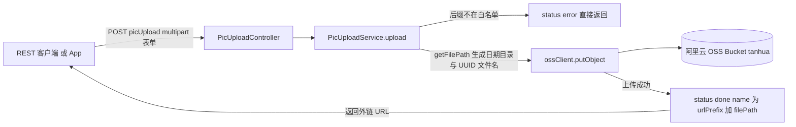

# 头像上传交给对象存储：接入阿里云 OSS 的完整一步

> 🔒 安全提示：文中示例的口令/密钥均为课程教学环境演示口径，生产环境的安全要求见《安全与合规须知》。

完善个人信息里有个特殊角色：头像。昵称、生日、城市是几个字符串，头像却是一张实打实的图片文件。图片往哪放？塞进 MySQL 的 BLOB 会把表撑得又慢又大，放应用服务器本地磁盘则在多实例部署时立刻失效。这一步的正确答案是对象存储：文件放云端，数据库里只留一个访问 URL。课程选的是阿里云 OSS，本节把从开通服务到返回外链的整条链路走通，为后面「非人像图片不许上传」的人脸校验铺好地基。

## 先给结论

- OSS 里存放图片的容器叫 Bucket，可以理解为「图片仓库」，图片以对象形式存入，配好权限后外链 URL 可直接访问。
- 接入 OSS 只动三处：`pom.xml` 加 SDK 依赖，`resources` 下建 `aliyun.properties` 放五个参数，`AliyunConfig` 里初始化一个 `OSSClient`。
- 上传的核心调用是一行 `ossClient.putObject(bucketName, filePath, inputStream)`，`filePath` 按日期分目录：`images/yyyy/MM/dd/uuid.jpg`。
- 返回给前端的外链是 `urlPrefix + filePath`，这个 URL 就是将来写进 `tb_user_info.logo` 字段的值。
- `accessKeyId` 与 `accessKeySecret` 是账号级凭证，配置里必须打码保密，泄露等于把 Bucket 交了出去。

## 为什么头像不进数据库，要进对象存储

**第一，图片的访问模式与结构化数据完全不同。** 用户资料需要按条件查询、关联、统计，而头像只有一种操作：按 URL 读取。把几十 KB 到几 MB 的二进制塞进行里，查询缓存、备份、主从同步全部跟着变重，收益却是零。

**第二，对象存储天生为这种场景设计。** OSS 按对象组织数据，写入时给一个 key（即这里的 `filePath`），读取时用 URL 直接 GET，容量、带宽、持久性都由云服务兜底。应用服务器保持无状态，任何一台实例都能产出同样格式的 URL。

两个关键概念在此对齐：

- **Bucket**：存储空间，相当于图片仓库名，账号内唯一。课程里按项目取名，例如 `tanhua`。
- **urlPrefix**：访问上传图片的 URL 前缀，即整个外链去掉文件路径的那一段。它与 Bucket 所在地域绑定，课程选择的是上海节点，前缀形如 `http://tanhua.oss-cn-shanghai.aliyuncs.com/`。

## 开通服务与五项配置

使用 OSS 前要在阿里云控制台购买或开通该服务，再创建一个 Bucket，创建时选择地域（课程用上海节点）与读写权限。购买步骤是纯控制台操作，不展开；真正的工程动作是把参数落到配置文件。在 `src/main/resources` 下新建 `aliyun.properties`：

```properties
# 外网访问的节点地址，与 Bucket 地域一致
aliyun.endpoint = http://oss-cn-shanghai.aliyuncs.com
# 值已打码：开通 OSS 后在访问控制台创建，请换成自己的
aliyun.accessKeyId = example-ak
aliyun.accessKeySecret = example-sk
# 存储空间名，自己创建的 Bucket
aliyun.bucketName = tanhua
# 上传成功后拼接外链用的 URL 前缀
aliyun.urlPrefix = http://tanhua.oss-cn-shanghai.aliyuncs.com/
```

五个参数各司其职：endpoint 决定请求发往哪个地域；一对 AccessKey 做身份认证；bucketName 指定存进哪个仓库；urlPrefix 用于上传成功后拼出可访问的外链。其中 AccessKey 在控制台创建后只能看到一次，粘贴进配置时不要提交到任何公共仓库。

## 三个类的分工：Config 初始化，Service 上传，Controller 收口

sso 工程的 `pom.xml` 加上 OSS 的依赖：

```xml
<dependency>
    <groupId>com.aliyun.oss</groupId>
    <artifactId>aliyun-oss-sdk</artifactId>
    <version>2.8.3</version>
</dependency>
```

课程画面里坐标写作 `aliyun-oss-sdk`，Maven 中央仓库中实际可解析的坐标是 `aliyun-sdk-oss`，引入时以中央仓库为准，版本对应课程画面取 2.8.3。

接着写配置类。它要读上面那份 properties，并把五个参数收进字段，顺手把 `OSSClient` 作为 Bean 交给 Spring 容器：

```java
package com.study.tanhua.sso.config;

import com.aliyun.oss.OSSClient;
import lombok.Data;
import org.springframework.boot.context.properties.ConfigurationProperties;
import org.springframework.context.annotation.Bean;
import org.springframework.context.annotation.Configuration;
import org.springframework.context.annotation.PropertySource;

@Configuration
@PropertySource("classpath:aliyun.properties")
@ConfigurationProperties(prefix = "aliyun")
@Data
public class AliyunConfig {
    private String endpoint;
    private String accessKeyId;
    private String accessKeySecret;
    private String bucketName;
    private String urlPrefix;

    @Bean
    public OSSClient ossClient() {
        return new OSSClient(endpoint, accessKeyId, accessKeySecret);
    }
}
```

`@PropertySource` 指定读 classpath 下的 `aliyun.properties`，`@ConfigurationProperties(prefix = "aliyun")` 让框架按 `aliyun.` 前缀自动绑定同名字段。`OSSClient` 由 endpoint 与一对 AccessKey 三个参数构造，初始化一次全局复用。

上传逻辑独立成 `PicUploadService`，校验、生成路径、调用 OSS 都在这里：

```java
package com.study.tanhua.sso.service;

import com.aliyun.oss.OSSClient;
import com.study.tanhua.sso.config.AliyunConfig;
import com.study.tanhua.sso.vo.PicUploadResult;
import org.apache.commons.lang3.StringUtils;
import org.joda.time.DateTime;
import org.springframework.beans.factory.annotation.Autowired;
import org.springframework.stereotype.Service;
import org.springframework.web.multipart.MultipartFile;

import java.io.ByteArrayInputStream;
import java.util.UUID;

@Service
public class PicUploadService {
    // 允许上传的格式
    private static final String[] IMAGE_TYPE = new String[]{"bmp", "jpg", "jpeg", "gif", "png"};

    @Autowired
    private OSSClient ossClient;

    @Autowired
    private AliyunConfig aliyunConfig;

    public PicUploadResult upload(MultipartFile uploadFile) {
        PicUploadResult fileUploadResult = new PicUploadResult();
        // 图片做校验，对后缀名
        boolean isLegal = false;
        for (String type : IMAGE_TYPE) {
            if (StringUtils.endsWithIgnoreCase(uploadFile.getOriginalFilename(), type)) {
                isLegal = true;
                break;
            }
        }
        if (!isLegal) {
            fileUploadResult.setStatus("error");
            return fileUploadResult;
        }
        // 文件拆解
        String fileName = uploadFile.getOriginalFilename();
        String filePath = getFilePath(fileName);
        // 上传阿里云
        try {
            // 目录结构：images/2018/12/29/xxxx.jpg
            ossClient.putObject(aliyunConfig.getBucketName(), filePath,
                    new ByteArrayInputStream(uploadFile.getBytes()));
        } catch (Exception e) {
            e.printStackTrace();
            fileUploadResult.setStatus("error");
            return fileUploadResult;
        }
        // 上传成功
        fileUploadResult.setStatus("done");
        fileUploadResult.setName(this.aliyunConfig.getUrlPrefix() + filePath);
        fileUploadResult.setId(String.valueOf(System.currentTimeMillis()));
        return fileUploadResult;
    }

    private String getFilePath(String fileName) {
        String baseFolder = "images";
        // 按日期分目录，文件名用 UUID 防止重名覆盖
        String folder = DateTime.now().toString("yyyy/MM/dd");
        String suffix = StringUtils.substringAfterLast(fileName, ".");
        return baseFolder + "/" + folder + "/" + UUID.randomUUID() + "." + suffix;
    }
}
```

方法体主干来自课程画面：先对后缀做白名单校验，不合法直接标记 `error` 返回；合法则生成存储路径，`putObject` 把字节流推到 OSS；成功后把状态置为 `done`，`name` 字段拼出外链。`getFilePath` 与返回值类 `PicUploadResult` 画面中未完整展开，按课程目录结构补全如下，`DateTime` 来自 `joda-time` 依赖：

```java
@Data
public class PicUploadResult {
    private String status; // done / error
    private String name;   // 外链 URL
    private String id;     // 唯一标识
}
```

最后由 Controller 收口，接收 `multipart/form-data` 表单里的文件字段并交给 Service：

```java
@RestController
public class PicUploadController {

    @Autowired
    private PicUploadService picUploadService;

    @PostMapping("picUpload")
    public ResponseEntity<Object> upload(@RequestParam("file") MultipartFile uploadFile) {
        PicUploadResult result = this.picUploadService.upload(uploadFile);
        if ("error".equals(result.getStatus())) {
            return ResponseEntity.status(HttpStatus.INTERNAL_SERVER_ERROR).body(result);
        }
        return ResponseEntity.ok(result);
    }
}
```



这张图是上传请求的完整路径：校验失败在本地短路，通过才走网络；真正进入 OSS 的对象 key 就是日期目录加 UUID，天然避免同名覆盖。

## 联调验证：从 REST 客户端到 OSS 控制台

服务重启后，用 REST 客户端发起验证：请求方法 POST，地址指向服务的 `picUpload` 路径，`Content-Type` 选 `multipart/form-data`，添加一个文件字段，字段名 `file`，值从资料里选一张测试图片。请求进入断点后能看清两个动作：后缀校验放行，`putObject` 上传成功。响应体形如：

```json
{
  "status": "done",
  "name": "http://tanhua.oss-cn-shanghai.aliyuncs.com/images/2025/08/02/xxx.jpg",
  "id": "1754092800000"
}
```

把 `name` 粘贴到浏览器地址栏，图片直接打开，说明外链已经可用。再登录阿里云控制台进入 OSS 的对象存储页面，打开对应 Bucket 的文件管理，按日期目录逐层点进去，能看到刚刚上传的对象及时间戳。两条验证路径都通，OSS 这一环就算落地。至于「上传的是不是真人头像」，是下一节人脸识别要解决的问题。

## 常见误区

- **AccessKey 提交进代码仓库。** 错例：真实密钥随 `aliyun.properties` 推到公共仓库。正解：配置文件中打码或走环境变量，仓库里只留占位，泄露后立即在控制台禁用并轮换。
- **只校验后缀就当安全了。** 错例：把恶意文件改名为 `.jpg` 即可绕过白名单。正解：后缀校验只挡明显不合法的输入，工程上还应校验文件头魔数或限制大小，本课后续的人像校验再补一层业务约束。
- **Bucket 权限配成私有导致外链打不开。** 错例：上传成功，`name` 返回的 URL 浏览器访问 403。正解：公开读的 Bucket 才能匿名通过外链访问图片；若必须私有，就要改用带签名的临时 URL。
- **endpoint 与 Bucket 地域不一致。** 错例：Bucket 建在上海，endpoint 写成其他地域，上传报错或外链前缀拼错。正解：endpoint、urlPrefix、Bucket 三者必须指向同一地域。

## 面试可能被问到的问题

1. 面试官追问：「图片为什么要放对象存储，放数据库 BLOB 或本地磁盘不行吗？」
   答：数据库存 BLOB 会让行变大，拖累查询、备份与主从同步；本地磁盘在多实例部署时不共享，且无法水平扩容。对象存储按 URL 读写、容量与带宽由服务端兜底，应用保持无状态，是图片类文件的标准去处。
2. 面试官追问：「putObject 的第二个参数 filePath 起什么作用？为什么要按日期加 UUID 组织？」
   答：它是对象在 Bucket 内的 key。按日期分目录便于按时间排查与管理，UUID 文件名避免用户上传同名文件互相覆盖，整体 key 也在统计上更均匀。
3. 面试官追问：「上传接口的后缀白名单校验安全吗？」
   答：只能算第一道闸，判断依据是用户可随意修改的文件名。更可靠的做法是读取文件头的魔数判断真实类型，再叠加大小限制；在头像场景还有一层业务校验，即人脸识别确认是合法人像后才落库。
4. 面试官追问：「AccessKeySecret 泄露的后果与应对？」
   答：拿到这对凭证就能对账号下的 Bucket 任意读写甚至删除。应对是凭证不进公共仓库、按最小权限使用子账号、配置打码或走环境变量，发现泄露立即禁用并轮换。
5. 面试官追问：「AliyunConfig 里为什么用 @ConfigurationProperties 而不是散着 @Value？」
   答：五个参数同属一个前缀且语义成组，集中绑定到配置类字段上类型安全、便于统一管理；再由配置类自己产出 OSSClient Bean，后续 Service 只注入使用，不感知构造细节。

## 配套资料

- 数据库：`materials/code/07/day01 探花交友-项目搭建以及登录完善个人信息/day01/代码/mytanhua.sql`，其中 `tb_user_info.logo` 字段即头像外链的落库位置。
- 原型：`materials/code/07/day01 探花交友-项目搭建以及登录完善个人信息/day01/资料/探花交友移动端原型V1.2/首次登录信息完善.html`，设置头像按钮对应的正是本节的上传链路。
- 学习目标：`materials/code/07/day01 探花交友-项目搭建以及登录完善个人信息/day01/学习目标.md`，列有「掌握阿里云OSS的应用」。
- 说明：day01 资料包无工程源码，`PicUploadController`、`PicUploadResult`、`getFilePath` 为按课程写法补全的示例；OSS 密钥已打码；包名按规范改写为 `com.study.tanhua`。
