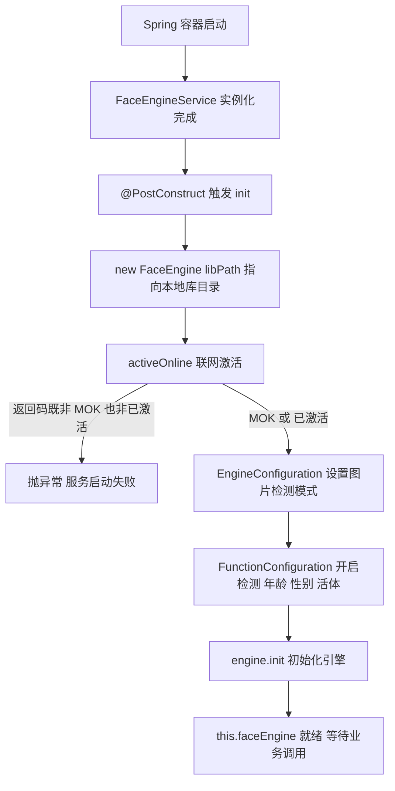

# 人像校验把关头像：接入虹软 ArcFace 本地人脸识别引擎

头像上传通道打通之后还有一道业务闸门：交友产品不允许用户拿风景照、宠物照当头像，上传的必须是真实人像。人脸识别的技术选型不少，云端 API 简单但按调用量计费，长期跑下来成本不低。课程选了另一条路线：虹软开放平台的 ArcFace 人脸识别 SDK，免费、本地化运行，图片数据不出服务器。这一节把「注册下载、装依赖、激活引擎、判断人像」四步全部落地。

## 先给结论

- 虹软 ArcFace 的 SDK 由两部分组成：一个 Java 驱动 jar 包加一组平台本地库（Windows 是 dll，Linux 是 so），jar 只是桥，真正的识别逻辑在本地库里。
- 驱动 jar 没有发布到 Maven 中央仓库，需要用 `mvn install:install-file` 手工装进本地仓库，再在 `pom.xml` 引用。
- 引擎初始化放在 `@PostConstruct` 里：`new FaceEngine(libPath)` 指向本地库目录，`activeOnline` 联网激活，配置功能后 `init`，随 Spring 容器启动一次完成。
- 判断人像只需一个返回值：`detectFaces` 返回图片中所有人脸的坐标列表，列表非空即人像，为空即非人像。
- SDK 免费但按年授权：首次使用需联网激活，之后可离线运行，有效期一年，到期重新激活即可。
- `appid` 与 `sdkkey` 是应用级凭证，配置文件中打码保管。

## 为什么选本地 SDK 而不是云端接口

人脸识别的应用早已铺开：小区门禁、高铁站刷脸进站，背后都是同一类能力。可选方案分两类，一类是云厂商的在线识别服务，接 HTTP 接口就行，但按次计费，头像上传这类高频入口的成本会持续累积；另一类是本地化 SDK，识别过程在应用所在机器完成，虹软的 ArcFace 属于这类，对开发者免费，小米、魅族等企业的设备上也在使用它的技术。

对头像校验这个场景，本地 SDK 还有两个隐性好处：识别不依赖外网，响应延迟稳定；用户照片不离开自己的服务器，隐私面更小。代价则是要自己管理本地库文件与授权激活，这正是本节要处理的工程细节。

## 开发者平台四步走：注册、实名、建应用、下 SDK

使用流程在虹软开放平台官网上完成：注册开发者账号，完成实名认证，然后创建应用并选择所属行业场景。实名认证是硬性前置条件，没有实名的账号无法下载 SDK。应用创建后，为它添加人脸识别 SDK，选择平台与版本。课程给同一应用添加了两个平台的 SDK：

- `ArcFace Java Windows x64 V2.2`，开发期在本机运行用；
- `ArcFace Java Linux x64 V2.2`，将来发布到生产环境用。

授权按年计算：SDK 免费使用一年，到期后联网重新激活即可继续使用，这个动作后面代码里的激活返回值会体现。

## 把 SDK 装进工程：本地库落盘，驱动包进本地仓库

解压任意一个 SDK 压缩包，里面有三样东西：官方示例代码（各种 API 的用法写得很全，遇到不确定的签名回这里查）、一个 jar 包、一个库文件目录。看 jar 包的定位要特别清楚：**它是 Java 程序调用本地库的驱动包，不是识别功能本身**，真正的算法实现在打包好的动态库里（Windows 下的 dll、Linux 下的 so）。把 WIN64 目录解压到磁盘固定位置，课程放在 `F:\code\WIN64`，这个路径马上会进配置。

驱动 jar 不在 Maven 中央仓库，在线拉不到，需要手工安装进本地仓库：

```bash
mvn install:install-file -DgroupId=com.arcsoft.face -DartifactId=arcsoft-sdk-face -Dversion=2.2.0.1 -Dpackaging=jar -Dfile=arcsoft-sdk-face-2.2.0.1.jar
```

安装成功后，`pom.xml` 里就能正常声明依赖了，顺带补上上传服务用到的 `joda-time`：

```xml
<dependency>
    <groupId>joda-time</groupId>
    <artifactId>joda-time</artifactId>
</dependency>
<dependency>
    <groupId>com.arcsoft.face</groupId>
    <artifactId>arcsoft-sdk-face</artifactId>
    <version>2.2.0.1</version>
</dependency>
```

配置文件接上。前面搭建配置骨架时留过人脸识别的占位，现在把三个键填齐，值来自开发者中心「我的应用」页面的 APP ID 与 SDK KEY，复制时只取值本身：

```properties
# 通过参数配置（在配置文件中填对应的参数）
# 值已打码：开放平台创建应用后获得，请换成自己的
arcsoft.appid = example-appid
arcsoft.sdkkey = example-sdkkey
# 本地库文件目录，即解压出的 WIN64 目录
arcsoft.libPath = F:\code\WIN64
```

## 引擎初始化：@PostConstruct 里的激活与装配

识别逻辑封装成 `FaceEngineService`。引擎的初始化有明确的时机要求：容器启动时做一次，之后全局复用，Spring 的 `@PostConstruct` 正好挂在 Bean 实例化完成之后执行：

```java
@Value("${arcsoft.appid}")
private String appId;
@Value("${arcsoft.sdkkey}")
private String sdkKey;
@Value("${arcsoft.libPath}")
private String libPath;

private FaceEngine faceEngine;

@PostConstruct
public void init() {
    // 引擎实例指向本地库目录
    FaceEngine engine = new FaceEngine(libPath);
    // 在线激活：首次使用必须联网，已激活的再次启动返回已激活
    int activeCode = engine.activeOnline(appId, sdkKey);
    if (activeCode != ErrorInfo.MOK.getValue()
            && activeCode != ErrorInfo.MERR_ASF_ALREADY_ACTIVATED.getValue()) {
        LOGGER.error("引擎激活失败");
        throw new RuntimeException("引擎激活失败");
    }
    // 引擎全局配置：处理图片，按指定方向检测
    EngineConfiguration engineConfiguration = new EngineConfiguration();
    engineConfiguration.setDetectMode(DetectMode.ASF_DETECT_MODE_IMAGE);
    engineConfiguration.setDetectFaceOrientPriority(DetectOrient.ASF_OP_0_ONLY);
    // 功能配置：按需开启
    FunctionConfiguration functionConfiguration = new FunctionConfiguration();
    functionConfiguration.setSupportAge(true);
    functionConfiguration.setSupportFace3DAngle(true);
    functionConfiguration.setSupportFaceDetect(true);
    functionConfiguration.setSupportGender(true);
    functionConfiguration.setSupportLiveness(true);
    functionConfiguration.setSupportIRLiveness(true);
    engineConfiguration.setFunctionConfiguration(functionConfiguration);
    // 初始化引擎
    int initCode = engine.init(engineConfiguration);
    if (initCode != ErrorInfo.MOK.getValue()) {
        LOGGER.error("初始化引擎出错");
        throw new RuntimeException("初始化引擎出错");
    }
    this.faceEngine = engine;
}
```

三段结构清晰：激活、引擎配置、初始化。激活返回值有两个合法结果，`MOK` 表示本次激活成功，`MERR_ASF_ALREADY_ACTIVATED` 表示此前已激活过，两个都放行；其余返回码一律抛异常，让服务在启动期就失败，而不是拖到第一次上传才暴露。功能配置里年龄、性别、活体等都打开了，本课真正用到的只有人脸检测，其余属于可以顺手体验的能力。方法签名在 SDK 版本之间存在差异，写不确定的 API 时回 SDK 附带的示例代码核对。



这张图描述引擎随容器启动的装配路径：激活失败直接把失败提前到启动阶段，就绪后的引擎对象被保留在字段里，供后续每次上传请求调用。

## 判断人像：一个列表非空判断就够了

业务方法 `checkIsPortrait` 的思路直白：把图片读成引擎需要的像素数据，交给 `detectFaces`，拿回人脸列表。一张图片里可能有多张人脸，所以返回的是列表，元素是每张人脸在图中的坐标信息；列表非空说明图里至少有一张人脸，即人像成立。

```java
public boolean checkIsPortrait(File imageFile) {
    try {
        // ImageIOHelper 来自 SDK 示例代码，负责把图片文件读成 BGR 像素数据
        ImageInfo imageInfo = ImageIOHelper.getRGBData(imageFile);
        List<FaceInfo> faceInfoList = new ArrayList<>();
        int detectCode = this.faceEngine.detectFaces(imageInfo, faceInfoList);
        return detectCode == ErrorInfo.MOK.getValue() && !faceInfoList.isEmpty();
    } catch (Exception e) {
        LOGGER.error("人脸检测出错", e);
        return false;
    }
}
```

用单元测试验证。课程资料里备了几张图片：人像照片应返回 `true`，风景或静物照应返回 `false`：

```java
@RunWith(SpringRunner.class)
@SpringBootTest
public class TestFaceEngineService {

    @Autowired
    private FaceEngineService faceEngineService;

    @Test
    public void testCheckIsPortrait() {
        File file = new File("F:/code/1.jpg");
        boolean checkIsPortrait = this.faceEngineService.checkIsPortrait(file);
        System.out.println(checkIsPortrait); // 人像 true，非人像 false
    }
}
```

实测结果：人像图片输出 `true`，无脸图片输出 `false`，多测几张基本没有误判。引擎还能顺带返回性别与年龄等附加信息，性别识别较准，年龄受美颜滤镜影响只能参考。当前需求只要区分人像与非人像，一个 `checkIsPortrait` 就够用了，下一节把它接到上传链路里。

## 常见误区

- **把驱动 jar 当成 SDK 全部。** 错例：只装了 jar，没解压 WIN64 本地库，启动时报引擎初始化失败或本地库加载错误。正解：jar 只负责调用，本地库必须解压落盘，`libPath` 精确指向该目录。
- **库文件平台与运行环境不匹配。** 错例：开发机用 Windows 版 SDK，部署到 Linux 却没换 Linux 版。正解：两个平台的库各自下载，部署环境用 Linux 版，版本号尽量与开发期一致。
- **激活失败被吞掉。** 错例：捕获激活异常后继续运行，上传时才莫名报错。正解：激活与初始化的失败码都抛异常终止启动，把问题暴露在最前面。
- **凭证随手贴进公共仓库。** 错例：`appid` 与 `sdkkey` 明文提交。正解：配置打码或外置，凭证与应用绑定，泄露会导致他人冒用额度，发现后到开发者中心重置。

## 面试可能被问到的问题

1. 面试官追问：「人脸识别为什么选本地 SDK 而不用云端 API？」
   答：本地 SDK 免费且识别在服务器内完成，没有按量计费与外网延迟，照片不出内网，隐私可控；云端 API 接入简单、免维护，适合调用量小或没有 GPU 运维能力的场景。头像校验这类高频、隐私敏感的入口更适合本地方案。
2. 面试官追问：「为什么 jar 要手工 install 到本地仓库？」
   答：该驱动包没有发布到 Maven 中央仓库，在线依赖解析不到。install-file 把本地 jar 按坐标安装进本地仓库，之后就能按常规依赖引用；团队协作时可改用私服统一分发。
3. 面试官追问：「@PostConstruct 做引擎初始化有什么好处？换到第一次请求时初始化行不行？」
   答：Bean 实例化完成后立即执行，失败会让容器启动失败，问题在部署期暴露；懒初始化会把错误推迟到线上第一次请求，且存在并发重复初始化的隐患。初始化一次、全局复用的资源都适合放这里。
4. 面试官追问：「detectFaces 的返回值怎么用来判断人像？」
   答：它返回图片中所有人脸的信息列表，元素含人脸区域坐标。列表非空即判定为人像，空列表即非人像；需要更严格时还可以叠加人脸角度、活体等已开启的功能做二次过滤。
5. 面试官追问：「SDK 按年授权的激活机制对工程上有什么影响？」
   答：激活是联网调用 `activeOnline`，成功或已激活都放行，之后可离线运行。工程上要保证启动日志能看到激活结果，到期前重新部署时会自动再次激活；若环境完全无外网，需提前按官方离线激活方式处理。

## 配套资料

- 学习目标：`materials/code/07/day01 探花交友-项目搭建以及登录完善个人信息/day01/学习目标.md`，列有「掌握人脸识别技术的使用」。
- 数据库：`materials/code/07/day01 探花交友-项目搭建以及登录完善个人信息/day01/代码/mytanhua.sql`，人像校验通过后头像 URL 写入 `tb_user_info.logo`。
- 原型：`materials/code/07/day01 探花交友-项目搭建以及登录完善个人信息/day01/资料/探花交友移动端原型V1.2/首次登录信息完善.html`，上传头像即触发人像校验。
- 说明：虹软 SDK 压缩包与测试图片未随资料包提供，需到官方开放平台按课程步骤自行下载；`checkIsPortrait` 与测试类为按课程画面与 SDK 示例写法补全的示例；`appid`、`sdkkey` 已打码；包名按规范改写为 `com.study.tanhua`。
