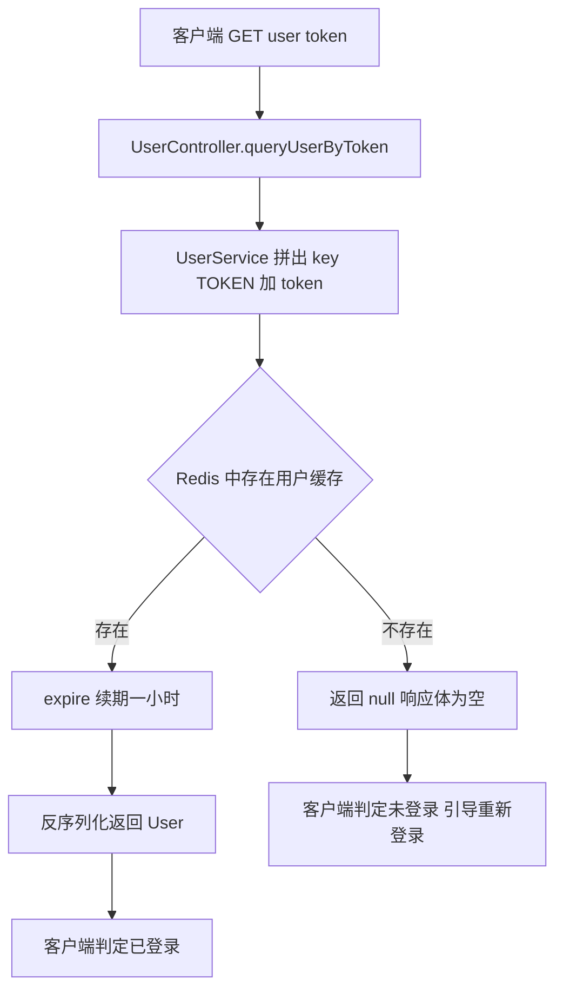

# 检查登录状态：一个 GET 接口收口 day01 的 token 体系

App 冷启动、从后台切回前台、进入需要身份的页面，客户端都需要先问一句「这个用户还登录着吗」。token 方案里没有传统 Session，登录态的判定锚点在服务端 Redis：签发 token 时写入的用户缓存还在不在。查询方法在打通登录逻辑时已经写好，本节只差把它暴露成一个 HTTP 接口，顺便把 day01 的功能链收个尾。

## 先给结论

- 新增一个查询接口：`GET /user/{token}`，token 直接作为路径参数，返回 `User` 对象或空，客户端以返回值有无判断登录态。
- Controller 不写任何新逻辑，一行调用转给 `UserService.queryUserByToken`，登录态的语义全部沉淀在 Service 里。
- 查到即续期：Redis 缓存重新计时 1 小时，持续活跃的用户不会被中途登出，空闲超时的 token 自然失效。
- token 无效时响应体为空，客户端据此走未登录分支，引导用户重新登录。
- 每个接口手工校验 token 是初级形态，工程化的进化方向是拦截器统一校验、ThreadLocal 保存当前用户、白名单放行登录入口，本节给出可直接套用的补充示例。

## 登录态到底存在哪

传统 Session 方案里，登录态是服务器内存里的一份会话数据，集群下要处理共享问题。token 方案把凭证交给客户端自己携带，服务端反而不保存会话，只在 Redis 里留一份用户缓存：登录成功写入，带过期时间；校验时按 token 找缓存。

这套设计下「是否登录」有一个唯一可靠的判定：**Redis 里能不能按 token 查到用户缓存**。token 字符串本身即使没被篡改，也可能因为过期被清理；反过来只要缓存还在，就代表这个用户在有效期内活跃过。所以检查登录状态的接口，本质就是对 Redis 的一次有状态查询，而不是解析 token 的本地计算。

## Controller：一行转发就是一个接口

在 `UserController` 里追加一个方法，记得导入 `User` 实体类：

```java
// 根据token查询用户数据
@GetMapping("{token}")
public User queryUserByToken(@PathVariable("token") String token) {
    return this.userService.queryUserByToken(token);
}
```

方法体只有一次转发。`@GetMapping("{token}")` 把路径变量绑定到参数上，返回值是 `User` 对象；token 无效时 Service 返回 null，响应体就是空的。把「返回值有无」当成登录态开关，客户端代码因此非常简单。

真正有内容的是 Service 里这个方法，逐行走一遍：

```java
public User queryUserByToken(String token) {
    try {
        String redisTokenKey = "TOKEN_" + token;
        String cacheData = this.redisTemplate.opsForValue().get(redisTokenKey);
        if (StringUtils.isEmpty(cacheData)) {
            // Redis 中查不到，登录态已失效
            return null;
        }
        // 刷新时间，滑动过期
        this.redisTemplate.expire(redisTokenKey, 1, TimeUnit.HOURS);
        return MAPPER.readValue(cacheData, User.class);
    } catch (Exception e) {
        e.printStackTrace();
    }
    return null;
}
```

四个要点：key 是固定前缀拼 token；查不到立刻返回 null，这是登录态失效的唯一出口；查到先 `expire` 续期一小时，把过期时间从「登录那一刻」变成「最后一次活跃那一刻」；再反序列化成 `User` 返回。任何异常都按未登录处理，宁可让用户重新登录，也不放行一个状态存疑的请求。



这张图把登录态检查的判断路径画全：所有分支的分歧点只有 Redis 缓存的存在与否，续期动作让这条链路自带保活语义。

## REST 验证：两种 token，两种结果

服务重启后用 REST 客户端验证。请求方法 GET，地址在用户路径后拼上登录时拿到的 token，请求头全部去掉。发送后响应里拿到了期望的用户数据，包含用户 id 与手机号，登录态有效。把路径里的 token 随手改成一段无意义字符再发，响应体空空如也。两种结果对照，检查登录状态的功能就验证完毕：客户端只要看返回值有没有数据，就能决定继续用当前用户还是跳回登录页。

## 工程延伸：把重复校验交给拦截器

逐接口手工校验有个隐性成本：新接口一多，谁漏写一行校验就是一个越权入口。Spring MVC 提供了拦截器把这个动作收敛到一处，配合 ThreadLocal 让整条请求链路随时能拿到当前用户。以下是按主流写法补全的示例，路径按实际接口调整：

```java
@Component
public class TokenInterceptor implements HandlerInterceptor {

    @Autowired
    private UserService userService;

    @Override
    public boolean preHandle(HttpServletRequest request, HttpServletResponse response,
                             Object handler) throws Exception {
        String token = request.getHeader("Authorization");
        User user = this.userService.queryUserByToken(token);
        if (user == null) {
            response.setStatus(HttpStatus.UNAUTHORIZED.value());
            return false;
        }
        // 当前用户放进 ThreadLocal，本请求内随时可取
        UserHolder.set(user);
        return true;
    }

    @Override
    public void afterCompletion(HttpServletRequest request, HttpServletResponse response,
                                Object handler, Exception ex) {
        UserHolder.clear();
    }
}
```

```java
public class UserHolder {
    private static final ThreadLocal<User> LOCAL = new ThreadLocal<>();

    public static void set(User user) {
        LOCAL.set(user);
    }

    public static User get() {
        return LOCAL.get();
    }

    public static void clear() {
        LOCAL.remove();
    }
}
```

注册拦截器时用白名单圈定放行范围，登录、发验证码这类未登录入口必须排除在外：

```java
@Configuration
public class WebConfig implements WebMvcConfigurer {

    @Autowired
    private TokenInterceptor tokenInterceptor;

    @Override
    public void addInterceptors(InterceptorRegistry registry) {
        registry.addInterceptor(this.tokenInterceptor)
                .addPathPatterns("/**")
                // 白名单：登录前的入口一律放行
                .excludePathPatterns("/user/login", "/user/sendVerifyCode", "/picUpload");
    }
}
```

改造后业务方法里的 token 查询全部消失，取用户改用 `UserHolder.get()`；`checkIsPortrait` 这类校验之后要拿当前用户 id 的地方，也不再需要逐层传 token。

## day01 收官盘点

到这里，day01 的功能面全部铺完，回头看这条主线：

- 环境：Redis 集群、消息中间件、Android 模拟器逐一就位；
- 数据：`mytanhua` 库建好 `tb_user` 与 `tb_user_info`，配置文件连起数据源、缓存与消息服务；
- 登录：验证码登录打通，token 签发与 Redis 缓存落地；
- 完善信息：OSS 头像上传、虹软人像校验、资料落库三个能力组装成完整链路；
- 登录态：查询接口与滑动过期收口，客户端有了判断登录状态的依据。

下一站进入 day02 的首页功能，今天铺好的 token 校验与资料表会立刻被用上。

## 常见误区

- **token 走路径参数当成常态。** 错例：所有接口都把 token 拼进 URL。正解：token 出现在路径会随访问日志、代理日志留存，扩大泄露面，工程上统一放 `Authorization` 请求头；本课用路径参数只为演示直观。
- **只查缓存忘了续期。** 错例：每次校验都命中缓存却不刷新过期时间，活跃用户一小时后仍被登出。正解：查到即 expire，做成滑动过期。
- **ThreadLocal 用完不清理。** 错例：拦截器只 set 不 clear，Tomcat 线程池复用线程，下一个请求可能读到上一个用户的数据。正解：`afterCompletion` 里强制 `remove`，用完即清。
- **白名单漏配登录入口。** 错例：拦截器拦了 `/**` 却忘了放行登录与发验证码接口，客户端还没登录就被 401 挡住。正解：注册拦截器后把所有未登录可达的接口逐一列进 `excludePathPatterns`。

## 面试可能被问到的问题

1. 面试官追问：「拦截器和过滤器有什么区别，token 校验该用哪个？」
   答：过滤器是 Servlet 规范的组件，在容器层对所有请求生效，拿不到 Spring MVC 的处理器信息；拦截器是 Spring MVC 的组件，能感知到要执行哪个 Controller 方法，还能在 `afterCompletion` 做清理。token 校验通常放拦截器，因为需要按路径配置白名单并配合 Spring 容器注入。
2. 面试官追问：「ThreadLocal 为什么会有内存泄漏风险？」
   答：线程池里的线程长期存活，ThreadLocalMap 的 key 是弱引用会被回收，value 却还挂在线程上，不被清理就一直在。必须在请求结束时调用 remove，拦截器的 afterCompletion 正是这个用途。
3. 面试官追问：「token 无状态，为什么还要查 Redis？」
   答：token 的签名保证它没被篡改，但保证不了它该不该继续有效。登出、封号、改密都需要让已签发的 token 立即失效，这只有服务端持有状态才能做到；Redis 缓存就是这份状态，顺带实现了续期与统一校验。
4. 面试官追问：「滑动过期和固定过期怎么选？」
   答：固定过期实现简单、可预期，适合安全要求高、会话短的场景；滑动过期以最后一次活跃重新计时，适合社交、电商这类长会话产品，代价是极活跃用户的 token 永不过期，需辅以最长有效期或二次认证兜底。
5. 面试官追问：「检查登录态的接口返回 null 和抛 401，客户端分别怎么处理？」
   答：返回空体的设计把判断权交给客户端，拿到数据继续流程，拿不到就走未登录分支，实现简单但语义弱；工程上更推荐拦截器直接回 401 状态码，客户端按状态码统一弹登录框，语义明确且不用在每个接口解析响应体。

## 配套资料

- 学习目标：`materials/code/07/day01 探花交友-项目搭建以及登录完善个人信息/day01/学习目标.md`，day01 的收口项落在「独立完成登录的功能」与「独立完成完善个人信息功能」。
- 数据库：`materials/code/07/day01 探花交友-项目搭建以及登录完善个人信息/day01/代码/mytanhua.sql`，登录态检查返回的用户数据即来自 `tb_user`。
- 原型：`materials/code/07/day01 探花交友-项目搭建以及登录完善个人信息/day01/资料/探花交友移动端原型V1.2/登录页.html`，未登录分支最终引导回的界面。
- 说明：day01 资料包无工程源码，Controller 与 `queryUserByToken` 按课程画面整理；拦截器、`UserHolder`、白名单注册为按主流写法补全的工程延伸示例；包名按规范改写为 `com.study.tanhua`。
