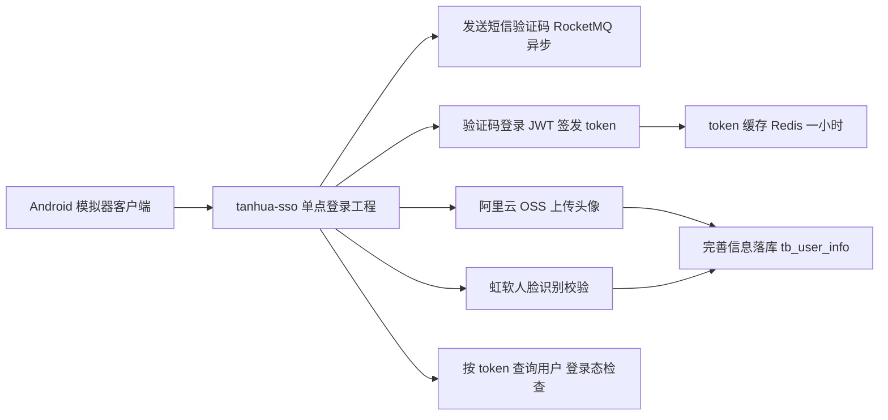

# day01 复盘：探花交友从工程搭建到登录闭环的第一天

> 🔒 安全提示：文中示例的口令/密钥均为课程教学环境演示口径，生产环境的安全要求见《安全与合规须知》。

项目课的第一天最容易「当时都会，回头全忘」：环境装了一堆、接口写了七八个、外部服务接了两三家，隔天想复述却串不成线。复盘的价值在于把两条线分开盘点：项目认知是一条线，动手实现是另一条线，中间的衔接点与遗留问题单独登记，作为进入 day02 的输入。

## 先给结论

- day01 分两条线：认知线覆盖项目背景、市场与竞争分析、技术方案、技术架构、解决方案与技术亮点，做到能讲清楚即可；动手线从工程搭建一路写到登录态检查，全部落到可验证的接口。
- 工程形态是一个父工程加一个单点登录工程：父工程统一管理依赖版本，`tanhua-sso` 承载用户侧全部接口。
- 登录闭环四块拼图：短信验证码经 RocketMQ 异步解耦、JWT 签发 token 并缓存 Redis、OSS 头像上传加虹软人脸识别、完善信息落库。
- 收口动作是按 token 查询用户：Redis 查到即续期一小时，客户端以返回值有无判断登录态。
- 遗留问题已登记：token 逐接口手工校验、依赖声明大而全、首页功能未动工，恰好是 day02 的三个入口。

## 一天的内容地图

认知线的起点是「这是个什么项目」。探花交友定位陌生人社交，资料里的项目介绍从背景、市场分析、竞争分析写到技术方案、技术架构、技术解决方案与技术亮点。这一部分的目标不是背熟，而是建立全貌：技术栈里有 Elasticsearch、MongoDB、Redis、RocketMQ、Apache Dubbo、Spark MLlib，它们各自在后续天次各就各位，day01 只动其中一小部分。

动手线才是第一天的主产出，整条链路如下。



这张图把 day01 的动手线画成一条以 `tanhua-sso` 为中心的功能链：验证码与登录在左，头像与人脸在右，全部汇入完善信息，最后由 token 查询收口。关键路径是「验证码换 token、token 换登录态」，其余能力都是给完善信息做配套。

## 工程形态：父工程加单点登录工程

搭工程在 day01 里花的时间不多，但结构值得复盘。父工程统一管理依赖与版本，业务代码全部放进 `tanhua-sso` 模块。按画面线整理后的坐标如下：

```xml
<parent>
    <groupId>org.springframework.boot</groupId>
    <artifactId>spring-boot-starter-parent</artifactId>
    <version>2.1.0.RELEASE</version>
    <relativePath/>
</parent>
<groupId>com.study.tanhua</groupId>
<artifactId>tanhua-parent</artifactId>
<version>1.0-SNAPSHOT</version>
<packaging>pom</packaging>
<modules>
    <module>tanhua-sso</module>
</modules>
```

`tanhua-sso` 的依赖以 `spring-boot-starter-web`、`spring-boot-starter-data-redis` 与 MyBatis-Plus 为主，覆盖了验证码、登录、完善信息三条链路。

一个值得复盘的细节：画面里的父工程 pom 声明了一长串 starter，从 `data-mongodb`、`data-elasticsearch` 到 `security`、`websocket` 几乎全家桶。**声明了不等于用了。** day01 实际用到的只有 web、redis、mysql 驱动、MyBatis-Plus 与 RocketMQ 相关这几样，其余属于项目全程预埋。复盘时要把「已用」与「预埋」分开记账，避免后面排查依赖冲突时大海捞针。

## 登录闭环的四块拼图

**第一块，验证码。** Controller 接收手机号后通过 `RocketMQTemplate` 发出消息，消费端负责生成验证码、写入 Redis 并调用短信通道下发。把「接收请求」与「发短信」拆成两段，高峰期的发送压力被队列削平，通道抖动也不会阻塞用户请求。

**第二块，登录。** 校验验证码通过后用 JWT 签发 token，以 `TOKEN_` 前缀拼接 token 作为 key，把用户对象缓存进 Redis，过期时间一小时。登录态的判定锚点也落在这里，后续按 token 查缓存即可。

**第三块，外部能力。** 头像上传走阿里云 OSS，配置集中在 `AliyunConfig`（endpoint、accessKeyId、accessKeySecret 三要素）；人像校验走虹软开放平台的本地 SDK，识别通过才允许资料入库。两样外部服务在工程里都做了封装隔离，业务代码不直接碰 SDK 细节。

**第四块，落库与收口。** 完善信息写入 `tb_user_info`，表结构在资料包的 `mytanhua.sql` 里是现成的：

```sql
CREATE TABLE `tb_user_info` (
  `id` bigint(20) NOT NULL AUTO_INCREMENT,
  `user_id` bigint(20) NOT NULL COMMENT '用户id',
  `nick_name` varchar(50) DEFAULT NULL COMMENT '昵称',
  `logo` varchar(100) DEFAULT NULL COMMENT '用户头像',
  `tags` varchar(50) DEFAULT NULL COMMENT '用户标签：多个用逗号分隔',
  `sex` tinyint(1) DEFAULT '3' COMMENT '性别，1-男，2-女，3-未知',
  `age` int(11) DEFAULT NULL COMMENT '用户年龄',
  `edu` varchar(20) DEFAULT NULL COMMENT '学历',
  `city` varchar(20) DEFAULT NULL COMMENT '居住城市',
  -- 其余字段含 birthday、cover_pic、industry、income、marriage 等，此处省略
  PRIMARY KEY (`id`),
  KEY `user_id` (`user_id`)
) ENGINE=InnoDB DEFAULT CHARSET=utf8 COMMENT='用户信息表';
```

用户主表 `tb_user` 只存手机号与密码，画像相关的十几个字段独立成表，`user_id` 一个索引把两表连起来。表里预置的学历、城市、性别等字段，到 day02 的推荐查询里会直接被当成筛选条件用上。

从输入手机号发验证码，到登录拿到 token，再到完善信息、按 token 查用户，整条链路在 day01 结束前完整走通了一遍。资料包预置的两条用户记录（密码字段是 123456 的 MD5 值）可以直接拿来复测。

## 遗留问题与 day02 预告

三个问题带着进 day02：token 校验目前逐接口手工调用，工程化方向是拦截器统一校验加 ThreadLocal 保存当前用户；父工程依赖需要按需清理；首页的今日佳人与推荐列表完全没动工，它们依赖 MongoDB 与 Dubbo 两样新技术。day02 的议程依次是首页功能说明、实现今日佳人、统一接口服务地址、实现推荐用户列表、接口统一增加缓存、整合前端联调测试，全部围绕首页这一屏展开。

## 常见误区

- **复盘只记功能名，不记接口与数据。** 错例：能说出「做了登录」，却说不清 token 怎么签发、存哪、怎么过期。正解：每个功能落到「接口、数据、外部依赖」三要素。
- **全家桶依赖照单全收。** 错例：pom 里几十个 starter 一个不删，启动变慢还容易版本冲突。正解：当前天次用不到的依赖先移除，需要时再加回。
- **把认知线内容当重点反复背。** 错例：技术亮点倒背如流，验证码的消费端却没亲手写过。正解：认知线做到面试能讲清楚，动手线必须本地跑通。
- **预置数据当真实数据。** 错例：拿资料包预置账号当生产数据做断言。正解：预置记录仅供功能验证，密码是公开的 123456，换环境必须重置。

## 面试可能被问到的问题

1. 面试官追问：「项目第一天你做了哪些事，为什么这么安排？」
   答：认知与动手两条线并行。认知线建立项目全貌与技术选型的印象，动手线优先打通「登录」这条最小闭环，因为后续所有功能都以登录态为前提，验证码、JWT、OSS、人脸识别都服务于这个闭环。
2. 面试官追问：「发送验证码为什么要经过 RocketMQ？」
   答：把接收请求与发短信解耦成两段，高峰期发送压力由队列削峰，短信通道抖动时不阻塞用户请求，消费失败还能重试。代价是多一跳链路，需要处理消息可靠性与幂等。
3. 面试官追问：「有了 JWT 为什么还要把用户缓存进 Redis？」
   答：JWT 只能证明 token 没被篡改，不能主动让它失效。Redis 里的用户缓存是服务端持有的状态，登出、封号、改密都能即时生效，同时承担滑动续期与统一校验。
4. 面试官追问：「人脸识别为什么选本地 SDK 而不是云接口？」
   答：本地 SDK 离线调用、无按次费用，识别只返回结果不上传留存，隐私压力小；云接口省维护但有网络依赖与按量计费。社交场景调用量大，本地 SDK 更划算。
5. 面试官追问：「完善信息为什么不放进 tb_user 而要单独建表？」
   答：登录凭证字段少而稳定，画像字段多且经常扩展。拆表让主表保持精简，画像表独立演化，还能单独接缓存与搜索，互不影响写入性能。

## 配套资料

- 学习目标：`materials/code/07/day01 探花交友-项目搭建以及登录完善个人信息/day01/学习目标.md`，九条目标里动手类占五条，与 day01 的动手线一一对应。
- 数据库：`materials/code/07/day01 探花交友-项目搭建以及登录完善个人信息/day01/代码/mytanhua.sql`，含 `tb_user`、`tb_user_info` 建表语句与预置数据。
- 原型：`materials/code/07/day01 探花交友-项目搭建以及登录完善个人信息/day01/资料/探花交友移动端原型V1.2/index.html`，产品原型总入口，与认知线的功能介绍对应。
- 说明：day01 资料包无工程源码，pom 坐标按课程画面整理并改写，包名规范为 `com.study.tanhua`，模块名按业务语义改写为 `tanhua-parent` 与 `tanhua-sso`。
