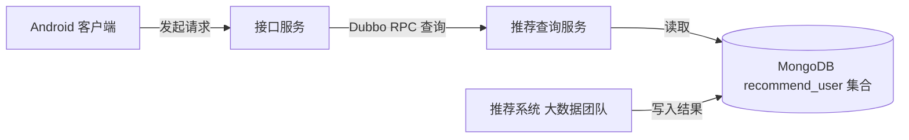

# 今日佳人功能分析：把缘分值最高的人送到首页

首页第一张卡片叫今日佳人，看图很简单，问题马上就来了：推荐算法还没写，这个功能怎么开工？课程给出的答案是不阻塞：接口层只负责把「已有的推荐结果」查出来展现，算法侧后续补齐，两边约定一份数据结构在 MongoDB 上对接。下面把这层分析的结论说透，实现细节交给后续小节。

## 先给结论

- 今日佳人 = 为当前登录用户挑选缘分值最高的一位用户展示，候选按城市与性别圈定，并列时随机取一。
- 缘分值由行为因子加权打分构成，点击、点赞、评论、学历等都会作为因子，按人个性化计算。
- 现阶段不实现推荐算法，只做「结果已有」假设下的查询展现，算法在后续天次用 Spark MLlib 补齐。
- 推荐结果存 MongoDB 的 `recommend_user` 集合，推荐系统负责写入，接口服务只读，中间用 Dubbo 连接。
- 接口契约已由 mock 文档定死：`GET /tanhua/todayBest`，返回 id、avatar、nickname、gender、age、tags、fateValue 七个字段。

## 业务规则：圈定候选再加排序

功能描述一句话：今日佳人根据每个用户不同的推荐结果，把推荐分值最大的那个用户展现出来。拆成三段就清楚了。

**第一段，圈定候选。** 推荐不是全库捞人，先按条件过滤：目标用户的性别偏好、所在城市，把候选人缩到一个合理的集合里。

**第二段，读取缘分值。** 缘分值不是一个现成字段，它由一串行为因子加权构成：点击、点赞、评论这类互动行为，加上学历等画像信息，共同组成打分。同一个候选人在不同人眼里分值不同，这就是个性化。

**第三段，取最大并展现。** 从候选集里取缘分值最高的一位，分值并列时随机取一即可。首页展示的是结果而不是过程，用户只关心「今天推荐给我的这个人是谁」。

现阶段的边界也在这里：三段里的第二段（怎么算分）现阶段不实现，数据库里先构造测试分数，算法在后续天次用 Spark MLlib 补上。接口层只要假定「集合里已经有带分值的结果」，开发就不会被算法侧卡住。

## 数据从哪来：一条三团队的分工链

这个功能的完整链路涉及三个角色：客户端发起请求，接口服务查询数据，推荐系统产出数据。数据交接点只有一个，就是 MongoDB：



客户端到接口服务走 HTTP，接口服务到推荐查询服务走 Dubbo RPC，两侧唯一的共享物是 `recommend_user` 集合：大数据团队算完把结果写进来，后端只管读。这个设计把「算法怎么算」彻底隔离在接口层之外，替换算法、调整因子都不用动接口代码。

集合里的文档结构长这样：

```json
{
  "userId": 1001,
  "toUserId": 1,
  "score": 90,
  "date": "2019/1/1"
}
```

四个字段的语义：`userId` 是被推荐的用户（候选人），`toUserId` 是推荐给谁（当前登录用户），`score` 就是缘分值，`date` 记录推荐日期。要提醒一个后续排错环节专门处理过的坑：**MongoDB 的字段名区分大小写**，查询代码里写 `toUserId`，插入测试数据时如果写成全小写的 `touserId`，条件查询将永远为空，而且不会报任何错。

## 接口契约分析

mock 文档把这个接口的契约先锁死了：路径 `GET /tanhua/todayBest`，状态标注「前端已联调」。请求头两样：`Content-Type: application/json` 与 `Authorization`，后者携带登录时签发的 JWT，服务端要凭它找到当前用户，再去查「推荐给这个人」的结果。

返回体就是首页卡片那七个字段：`id`、`avatar`、`nickname`、`gender`、`age`、`tags`、`fateValue`。注意最后一个：数据库里存的是 `score` 原始分值，返回前要转成整数缘分值 `fateValue`，存储值与展示值分开，是留给后续调整展示策略的余地。

契约先行的另一个好处是并行：前端按 mock 文档开发界面，后端按同一契约实现查询，双方最后在联调时对字段即可，谁也不用等谁。

## 环境先行：部署 MongoDB

链路里唯一的新环境是 MongoDB，画面给出的部署方式是 Docker 两条命令：

```bash
# 拉取镜像
docker pull mongo:4.0.3

# 创建容器
docker create --name mongodb --restart=always -p 27017:27017 -v mongodb:/data/db mongo:4.0.3
```

三个参数值得记住：`--restart=always` 让容器随宿主机自启并在异常退出后自动拉起；`-p 27017:27017` 把默认端口映射到宿主机，Spring Boot 的连接串指向这里；`-v mongodb:/data/db` 把数据落到命名数据卷，容器删除重建数据不丢。创建后 `docker start mongodb` 启动即可。

## 实现路径预告

分析到位之后，后面的实现是一条固定路径：部署 MongoDB、设计推荐结果集合并构造测试数据、搭建 Dubbo 工程并定义接口、实现查询最大得分推荐用户与推荐用户列表两个服务、搭建接口服务工程并对齐 mock 契约、编写业务代码、统一接口服务入口、整合测试。三个结论会在路径上逐一兑现：假设结果已有落在集合设计上，MongoDB 交接落在环境部署上，Dubbo 连接落在工程拆分上。

## 常见误区

- **等推荐算法上线才开工。** 错例：没有真实分值就把功能挂起，前后端一起空转。正解：契约与展现先行，用构造数据跑通全链路，算法后补不影响接口层。
- **MongoDB 字段名大小写随意。** 错例：插入时 `touserId`、查询时 `toUserId`，查不到数据还以为是环境问题。正解：字段名与实体属性保持完全一致，用同一份文档约束读写两侧。
- **把 score 原样透出给前端。** 错例：直接返回打分原始值甚至内部权重。正解：转换成展示用缘分值，内部计算细节不外泄，调整展示口径也不用改存储。
- **推荐结果缓存成全局一份。** 错例：按接口缓存，所有用户共享同一份今日佳人。正解：推荐天然按用户个性化，缓存 key 必须带上用户 id，这也是统一缓存设计时最容易踩的坑。

## 面试可能被问到的问题

1. 面试官追问：「推荐系统还没做，首页功能怎么并行开发？」
   答：契约先行加分层假设。接口层只依赖「结果已有」的集合结构，数据侧按同一契约写入，先用构造数据跑通全链路，算法侧后补不影响接口层交付节奏。
2. 面试官追问：「缘分值是怎么算出来的？」
   答：多因子加权打分，点击、点赞、评论等行为因子加学历等画像因子，由数据侧离线批量计算写入结果库，线上只读。因子与权重可配置，便于运营调优。
3. 面试官追问：「为什么用 MongoDB 存推荐结果而不是 MySQL？」
   答：推荐结果按用户批量写入、读多写少、无事务需求，文档结构松散且会随因子扩展变化，MongoDB 的文档模型省去表结构变更，批量写性能也好。
4. 面试官追问：「Dubbo 在这条链路里解决什么问题？」
   答：接口服务与推荐查询分属两个工程，Dubbo 提供进程间 RPC 与服务治理，推荐服务可以独立开发、部署与扩容，接口层无需感知其内部实现。
5. 面试官追问：「今日佳人要保证每个用户看到的不一样吗？」
   答：个性化推荐天然按用户计算，同一个用户短时间刷新应保持一致，避免闪烁；候选为空时按城市与性别随机兜底，保证功能永远有内容。

## 配套资料

- 学习目标：`materials/code/07/day02 探花交友-实现首页功能/day02/学习目标.md`，「独立完成今日佳人的功能」与「独立完成 Dubbo 服务的开发」两条即本功能的两条主线。
- 说明：day02 资料包无工程源码，Docker 命令、`recommend_user` 集合结构与 mock 契约字段按课程画面与接口文档整理，接口文档平台地址含引流信息不列出；包名规范为 `com.study.tanhua`。
