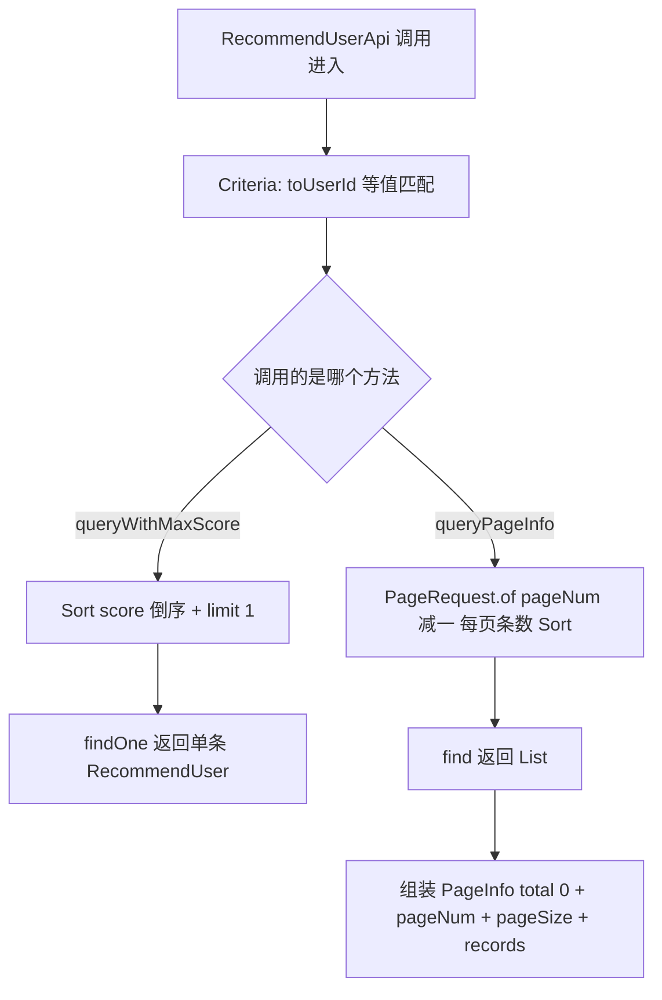

# MongoTemplate 落地两种查询：缘分值最高的一位与推荐用户分页列表

契约在上一课已经立好，`RecommendUserApi` 的两个方法还停在返回 null 的骨架状态。这一课把实现填进去：`queryWithMaxScore` 从 `recommend_user` 集合里挑出缘分值最高的一位，`queryPageInfo` 按缘分值倒序分页吐出整个推荐列表。两个方法过滤条件完全相同，差别只在读取方式上，正好是一组对照实验：单条怎么取、列表怎么翻页、翻页时页码偏移这个经典坑怎么踩又怎么爬出来。

## 先给结论

- 两个查询共用同一过滤条件 `toUserId` 等值匹配，差异只在读取姿势：单条用 `Sort` 倒序加 `limit(1)` 配 `findOne`，列表用 `find` 配 `Pageable` 分页。
- Spring Data 的分页页码从 0 开始，业务传入的 pageNum 要先减一再交给 `PageRequest.of`，这节课就在这里踩出了一次真实的 off-by-one。
- 分页结果的 total 暂时给 0：前端下拉刷新式的加载不依赖总条数，返回空列表即停止翻页，需要时再补 count 查询。
- 实现类用 Alibaba 系的 `@Service(version = "1.0.0")` 暴露为 Dubbo 服务，版本号要和消费方的 `@Reference` 对得上。

## 一、配置文件：先让 MongoTemplate 连得上库

实现类要注入 `MongoTemplate`，模板对象由 Spring Data MongoDB 的自动配置按 `spring.data.mongodb.uri` 创建，所以配置文件先补齐。上一课只写了 Dubbo 相关的键，这一课把 MongoDB 连接一起放全：

```properties
# Spring boot application
spring.application.name = tanhua-dubbo-server
# dubbo 注解扫描包
dubbo.scan.basePackages = com.study.tanhua.dubbo.server
dubbo.application.name = tanhua-dubbo-provider
dubbo.protocol.name = dubbo
dubbo.protocol.port = 20880
dubbo.registry.address = zookeeper://192.168.31.81:2181
dubbo.registry.client = zkclient
# MongoDB 连接，库为 day1 规划的 tanhua
spring.data.mongodb.uri = mongodb://192.168.31.81:27017/tanhua
```

Dubbo 一段决定服务怎么暴露：扫描包覆盖实现类所在位置，协议端口 20880，注册中心指向 day1 部署的 ZooKeeper，`registry.client` 指定用 zkclient 作 ZooKeeper 客户端，day1 部署时选的版本与它匹配。MongoDB 一段决定数据从哪来：`27017` 是 day2 部署 MongoDB 时的默认端口，库名 `tanhua` 与上一课造数时 `use tanhua` 的目标库一致。`spring.data.mongodb.uri` 这个键名是 Spring Boot 约定写法，写错一个字母模板对象就不会按预期创建，排查时要先盯这里。

配置项在课堂上的出现顺序也有讲究：先写 Dubbo 段让服务能暴露，再补 MongoDB 段让数据能查到，两组键互不依赖却都影响启动，分段写、分段验，比一次贴完再排查省时间。键值里另一个容易忽略的细节是 URI 里的库名属于连接语义的一部分，同一个 MongoDB 实例上切换库，改的就是这个尾缀。

## 二、queryWithMaxScore：条件、排序、只取一条

方法的语义是「给张三的推荐里缘分值最高的那一位」。集合里给张三的推荐有几十条，`toUserId` 都等于张三的 id，得分各不相同，所以查询拆成三步：按 `toUserId` 过滤、按 `score` 倒序、只取第一条。

```java
@Override
public RecommendUser queryWithMaxScore(Long userId) {
    // 条件：推荐给了谁，toUserId 与登录用户 id 等值
    Criteria criteria = Criteria.where("toUserId").is(userId);
    // 查询：按 score 倒序排列，只取一条
    Query query = Query.query(criteria)
            .with(Sort.by(Sort.Order.desc("score")))
            .limit(1);
    return this.mongoTemplate.findOne(query, RecommendUser.class);
}
```

三个对象各管一段。`Criteria` 描述过滤条件，`Criteria.where("toUserId").is(userId)` 生成的就是 MongoDB 里的 `{ "toUserId": userId }` 等值匹配，字段名写的是文档里的键名，不是 Java 属性名，两者在这里必须保持同一套拼写。`Query.query(criteria)` 把条件装进查询对象，`.with(...)` 挂排序，`.limit(1)` 限定返回条数，这三个方法都返回 `Query` 自身，所以能一路链下去。`Sort.by(Sort.Order.desc("score"))` 里外两层不是套话：`Sort.Order.desc` 只造一个排序项，`Sort` 才是排序容器，框架的 API 就是这样设计的。

把这段 Java 链翻译回 MongoDB 的 shell 语句，语义会立刻落地：`db.recommend_user.find({ "toUserId": 1 }).sort({ "score": -1 }).limit(1)`。学 Spring Data MongoDB 有个高效习惯，每写一段链式 API 就在客户端里跑一遍等价的 shell，两边的对应关系（Criteria 对 find 参数、Sort 对 sort、limit 对 limit）过一遍手，排查问题时才敢断定问题出在哪一层。框架没有魔法，它只是把 shell 语句按对象模型重新组织了一遍。

最后落点是 `findOne`：它执行查询并返回第一条，配合前面 `limit(1)`，数据库端就能确认只传输一条文档，不用把几十条拉回内存再截断。`findOne` 的签名只需要 `Query` 与实体类型，集合名由实体上 `@Document(collection = "recommend_user")` 的映射自动确定，方法参数里见不到集合字样，这正是 Spring Data 风格的封装：类型即映射，映射即路由。排序依据是 `score` 而不是 `date`，上一课已经把讲义注释里「按时间倒序」的说法修正过，实现与口径保持一致。上一课建复合索引时选的正是 `toUserId` 加 `score` 的组合，这个查询恰好是索引定义的最优场景：先按 `toUserId` 等值定位，再按 `score` 有序读取，取第一条时直接命中索引头部。

## 三、暴露为 Dubbo 服务：@Service 加版本号

查询逻辑写完还不算数，这个类必须先成为 Dubbo 服务，注册中心里才有它的位置：

```java
package com.study.tanhua.dubbo.server.api;

import com.alibaba.dubbo.config.annotation.Service;
import com.study.tanhua.dubbo.server.pojo.RecommendUser;
import com.study.tanhua.dubbo.server.vo.PageInfo;
import org.springframework.beans.factory.annotation.Autowired;
import org.springframework.data.mongodb.core.MongoTemplate;

@Service(version = "1.0.0")
public class RecommendUserApiImpl implements RecommendUserApi {

    @Autowired
    private MongoTemplate mongoTemplate;
}
```

`@Service` 来自 `com.alibaba.dubbo.config.annotation` 包，职责是把实现类暴露为 Dubbo 服务并注册到 ZooKeeper，与 Spring 的同名组件注解毫无关系，import 必须认准。它生效的前提还有一条：实现类所在包必须落在配置文件 `dubbo.scan.basePackages` 声明的扫描范围内，扫描是按包向下的，本例的 api 包恰好是扫描根的子包。版本号 `1.0.0` 是这一课新加的参数：Dubbo 允许同一个接口按版本并存多个实现，注册时带上版本，消费方引用时按版本匹配，两边数字不一致就等于两个服务。契约刚发布就养成带版本的习惯，后续接口演进时会省掉很多麻烦。Dubbo 2.7 之后这对注解更名为 `@DubboService` 与 `@DubboReference`，课程用的 2.6.4 还是老名字，读其他资料时按版本对号入座。

## 四、单元测试：从注入失败到跑通

测试需要启动类。server 模块建好时还没有启动类，按画面补一个最普通的 Spring Boot 入口：

```java
package com.study.tanhua.dubbo.server;

import org.springframework.boot.SpringApplication;
import org.springframework.boot.autoconfigure.SpringBootApplication;

@SpringBootApplication
public class DubboApplication {
    public static void main(String[] args) {
        SpringApplication.run(DubboApplication.class, args);
    }
}
```

测试类放在与实现类相同的包下，用 Spring Test 拉起容器再注入接口：

```java
package com.study.tanhua.dubbo.server.api;

import com.study.tanhua.dubbo.server.pojo.RecommendUser;
import org.junit.Test;
import org.junit.runner.RunWith;
import org.springframework.beans.factory.annotation.Autowired;
import org.springframework.boot.test.context.SpringBootTest;
import org.springframework.test.context.junit4.SpringJUnit4ClassRunner;

@RunWith(SpringJUnit4ClassRunner.class)
@SpringBootTest
public class TestRecommendUserApi {

    @Autowired
    private RecommendUserApi recommendUserApi;

    @Test
    public void testQueryWithMaxScore() {
        RecommendUser recommendUser = this.recommendUserApi.queryWithMaxScore(1L);
        System.out.println(recommendUser);
    }
}
```

参数取 `1L` 有讲究：day2 造数时 99 条推荐数据的 `toUserId` 全部是 1，查 1 号用户必然能命中整批数据，结果可预期，适合做基准用例。第一次运行直接报错，提示无法创建目标 bean，找不到对应对象，注入失败。回看实现类才发现漏了 Dubbo 的 `@Service` 注解，类只是普通对象，既没暴露成服务也没有注册进容器，`@Autowired` 自然无 bean 可注入。补上 `@Service(version = "1.0.0")` 再跑，控制台打出结果：得分最高的推荐用户是 id 为 13 的用户，缘分值 98，推荐对象是 1 号用户。这个 98 与 day2 造数时随机分布里的最高分吻合，说明过滤、排序、取一条三段逻辑都对了。

顺带说清这次注入的机制：测试类注入的是 `RecommendUserApi` 接口，容器里恰好有本进程的实现 bean，调用落在本地方法栈上，没有经过网络；Dubbo 的暴露逻辑照常执行，服务元信息照常注册进 ZooKeeper。真正发起远程调用的是独立的消费方工程，那边拿同一行 `@Autowired` 写法配合 `@Reference` 注解，得到的才是远程代理。同一份接口在本进程与远端两种语境下的解析差异，是 Dubbo 开发者必须心里有数的一层。

## 五、queryPageInfo：find 加 Pageable 的分页列表

列表查询的条件段与单条查询完全一样，多出来的是分页参数。查询对象之外还需要一个 `Pageable` 描述「第几页、每页多大、按什么排序」，代码先给出完成态：

```java
@Override
public PageInfo<RecommendUser> queryPageInfo(Long userId, Integer pageNum, Integer pageSize) {
    // 条件：与单条查询一致
    Criteria criteria = Criteria.where("toUserId").is(userId);
    // 分页：页码从 0 开始，业务页码先减一；按 score 倒序
    Pageable pageable = PageRequest.of(pageNum - 1, pageSize,
            Sort.by(Sort.Order.desc("score")));
    Query query = Query.query(criteria).with(pageable);
    List<RecommendUser> recommendUsers = this.mongoTemplate.find(query, RecommendUser.class);
    // 总条数暂不提供，需要时再补 count 查询
    return new PageInfo<>(0, pageNum, pageSize, recommendUsers);
}
```

构造 `Pageable` 的过程值得完整回放，因为两处 API 选择都有原因。`Pageable` 本身是个接口，直接 `new Pageable()` 编译不过，IDE 里 go to implementation 一看，`PageRequest` 就是那个实现；`PageRequest` 老的构造方法已经标记过时，官方推荐走静态工厂 `PageRequest.of`，重载版本里有「页码、每页条数」和「页码、每页条数、排序」等多种签名，选与需求严丝合缝的那个，排序在工厂里一次给足，避免查询对象上再补一次。排序参数这里还卡了一下编译：`Sort.Order.desc("score")` 的类型是单个排序项，塞不进 `PageRequest.of` 的 `Sort` 参数位，必须用 `Sort.by(...)` 包一层把排序项升级成排序对象。这两个 API 细节在 IDE 里当场暴露，报错信息直接指向类型不匹配，按提示改即可。

`Query` 的挂载方式也有一层对称性：排序可以走 `.with(Sort)`，分页走 `.with(Pageable)`，两者都返回 `Query` 自身，链式拼装后交给执行方法。课堂上先写了 `.with()` 空参占位、再补 Pageable 实例的过程，本质就是在为这个链路凑齐类型。

执行查询的方法从 `findOne` 换成 `find`，返回 `List<RecommendUser>`。分页参数挂在 `Query` 上之后，框架会把它翻译成 MongoDB 的 `skip` 与 `limit`：第 3 页每页 5 条，翻成底层就是跳过前 10 条、取 5 条。排序没变，仍是 `score` 倒序，所以列表是缘分值从高到低的一串推荐，与单条查询共用同一条 `toUserId` 加 `score` 复合索引，排序方向也与索引一致，页深不大时性能与单条查询同量级。`find` 的重载还有带集合名的三参数版本，显式指定读写哪个集合，本场景实体映射已明确，两参数版即可。

## 六、页码从 0 开始：一次真实的 off-by-one

这个方法第一版写的是 `PageRequest.of(pageNum, pageSize, ...)`，页码原样传入。测试方法连打三页做对照：

```java
@Test
public void testQueryPageInfo() {
    System.out.println(this.recommendUserApi.queryPageInfo(1L, 1, 5));
    System.out.println(this.recommendUserApi.queryPageInfo(1L, 2, 5));
    System.out.println(this.recommendUserApi.queryPageInfo(1L, 3, 5));
}
```

跑出来的数据当场露馅：第一页第一条的缘分值是 96，而单条查询已经证明全集合最高分是 98，倒序列表的第一名怎么会是 96。原因就是页码基点：Spring Data 的分页从 0 开始计数，业务上传来的是「第 1 页」，直接传进去实际执行的是跳过第 1 条再取，最高的那条 98 分被整页跳过了。把构造改成 `PageRequest.of(pageNum - 1, ...)` 再跑，第一页第一条回到 id 为 13 的用户、98 分，紧接着是另一条 98 分（id 为 45 的用户），随后是 97、96 依次排开；原先冒名顶替出现在第一页开头的 96 分数据被顺移到第二页开头。两次输出一对照，off-by-one 的现象与修复都清清楚楚。

从这次现象还能读出排序的稳定性：98 分不止一条，id 为 13 与 45 的用户先后出现，说明同分文档按自然顺序衔接，页与页之间没有重叠也没有遗漏，三页连打的结果能首尾相接。验证分页正确性时，除了看第一条，还应该把几页数据连起来看边界，缺一条或多一条都意味着偏移量没算对。

这不是 MongoDB 独有的规矩，Spring Data 全家桶的 `PageRequest`、JPA 的 `Pageable` 都是 0 基页码，而业务侧用户看到的页码永远从 1 开始，两边永远差 1，接手任何带分页的代码都要先确认这个换算发生在哪一层。排查这类问题的诀窍是打印底层执行的语句：把页码参数与换算结果一起输出，1 与 0 的差别肉眼看不出，日志里一眼就现形。

## 七、total 先给 0：分页指标的取舍

`PageInfo` 的构造里 total 写死为 0，这不是偷懒，是按前端交互形态做的取舍。这套 APP 的推荐列表是下拉刷新式的：每翻一页请求一次，直到某次返回的列表为空就不再加载，全程不需要知道一共有多少条。真正需要 total 的是传统页码条式的分页，要渲染「共 N 页」就得先 count 一遍。MongoDB 里补这个能力也不难，`mongoTemplate.count(query, RecommendUser.class)` 按同样的条件数一次即可，等交互形态提需求再加，不必提前付费。

两种交互形态背后是两种分页协议。页码条式把 total、pageNum、pageSize 全交给前端自行组织跳页，后端必须保证 count 与取数两个动作口径一致，否则页码条与数据对不上；下拉刷新式把「还有没有」的判断外包给「返回列表是否为空」，后端少一次 count，前端少一页状态，代价是用户不能直达第 20 页。信息流产品几乎都选后者，本课程的 APP 原型也是这个形态，接口与交互的这层耦合值得在设计期就想清楚，而不是等前端来问。代价与收益都摆上台面再选型，比事后返工便宜得多。



这张图把两个方法收拢在同一条过滤分支上：条件段完全共享，读取段分岔，单条走排序加 limit，列表走分页对象加 find。理解了这棵树，后面无论加新的查询维度，改的都是条件段，读取段照搬即可。

## 常见误区

- **业务页码直接传给 `PageRequest.of`。** 错例：第一页传 1，底层跳过 1 条，最高分那条永远出不来。正解：Spring Data 页码 0 基，构造时统一做 `pageNum - 1` 换算，并保留在同一个工具方法里，避免各处各换各的。
- **把 `Sort.Order.desc(...)` 直接当 `Sort` 传。** 错例：编译期类型不匹配报错。正解：单个排序项必须经 `Sort.by(...)` 包装成排序对象再交给 `PageRequest.of` 或 `Query.with`。
- **实现类漏标 Dubbo 的 `@Service`，或导成了 Spring 的组件注解。** 错例：测试注入时报找不到 bean；或类成了普通 Bean，注册中心里永远查不到服务。正解：import 认准 `com.alibaba.dubbo.config.annotation.Service`，并给出与消费方一致的 version。
- **条件字段名写成 Java 属性名。** 错例：`Criteria.where("toUserId")` 写成文档里不存在的拼写，查询永远空集。正解：`Criteria` 里的字符串是 MongoDB 文档键名，与造数脚本、实体 `@Document` 映射保持同一套拼写。

## 面试可能被问到的问题

1. 面试官追问：「Spring Data MongoDB 里 findOne 和 find 有什么区别？」
   答：findOne 按查询条件取第一条并映射为单个对象，find 返回符合条件的全部映射列表。findOne 内部等价于 find 加 limit 1，配合显式的排序与 limit 能把取一条的意图下沉到数据库端，避免拉全量到内存再截断；find 常与 Pageable 组合做分页，框架把页码翻译成 skip 与 limit。
2. 面试官追问：「分页页码为什么减一？哪一层负责换算最合适？」
   答：Spring Data 的 PageRequest 页码从 0 开始，业务与用户习惯从 1 开始，两边差 1。换算最好收在持久层入口或统一工具里，让上层永远传业务页码；一旦各调用点自行换算，漏掉一处就是 off-by-one，而且这种 bug 只在边界数据上暴露，很难在测试里发现。
3. 面试官追问：「查询最高得分为什么不需要把全部数据拉回来比较？」
   答：排序条件下推到数据库，按 score 倒序配合 limit 1，MongoDB 利用 toUserId 加 score 的复合索引可以直接按索引有序读取第一条，代价接近索引查找而不是全量扫描加内存排序。数据量越大，这种下推的收益越明显。
4. 面试官追问：「Dubbo 服务注册时带 version 有什么用？」
   答：版本号让同一接口的多个实现并存，灰度发布时新旧版本同时在线，消费方按版本选择调用对象；不匹配的版本互相不可见，等于天然隔离。接口不兼容变更时，升级版本号再让消费方分批切换，比直接改实现安全得多。
5. 面试官追问：「下拉刷新式分页和传统页码分页，后端实现有什么不同？」
   答：传统页码分页需要 total 来渲染页码条，要先执行 count 再取当页数据；下拉刷新式只需要「下一批」，不需要 total，每次带上一次的末尾位置或页码继续取，返回空列表表示到底。后者省掉 count 开销，代价是无法跳页，适合信息流类场景。
6. 面试官追问：「跳页很深时 skip 会变慢，有什么办法？」
   答：skip 加 limit 的实现要先扫过并丢弃前面所有页的记录，页越深代价越大。可以改用游标式分页，把上一页最后一条的排序值（如 score 与 id）作为下一页的起始条件，配合索引直接定位，避免大偏移扫描；这就是很多信息流接口翻页时带回游标的原因。

## 配套资料

- 学习目标：`materials/code/07/day02 探花交友-实现首页功能/day02/学习目标.md`，「独立完成 dubbo 服务的开发」对应本课两个查询实现。
- 数据库：`materials/code/07/day01 探花交友-项目搭建以及登录完善个人信息/day01/代码/mytanhua.sql`，测试用户表与推荐数据按 id 咬合的口径可回溯。
- 说明：day02 资料包未含工程源码，本课实现与配置均按课程画面逐行整理；`PageRequest.of` 的两处 API 修正、页码减一与 total 置 0 的取舍，均按声音线记录。
