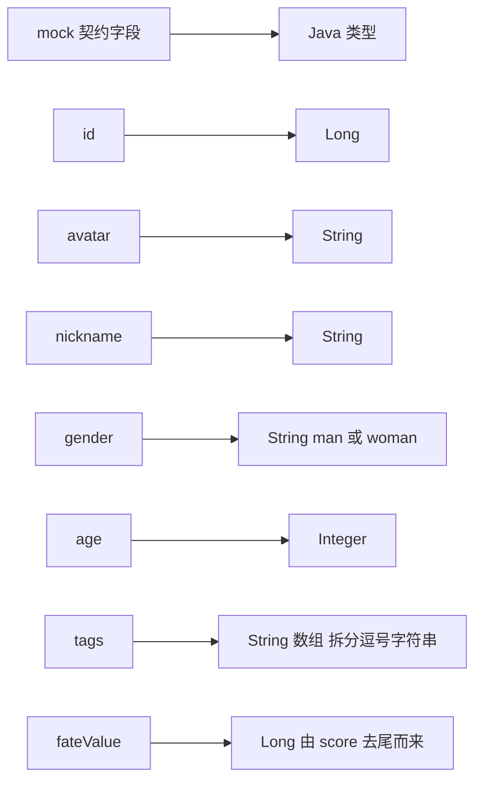

# 以 mock 契约为准：今日佳人的接口约定与基础代码

前后端并行开发的开工方式：后端还没写一行业务代码，前端已经按 mock 数据把界面调通了。对接的依据是一份接口文档（mock 服务），它规定了请求路径、参数位置和响应结构，后端要做的就是让真实接口长成 mock 描述的样子。这一课先读懂这份契约，再按契约把工程里要用的枚举与实体提前备好，业务逻辑留给下一课。

## 先给结论

- mock 契约三要素：`GET /tanhua/todayBest` 路径、请求头 `Authorization` 携带登录 token、响应固定七个字段，后端代码完全照此实现。
- `gender` 的取值是 `man` 与 `woman` 字符串，枚举常量名就按 `MAN`、`WOMAN` 命名，输出时 `name().toLowerCase()` 直接得到契约要求的值。
- `SexEnum` 实现 MyBatis-Plus 的 `IEnum<Integer>`，把数据库的 1、2、3 翻译成有语义的枚举，枚举包要被 `type-enums-package` 配置覆盖。
- 基础代码三件：`BasePojo` 承载公共时间字段，`User` 对接 SSO 返回，`UserInfo` 对接 `tb_user_info` 表，`password` 字段加 `@JsonIgnore` 防止序列化外泄。

## 一、mock 服务：前后端并行的契约

mock 服务是接口文档平台提供的模拟地址：前端在真实接口就绪前请求它，拿到结构与真实接口完全一致的数据。今日佳人的契约长这样：

- 请求方式与路径：`GET /tanhua/todayBest`，mock 地址形如 `https://mock.example.com/mock/164/tanhua/todayBest`，真实工程里由接口服务实现同一路径。
- 请求参数：业务参数一个都没有，唯一的凭据在请求头里，`Authorization` 字段携带登录后颁发的 token，`Content-Type` 为 `application/json`。
- 响应结构：id（推荐用户 id）、avatar（头像）、nickname（昵称）、gender（性别）、age（年龄）、tags（标签数组）、fateValue（缘分值）。

照着文档还原一份响应示例：

```json
{
  "id": 13,
  "avatar": "https://img.example.com/avatar/13.jpg",
  "nickname": "小鹿",
  "gender": "man",
  "age": 28,
  "tags": ["单身", "本科", "年龄相仿"],
  "fateValue": 98
}
```

契约里藏着两个后端必须消化的细节。tags 的校验规则写着「元素最小个数 1、元素互不相同、元素类型 string」，它是数组，而数据库 `tb_user_info.tags` 存的是逗号分隔的字符串，取数后要拆分成数组交出去。gender 的取值域是 `man` 与 `woman` 两个字符串，不是数字 1 与 2，数据库的性别列怎么映射成这两个词，由枚举负责。



这张图是字段级的地形图：左列是前端认的字，右列是后端算的类型，箭头上没有一条是天然相等的，gender 要靠枚举翻译，tags 要靠拆分，fateValue 要靠下一课的缘分值计算。契约先行的好处此刻显现，两个类型之间差在哪一步，看图即可定位。

## 二、SexEnum：让 1、2、3 变成有语义的性别

`com.study.tanhua.server.enums` 包下创建性别枚举，与 SSO 工程里的同名枚举保持一致，直接复用写法：

```java
package com.study.tanhua.server.enums;

import com.baomidou.mybatisplus.core.enums.IEnum;

public enum SexEnum implements IEnum<Integer> {
    MAN(1, "男"),
    WOMAN(2, "女"),
    UNKNOWN(3, "未知");

    private int value;
    private String desc;

    SexEnum(int value, String desc) {
        this.value = value;
        this.desc = desc;
    }

    @Override
    public Integer getValue() {
        return this.value;
    }

    @Override
    public String toString() {
        return this.desc;
    }
}
```

`IEnum<Integer>` 是 MyBatis-Plus 提供的枚举适配接口，`getValue()` 告诉框架数据库里存哪个值，查询时 1 自动翻回 `MAN`，插入时枚举自动翻回 1，业务代码全程不出现魔法数字。常量名取 `MAN` 与 `WOMAN` 不是随手：契约的 gender 值域就是 `man` 与 `woman`，Java 枚举的 `name()` 返回常量名，后续组装响应时 `name().toLowerCase()` 一步到位，常量名与契约值域对齐能省掉一层转换。

枚举能被识别还差一个配置开关，就是上一课已经写进 `application.properties` 的 `mybatis-plus.type-enums-package=com.study.tanhua.server.enums`，框架按这个包扫描 IEnum 实现，包名写错或包位置挪走，映射就静默失效，这一课建包填类的动作正是在兑现那条配置。

## 三、BasePojo：公共字段的一次性收口

每个实体都有 created 与 updated 两个时间列，收进抽象父类 `BasePojo`，与 SSO 工程保持同一套结构：

```java
package com.study.tanhua.server.pojo;

import com.fasterxml.jackson.annotation.JsonFormat;
import lombok.Data;

import java.io.Serializable;
import java.util.Date;

@Data
public abstract class BasePojo implements Serializable {

    @JsonFormat(pattern = "yyyy-MM-dd HH:mm:ss")
    private Date created;

    @JsonFormat(pattern = "yyyy-MM-dd HH:mm:ss")
    private Date updated;
}
```

`@JsonFormat` 固定序列化格式，响应里时间以 `yyyy-MM-dd HH:mm:ss` 输出，避免默认时间戳或多时区问题。字段注解按画面线与 SSO 工程同类实现补全，抽象类不可实例化，实体继承它即可获得这两个字段。

## 四、User 与 UserInfo：两个 pojo 各对一个数据源

`User` 承接 SSO 接口按 token 返回的登录用户，字段只保留业务要用的三列：

```java
package com.study.tanhua.server.pojo;

import com.fasterxml.jackson.annotation.JsonIgnore;
import lombok.AllArgsConstructor;
import lombok.Data;
import lombok.NoArgsConstructor;

@Data
@NoArgsConstructor
@AllArgsConstructor
public class User extends BasePojo {
    private Long id;
    private String mobile;    // 手机号
    @JsonIgnore
    private String password;  // 密码，json 序列化时忽略
}
```

`@JsonIgnore` 挂在 password 上是安全习惯：对象一旦被序列化成 JSON 返回或写日志，密码字段不会跟着出去，字段在业务里可用，传输时不可见。

`UserInfo` 对接 `tb_user_info` 表，字段与建表语句一一咬合：

```java
package com.study.tanhua.server.pojo;

import com.study.tanhua.server.enums.SexEnum;
import lombok.AllArgsConstructor;
import lombok.Data;
import lombok.NoArgsConstructor;

@Data
@NoArgsConstructor
@AllArgsConstructor
public class UserInfo extends BasePojo {
    private Long id;             // 主键，即用户 id
    private String nickName;     // 昵称
    private String logo;         // 用户头像
    private String tags;         // 用户标签，多个用逗号分隔
    private SexEnum sex;         // 性别
    private Integer age;         // 年龄
    private String edu;          // 学历
    private String city;         // 居住城市
    private String birthday;     // 生日
    private String coverPic;     // 封面图片
    private String industry;     // 行业
    private String income;       // 收入
    private String marriage;     // 婚姻状态
}
```

类型选择上有一处刻意：nickName 用驼峰、数据库列是 `nick_name`，靠 MyBatis-Plus 的驼峰转换对上，不用写映射注解；sex 的类型是 `SexEnum` 而不是 Integer，数据库的 tinyint 值进出来就完成枚举转换，不过这一步藏着一个版本相关的坑，下一课的测试会把它炸出来，此处先按契约把类型立对。mock 契约要求的今日佳人 VO（id、avatar、nickname、gender、age、tags、fateValue）属于接口响应层，留到业务代码那一课与 Controller 一起创建。

## 常见误区

- **gender 字段照数据库存数字。** 错例：响应里 gender 返回 1 或 2，前端判断失效。正解：契约值域是 `man` 与 `woman`，由枚举常量名转小写得出，数据库数字不出现在响应里。
- **枚举包不在扫描范围内。** 错例：`SexEnum` 建在了配置未覆盖的包里，查询结果枚举字段映射失败。正解：包路径与 `mybatis-plus.type-enums-package` 配置保持一致。
- **password 直接序列化输出。** 错例：User 对象转 JSON 时密码一并返回，日志与接口响应泄漏敏感信息。正解：`@JsonIgnore` 标注敏感字段，或改用传输视图控制输出。
- **tags 当字符串直接给前端。** 错例：响应 tags 输出 `单身,本科,年龄相仿` 一个字符串，前端按数组渲染报错。正解：出参前按逗号拆分成数组，拆分逻辑收在组装处统一处理。

## 面试可能被问到的问题

1. 面试官追问：「mock 服务在前后端协作里起什么作用？」
   答：接口先定义后实现，mock 提供与真实接口同路径、同结构、同取值域的模拟数据，前端不必等后端完成即可联调界面；后端按文档实现，交付时直接替换地址。契约一旦确认就成双方基准，变更要走文档评审，避免口径漂移。
2. 面试官追问：「MyBatis-Plus 处理枚举有哪几种方式？」
   答：常用两种，实现 IEnum 接口在 getValue 里声明存储值，或用 @EnumValue 注解标在字段上声明存库值。框架按 type-enums-package 或全局扫描注册映射，查询与写入自动双向转换。通用枚举之外还有 DefaultEnumTypeHandler 兜底，按名字或序号映射，但可读性与可控性不如前两种。
3. 面试官追问：「为什么实体要继承 BasePojo？有什么代价？」
   答：created 与 updated 是全表公共字段，收进父类后映射与序列化格式只写一次，配合 MyBatis-Plus 的自动填充还能统一维护时间。代价是实体结构多一层继承，查询列默认包含这两个字段，跨服务传输的对象要留意序列化父类字段。
4. 面试官追问：「@JsonIgnore 的作用范围是什么？还有别的选择吗？」
   答：它作用于 Jackson 序列化与反序列化全程，字段不输出也不输入。若需要同一对象在两种视图间切换，可用 @JsonProperty 控制名或 @JsonView 按视图分组输出；仅日志脱敏的场景也可以在日志框架里做，避免影响接口行为。
5. 面试官追问：「接口响应里为什么推荐用字符串枚举值而不是数字？」
   答：字符串自解释，联调与排查日志时一眼可读，前端不需要维护一张数字含义表；数字省带宽但换来隐式约定，一旦前后端字典不同步就是难查的 bug。行业默认是响应出字符串、数据库存数字，转换收口在后端一层。

## 配套资料

- 学习目标：`materials/code/07/day02 探花交友-实现首页功能/day02/学习目标.md`，「独立完成今日佳人的功能」对应的基础代码部分。
- 数据库：`materials/code/07/day01 探花交友-项目搭建以及登录完善个人信息/day01/代码/mytanhua.sql`，`tb_user` 与 `tb_user_info` 的列定义是 User、UserInfo 字段口径的唯一来源，性别列默认值 3 对应 UNKNOWN。
- 前端原型：`materials/code/07/day01 探花交友-项目搭建以及登录完善个人信息/day01/资料/探花交友移动端原型V1.2/`，首页今日佳人卡片的展示形态与 mock 字段对应。
- 说明：day02 资料包未含工程源码，枚举与实体按课程画面逐行整理，`BasePojo` 的字段注解为按本课写法补全的示例；mock 地址按规范以 example.com 占位。
