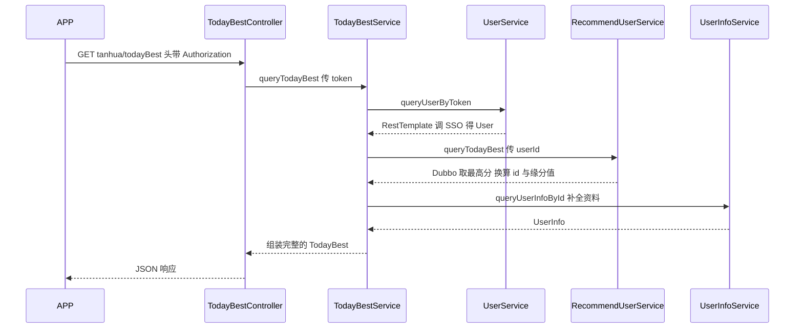

# 今日佳人全链路实现：从 Controller 到 Dubbo 调用的组装过程与枚举映射 bug 修复

契约、工程、基础代码都齐了，这一课把今日佳人真正跑通：Controller 接住 APP 的请求，Service 层串起 SSO 登录态、Dubbo 远程查询与用户资料补全三段逻辑，最后整合测试。过程并不平坦，MongoDB 依赖在消费方炸出两类报错，性别枚举又埋着一个 tinyint 映射的空指针，两条故障的定位与修复正好补全了整条链路的认知。

## 先给结论

- 一次今日佳人请求要走四段：Controller 从请求头取 token，TodayBestService 编排，UserService 经 RestTemplate 调 SSO 验登录态，RecommendUserService 经 Dubbo 取缘分值最高的一位。
- 今日佳人的 id 取 `recommendUser.getUserId()`，即被推荐的那个人，不是推荐对象 `toUserId`；缘分值由 score 去尾而来，`Math.floor` 后转 long，98.2 按 98 输出。
- 查不到最高分推荐用户时走默认推荐，id 来自配置项 `tanhua.sso.default.user`，不硬编码。
- MongoDB starter 在消费方的正确处理是保留依赖、排除自动配置：`@SpringBootApplication` 的 exclude 属性加 `MongoAutoConfiguration` 与 `MongoDataAutoConfiguration`，直接排除依赖会让 RPC 反序列化因缺 `ObjectId` 类而失败。
- 性别字段读出 null 引发的空指针，根因是 MySQL 列类型 `tinyint(1)` 不被 MyBatis-Plus 的 IEnum 映射支持，把列改成 `int` 即恢复。

## 一、调用链路与分工

按 mock 契约反推，业务实现要做三件事：按前端结构定义 vo 对象；根据 SSO 系统提供的接口查当前登录用户；根据 Dubbo 系统提供的服务查今日佳人数据。落到工程里就是一条四层链路：



TodayBestService 是总装车间，其余三个 Service 是配件供应商：U 供应「请求者是谁」，R 供应「推荐给谁、缘分值多少」，I 供应「这个人的详细资料」。vo 也在这层亮明身份：`TodayBest` 按 mock 响应结构定义，放进 `com.study.tanhua.server.vo` 包，字段为 id、avatar、nickname、gender、age、tags、fateValue，与上一课的契约映射表一一对应。

配套的包结构也在这一课定型：`controller` 放接口层，`service` 放业务编排与数据访问，`vo` 与 `pojo` 分居两侧，`mapper` 放 MyBatis 接口，`enums` 放性别枚举。每个包一条职责线，后面加功能就是往既定包里添类，工程长到十几个功能时依然找得到北。分包看似小事，实际是团队协作里最便宜的约定。

## 二、Controller：把契约路径钉进代码

```java
@RestController
@RequestMapping("tanhua")
public class TodayBestController {

    @Autowired
    private TodayBestService todayBestService;

    /**
     * 今日佳人
     */
    @GetMapping("todayBest")
    public TodayBest queryTodayBest(@RequestHeader("Authorization") String token) {
        return this.todayBestService.queryTodayBest(token);
    }
}
```

类级 `@RequestMapping("tanhua")` 加方法级 `@GetMapping("todayBest")` 拼出契约路径，GET 语义用 `@GetMapping` 比宽泛的 `@RequestMapping(method = ...)` 更直观。路径不是随手写的，mock 文档上接口地址里路径段的拆分就是这两级注解的拆分依据，路径对不上，前端切环境时请求会直接 404。token 藏在请求头里，`@RequestHeader("Authorization")` 一行取到，Controller 不做任何业务判断，只做转发，返回值就是 vo 本身，`@RestController` 等价于 `@Controller` 加 `@ResponseBody`，每个方法返回的对象都走 JSON 序列化，不必逐个标注。这个类调用的 `TodayBestService` 用的是 Spring 的 `@Service` 注解，与 Dubbo 的同名注解是两个世界，import 时要看清。

## 三、TodayBestService：总装车间

先给骨架再填肉，方法语义一步到位：

```java
@Service
public class TodayBestService {

    @Autowired
    private UserService userService;
    @Autowired
    private RecommendUserService recommendUserService;
    @Autowired
    private UserInfoService userInfoService;

    @Value("${tanhua.sso.default.user}")
    private Long defaultUserId;

    private static final String SEPARATOR = ",";

    public TodayBest queryTodayBest(String token) {
        // 根据token查询当前登录的用户信息
        User user = this.userService.queryUserByToken(token);
        if (user == null) {
            return null;
        }
        // 查询今日佳人
        TodayBest todayBest = this.recommendUserService.queryTodayBest(user.getId());
        if (todayBest == null) {
            // 未找到最高得分的推荐用户，给出默认推荐用户
            todayBest = new TodayBest();
            todayBest.setId(defaultUserId);
            todayBest.setFateValue(95L);
        }
        // 补全用户信息
        UserInfo userInfo = this.userInfoService.queryUserInfoById(todayBest.getId());
        if (null != userInfo) {
            todayBest.setAge(userInfo.getAge());
            todayBest.setAvatar(userInfo.getLogo());
            todayBest.setGender(userInfo.getSex().name().toLowerCase());
            todayBest.setNickname(userInfo.getNickName());
            todayBest.setTags(StringUtils.split(userInfo.getTags(), SEPARATOR));
        }
        return todayBest;
    }
}
```

方法读下来就是链路图的三段：先验身份，token 无效直接返回 null；再取推荐，拿不到最高分就落到默认推荐用户，id 从配置注入，缘分值给个固定值 95；最后补资料，昵称、头像、年龄、性别、标签这五个字段在 mock 契约里有、但推荐数据里没有，全部从 `tb_user_info` 查出后塞进 vo。补全段外面套着 `null != userInfo` 的判断，资料缺失时也要把已知的 id 与缘分值还回去，而不是整个失败。默认分支按画面线还有一版会固定一组标签，课堂保持最小实现，标签空缺时前端按空数组渲染即可。

`@Value("${tanhua.sso.default.user}")` 正是搭建工程那课注释掉的那行配置，此刻解除注释生效，默认推荐用户 id 为 2。默认推荐的语义值得一句说明：推荐库没覆盖到的用户也会打开首页，卡片不能空白，用一个固定的种子用户兜底，缘分值给个固定值 95，前端按正常卡片渲染，用户侧无从分辨，这就是降级路径的全部形态。配置与代码的分工在这里体现得很具体：换成哪个默认用户是运营决策，改配置即可，不动代码。

补全段里还有一处工具方法的细节：`StringUtils.split` 对 null 输入返回 null 而不抛异常，标签列没有维护的用户也不会打断链路，比 `String.split` 需要先判空的处理省一步。分隔符提出来当常量，与 `tb_user_info.tags` 列注释里「多个用逗号分隔」的约定呼应，数据怎么存、怎么拆，同一个口径收在一处。

## 四、UserService：RestTemplate 调 SSO 验登录态

```java
@Service
public class UserService {

    private static final ObjectMapper MAPPER = new ObjectMapper();

    @Autowired
    private RestTemplate restTemplate;

    @Value("${tanhua.sso.url}")
    private String ssoUrl;

    public User queryUserByToken(String token) {
        // 调用SSO系统的接口服务查询用户信息
        String url = ssoUrl + "user/" + token;
        try {
            String jsonData = this.restTemplate.getForObject(url, String.class);
            if (StringUtils.isEmpty(jsonData)) {
                return null;
            }
            return MAPPER.readValue(jsonData, User.class);
        } catch (Exception e) {
            return null;
        }
    }
}
```

SSO 工程已经提供按 token 查用户的 REST 接口，本方法就是一次标准的 HTTP 调用：地址前缀从配置项 `tanhua.sso.url` 注入，配置值以斜杠结尾（`http://127.0.0.1:18080/`），后段拼上 `user/` 与 token，两段拼法让 SSO 地址改动时业务代码零修改。调试时在拼完的 url 上打一个断点，配置注入是否生效、路径拼接是否正确，一眼可查。第一步取回 `String` 而不是直接反序列化，是为了先判空再解析，token 无效时 SSO 返回空体，直接反序列化反而会抛出难以理解的异常。`ObjectMapper` 定义成静态常量复用，它线程安全且创建成本不低，每个方法 new 一个是常见的隐性浪费；`readValue` 抛的是受检异常，统一捕获后返回 null，语义收敛为「查不到就当未登录」，由上层决定后续动作。这个收敛是有意为之：登录态校验的失败原因是多样的（token 过期、格式错、SSO 不可用），上层关心的只有「这个人是谁」一个问题的答案，原因留在日志里即可。

## 五、RecommendUserService：Dubbo 取最高分与缘分值换算

```java
@Service
public class RecommendUserService {

    @Reference(version = "1.0.0")
    private RecommendUserApi recommendUserApi;

    public TodayBest queryTodayBest(Long userId) {
        RecommendUser recommendUser = this.recommendUserApi.queryWithMaxScore(userId);
        if (null == recommendUser) {
            return null;
        }
        TodayBest todayBest = new TodayBest();
        // 今日佳人是被推荐的那个人，取 userId 而不是 toUserId
        todayBest.setId(recommendUser.getUserId());
        // 缘分值：score 去掉小数部分，98.2 按 98 输出
        todayBest.setFateValue(Double.valueOf(Math.floor(recommendUser.getScore())).longValue());
        return todayBest;
    }
}
```

`@Reference(version = "1.0.0")` 生成接口的远程代理，写法上与注入本地 Bean 无异，版本号必须与服务端 `@Service(version = "1.0.0")` 一致，两边对不上时注册中心里就是两个互不相见的服务，调用会报找不到提供者。这一层的换算有两个语义点。id 的方向：`recommend_user` 一行文档里，`toUserId` 是推荐给了谁，`userId` 是被推荐的那个人，今日佳人卡片要展示后者，写反了首页就永远显示自己。缘分值的算式：契约要 Long，数据库 score 是 Double，业务口径是不四舍五入、直接去掉小数，所以走 `Math.floor` 再 `Double.valueOf(...).longValue()` 的组合，98.2 与 98.9 都输出 98；强转 `(long)` 也能截断，但显式 floor 把「去尾」的业务意图写在了代码里，读代码的人不必回忆强转对浮点数的舍入方向。

vo 在这里只填了两个业务字段，其余全留给上一层的补全段，这是刻意的分层：推荐数据与用户资料来自两个数据源，谁的数据谁负责填，TodayBestService 只做拼装。

## 六、UserInfoService：资料补全的数据来源

```java
@Service
public class UserInfoService {

    @Autowired
    private UserInfoMapper userInfoMapper;

    public UserInfo queryUserInfoById(Long id) {
        // 为简化处理直接查询数据库；正式项目建议同样下沉为 dubbo 服务
        return this.userInfoMapper.selectById(id);
    }
}
```

```java
public interface UserInfoMapper extends BaseMapper<UserInfo> {
}
```

按 id 查 `tb_user_info` 是一行 `selectById` 的事，`BaseMapper` 提供的通用能力省掉了 XML。这里有个工程决策要交代：本课程为了聚焦链路，直接在这个工程里查库，MyBatis 系依赖也因此出现在依赖清单里；如果按服务化原则做，用户资料也该下沉成 Dubbo 服务让所有应用复用，课上明确给出这个建议，取舍是阶段性的。启动类同时要补上 `@MapperScan("com.study.tanhua.server.mapper")`，mapper 接口的扫描包在此注册，接口本身不必再挂注解。

## 七、整合测试：固定验证码、ZooInspector 与全链路断点

链路横跨三个进程，测试按依赖顺序点火。短信验证码先改造：`SmsService` 的 `sendCheckCode` 注释掉真实发送逻辑，固定生成 `123456`，测试闭环不必每次等真短信，这个改动只属于测试期，联调完要还原。接着起 Dubbo 服务工程，用资料包里的 ZooInspector 连上 ZooKeeper，树里展开 `dubbo` 目录能看到注册的 `RecommendUserApi` 及其提供者节点，服务暴露有了图形化证据，这一步把「服务起没起来」从猜变成看。再起 SSO 工程（18080），用 REST 工具走登录：给测试手机号发验证码、校验验证码，响应里拿回 token；token 是长串字符串，直接从响应里复制，后续每个请求头都粘贴它。最后起本工程（18081），写整合测试直捣业务方法：

```java
@RunWith(SpringJUnit4ClassRunner.class)
@SpringBootTest
public class TestTodayBest {

    @Autowired
    private TodayBestService todayBestService;

    @Test
    public void testQueryTodayBest() {
        String token = "登录后获取的token";
        TodayBest todayBest = this.todayBestService.queryTodayBest(token);
        System.out.println(todayBest);
    }
}
```

在 `TodayBestService` 打断点以 debug 方式跑，逐段验证：SSO 返回的 User 反序列化正常，URL 与配置一致；Dubbo 调用拿到 id 为 13、缘分值 98 的推荐；资料补全后昵称、头像、性别、年龄、标签逐一就位。Service 层通了，Controller 只是多一层转发，最后用 REST 工具向 `http://127.0.0.1:18081/tanhua/todayBest` 带上 `Authorization` 头发 GET，返回的 JSON 与 mock 契约字段完全一致，前后端对接条件达成。

## 八、MongoDB 自动配置：两类报错与两种解法

整合测试第一次运行报的是 `RpcException: Failed to invoke the method queryWithMaxScore`，展开是 hessian 反序列化在 `RecommendUser` 上找不到字段，根源是 `org.bson.types.ObjectId` 类在消费方 classpath 上不存在。回想搭建工程那一步，引入 interface 依赖时把 MongoDB starter 排除了，而这个实体的主键恰恰是 `ObjectId`，服务端传回来的对象在消费方无法还原。把 exclusion 打开，测试立即可跑，数据也对。

依赖一回来，新的报错又出现了：启动时抛 `MongoSocketOpenException: Exception opening socket`，底层是 `Connection refused`。原因是 Spring Boot 的自动配置发现 classpath 上有 MongoDB starter，就默认去连本地 27017，而这个工程根本没有配置连接串。两类报错看似无关，实际同源：都源于「这份依赖对消费方工程是多余的」这一事实，一个炸在启动时，一个炸在调用时，把因果理顺，两种解法的边界也就清楚了。两个解法摆在桌面上：其一，回到排除依赖的方案，简单但刚验证过，会让 RPC 传输对象反序列化失败；其二，依赖照留，把 MongoDB 的自动配置排除掉，配置类不加载就不会建连：

```java
@SpringBootApplication(exclude = {MongoAutoConfiguration.class,
        MongoDataAutoConfiguration.class})
@MapperScan("com.study.tanhua.server.mapper")
public class ServerApplication {
    public static void main(String[] args) {
        SpringApplication.run(ServerApplication.class, args);
    }
}
```

exclude 属性点名列出 `MongoAutoConfiguration` 与 `MongoDataAutoConfiguration` 两个自动配置类，重启后报错消失，测试结果与预期一致。两个类各有分工，前者负责连接工厂与模板对象，后者负责映射与索引的自动行为，点名排除即断掉全部建连路径，而依赖 jar 里的类型照常可用。这条经验值得抽象：引入一个 starter 等于同时引入了它的能力与它的启动行为，只想借类型、不想接行为时，exclude 自动配置是比排除依赖更精准的手术刀，代价要提前想到（本例里排除依赖连带丢了传输类型，就是没想全的例子）。

## 九、性别枚举的 NPE：tinyint 列的映射陷阱

Service 测试曾一度通过，后来连上正确的目标库复测时，空指针出现了，栈顶指向 `TodayBestService.queryTodayBest` 里的资料补全段。定位过程：断点里 `userInfo` 本身不是 null，往下单步，`userInfo.getSex()` 返回 null，执行 `getSex().name()` 直接炸。早期没复现是因为测试环境连的库表结构与目标库存在差异，掩盖了问题。

根因在列类型。`tb_user_info` 的 sex 列在 `mytanhua.sql` 里定义为 `tinyint(1)`，而 `UserInfo.sex` 的类型是 `SexEnum`，靠 MyBatis-Plus 的 `IEnum<Integer>` 做映射；框架这一版本没有处理 tinyint 这种 JDBC 类型，转换链路走不通，字段被静默置 null，空指针只是迟到的表象。tinyint(1) 自身还有历史包袱，MySQL 驱动默认会把宽度为 1 的 tinyint 当布尔值对待，类型歧义进一步放大映射的不确定性。修复就是把列类型改成 int：

```sql
ALTER TABLE tb_user_info MODIFY COLUMN sex int(11) DEFAULT 3 COMMENT '性别，1-男，2-女，3-未知';
```

课堂在客户端直接调整列类型，此语句为按画面整理的等价写法。修完再验证：把 id 为 13 的用户性别值改成 2，重新跑测试，输出里 `gender=woman`、`age=36`、`tags=[单身, 本科, 年龄相仿]`、`fateValue=98`，数据库值到枚举、枚举名转小写、标签拆分成数组这三段转换一次串通。这个 bug 的定性是框架版本的能力缺口，业务侧改不了框架，就只能改数据类型去兼容，识别「静默置 null」这类映射失败是关键功力：异常栈指哪打哪不一定对，值是哪一层丢的要往下挖一层。

## 常见误区

- **id 取反方向。** 错例：`todayBest.setId(recommendUser.getToUserId())`，首页永远显示请求者本人。正解：今日佳人是被推荐的那个人，取 `getUserId()`，`toUserId` 是查询条件不是结果。
- **缘分值四舍五入。** 错例：用 `Math.round`，98.5 变 99，与产品口径不符。正解：明确「去尾不过入」的语义，用 `Math.floor` 后转 long，语义写进注释。
- **消费方直接排除 MongoDB 依赖。** 错例：排除后启动干净了，但 RPC 返回的实体含 `ObjectId` 字段，hessian 反序列化抛 `NoSuchFieldError`。正解：依赖保留、自动配置排除，类型在线、连接不建。
- **枚举映射失败只看异常栈。** 错例：空指针指向业务行，反复检查业务代码。正解：枚举字段为 null 时先确认列类型与 IEnum 泛型是否匹配，tinyint(1) 在该框架版本上映射不了，改列为 int。
- **默认推荐用户 id 硬编码。** 错例：`todayBest.setId(2L)` 写死在代码里。正解：`@Value("${tanhua.sso.default.user}")` 从配置读，换默认用户不动代码。

## 面试可能被问到的问题

1. 面试官追问：「一个 HTTP 请求进来，接口服务的处理链路怎么设计？」
   答：Controller 只做协议适配与参数提取，业务编排下沉 Service；Service 按数据来源拆成多个协作 Service，每个只对一个数据源负责，最后统一组装 vo。这样登录态、业务查询、资料补全各自可测、可替换，链路问题也能按层定位。
2. 面试官追问：「RestTemplate 调用第三方接口，工程上要注意什么？」
   答：地址与路径前缀放配置项便于切换环境；响应先判空再反序列化，异常统一捕获并给出业务语义的返回；必须设置连接与读取超时防止线程堆积；字符集显式指定避免中文乱码。更进一步的方案是声明式的 Feign 或 WebClient，但超时、降级、序列化这些关注点不变。
3. 面试官追问：「消费方不需要连数据库，为什么还要保留 MongoDB 依赖？」
   答：依赖里有两类内容，自动配置行为与业务类型。消费方虽然不连库，但 Dubbo 传输的实体主键用了 `org.bson.types.ObjectId`，这个类型就来自 MongoDB 的 jar，去掉依赖类型无法反序列化。正确做法是保留依赖、通过 exclude 排除 `MongoAutoConfiguration` 与 `MongoDataAutoConfiguration`，类型在线、自动建连关闭。
4. 面试官追问：「@Value 注入配置的时机与限制是什么？」
   答：容器刷新阶段由属性解析器按占位符从 Environment 里取值后注入字段，依赖配置文件或环境变量已就位。限制是注入后修改配置不会自动生效，需要动态刷新能力时要引入配置中心；密钥类敏感值也不建议用字段注入的字符串常驻内存，按需加解密更稳妥。
5. 面试官追问：「MyBatis-Plus 枚举映射失败通常是什么原因？」
   答：常见三类，枚举包不在 type-enums-package 扫描范围；存储值类型与 IEnum 泛型不匹配，例如 MySQL 的 tinyint(1) 在部分版本会被驱动当布尔处理导致映射不到；枚举常量与库值对不上。排查思路是先把字段临时换成 Integer 确认数据在，再逐步恢复枚举定位断点。
6. 面试官追问：「整合测试要跨多个进程，怎么保证测试稳定？」
   答：按依赖顺序编排环境，先注册中心、再提供方、后消费方，用 ZooInspector 这类工具把服务注册做成可观察的检查点；外部依赖用固定值收敛，如固定验证码、固定测试账号；断言落在业务结果而非控制台输出。CI 环境下还要给启动与调用加超时，失败时保留注册中心快照便于回放。

## 配套资料

- 学习目标：`materials/code/07/day02 探花交友-实现首页功能/day02/学习目标.md`，「独立完成今日佳人的功能」「独立完成接口入口的统一」对应本课链路与整合测试。
- 数据库：`materials/code/07/day01 探花交友-项目搭建以及登录完善个人信息/day01/代码/mytanhua.sql`，`tb_user_info.sex` 列为 `tinyint(1) DEFAULT 3` 是本课枚举 bug 的实物证据，修复即调整该列类型。
- ZooKeeper 图形工具：`materials/code/07/day02 探花交友-实现首页功能/day02/资料/ZooInspector/`，整合测试环节用它确认 `RecommendUserApi` 已注册。
- 说明：day02 资料包未含工程源码，本课代码均按课程画面逐行整理；默认分支的固定标签版为讲义版本记录，课堂按最小实现；`ALTER` 语句为按画面整理的等价写法。
