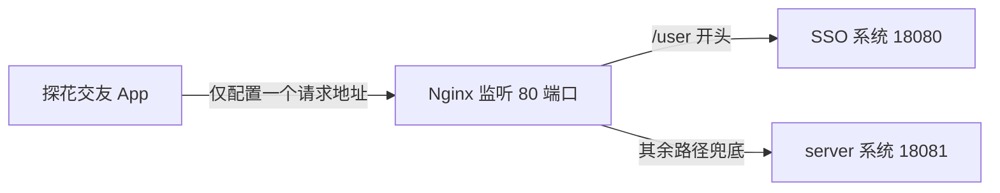

# 用 Nginx 统一接口服务入口：前端只记一个地址，按路径分发到两个后端

后端拆成两个服务之后，一个现实问题立刻摆上桌面：探花交友 App 的请求地址只能配置一个，而此刻后端已经跑着两个入口，SSO 系统监听 18080，承接登录、验证码这类用户接口；server 系统监听 18081，承接今日佳人等业务接口。地址只给谁，另一组接口就够不着。这一课用 Nginx 反向代理把两个入口收拢为一个：所有请求先到 Nginx 的 80 端口，再按路径前缀转发给对应的后端服务。

## 先给结论

- 统一入口的根因在客户端：单个前端只能配置一个请求地址，这句话说的是「每一个前端只能配一个」，不是所有前端加起来只能有一个。
- 方案是 Nginx 反向代理，按 location 前缀分发：`/user` 开头的请求转发到 18080 的 SSO 系统，其余请求兜底转发到 18081 的 server 系统，以后新增服务就是再补一段同构的 location。
- Windows 版 Nginx 解压即用，`start nginx.exe` 启动，修改 `nginx.conf` 后执行 `nginx.exe -s reload` 让配置生效，不必重启进程。
- 入口统一后，联调地址变成不带端口的 `http://127.0.0.1/tanhua/todayBest`；返回 502 说明 Nginx 本身正常，是它背后的某个后端没起来。
- 开发期由 Nginx 统一本地联调入口，项目正式发布时同样交给 Nginx，前端的地址配置一次就不再动。

## 一个地址的限制是怎么来的

把话说透，限制不在后端，而在客户端。App 打包时请求地址写进客户端配置，界面上只有一个 baseURL 可以填。后端有两个端口，意味着无论怎么填，总有一组接口从 App 直接发不出去；就算客户端支持多个地址，后端一旦换机器、换端口，App 也得跟着发新版本，这个代价在生产环境不可接受。

类比公司前台总机：访客只需要记住前台一个号码，转接到哪个分机由前台决定。Nginx 在这套架构里扮演的就是前台，对外只暴露 80 端口，对内按请求路径把流量转给不同服务。对 App 来说，目标地址从「SSO 系统或 server 系统」退化成「一台 Nginx」；对后端来说，服务可以随意迁移扩容，只要 Nginx 里的转发规则同步更新即可。

**反向代理是关键词。** 客户端明确知道自己访问的是 Nginx，但不知道也不关心请求最终落在哪台后端上，转发由服务端一侧代劳，这与「代理客户端出去访问」的正向代理方向相反。统一入口、负载均衡、动静分离，都建立在这个能力上，本课用到的只是按路径转发这一项。

## 部署 Nginx：解压、启动、重载

安装包 `nginx-1.17.3.zip` 在课程资料中已经备好，解压到任意目录即可，没有安装程序，演示中解压到了 F 盘的 soft 目录。启动方式是进入解压目录后在命令行执行启动命令：

```bash
# 进入 Nginx 解压目录后执行
start nginx.exe        # 启动 Nginx
nginx.exe -s reload    # 修改配置后重载，使其生效
```

启动后浏览器访问 `127.0.0.1`，看到 Nginx 的欢迎页就说明服务已经起来了，默认监听的正是 80 端口。Windows 版 Nginx 是常驻后台进程，命令行窗口关掉它也不会退出；改配置后不需要杀进程重启，一条 `reload` 命令就能让新配置生效，这是后面反复调整转发规则时最省事的一点。

## 按路径分发：location 与 proxy_pass

配置文件在解压目录的 `conf/nginx.conf`。默认文件里塞满了示例与注释，PHP 转发相关的 location 块与多余的静态站点配置对本课没有用处，先把这些清掉，只保留监听 80 的 server 块、错误页指令，再补上两段核心转发规则：

```nginx
server {
    listen       80;
    server_name  localhost;

    # SSO 系统的接口都以 /user 开头，命中后转发到 18080
    location /user {
        proxy_pass http://127.0.0.1:18080;
    }

    # 其余请求兜底转发给 server 系统，例如 /tanhua/todayBest
    location / {
        proxy_pass http://127.0.0.1:18081;
    }

    error_page   500 502 503 504  /50x.html;
}
```

转发规则的读法：`location /user` 是前缀匹配，请求路径以 `/user` 开头就走这条，`proxy_pass` 指明转发的目标；`location /` 匹配所有路径，起兜底作用，凡是不满足前面规则的请求都被送往 18081。Nginx 对前缀匹配取最长优先，`/user/login` 会命中 `/user` 而不是 `/`，两段规则互不干扰。默认配置里指定 404 与 500 错误页的指令暂时保留，出问题时浏览器至少能看到 Nginx 的错误页而不是白屏。

改完执行 `nginx.exe -s reload`，新规则立即生效。由此也能看出按路径分发的扩展方式：将来如果再起一个服务监听 18082，给它的接口约定一个独立前缀，加一段同构的 location 就完成接入，App 侧零改动。



这张图就是统一入口的全部逻辑：App 的所有请求汇聚到 Nginx，Nginx 按路径前缀把流量二分，`/user` 流向 SSO 系统，其余全部交给 server 系统，两个后端对客户端完全透明。

## 联调验证：200 与一次 502 的插曲

验证从今日佳人开始。请求地址换成 `http://127.0.0.1/tanhua/todayBest`，与之前的直连地址相比只是去掉了 18081 端口：路径以 tanhua 开头，匹配不到 `/user`，落进兜底规则转发到 18081。第一次请求返回了 502 Bad Gateway，原因是 server 服务当时停着，Nginx 转发时找不到活着的后端；把 server 系统重新启动，同一请求再次发送，返回 200 与正确的数据。这个小插曲正好把两种故障隔离开：出现 502 时 Nginx 是通的，要查的是它背后那台服务。

SSO 侧同样验证：发送验证码的 POST 请求，地址同样去掉 18080 端口直接发给 Nginx，请求命中 `/user` 转发到 SSO 系统，返回结果与直连时完全一致。到这一步，前端只需要配置 `http://127.0.0.1` 一个地址，登录与业务接口都能走通，统一入口的目的达成。以后项目发布，同样的 Nginx 配置思路搬到服务器上，前端配置依旧不用变。

## 常见误区

- **把「只能设置一个请求地址」理解成全局限制。** 错例：以为所有前端系统加起来只能有一个请求地址，于是怀疑方案本身有问题。正解：限制针对单个客户端，每个前端各自配置一个地址，配的都是同一个 Nginx 入口。
- **修改配置后忘记 reload。** 错例：location 改了半天，测试结果一直不变，怀疑写法有误。正解：`nginx.conf` 的改动不会自动生效，执行 `nginx.exe -s reload` 之后再验证。
- **看到 502 就去排查 Nginx。** 错例：认为 502 是 Nginx 配错了。正解：502 表示 Nginx 正常收到请求但后端不可达，先确认被代理的服务是否启动、端口是否与 `proxy_pass` 一致。
- **proxy_pass 末尾随意带斜杠。** 错例：把 `proxy_pass http://127.0.0.1:18080;` 写成 `http://127.0.0.1:18080/;`，路径被重写，`/user/login` 到达后端时变成了 `/login`。正解：`proxy_pass` 不带路径部分时原样透传请求 URI；带了路径则用它替换匹配到的 location 前缀，两种写法语义不同。

## 面试可能被问到的问题

1. 面试官追问：「正向代理和反向代理的区别是什么？」
   答：正向代理站在客户端一侧，代替客户端向服务端发起请求，服务端不知道真实客户端是谁；反向代理站在服务端一侧，接收客户端请求后转发给内部服务，客户端不知道真实后端是谁。Nginx 统一接口入口用的是反向代理。
2. 面试官追问：「Nginx 的 location 匹配规则是怎样的？」
   答：常用的是前缀匹配与正则匹配，前缀匹配遵循最长匹配优先，正则按出现顺序先命中先用，正则命中后不再回落前缀。本课的 `/user` 与 `/` 都是前缀匹配，靠最长匹配保证 `/user/login` 落到 SSO 系统。
3. 面试官追问：「proxy_pass 后面带不带斜杠有什么区别？」
   答：不带 URI 时，Nginx 把客户端的原始请求路径原样转给后端；带了路径，比如末尾的斜杠，Nginx 会用该路径替换掉 location 匹配到的前缀再转发。统一入口场景需要原样透传，所以目标地址写到端口为止。
4. 面试官追问：「为什么用 Nginx 做统一入口，而不是让前端配置多个后端地址？」
   答：客户端配置难以跟随服务端扩容变化，App 发版成本高；统一入口把后端拓扑收敛到服务端一侧，服务迁移、扩容、增加模块只改 Nginx 配置。入口层还能顺势承担负载均衡、HTTPS 卸载、限流等职责。
5. 面试官追问：「看到 502 Bad Gateway 你的排查思路是什么？」
   答：先确认 Nginx 进程活着且监听端口正常，说明请求已进入入口层；然后查被代理的后端服务是否启动、监听端口与 proxy_pass 是否一致、后端是否假死或连接数耗尽；再看后端自身日志定位。本课的 502 就是后端服务没启动造成的。
6. 面试官追问：「reload 和重启 Nginx 进程有什么区别？」
   答：reload 会加载新配置并平滑替换 worker 进程，存量连接处理完再退出，服务不中断；直接重启进程会断开所有连接。频繁调整转发规则时用 reload，配置结构性变更或版本升级才考虑重启。

## 配套资料

- 学习目标：`materials/code/07/day02 探花交友-实现首页功能/day02/学习目标.md`，其中「独立完成接口入口的统一」即本课对应目标。
- 说明：day02 资料包未含工程源码，`nginx-1.17.3.zip` 属于课程原始安装包未入库，`nginx.conf` 按课程画面逐行整理并保留画面中确认的两段 location，错误页指令为默认配置的保留项。
