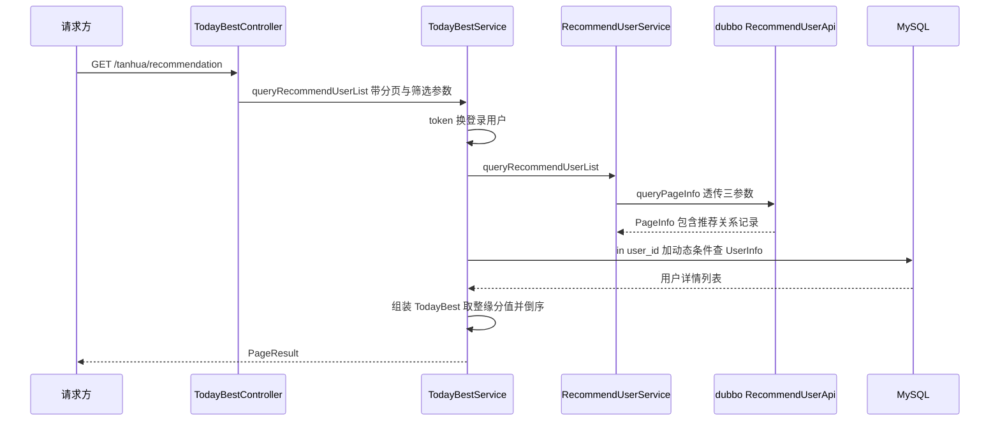

# 推荐用户列表的完整链路：Dubbo 分页查推荐关系，再回 MySQL 组装用户视图

今日佳人卡片之下还有一块推荐列表，它要按分页展示所有推荐用户。数据来源与今日佳人完全相同，都是 dubbo 服务背后的 `recommend_user` 集合，区别只在取舍：今日佳人只取缘分值最高的一位，列表则把分页内的推荐用户全部展现。难点在于拼装：推荐关系在 MongoDB 里只有用户 id 和缘分值，头像、昵称、年龄这些展示字段躺在 MySQL 的用户信息表里，两个数据源要按 id 对上号，还要支持筛选与倒序。这一课把这条链路从头走到尾。

## 先给结论

- 接口契约来自 mock 平台的「推荐好友」接口：路径 `/tanhua/recommendation`，参数 `page`、`pagesize` 外加性别、近期登录时间、年龄、居住地、学历等筛选条件；响应是 counts、pagesize、pages、items 四件套。
- 链路分三段：Controller 接参并校验登录态；Service 层通过 dubbo 的 `queryPageInfo(userId, pageNum, pageSize)` 拿到推荐关系分页；再用 userIds 回 MySQL 查用户详情。
- 查用户详情用 MyBatis-Plus 的 QueryWrapper 动态拼条件：`in("user_id", userIds)` 是主条件，age、city 等筛选先判空再拼，参数没传就不进 SQL。
- 视图对象 `TodayBest` 一个个组装，缘分值要做 `Math.floor` 取整，得分 96.2 展示为 96；`in` 查询不保证顺序，出口前用 `Collections.sort` 按缘分值倒序。
- `PageResult` 的 counts 与 pages 按接口口径固定给 0，前端瀑布流不做总条数计算，这不是缺陷而是约定。

## 接口契约：mock 约定与两个传输对象

mock 平台上的「推荐好友」接口约定了这套接口的进出。请求参数除请求头里的 token 外，还包括 `page` 当前页、`pagesize` 每页条数，以及 gender、近期登录时间、年龄、居住地、学历等一串查询条件。条件之所以这么多，是因为产品设计上有筛选面板，课程阶段只做链路主干，筛选面板留待后续实现。响应数据包含 counts 总记录数、pagesize 页大小、pages 总页数与 items 列表，items 里的元素与今日佳人共用同一套字段。

按契约先补两个传输对象。查询参数对象放进 vo 包，字段与 mock 参数一一对应：

```java
package com.study.tanhua.server.vo;

import lombok.Data;

import java.io.Serializable;

@Data
public class RecommendUserQueryParam implements Serializable {

    private static final long serialVersionUID = 1L;

    private Integer page;        // 当前页码
    private Integer pagesize;    // 每页条数
    private String gender;       // 性别
    private String lastLogin;    // 近期登录时间
    private Integer age;         // 年龄
    private String city;         // 居住地
    private String education;    // 学历
}
```

响应对象 `PageResult` 与上一课今日佳人的返回粒度对齐：

```java
package com.study.tanhua.server.vo;

import lombok.AllArgsConstructor;
import lombok.Data;
import lombok.NoArgsConstructor;

import java.io.Serializable;
import java.util.List;

@Data
@NoArgsConstructor
@AllArgsConstructor
public class PageResult implements Serializable {

    private static final long serialVersionUID = 1L;

    private Integer counts;     // 总记录数
    private Integer pagesize;   // 页大小
    private Integer pages;      // 总页数
    private Integer page;       // 当前页码
    private List<?> items;      // 列表数据，元素为 TodayBest
}
```

items 的元素类型就是今日佳人用过的 `TodayBest`，一套视图对象同时喂两张卡片与一张列表，接口之间口径才不会漂移。

## Controller 与 Service：token 换用户，再透传 Dubbo

Controller 写在已有的 `TodayBestController` 里即可，只要路径符合 mock 约定；也可以单独拆一个类，全凭工程习惯。方法上用 `@GetMapping` 标记路径，参数收 `RecommendUserQueryParam` 与 token：

```java
package com.study.tanhua.server.controller;

import com.study.tanhua.server.service.TodayBestService;
import com.study.tanhua.server.vo.PageResult;
import com.study.tanhua.server.vo.RecommendUserQueryParam;
import org.springframework.beans.factory.annotation.Autowired;
import org.springframework.web.bind.annotation.GetMapping;
import org.springframework.web.bind.annotation.RequestMapping;
import org.springframework.web.bind.annotation.RestController;

@RestController
@RequestMapping("tanhua")
public class TodayBestController {

    @Autowired
    private TodayBestService todayBestService;

    /**
     * 推荐好友列表
     */
    @GetMapping("recommendation")
    public PageResult queryRecommendationList(RecommendUserQueryParam queryParam, String token) {
        return this.todayBestService.queryRecommendUserList(queryParam, token);
    }
}
```

Service 的第一步永远是同一件事：用 token 换出登录用户。第二步把分页参数转交 dubbo 服务，这一层只做转发，不做数据处理：

```java
package com.study.tanhua.server.service;

import com.alibaba.dubbo.config.annotation.Reference;
import com.study.tanhua.dubbo.server.api.RecommendUserApi;
import com.study.tanhua.dubbo.server.pojo.RecommendUser;
import com.study.tanhua.dubbo.server.vo.PageInfo;
import com.study.tanhua.server.pojo.User;
import com.study.tanhua.server.vo.RecommendUserQueryParam;
import com.study.tanhua.server.vo.TodayBest;
import org.springframework.beans.factory.annotation.Autowired;
import org.springframework.stereotype.Service;

import java.util.List;

@Service
public class RecommendUserService {

    @Reference
    private RecommendUserApi recommendUserApi;

    /**
     * 分页查询推荐用户，参数直接透传给 dubbo 服务
     */
    public PageInfo<RecommendUser> queryRecommendUserList(Long id, Integer page, Integer pagesize) {
        return this.recommendUserApi.queryPageInfo(id, page, pagesize);
    }
}
```

`TodayBestService` 里的编排方法负责串起整个流程：

```java
public PageResult queryRecommendUserList(RecommendUserQueryParam queryParam, String token) {
    // 根据token查询当前登录的用户信息
    User user = this.userService.queryUserByToken(token);
    if (user == null) {
        return null;
    }
    PageInfo<RecommendUser> pageInfo = this.recommendUserService
            .queryRecommendUserList(user.getId(), queryParam.getPage(), queryParam.getPagesize());
    List<RecommendUser> records = pageInfo.getRecords();
    // 需要查询用户的信息，并且按照条件查询
    List<Long> userIds = new ArrayList<>();
    for (RecommendUser record : records) {
        userIds.add(record.getUserId());
    }
    QueryWrapper<UserInfo> queryWrapper = new QueryWrapper<>();
    queryWrapper.in("user_id", userIds);                        // 用户id，必须条件
    if (queryParam.getAge() != null) {
        queryWrapper.lt("age", queryParam.getAge());            // 年龄筛选，示例条件
    }
    if (StringUtils.isNotEmpty(queryParam.getCity())) {
        queryWrapper.eq("city", queryParam.getCity());          // 城市筛选，示例条件
    }
    List<UserInfo> userInfos = this.userInfoService.queryUserInfoList(queryWrapper);
    // 组装 TodayBest 列表，见下文
    return null;
}
```

这里有一个要提前想明白的口径：dubbo 分页返回的可能有 10 条推荐，但其中符合筛选条件的也许只有 3 条，最终响应给前端的就是这 3 条，而不是把 10 条原样上交。所以用户详情必须带条件查，而不是按推荐顺序逐个查。age 与 city 两段条件在课程里是「先判空、再拼接」的写法模板，mock 里其余筛选条件（性别、近期登录时间、学历等）属于后续筛选面板的实现范围；`tb_user_info` 表的 `age` 与 `city` 都是真实存在的列，条件命中时能正常过滤。不传参数时这两段 if 不会进入 SQL，联调不受影响。



这张时序图把两个数据源的分工划清：dubbo 一侧只回答「推荐了谁、缘分值多少」，MySQL 一侧回答「这个人长什么样」，Service 是把两边缝起来的那根线。

## VO 组装：TodayBest 与缘分值取整

拿到用户详情后逐个组装视图对象，字段与今日佳人的写法一致：

```java
List<TodayBest> todayBests = new ArrayList<>();
for (UserInfo userInfo : userInfos) {
    TodayBest todayBest = new TodayBest();
    todayBest.setId(userInfo.getUserId());            // 用户id
    todayBest.setUserId(userInfo.getUserId());
    todayBest.setAge(userInfo.getAge());
    todayBest.setGender(userInfo.getSex().name().toLowerCase());   // man / woman
    todayBest.setAvatar(userInfo.getLogo());
    todayBest.setNickname(userInfo.getNickName());
    todayBest.setTags(StringUtils.split(userInfo.getTags(), ',')); // 标签串拆数组
    todayBests.add(todayBest);
}
```

第一次跑测试用例就暴露了一个问题：响应里每个元素的缘分值都是 null。原因很简单，组装时压根没有赋值。缘分值在 `RecommendUser` 记录里，需要拿 `records` 按 id 对号入座，取整的逻辑与今日佳人相同，得分 96.2 只显示整数部分：

```java
// 补缘分值：records 里是原始推荐数据，按用户id匹配
for (RecommendUser record : records) {
    if (record.getUserId().longValue() == todayBest.getId().longValue()) {
        // 得分为 96.2 时，需要显示的分值是 96
        double score = Math.floor(record.getScore());
        todayBest.setFateValue(Double.valueOf(score).longValue()); // 分值
    }
}
```

比较的是 `longValue()` 而不是对象本身，因为包装类型直接用等号比较在超出缓存区间时会得到错误结果。补上这段后缘分值有了，但新问题跟着出现：列表没有按缘分值从大到小排列。

## 排序：in 查询不负责顺序

数据源是 `queryWrapper.in("user_id", userIds)`，MySQL 对 `in` 查询没有顺序承诺，返回顺序与传入集合的顺序无关，更不会按缘分值排。缘分值也不在 MySQL 表里，想靠 SQL 排序还得再关联一次，得不偿失，所以排序放在内存里做：

```java
// 按缘分值倒序，大的排前面
Collections.sort(todayBests, (o1, o2) -> new Long(o2.getFateValue() - o1.getFateValue()).intValue());
```

比较器返回负数表示 o1 排前面，正数表示 o2 排前面，`o2 减 o1` 得到的就是从大到小。画面上写的是 `new Long(...)`，声音线也提示了等价写法 `Long.valueOf(...).intValue()`，新代码里建议用后者，`new Long` 在高版本 JDK 已经废弃。

排序完成后把 `PageResult` 拼出来返回：

```java
// counts 与 pages 按接口口径固定为 0，前端不做总条数计算
return new PageResult(0, queryParam.getPagesize(), 0, queryParam.getPage(), todayBests);
```

启动 server 服务后用 REST 客户端验证：请求 `http://127.0.0.1/tanhua/recommendation?page=1&pagesize=10` 并带上登录 token，返回结构如下（示例数据按课程响应结构脱敏整理，站点以 example.com 占位）：

```json
{
  "counts": 0,
  "pagesize": 10,
  "pages": 2,
  "page": 1,
  "items": [
    {
      "id": 5,
      "nickname": "user_5",
      "avatar": "https://example.com/images/logo/16.jpg",
      "gender": "man",
      "age": 23,
      "tags": ["单身", "本科", "年龄相仿"],
      "fateValue": 98
    }
  ]
}
```

缘分值一行从大到小严格递减；把 pagesize 调大到 12 再请求，多出来的条目依然接在队尾按倒序排列，列表功能至此闭环。

## 常见误区

- **用等号比较 Long 对象。** 错例：`record.getUserId() == todayBest.getId()`，超出缓存区间的 Long 值比较恒为假，缘分值匹配不上。正解：拆箱比较 `longValue()`，或用 `Objects.equals`。
- **比较器方向写反或依赖减法。** 错例：把 `o2 - o1` 写成 `o1 - o2`，列表变成升序；大数值相减还可能溢出。正解：倒序用 `Long.compare(o2.getFateValue(), o1.getFateValue())`，语义明确且无溢出。
- **缘分值忘了取整。** 错例：直接把 96.2 这类小数放给前端。正解：`Math.floor` 后转 long，展示口径以 mock 契约为准。
- **动态条件不判空。** 错例：age 没传也拼进 SQL，条件变成空值比较。正解：每个可选条件先判断是否为空，再往 QueryWrapper 上加。

## 面试可能被问到的问题

1. 面试官追问：「推荐关系在 MongoDB、用户详情在 MySQL，为什么要拆成两次查询？」
   答：数据归属不同，推荐关系由推荐系统产生，属 dubbo 服务管辖；用户详情是主数据，归 MySQL。跨库没法一次 join，通过 id 集合把两边缝合，还顺带把筛选条件下推到了详情查询里，架构上每个数据源只对自己的数据负责。
2. 面试官追问：「MyBatis-Plus 的 QueryWrapper 动态条件怎么写才安全？」
   答：条件按需拼接，先判空再调用 in、lt、eq；列名写在代码里而非用户输入，值由预编译占位符传递，避免 SQL 注入；本课的 age 与 city 判断就是标准的判空拼接模板。
3. 面试官追问：「in 查询为什么不能保证顺序？排序应该放在哪一层？」
   答：SQL 标准不承诺无 order by 时的返回顺序，in 只是过滤条件。排序可以下推到 SQL 或 MongoDB 查询，也可以在内存做；本课数据已分页、量级小，内存 Collections.sort 成本可忽略，而缘分值不在 MySQL 表里，内存排序反而省一次关联。
4. 面试官追问：「Comparator 用相减实现倒序有什么隐患？」
   答：相减在大数值上会溢出，导致比较结果符号错误、排序错乱；正确写法是 compare 方法，如 Long.compare(o2, o1)。相减只在小且可预判的数值区间里安全。
5. 面试官追问：「分页接口把 counts 固定给 0 合理吗？」
   答：这是接口契约层面的取舍。本项目的列表是瀑布流下拉加载，前端不渲染总页码，把 counts 置 0 就免去了数据库的 count 全表开销；如果产品要显示共 N 条，就必须真实返回，口径跟着前端需要走。
6. 面试官追问：「缘分值 96.2 为什么取整后再返回？」
   答：展示层数据要遵循设计稿与 mock 契约，前端以整数展示缘分值；取整放在服务端统一做，避免每个客户端各写一套舍入逻辑造成口径不一，Math.floor 向下取整与设计预期一致。

## 配套资料

- 学习目标：`materials/code/07/day02 探花交友-实现首页功能/day02/学习目标.md`，其中「独立完成推荐用户列表的功能」即本课对应目标。
- 数据库：`materials/code/07/day01 探花交友-项目搭建以及登录完善个人信息/day01/代码/mytanhua.sql`，用户信息表结构与测试用户的字段口径回溯于此。
- 说明：day02 资料包未含工程源码，Controller、Service 与 vo 均按课程画面逐行整理并补全为可编译示例，包名按规范改写为 `com.study.tanhua` 系；mock 平台地址属第三方站点，示例中以 example.com 占位；响应 JSON 中的昵称与头像为脱敏示例数据。
