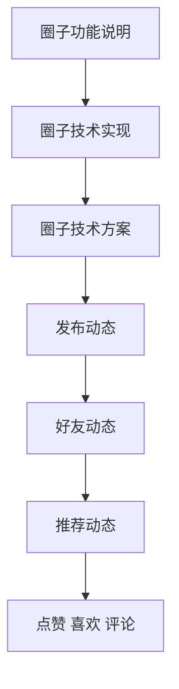

# day03 开篇：圈子功能的学习路线、技术盘点与开工依赖

首页闭环之后，App 底部导航的第二个 tab「圈子」要提上日程了。它对标微信朋友圈：能发、能看、能互动。朋友圈人人刷过，但把它作为一个需要自己实现的功能模块，一天之内要跑通发布、浏览、点赞、评论，开工前必须把路线和依赖盘清楚，否则很容易在表设计上返工。

## 先给结论

- day03 的目标是圈子功能，功能面覆盖发布动态、查看好友动态、查看推荐动态、点赞、喜欢、评论，以及评论的点赞。
- 学习路线是先方案后编码：功能说明、技术实现、技术方案三步分析在前，发布动态、好友动态、推荐动态三个编码任务在后。
- 技术栈沿用既有基建：存储靠 MongoDB，缓存靠 Redis，服务间调用靠 dubbo；发布链路里时间线的写入会引入 RocketMQ 做异步化。
- 动手前的依赖检查清单：MongoDB 4.0.3 在线、ZooKeeper 3.4.13 在线、dubbo 契约先行、图片上传与经纬度数据可用。

## 今天要做什么：功能清单与对标对象

圈子与微信朋友圈同构：个人可以发布动态，动态由文字与图片组成；好友能看到这些动态；系统还会把「可能感兴趣的人」的动态推进推荐频道；对内容可以做点赞、喜欢、评论三类互动，评论本身还能被点赞。对照课程大纲，这一天的工作按六个环节展开：圈子功能说明、圈子技术实现、圈子技术方案、圈子实现发布动态、圈子实现好友动态、圈子实现推荐动态，互动类功能穿插在编码任务里。

大纲的编排顺序也有讲究：前三个环节不写一行业务代码，只回答「做什么、用什么做、为什么这么做」。day02 的经验已经证明这套铺垫的价值，今日佳人正是先定 dubbo 契约再填实现，两头并行才没有互相等待。

## 学习路线：先方案，后编码

这张图按大纲顺序画出六个环节的推进关系，互动功能随发布与浏览两条链路一并落地。



关键路径读法：方案分析阶段的产出是四张核心集合的设计与发布、查看两条流程的定义，编码阶段的三条链路全部挂在这两份产出上。发布动态链路最长，因为它同时牵扯图片上传、MongoDB 写入与时间线扩散；好友动态与推荐动态本质是两个查询入口，复用同一套数据层。

## 技术盘点：复用什么，新引入什么

复用侧都是 day01 与 day02 的积累：Nginx 统一入口让圈子的接口继续走 80 端口兜底转发；统一缓存让动态列表这类高频读请求自动获得加速；dubbo 2.6.4 加 ZooKeeper 3.4.13 继续承担服务注册与发现。新增侧有两件：一是圈子自己的数据模型，MongoDB 里的动态、相册、评论、时间线等集合；二是消息中间件 RocketMQ，课程大纲的技术实现环节会给它留位置，用于把发布动作里「写所有好友时间线」这一步从同步串行改成异步消息驱动，细节在后续小节展开。

编码尚未开始，接口契约可以先落下来，这是 dubbo 项目的标准起手式：

```java
// 圈子的 dubbo 契约预览（预告示例，按本课写法补全，落位 my-tanhua-dubbo-interface）
public interface MovementApi {

    // 发布动态，返回动态 id
    String publish(Movement movement);

    // 好友动态：分页查询自己的时间线
    PageInfo<Movement> queryFriend(Long userId, Integer page, Integer pageSize);

    // 推荐动态：分页查询推荐池，数据由推荐系统写入
    PageInfo<Movement> queryRecommend(Long userId, Integer page, Integer pageSize);
}
```

三个方法对应三条链路，发布是写，好友与推荐是读。契约先行之后，接口服务工程可以先以 mock 数据联调页面，dubbo 实现再逐步填实。

## 动手前的依赖检查

编码开工前，三件基础设施必须在线：MongoDB 4.0.3 存动态数据，ZooKeeper 3.4.13 承载 dubbo 注册，Redis 供给统一缓存。快速自检一条命令就能覆盖：

```bash
# 动手前确认三件基础设施在线（按本课环境口径）
mongo --eval "db.version()"        # 期望输出 4.0.3
echo ruok | nc 127.0.0.1 2181      # ZooKeeper 应答 imok
redis-cli ping                     # 应答 PONG
```

数据依赖同样要确认：好友关系数据是否已经造好，决定好友动态链路能不能调通；用户经纬度是否落库，决定动态距离能不能计算；图片上传通道是否可用，决定发布动态的图片如何落对象存储。这些依赖任何一处缺失，对应链路都会在联调阶段才暴露问题，前置检查的成本远低于返工。

## 常见误区

- **跳过方案分析直接写代码。** 错例：上来就建集合写接口，发到好友动态时发现缺时间线结构。正解：先跟着功能说明与技术方案把集合设计定稿，再进入编码。
- **把圈子当成纯前端功能。** 错例：以为只是复刻朋友圈界面。正解：界面之下有存储选型、读写流程与异步化三条硬问题，接口才是工作量主体。
- **以为 RocketMQ 的细节当天开头就展开。** 错例：开篇就搭消息集群。正解：课程在技术实现环节才引入，前期只需要知道异步化的动机是写扩散。
- **忘记复用统一入口与统一缓存。** 错例：给圈子接口单独开端口、单独写缓存逻辑。正解：新接口天然走 Nginx 兜底转发与拦截器缓存，无需额外配置。

## 面试可能被问到的问题

1. 面试官追问：「拿到一个类似朋友圈的需求，你怎么拆解？」
   答：先按用户行为拆功能面：发布什么内容、谁能看到、能做什么互动；再按数据流拆链路：发布是写路径，浏览按来源分好友与推荐两个读路径，互动是围绕内容的轻量写。最后对每条链路问存储与性能问题，拆出的每个功能都能对应到接口与数据集合。
2. 面试官追问：「发布动态为什么要引入消息中间件？」
   答：发布动作除了写动态本身，还要扩散到所有好友的时间线，好友量大时同步串行写入会拖长发布接口的响应时间。把扇出写入交给 RocketMQ 异步完成，发布接口只写自己的数据就返回，用户感知延迟低，写入失败还能靠消息重试补偿。
3. 面试官追问：「好友动态和推荐动态的数据来源有什么区别？」
   答：好友动态来自时间线，是好友发布时主动扩散进来的收件箱数据，可读性与好友关系强绑定；推荐动态来自推荐池，由推荐系统按算法筛选后写入，与好友关系无关。两个读入口复用同一份动态明细，只是查询入口不同。
4. 面试官追问：「dubbo 契约先行在实际项目里怎么落地？」
   答：接口定义独立成模块供双方依赖，服务端按契约实现，消费端先拿 mock 实现联调。它把依赖方向变成面向抽象，接口一旦定稿，前后端与两个工程之间就能并行推进，变更只在契约模块上收敛。
5. 面试官追问：「新功能开工前的依赖检查怎么做？」
   答：分三层核对：基础设施层确认中间件版本与连通性；数据层确认预置数据与索引满足查询条件；接口层确认上游契约与下游依赖是否就绪。每层给出可执行的自检命令，而不是凭印象判断。

## 配套资料

- 圈子页面交互原型：`materials/code/07/day01 探花交友-项目搭建以及登录完善个人信息/day01/资料/探花交友移动端原型V1.2/圈子.html`，本课功能清单与原型页面一一对应，原型内文案均为演示数据。
- day03 资料目录：`materials/code/07/day03 探花交友-实现圈子功能/`，day03 资料包未随代码资料入库，工程与 SQL 以课程画面为准。
- 说明：文中 `MovementApi` 接口与命令为按本课写法补全的预告示例，最终实现以后续小节为准。
