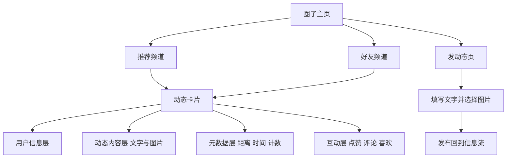

# 圈子功能说明：一张动态卡片背后的产品要素

微信朋友圈人人都刷过，但真正要自己实现时就会发现，这张看似简单的信息流里塞满了产品要素：频道切换、卡片信息、相对时间、地理距离、互动计数、发布约束。day03 的功能说明环节把这些要素逐一拆开，编码之前先看清页面上的每个区域由什么数据驱动，接口设计才不会漏字段。

## 先给结论

- 圈子对标微信朋友圈，信息流有两个频道：推荐由系统推送，好友来自关注关系，底部导航第二个 tab「圈子」即入口。
- 一张动态卡片分四层：用户信息（头像、昵称、学历、年龄相仿、婚姻状况）、动态文字、动态图片、元数据（发布时间距今、与我的距离、浏览量、点赞评论等计数）。
- 距离与时间是两个计算型字段：距离由发布地经纬度与我的位置实时计算，时间显示为取整后的相对时间，如 10 分钟前、3 小时前、2 天前。
- 互动三件套是点赞、评论、喜欢，评论区支持追加评论与评论点赞。
- 发布入口在圈子页右上角，文字加图片的轻量编辑页，原型口径为内容不超过 140 字、图片最多 6 张。

## 从朋友圈到圈子：页面结构与交互

圈子页的骨架与朋友圈一致：顶部是频道切换，下方是动态信息流，右上角一枚发布按钮。课程演示里推荐频道展示系统推送的动态，好友频道展示我的好友们发布的内容；点开一张卡片的评论区，可以看到评论总数、每条评论的内容与时间，还有追加评论的输入框。

这张图把圈子页的信息层级与跳转关系画成一棵结构树。



结构树的要点在于频道与卡片的关系：两个频道共享同一张卡片结构，差别只在数据来源，这意味着接口返回的卡片模型可以设计成同一个 VO，由服务端按频道填充数据。

## 一张动态卡片的信息结构

卡片上每个位置都对应一个接口字段。按原型把字段收拢成一个 VO，接口设计的全貌就出来了：

```java
// 动态卡片 VO：字段口径按原型与本课写法补全（示例）
public class MovementVo {

    private String id;              // 动态 id
    private Long userId;            // 发布者 id
    private String nickname;        // 昵称
    private String avatar;          // 头像
    private Integer age;            // 年龄
    private String education;       // 学历
    private String marriage;        // 婚姻状况
    private String textContent;     // 动态文字
    private List<String> medias;    // 图片地址列表，最多 6 张
    private String createDate;      // 相对时间，如 10分钟前
    private Long distance;          // 发布地与我的距离，单位米
    private Long pinCount;          // 点赞数
    private Long commentCount;      // 评论数
    private Long loveCount;         // 喜欢数
    private Boolean hasLiked;       // 当前用户是否已点赞
    private Boolean hasLoved;       // 当前用户是否已喜欢
    // getter / setter 略
}
```

用户信息层的字段来自 MySQL 的用户资料，动态内容层与互动计数来自圈子自己的存储，两组数据在服务端拼装后一次性下发，避免前端发多次请求拼页面。`hasLiked` 与 `hasLoved` 这类布尔字段容易被遗漏，缺了它们前端就无法渲染「我是否已点过赞」的状态。

## 两个计算型字段：距离与时间

**距离不是用户填写的，而是算出来的。** 卡片上的「20km」是发布动态时的位置与当前用户位置之间的地理距离，参与计算的是两个经纬度点。MongoDB 原生支持地理位置索引，按本课写法补全的示例口径如下：

```bash
# 距离计算依赖地理位置索引（示例，按本课写法补全）
use tanhua
db.movement.createIndex({ "location": "2dsphere" })
# 以我的坐标查询附近的动态，maxDistance 单位为米
db.movement.find({
  "location": {
    $near: {
      $geometry: { type: "Point", coordinates: [121.475, 31.229] },
      $maxDistance: 50000
    }
  }
})
```

**时间是相对化的展示口径。** 原型明确要求显示发布时刻距今的时长并做取整：10 分钟前、3 小时前、2 天前。相对时间由服务端按发布时间换算后下发，前端只负责渲染，取整规则集中在服务端一处，改口径不用动客户端。

这两类字段也是本项目后续地理功能的伏笔，day10 用 Elasticsearch geo 实现搜附近时，经纬度数据的口径与此一脉相承。

## 发布动态的交互闭环

底部导航切到圈子后，点右上角发布按钮进入发动态页：一个文字输入框加一组图片选择。课程演示输入「今天心情很好！」并配一张图片完成发布，回到圈子页即可看到新动态。原型的约束写得很具体：内容不设下限但不得超过 140 字，照片一次最多选择 6 张，超过后选择入口置灰。这些约束前后端都要校验，前端控制输入与选图体验，后端做兜底拒绝。

图片本体不进数据库，上传后落对象存储，动态记录里只保存地址列表，这与头像上传的口径一致，接口返回的 `medias` 正是这组 URL。

## 常见误区

- **把距离当成用户填写字段。** 错例：发布时让用户手填「距离」或直接展示随机数。正解：距离是发布地经纬度与查看者位置的地理计算结果，存储层要保住经纬度并建地理索引。
- **时间直接返回年月日。** 错例：接口下发 `2019-08-02 16:43:46`，前端再拼「xx分钟前」。正解：按原型口径由服务端换算取整后的相对时间，口径集中一处。
- **图片与字数不做上限。** 错例：发布接口不校验图片数量与文字长度。正解：前端按 6 张图与 140 字限制交互，后端同步校验兜底。
- **两个频道共用一套查询逻辑。** 错例：推荐与好友动态都从好友关系表查。正解：推荐频道数据来自推荐系统的推荐池，好友频道来自时间线，来源不同，接口按频道分流。

## 面试可能被问到的问题

1. 面试官追问：「动态卡片字段这么多，接口怎么设计才不乱？」
   答：按卡片层级拆字段归属，用户信息、动态内容、元数据、互动状态各归其位，聚合成一个 VO 一次性下发；布尔类的个人状态字段单独列出，因为它们与查看者相关。字段来源不同的数据在服务端拼装，前端只面对一张完整卡片。
2. 面试官追问：「相对时间应该在哪一层计算？为什么？」
   答：在服务端计算。发布时间是服务端数据，取整规则属于产品口径，放在服务端可以让规则集中变更、多端一致；客户端只渲染字符串，也避免了设备时区或本地时钟错误带来的偏差。
3. 面试官追问：「动态距离的计算怎么实现？」
   答：发布时把发布地经纬度存进动态文档并建立 2dsphere 地理索引，查看时用查看者的坐标做 `$near` 这类地理查询或直接对两点算球面距离。数据量更大时可以把地理检索交给专门的引擎，本项目后续用 Elasticsearch geo 实现搜附近就是同一思路。
4. 面试官追问：「推荐动态和好友动态为什么是两个数据来源？」
   答：好友动态的可读范围由社交关系决定，来自好友发布时扩散进时间线的数据；推荐动态由推荐系统按兴趣算法从公开池筛选写入推荐表。两者更新节奏与生命周期都不同，混在一条链路里会让查询互相拖累。
5. 面试官追问：「图片最多 6 张这类约束，前端校验了后端还要做吗？」
   答：要做。前端校验只是体验层，请求可以被绕过，后端必须在发布接口里对文字长度、图片数量、图片地址合法性做兜底校验，约束的最终裁决权永远在服务端。
6. 面试官追问：「点赞、喜欢、评论这些互动数据怎么存？」
   答：本课把它们统一归入评论表：评论是带文字的记录，点赞与喜欢是不带文字的操作记录，都用动态或评论的 id 关联、用类型字段区分。计数可以从该表聚合，再配合缓存加速，避免高频更新直接压在动态明细上。

## 配套资料

- 圈子页面交互原型：`materials/code/07/day01 探花交友-项目搭建以及登录完善个人信息/day01/资料/探花交友移动端原型V1.2/圈子.html`，卡片字段口径、140 字与 6 张图的约束均出自原型标注，原型内文案均为演示数据。
- day03 资料目录：`materials/code/07/day03 探花交友-实现圈子功能/`，day03 资料包未随代码资料入库，工程代码以课程画面为准。
- 说明：`MovementVo` 定义与 Mongo 命令为按本课写法补全的示例，最终字段以实现环节为准。
