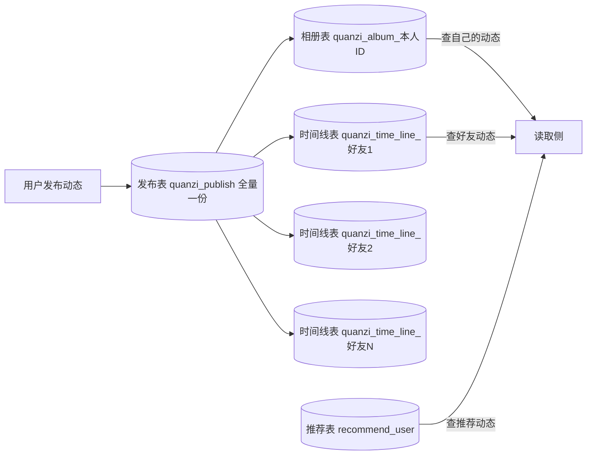

# 圈子的数据模型：发布表、相册表、时间线表与评论表

圈子是探花交友里对标「朋友圈」的功能：用户发一条动态，配上图片或小视频，好友能刷到、能点赞、能评论。动手写代码之前，这套功能的体验上限先押在数据模型上：动态正文存在哪、好友从哪张表读、点赞和评论怎么归拢。这一课把圈子最核心的四张表逐张拆开，顺带把「读简单写麻烦」还是「写简单读麻烦」这笔账算清楚。

## 先给结论

- 四张核心表：发布表 `quanzi_publish` 存动态全量信息；相册表 `quanzi_album_<userId>` 与时间线表 `quanzi_time_line_<userId>` 按用户分表，都只存发布 ID 指针；评论表 `quanzi_comment` 全局一张，点赞、评论、喜欢共用，靠 `commentType` 区分。
- 相册表管「我发过什么」，时间线表管「好友发过什么」，读取时各查各的表，谁也不用扫全量发布表。
- 时间字段一律存时间戳（Long 类型），需要展示时再格式化成字符串。
- 可见性用 `seeType` 加两个列表组合表达：1 公开、2 私密、3 部分可见、4 不给谁看。
- 评论表预留 `isParent` 与 `parentId` 两个字段支撑楼中楼回复，项目暂未实现评论树，但结构先支持。

## 一、一次发布对应几次写入

先把读写两条路径摊开。读的路径有三条，课程文档里概括得很直白：查看自己的动态，直接查相册表；查看好友的动态，查好友的时间线表；查看系统推荐的动态，查推荐表（day02 建好的 `recommend_user` 那条链路）。写的路径只有一条但要做三次落库：动态正文进发布表，自己的相册表补一条指针，再把这条动态投递进每个好友的时间线表。



这张图把圈子最核心的取舍画了出来：发布时写得辛苦，正文只存一份，但指针要向 N 个好友各投一条；换来的结果是读取时永远只碰一张小表，好友刷动态不必去扫庞大的发布集合。社交 feed 里这叫写扩散，也叫推模式，代价前置到发布，收益留给高频的浏览。

## 二、发布表：动态正文的唯一权威

发布表是唯一存动态正文的地方，其他表都只记它的 ID。结构按画面线抄录如下：

```json
# 表名: quanzi_publish
{
  "id": 1,                          # 主键id
  "userId": 1,                      # 用户id
  "text": "今天心情很好",            # 文本内容
  "medias": "http://xxxx/x/y/z.jpg", # 媒体链接，图片或小视频 url
  "seeType": 1,                     # 谁可以看，1-公开，2-私密，3-部分可见，4-不给谁看
  "seeList": [1,2,3],               # 给谁可见的列表
  "notSeeList": [4,5,6],            # 不给谁看的列表
  "longitude": 108.840974298098,    # 经度
  "latitude": 34.2789316522934,     # 纬度
  "locationName": "上海市浦东区",    # 位置名称
  "created": 1568012791171          # 发布时间
}
```

逐组看字段。`text` 与 `medias` 是内容本体，媒体是图片或小视频的 URL 列表，文件本体在对象存储里，表里只存地址。`seeType` 加 `seeList`、`notSeeList` 是一组可见性方案：公开与私密两种状态 `seeType` 自己就能表达；部分可见与不给谁看两种状态，分别靠 `seeList` 与 `notSeeList` 给出名单。这个组合与微信朋友圈的发布选项一一对应，当前课程没有实现可见性过滤的逻辑，字段先按默认值落库，需求来了不用改表。经度、纬度、位置名称三个字段支撑「动态带位置」的展示。`created` 用毫秒时间戳存储，课程明确不存字符串，需要展示时再做 format。

## 三、相册表与时间线表：两张按用户分表的指针表

相册表存储每个用户自己发布动态的历史，表名末尾带 userId，意味着每个用户一张专属集合：

```json
# 表名: quanzi_album_userId
{
  "id": 1,               # 主键id
  "publishId": 1001,     # 发布id
  "created": 1568012791171 # 发布时间
}
```

时间线表存储投递给用户的好友动态，同样每个用户一张表：

```json
# 表名: quanzi_time_line_userId
{
  "id": 1,             # 主键id
  "userId": 2,         # 好友id
  "publishId": 1001,   # 发布id
  "date": 1568012791171 # 发布时间
}
```

两张表长得几乎一样，差别在语义。相册表回答「我发过什么」，写发生在发布者自己的表里；时间线表回答「我的好友们发过什么」，写发生在读者的表里，发布一条动态要向每个好友的集合各投一条。`userId` 字段在时间线里记的是发布者是谁：投进李四的时间线时，这条记录的 `userId` 填发布者张三的 ID，李四刷列表时按时间倒序遍历自己的集合，再拿 `publishId` 回发布表取正文。

两张表都只存 ID 不存正文，理由与 day02 推荐集合只存用户 ID 是同一个：动态正文只有一份权威来源，改文案、删动态只改发布表一处，指针表永远不需要同步。如果哪天产品要求删除动态，发布表标记一下，所有时间线自然查不到有效正文，不需要挨个集合清理。

按用户分表是这组设计里最工程化的决定。单表亿级文档时，按用户 ID 切出几千上万个集合，每个集合只有几十几百条文档，读写都落在很小的数据面上，配合 MongoDB 的 WiredTiger 缓存，热门用户的查询基本全在内存。代价是集合名不能写死，代码里必须用带 userId 的动态集合名写入，这一点在后续实现篇里会专门展开。

## 四、评论表：一张表装下点赞、评论与喜欢

评论表全局一张，所有用户的评论数据都进来，所以它不做用户分表：

```json
# 表名: quanzi_comment
{
  "id": 1,              # 主键id
  "publishId": 1001,    # 发布id
  "commentType": 1,     # 评论类型，1-点赞，2-评论，3-喜欢
  "content": "给力！",   # 评论内容
  "userId": 2,          # 评论人
  "isParent": false,    # 是否为父节点，默认是否
  "parentId": 1001,     # 父节点id
  "created": 1568012791171
}
```

这张表最需要想明白的是 `commentType`。点赞、评论文字、点喜欢，在用户眼里是三种动作，在数据层面都是「某个用户对某条动态做了一次互动」，结构完全一致，区别只是类型编号与有没有 `content`。点赞与喜欢不填内容，评论才填。一张表承载三类互动，计数统计（一条动态多少赞、多少评论）也变成一个按 `publishId` 加 `commentType` 的 group 查询，不需要跨表汇总。

`isParent` 与 `parentId` 是给楼中楼回复预留的：A 评论一条动态，B 回复 A，C 再回复 B，能形成一棵评论树，`isParent` 标记这条评论是否是树根，`parentId` 记录父节点。课程当前没有实现评论树，设计阶段先把结构留出来，这是「表结构先行于功能」的典型做法。

## 五、索引与时间的两个补充细节

课程画面没有给出索引清单，这里按查询模式补一份建议（示例为按主流写法补充，非课程原稿内容）：发布表将来要按用户查自己的主页列表，建 `userId` 加 `created` 的复合索引；评论表按动态聚合互动数，建 `publishId` 加 `commentType` 的复合索引；相册与时间线因为按用户分表，单集合数据量小，默认的 `_id` 索引加上按时间的查询就够用，数据量上来再补。

时间戳存储再强调一遍取舍：Long 时间戳跨时区无歧义、比较排序天然正确、存储比字符串短；字符串直观但排序按字典序、时区信息丢失。存时间戳、在展示层格式化，是后端处理时间的通用姿势。

## 常见误区

- **把动态正文冗余进时间线表。** 错例：投递时把整条动态复制进每个好友的时间线，一次发布写 N 份全量数据，作者删动态后要清理所有副本。正解：时间线只存 `publishId` 指针，正文永远回发布表取。
- **时间字段存字符串。** 错例：`created` 存 `2019-09-14 20:46:26` 这样的文本，排序按字典序、跨时区歧义。正解：存毫秒时间戳 Long，展示时格式化。
- **评论表跟着用户分表。** 错例：仿照相册表给评论也按用户拆集合，统计一条动态的点赞数要扫 N 个集合。正解：评论按 `publishId` 归属查询，全局一张表加复合索引即可。
- **分表集合名写死。** 错例：代码里用 `@Document` 注解中的固定集合名写入相册与时间线，所有用户的数据混进一个集合，分表形同虚设。正解：写入时用第二个参数动态指定 `quanzi_album_<userId>` 这样的集合名。

## 面试可能被问到的问题

1. 面试官追问：「为什么自己的动态查相册表、好友动态查时间线表，而不统一查发布表？」
   答：发布表是全量大集合，直接按它查询要靠索引扫大面数据，且「我的好友们发过的」这种查询本质是对好友列表逐个过滤。相册与时间线按用户分表后，每次读取只碰一个小集合，读写路径互不干扰。这是用发布时的额外写入换读取时的高效，社交 feed 读远多于写，这笔账是划算的。
2. 面试官追问：「写扩散遇到百万粉丝的大 V 怎么办？」
   答：纯推模式对大 V 失效，一条动态要投递百万次。常见方案是推拉结合：普通用户的动态发布时推给好友时间线，大 V 的动态不推，粉丝刷 feed 时读自己的时间线外加拉取大 V 的最新发布做合并。探花交友这类熟人社交没有大 V 问题，纯推模式够用。
3. 面试官追问：「点赞、评论、喜欢为什么放一张表而不拆三张？」
   答：三者的数据结构一致，都是用户对动态的一次互动，只差类型与是否有内容。合并后按 `commentType` 区分，计数与去重逻辑统一，也避免了同一动作跨表一致性维护。拆三张表只在各类型字段差异巨大时才有价值。
4. 面试官追问：「评论的楼中楼结构在存储上怎么表达？」
   答：用 `isParent` 加 `parentId` 构成自关联。根评论 `isParent` 为 true 且 `parentId` 为空，回复指向父节点 ID。读取时先取根评论分页，再按根 ID 批量取子回复。层数过深时通常限制为两级，把多级回复拍平成「回复某人」的引用文本。
5. 面试官追问：「相册表和时间线表为什么要按用户分表，而不是加 userId 字段建索引？」
   答：分表后单集合数据量极小，读写的工作集能整个留在内存，且天然按用户物理隔离，删除用户数据直接删集合。单表加索引的方案在大数据量下索引深层、缓存命中差，还要靠查询条件保证隔离。分表的代价是集合名要动态拼，事务与跨表查询更麻烦，适合数据模型固定、访问模式单一的场景。

## 配套资料

- 原型：`materials/code/07/day01 探花交友-项目搭建以及登录完善个人信息/day01/资料/探花交友移动端原型V1.2/圈子.html`，圈子页面的移动端交互原型，本课四张表支撑的正是这套界面。
- 学习目标：`materials/code/07/day02 探花交友-实现首页功能/day02/学习目标.md`，其中 Dubbo 服务与 MongoDB 存储部分与本课衔接。
- 说明：day03 资料包未解出工程源码，表结构文档按课程画面逐字段整理；第五节的索引清单为按主流写法补充的建议示例，课程画面未给出；集合命名沿用画面原样。
