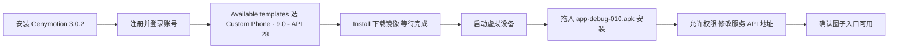

# 升级 Genymotion 到 3.0.2：API 28 镜像与新 apk 的环境统一

进入圈子功能开发前有个环境问题要先解决：新版 apk 装到旧模拟器上，部分页面效果出不来，动态列表这类界面渲染直接掉链子。原因不在代码，在于前端效果依赖更高的 Android API，而现有模拟器镜像还停在 API 23。Android 模拟器 Genymotion 的旧版本又装不了高 API 镜像，所以模拟器本体也要一起升。这一课就是一次统一的环境升级：模拟器升到 3.0.2，镜像统一换 Android 9.0（API 28），再装上新 apk 确认圈子入口能正常浏览。

## 先给结论

- Genymotion 升级到 3.0.2，下载镜像前需要注册并登录 Genymotion 账号。
- 统一选用 `Custom Phone - 9.0 - API 28` 模板（分辨率 768×1280）下载安装，旧的 API 23 镜像不再使用。
- day03 资料包内的 `app-debug-010.apk` 拖进模拟器即完成安装，圈子功能开发统一使用这个包。
- 装完首次启动要逐项允许权限，并把「修改服务 API 地址」指向自己的后台服务，才能在推荐页与圈子入口看到数据。

## 一、为什么非升不可

新版 apk 的界面大量使用了较高 API 才支持的渲染能力，低版本模拟器跑起来要么直接崩溃要么效果残缺。要升 Android API 版本，宿主模拟器 Genymotion 的旧版本又不支持那么新的镜像，于是升级分两层：模拟器软件本身从旧版升到 3.0.2，虚拟设备镜像从 API 23 换到 API 28。两层缺一不可，只换镜像不升模拟器，设备列表里根本看不到 Android 9.0 的模板；只升模拟器不换镜像，跑的还是旧系统。



这张图是环境统一的完整动作序列，每一步都是前置条件：没有账号登录，下载列表刷不出来；没有镜像，设备起不来；没有 apk 与正确的 API 地址，装完也只是个空壳应用。

## 二、下载并安装 API 28 镜像

装好 3.0.2 打开主界面，分两栏：上栏「我的已安装设备」，下栏「可用模板」。可用模板列表就是镜像市场，需要先用 Genymotion 账号登录才能正常拉取。列表里往下找 `Custom Phone - 9.0 - API 28` 这一档，分辨率 768×1280，选中后点右侧的 Install 开始下载安装，镜像有几百兆，耐心等进度条走完。装完后它自动出现在「我的已安装设备」里，与之前的 `Custom Phone - 4.1 - API 16`、API 23 的旧设备并列，但开发统一用新的这台。

选中新设备点 Start，弹出 `Initializing virtual device...` 的初始化对话框，之后进入 Android 主屏幕。第一次启动会比较慢，属于正常现象，虚拟机要把系统镜像解压部署到虚拟磁盘上。

## 三、安装 apk 与首次启动配置

apk 安装最省事的方式是直接把 `app-debug-010.apk` 从资源管理器拖进模拟器窗口，Genymotion 会自动调起安装流程，桌面出现探花交友的图标。拖拽背后走的就是 adb 通道，拖拽失败时可以用命令行替代：

```bash
# 查看模拟器是否被 adb 识别
adb devices
# 等价于拖拽安装，-r 表示覆盖安装保留数据
adb install -r app-debug-010.apk
# 卸载旧版本（包名以工程实际为准）
adb uninstall com.study.tanhua
```

启动应用后先过权限关：访问照片、媒体内容和文件的请求逐个允许，圈子要展示图片、发布要选图，存储权限被拒会让功能残缺。然后和之前一样进入「修改服务 API 地址」，把接口基地址指向自己机器上跑着的后台服务，保存后进推荐页能看到卡片数据，切到圈子入口能正常打开页面，环境统一就算完成。新版 API 下模拟器运行偶尔偏慢，属正常现象，不影响开发联调。

## 四、排错三则

**镜像下载列表为空或下载中断。** 多数是账号未登录或网络波动，登录后重进列表；下载中断直接删掉半成品重新 Install，Genymotion 会重新校验。

**启动卡在 Initializing virtual device。** 先关掉虚拟机进程重启模拟器再试一次；仍不行就删掉该设备重新从模板安装，镜像文件损坏是常见根因。

**拖拽 apk 无反应或安装失败。** 换 adb install 方式看具体报错；若提示签名冲突或已存在旧版本，先 `adb uninstall` 清掉旧包再装。apk 依赖的目标 API 高于模拟器系统时也会拒绝安装，此时确认用的是 API 28 设备而不是旧镜像。

## 常见误区

- **只升级模拟器不换镜像。** 错例：装了 3.0.2 却继续启动 API 23 的旧设备，新 apk 的界面效果依旧异常。正解：模拟器与镜像两层都要到位，统一用 API 28 设备。
- **存储权限拒绝后不处理。** 错例：权限弹窗一路拒绝，圈子页图片加载不出来还以为接口出错。正解：首次启动逐项允许权限，拒绝过就在系统设置里重置后重试。
- **新旧设备混用。** 错例：有时用 API 28 有时用 API 23，联调现象时好时坏难以定位。正解：团队统一一台设备模板，旧设备删除或停用。
- **把模拟器卡顿当成代码问题。** 错例：首启卡顿时反复杀进程重装 apk。正解：首次初始化与高 API 镜像本身偏慢，等首屏加载完成再判断是否真有问题。

## 面试可能被问到的问题

1. 面试官追问：「Genymotion 为什么比 Android 自带的 AVD 快？」
   答：Genymotion 的虚拟设备使用 x86 架构系统镜像，配合 VirtualBox 硬件虚拟化，指令基本直接跑在宿主 CPU 上；AVD 传统 ARM 镜像需要指令翻译，速度差一个量级。Genymotion 又把传感器、GPS、网络等模拟做成了易用的控制面板，工程上适合做功能联调。
2. 面试官追问：「API 23 与 API 28 对业务开发意味着什么？」
   答：API 版本决定系统提供的能力边界。API 26 引入通知渠道，API 28 强化了网络与权限模型，很多新 UI 组件与底层接口在低版本系统上不存在。前端效果依赖高 API 时，模拟器系统版本必须跟上，否则测的不是代码问题而是环境问题。
3. 面试官追问：「拖拽安装 apk 背后发生了什么？」
   答：模拟器监听到拖拽事件后，通过 adb 通道把 apk 推送到设备的临时目录，再调系统的 PackageInstaller 完成解析、校验签名、复制与注册。与 adb install 本质相同，拖拽只是图形化封装，命令行方式能拿到明确的报错信息，排错时更好用。
4. 面试官追问：「测试环境为什么强调统一模拟器版本？」
   答：不同 API 版本的系统行为有差异，权限模型、渲染效果、网络策略都可能不同，环境不统一会让同一个 apk 呈现不同现象，联调时把环境问题误判成代码问题。统一版本后现象可复现，问题定位才有稳定的基准。

## 配套资料

- 原型：`materials/code/07/day01 探花交友-项目搭建以及登录完善个人信息/day01/资料/探花交友移动端原型V1.2/圈子.html`，升级环境后要验证的圈子界面原型。
- 学习目标：`materials/code/07/day02 探花交友-实现首页功能/day02/学习目标.md`，环境类任务的背景与后续开发目标的衔接说明。
- 说明：day03 资料包未解出文件，`genymotion-3.0.2.exe` 与 `app-debug-010.apk` 为课程视频内使用的安装包与调试包，以课程资料为准；adb 命令为按主流写法补充的等价操作示例。
