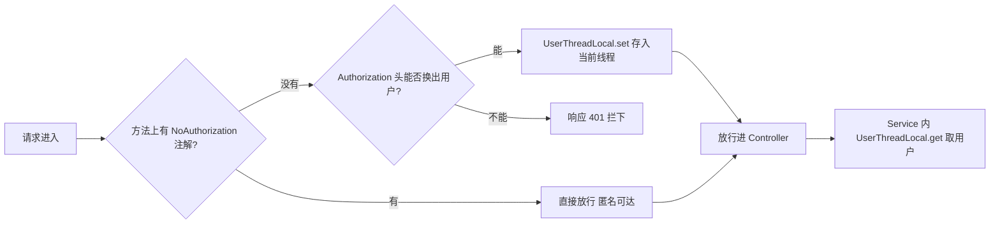

# 统一处理 token：拦截器加 ThreadLocal，业务方法不再人人查 Redis

翻一遍 server 工程的 Service 层会发现一个扎眼的规律：几乎每个方法的第一行都是 `queryUserByToken(token)` 加一句判空返回。登录校验是横切关注点，业务却是各写各的，接口一多这就是成片的模板代码，漏写一处就是一个匿名可调的漏洞。这一课把这个动作收口：写一个 `UserThreadLocal` 工具类和一个 `TokenInterceptor` 拦截器，请求一进来就完成 token 校验并把用户放进当前线程，业务代码此后只管取用；个别不需要登录的接口，用自定义注解 `@NoAuthorization` 自己举手声明。

## 先给结论

- 登录校验从 Service 下沉到拦截器：`preHandle` 里拿 `Authorization` 头换用户，查不到响应 401 并拦下，查到则 `UserThreadLocal.set(user)` 存入当前线程。
- `UserThreadLocal` 是对 `ThreadLocal<User>` 的静态封装，私有构造加静态 `set`/`get`，用户对象随线程走，任何一层都能直接取。
- 匿名接口用 `@Target(ElementType.METHOD)` 的 `@NoAuthorization` 注解标记，拦截器里反射判断方法是否带注解，带则直接放行。
- 拦截器注册顺序有讲究：token 拦截器必须排在缓存拦截器之前，权限不过就没有必要再查缓存。
- 改造后 Controller 不再声明 token 参数，Service 里一行 `UserThreadLocal.get()` 拿用户；被注解放行的接口里取到的用户是 null，业务上绝不能依赖它。

## 重复的登录校验该收口了

看看现状有多重复。发布动态要校验，查询推荐要校验，往后每加一个接口都要在方法开头重复同一段五行的样板：查用户、判空、返回失败。这不是业务逻辑，是每个请求都一样的入场检查，写一百遍也不会有一百个版本，只是把出错的概率放大一百倍。

解决思路顺着两个工具的特性来。拦截器 `HandlerInterceptor` 的 `preHandle` 在 Controller 方法执行之前运行，天然是做入场检查的位置，返回 false 就把请求挡在业务之外。ThreadLocal 则是每个线程自带的私有储物格，同一个线程里任何代码都能存取，线程之间互不可见。两者一拼：拦截器在校验通过后把 `User` 放进 ThreadLocal，业务方法再从 ThreadLocal 取，token 与用户对象就在请求链路上无感传递了，任何一层都不用再传参数。

## UserThreadLocal：线程内的随身口袋

工具类本身很短，放在 server 工程的 utils 包里：

```java
package com.study.tanhua.server.utils;

import com.study.tanhua.server.pojo.User;

public class UserThreadLocal {

    private static final ThreadLocal<User> LOCAL = new ThreadLocal<>();

    private UserThreadLocal() {
    }

    public static void set(User user) {
        LOCAL.set(user);
    }

    public static User get() {
        return LOCAL.get();
    }
}
```

三处写法都有理由。静态常量 `LOCAL` 全局只有一个 ThreadLocal 实例，但每个线程在它内部各有一份独立的值槽，存的 `User` 互不串台。构造方法私有化，堵住外部 new 出多余实例的路。`set` 与 `get` 必须是静态方法，课程现场第一版漏写了 static，调用时还得先有个工具类实例，与「全局工具」的定位自相矛盾，补上 static 才算定稿。使用侧从此变成一行：存是 `UserThreadLocal.set(user)`，取是 `UserThreadLocal.get()`。

## TokenInterceptor：preHandle 里的一次性校验

拦截器放在 interceptor 包，实现 `HandlerInterceptor` 接口，标记为 Spring 组件以便被注入：

```java
package com.study.tanhua.server.interceptor;

import com.study.tanhua.server.pojo.User;
import com.study.tanhua.server.service.UserService;
import com.study.tanhua.server.utils.UserThreadLocal;
import org.springframework.beans.factory.annotation.Autowired;
import org.springframework.stereotype.Component;
import org.springframework.web.servlet.HandlerInterceptor;

import javax.servlet.http.HttpServletRequest;
import javax.servlet.http.HttpServletResponse;

@Component
public class TokenInterceptor implements HandlerInterceptor {

    @Autowired
    private UserService userService;

    @Override
    public boolean preHandle(HttpServletRequest request, HttpServletResponse response,
                             Object handler) throws Exception {
        //请求头里取 token，去 Redis 换用户
        String token = request.getHeader("Authorization");
        User user = this.userService.queryUserByToken(token);
        if (null == user) {
            response.setStatus(401); //无权限
            return false;
        }
        //存储到当前的线程中
        UserThreadLocal.set(user);
        return true;
    }
}
```

逻辑与原来每个 Service 里的那五行使完全一致，只是位置换了：token 从请求头取，`queryUserByToken` 拿它拼 key 去 Redis 查，查到续期并反序列化。区别在于失败的处理：原来各方法自己返回 false 表示业务失败，现在拦截器直接 `response.setStatus(401)`，语义是「未认证」而非「业务出错」，客户端拿到 401 就知道该去重新登录，这个状态码的区分值后面测试时还会看到。校验通过则 `UserThreadLocal.set(user)` 把用户挂到当前线程，然后 `return true` 放行。

## @NoAuthorization：匿名接口自己举手

一刀切拦下所有请求会误伤确实不需要登录的接口，比如某些公开的配置读取。解决的办法是自定义注解，需要匿名的接口在方法上贴一个标记：

```java
package com.study.tanhua.server.utils;

import java.lang.annotation.*;

@Target(ElementType.METHOD)
@Retention(RetentionPolicy.RUNTIME)
@Documented
public @interface NoAuthorization {
}
```

三个元注解各管一件事：`@Target(ElementType.METHOD)` 限定只能贴在方法上，权限控制做到方法级粒度；`@Retention(RetentionPolicy.RUNTIME)` 保证运行期通过反射能读到它，这是拦截器判断的前提，缺了这条注解在运行期就是隐形的；`@Documented` 只是把注解带进 javadoc，属于标记性质的收尾。拦截器据此在鉴权之前加一段前置判断：

```java
//判断请求的方法上是否包含 @NoAuthorization 注解，包含则不需要做校验
if (handler instanceof HandlerMethod) {
    HandlerMethod handlerMethod = (HandlerMethod) handler;
    NoAuthorization noAuthorization =
            handlerMethod.getMethodAnnotation(NoAuthorization.class);
    if (null != noAuthorization) {
        return true;
    }
}
```

这里有个必须转手的类型判断：`preHandle` 拿到的 `handler` 声明类型是 `Object`，直接取方法注解无从下手，先 `instanceof HandlerMethod` 确认它是被适配成方法级处理器的实例，再强转后 `getMethodAnnotation` 读注解。读到注解就 `return true` 放行，不读 token 也不存用户；读不到才走上一节的正常鉴权。静态资源这类非方法级请求在 instanceof 处自然被滤掉，进正常校验分支，由 Redis 查不到而 401，不会出现空指针。

## 注册拦截器：顺序即语义

拦截器写完还要向 MVC 框架注册才会生效。day02 的统一缓存拦截器已经在 `WebConfig` 里注册过，现在把 token 拦截器加进去，注意加入的先后：

```java
package com.study.tanhua.server.config;

import com.study.tanhua.server.interceptor.RedisCacheInterceptor;
import com.study.tanhua.server.interceptor.TokenInterceptor;
import org.springframework.beans.factory.annotation.Autowired;
import org.springframework.context.annotation.Configuration;
import org.springframework.web.servlet.config.annotation.InterceptorRegistry;
import org.springframework.web.servlet.config.annotation.WebMvcConfigurationSupport;

@Configuration
public class WebConfig extends WebMvcConfigurationSupport {

    @Autowired
    private TokenInterceptor tokenInterceptor;

    @Autowired
    private RedisCacheInterceptor redisCacheInterceptor;

    @Override
    public void addInterceptors(InterceptorRegistry registry) {
        //token 拦截器在前，先鉴权再谈缓存
        registry.addInterceptor(this.tokenInterceptor).addPathPatterns("/**");
        registry.addInterceptor(this.redisCacheInterceptor).addPathPatterns("/**");
    }
}
```

顺序不是随意排的。按注册先后，请求依次穿过各拦截器的 `preHandle`，token 拦截器在前意味着权限校验先执行：校验不过直接 401，缓存拦截器根本不会运行，未登录者连 Redis 里的缓存都摸不到。反过来把缓存放前面，一个伪造 token 的请求若恰好命中缓存键，就能白拿别人的响应，既是安全问题也是资源浪费。拦截器链的注册顺序就是执行顺序，写的时候把「安全检查永远先于性能优化」这条直觉落在代码行的先后上。

## 改造旧代码并验证

注册完拦截器，回头清理旧代码。Controller 里 `@RequestHeader("Authorization") String token` 整个删掉，方法签名瘦身为五个业务参数；Service 里的 `queryUserByToken` 与判空返回也删掉，第一行换成从线程里取用户：

```java
public Boolean saveMovements(String textContent, String location, String longitude,
                             String latitude, MultipartFile[] multipartFile) {
    //登录用户已由拦截器放入当前线程，这里直接取用
    User user = UserThreadLocal.get();
    Publish publish = new Publish();
    publish.setUserId(user.getId());
    publish.setText(textContent);
    publish.setLocationName(location);
    publish.setLongitude(longitude);
    publish.setLatitude(latitude);
    //图片上传与 dubbo 调用逻辑不变
    List<String> imageUrls = new ArrayList<>();
    for (MultipartFile file : multipartFile) {
        PicUploadResult uploadResult = this.picUploadService.upload(file);
        imageUrls.add(uploadResult.getName());
    }
    publish.setMedias(imageUrls);
    return this.quanziApi.savePublish(publish);
}
```

此前所有带 token 参数的接口都按同样方式改造：查询推荐用户列表的那组 Controller 与 Service 一并瘦身，`UserThreadLocal.get()` 取代了参数与查库。只要请求能走进业务方法，用户必然非空，因为放行到这一步的请求都过了拦截器那一关，判空从此是多余的。

验证分三个场景走。带 token 且带图片的请求，断点先停在拦截器：注解判断不命中，token 换出用户，set 进线程，放行；进 Controller 再进 Service，断点里能看到 `UserThreadLocal.get()` 取出的正是拦截器里那个 user 对象，发布流程与改造前一致。无 token 的请求在拦截器就被 401 拦下，业务代码一行不执行。第三种场景测注解：给发布方法临时贴上 `@NoAuthorization` 重启再发，请求穿过拦截器直接进 Service，`UserThreadLocal.get()` 返回 null，下一行 `user.getId()` 抛出空指针，响应 500。这个「预期内的报错」恰恰证明注解生效：被标记的接口绕过了登录校验，而它们自己的业务如果依赖登录用户就会当场翻车，匿名接口的业务代码必须自证不读 ThreadLocal。

还有一个测试环境的小坑要提前绕开：统一缓存拦截器还在岗，同样的请求第二次发出时会在缓存层直接命中，从 Redis 回写响应，Controller 的断点纹丝不动，容易误判成拦截器失效。联调业务功能时把 `tanhua.cache.enable` 设为 false，缓存拦截器第一步就放行，测完再设回 true，一套代码两种行为。



读图的分叉点在最左侧的注解判断，它决定了后面整条鉴权链是否执行；所有进入业务的路径，线程里都已经备好了用户，除注解放行那条，业务侧对 ThreadLocal 的依赖必须以「可能为空」为前提。

## 常见误区

- **把注解贴在类上。** 错例：`@NoAuthorization` 标在 Controller 类头指望整个类免鉴权，`@Target(ElementType.METHOD)` 会在编译期直接报错。正解：注解只认方法，整类放行就在每个方法上标注，或另定义类级注解并在拦截器里补充判断。
- **拦截器注册顺序颠倒。** 错例：缓存拦截器在前，缓存命中直接回写，token 校验形同虚设，无效请求也能吃到缓存。正解：token 拦截器先注册，鉴权通过才有资格谈缓存。
- **匿名接口里读 ThreadLocal。** 错例：被 `@NoAuthorization` 放行的方法里照旧 `UserThreadLocal.get().getId()`，Tomcat 线程复用下可能取到上一位用户的残留数据，也可能取到 null 抛空指针。正解：匿名接口的业务不得依赖登录态，确需用户信息就让客户端显式传参。
- **401 与 500 混用。** 错例：token 失效也返回 500，前端分不清该重登录还是该报错。正解：认证失败固定 401，业务异常才是 500，状态码是接口双方共享的语义。
- **在异步逻辑里取用户。** 错例：Service 里另开线程做耗时任务，线程内 `UserThreadLocal.get()` 为 null。正解：ThreadLocal 值跟着线程走，开新线程前先在当前线程取出用户，作为参数显式传过去。

## 面试可能被问到的问题

1. 面试官追问：「ThreadLocal 为什么能做到线程之间互不干扰？」
   答：每个 Thread 对象内部持有一个 ThreadLocalMap，以 ThreadLocal 实例为键、值为业务对象。set 与 get 都以当前线程为入口操作各自的 map，同一个 ThreadLocal 在不同线程读出的是各自的值。它的隔离来自数据结构的归属：map 长在线程身上，而不是 ThreadLocal 身上。
2. 面试官追问：「Tomcat 线程池会复用线程，ThreadLocal 会不会串数据？」
   答：会，这正是要警惕的点。线程归还线程池后值槽不清空，下一个请求若不在入口覆盖 set，就能读到上一个请求的值。稳妥做法是拦截器在 afterCompletion 里调用 remove，或者像本课结构一样保证每个请求入口都无条件覆盖写入，匿名路径不读该值。内存层面，key 是弱引用、value 是强引用，不 remove 还可能造成 value 无法回收的泄漏。
3. 面试官追问：「为什么用拦截器做统一校验，而不是 Filter 或 AOP？」
   答：Filter 在 Servlet 层面工作，拿不到 HandlerMethod，判断方法注解要绕路；AOP 切 Controller 也能做，但 springmvc 的拦截器与执行链集成更顺，preHandle 的返回值天然控制放行与否，还能按 order 编排多个拦截器。本质三点都能实现，拦截器是 springmvc 场景下表达力与成本的平衡点。
4. 面试官追问：「白名单用注解标记和用配置文件列路径，各适合什么场景？」
   答：注解标记跟着代码走，方法挪包改路径都无需同步配置，适合数量少、与业务强绑定的例外；配置文件集中可见，运维不改代码就能调整，适合公开资源、健康检查这类与代码无关的路径。两者可以并存，注解解决「这个接口本身匿名」，配置解决「这类路径放行」。
5. 面试官追问：「token 校验放在拦截器里查 Redis，每个请求都查一次，要不要优化？」
   答：先算账：Redis 单次读在毫秒级以内，相比业务里的数据库与远程调用不算瓶颈。真要优化可以上本地缓存放 JWT 解析结果（配合 JWT 自校验特性就不用查存储），或对高频只读接口在网关层做鉴权结果缓存。优化的前提是量出瓶颈在哪，本课的阶段校验正确性优先于极致性能。

## 配套资料

- 代码：`materials/code/07/day03 探花交友-实现圈子功能/`，day03 资料包未解出工程源码（目录内仅存提取清单），`UserThreadLocal`、`TokenInterceptor`、`@NoAuthorization` 与 `WebConfig` 均按课程画面逐段整理，包名统一为 `com.study.tanhua` 系。
- 代码：`materials/code/07/day01 探花交友-项目搭建以及登录完善个人信息/`，`queryUserByToken` 的 Redis 查询与续期实现源自 day01 的登录与检查登录状态两课，测试账号与验证码口径同前。
- 代码：`materials/code/07/day02 探花交友-实现首页功能/`，统一缓存拦截器与 `tanhua.cache.enable` 开关出自 day02 的统一增加缓存逻辑三讲，本课的注册顺序建立在它之上。
