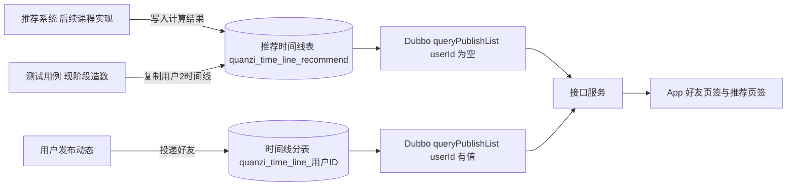

# 推荐动态的 Dubbo 服务：让 userId 的空与不空决定查哪张时间线表

圈子页有两个页签：好友动态与推荐动态。好友动态查的是自己的时间线分表，推荐动态的数据则来自推荐系统，而推荐系统要等到后续课程才真正实现。读取侧等不起，本课的做法是把两条读取路径收敛进同一个 Dubbo 方法：userId 有值查好友时间线分表，userId 为空查推荐时间线表。再把一批测试数据手工灌进推荐表，充当推荐结果，App 端的推荐页签从此有了数据来源，后续推荐系统落地时只需替换写入方。

## 先给结论

- 推荐动态与好友动态的数据结构完全同构，差异只在数据来源：好友动态在 `quanzi_time_line_<userId>`，推荐动态在 `quanzi_time_line_recommend`。
- Dubbo 方法 `queryPublishList(Long userId, Integer page, Integer pageSize)` 的 userId 参数用包装类型 Long，为 null 才能表达「推荐查询」这个语义，两条路径共用一套分页与批量查询代码。
- 推荐系统尚未实现，测试数据由测试用例构造：复用 `queryPublishList(2L, 1, 10)` 取出用户 2 时间线里的动态，逐条转换后写入推荐表。
- 测试用例同时持有 `@Reference` 的 Dubbo 代理与注入的 `MongoTemplate`，既走 RPC 拿数据，又直写集合造数。
- 推荐表造数完成、Dubbo 服务重启注册后，读取侧就位，下一课在接口服务层接出 `/movements/recommend` 即可联调。

## 一、推荐动态为什么落成一张时间线表

先把两条读取路径摊开对比。好友动态的读取靠写扩散：发布时把动态指针投进每个好友的时间线分表，读取时只查自己那张小表。推荐动态没有「好友投递」这个动作，它的数据来自推荐系统的计算结果，但读取侧面对的问题一模一样：拿到一批动态 ID，按发布时间倒序分页取出正文。数据来源不同，数据形态却可以完全相同，于是设计上直接复用时间线结构：userId、publishId、date 三个字段，一个 userId 对应一批动态指针。



读图的要点在左侧两个写入方：现阶段推荐表的数据由测试用例灌入，推荐系统落地后由它接管写入，读取侧代码不变。这也厘清了两条推荐链路的关系：day2 建好的推荐用户池解决的是「推荐谁」，属于人的推荐；本课的推荐时间线表解决的是「推荐哪些动态」，属于内容的推荐，两者各自独立成表。至于更完整的推荐动态方案，比如按推荐用户池圈定动态来源、再剔除用户已看过的内容，属于读取逻辑的后续演进，当前先把「推荐表可查、App 可见」这条最短链路打通。

## 二、改造 Dubbo 服务：集合名变成唯一变量

接口契约不动，仍是 `PageInfo<Publish> queryPublishList(Long userId, Integer page, Integer pageSize)`，实现里加一个分支：

```java
@Override
public PageInfo<Publish> queryPublishList(Long userId, Integer page, Integer pageSize) {
    String tableName = "quanzi_time_line_recommend";
    if (null != userId) {
        // 查询好友动态，按用户分表
        tableName = "quanzi_time_line_" + userId;
    }
    Pageable pageable = PageRequest.of(page - 1, pageSize, Sort.by(Sort.Order.desc("date")));
    Query query = new Query().with(pageable);
    List<Timeline> timelines = this.mongoTemplate.find(query, Timeline.class, tableName);
    List<ObjectId> publishIds = new ArrayList<>();
    for (Timeline timeline : timelines) {
        publishIds.add(timeline.getPublishId());
    }
    Query queryPublish = Query.query(Criteria.where("id").in(publishIds))
            .with(Sort.by(Sort.Order.desc("created")));
    List<Publish> publishList = this.mongoTemplate.find(queryPublish, Publish.class);
    PageInfo<Publish> pageInfo = new PageInfo<>();
    pageInfo.setPageNum(page);
    pageInfo.setPageSize(pageSize);
    pageInfo.setTotal(timelines.size());
    pageInfo.setRecords(publishList);
    return pageInfo;
}
```

变化集中在方法开头：集合名不再是写死的 `quanzi_time_line_ + userId`，而是一个变量，userId 为空时取推荐表，有值时按用户分表。后面的分页查询、ID 收集、批量取正文、组装 PageInfo，两条路径一字不差地共用。查询推荐动态的所有用户看到的都是同一批数据，推荐表天然是全局一张，不需要分表；好友时间线按用户隔离，集合名必须带上 userId，这个差异被压缩进一行字符串拼接，是同构设计换来的最大红利。

参数类型上有一个容易忽略的细节：userId 必须声明为包装类型 Long 而不是基本类型 long。long 无法赋值 null，调用方就失去了「不指定用户」的表达能力；接口方法一旦发布，改参数类型对消费方是破坏性变更，这一行签名要在第一天就定对。改造完成后重启 Dubbo 服务，服务重新注册到 ZooKeeper，provider 侧就绪。

## 三、测试用例充当推荐系统

推荐系统还没影，推荐表先要有数据。测试类里已经通过 `@Reference` 持有 QuanziApi 代理，再注入 `MongoTemplate`，就能写出这段造数逻辑：

```java
@Test
public void testRecommendPublish() {
    // 宣告用户 id 为 2 的动态作为推荐动态的数据
    PageInfo<Publish> pageInfo = this.quanziApi.queryPublishList(2L, 1, 10);
    for (Publish record : pageInfo.getRecords()) {
        Timeline timeline = new Timeline();
        timeline.setId(ObjectId.get());
        timeline.setPublishId(record.getId());
        timeline.setUserId(record.getUserId());
        timeline.setDate(System.currentTimeMillis());
        this.mongoTemplate.save(timeline, "quanzi_time_line_recommend");
    }
}
```

这段代码的思路值得拆开看。查询用的是 `queryPublishList(2L, 1, 10)`，传的是用户 2：按好友动态的路径查 `quanzi_time_line_2`，里面装的是好友用户 1 发布的全部动态指针，于是拿到了 7 条发布正文。循环体里逐条构建 Timeline 对象：新 ID 现场生成，publishId 指向发布表正文的主键 `record.getId()`，userId 保留发布者 ID（推荐页要展示是谁发的），时间取当前时间戳，最后写入推荐表。跑完用例，用图形化客户端检查 MongoDB，`quanzi_time_line_recommend` 集合出现，7 条指针整整齐齐：

```bash
db.getCollection("quanzi_time_line_recommend").find({})
```

这 7 条数据在业务上的含义是「系统把用户 1 的动态推荐给了所有用户」。数据是真的，推荐理由是假的，真实推荐系统上线后会按兴趣与热度计算这批 ID，但写入的表、写入的结构都不会变，这正是先把接口约定立起来、让生产方可以平滑替换的典型做法。

造数用例有一条纪律要守：它是可重复执行的，多跑一遍推荐表就翻倍成 14 条，App 端立刻出现重复卡片。测试数据脏了就把集合 drop 掉重新跑，与好友关系造数时的处理方式一致，比逐条挑着删可靠。

## 常见误区

- **userId 参数用基本类型 long。** 错例：`queryPublishList(long userId, ...)`，无法传 null 表达推荐查询，只能再开一个方法或加魔法值。正解：接口签名用 Long，空与不空是两条业务路径的开关。
- **推荐表集合名拼写漂移。** 错例：拼成 `quanzi_time_line_recommended` 或漏掉前缀下划线，造数写进一个集合、查询又指向另一个，App 推荐页永远空白且无任何报错。正解：集合名与好友时间线共用同一段拼接纪律，命名规则只在代码里出现一处。
- **publishId 指针指错。** 错例：把 Timeline 自身的 id 或其他无关字段赋给 publishId，推荐页能出卡片但正文拉取失败。正解：publishId 必须指向发布表 `quanzi_publish` 的主键，即 `record.getId()`。
- **测试用例重复执行导致数据翻倍。** 错例：跑了两遍用例，推荐页出现重复动态。正解：造数前 drop 集合，或者给用例加幂等清理逻辑，保持测试数据可重建。

## 面试可能被问到的问题

1. 面试官追问：「推荐动态和好友动态为什么共用一个 Dubbo 方法，而不是拆成两个接口？」
   答：两条路径的数据结构与查询逻辑完全一致，唯一差异是集合名，共用方法让接口收敛、消费方代码简单；拆开反而制造重复。当推荐侧演化出复杂逻辑，比如剔除已看、多路召回混排，再拆独立方法，接口演进跟随业务复杂度，而不是提前抽象。
2. 面试官追问：「接口参数为什么强调用包装类型 Long？」
   答：包装类型多了 null 这个状态，null 在这里是有业务含义的，代表不限定用户的推荐查询。基本类型只能携带数值，表达不了缺省语义，硬要表达只能约定魔法值，可读性和安全性都差；另外对包装类型做数值比较时要用 longValue 拆箱后比较或 equals，避免 Integer 缓存区间外的 == 陷阱。
3. 面试官追问：「推荐系统还没实现，为什么就先写查询接口和造数据？」
   答：这是消费者驱动的设计：先把读取侧的表结构、接口契约与 App 展示打通，用假数据验证整条链路，推荐系统只需要遵守「往推荐表写 Timeline 结构数据」这一个约定即可接入。写入方与读取方解耦，两边可以独立开发与替换，联调风险被拆到最小。
4. 面试官追问：「推荐表的全局查询在数据量大后会有什么问题？」
   答：所有用户共享一张推荐表，高频翻页会重复扫描同一批数据，热门内容也会被所有人反复命中。改进方向有分页游标化、按用户维度缓存推荐结果、给 date 字段建索引加速倒序分页；数据规模再大就把推荐结果按用户分表或落到缓存里，推荐表退化为批量导入的中间产物。
5. 面试官追问：「分页总数取 timelines.size() 有什么局限？」
   答：它只统计当前页查回的条数，不是集合的真实总数，前端的总条数与总页数展示会失真。精确总数要另发一次 countDocuments，多一次查询；列表类接口常在两者间折中，要么不展示总数只做上拉加载，要么允许总数近似，本项目的 PageResult 暂以 0 填充，也是同一个取舍。

## 配套资料

- 原型：`materials/code/07/day01 探花交友-项目搭建以及登录完善个人信息/day01/资料/探花交友移动端原型V1.2/圈子.html`，推荐页签的交互原型，本课打通的数据即该页签的来源。
- 数据库：`materials/code/07/day01 探花交友-项目搭建以及登录完善个人信息/day01/代码/mytanhua.sql`，用户表种子数据，测试账号体系与其对齐。
- 说明：day03 资料包未解出工程源码，Dubbo 接口改造与测试用例代码按课程画面逐段整理，包名与引用按规范改写为 `com.study.tanhua` 系；`quanzi_time_line_recommend` 集合名与造数逻辑以课程画面为准；Robo 3T 为课程使用的 MongoDB 图形化客户端。
