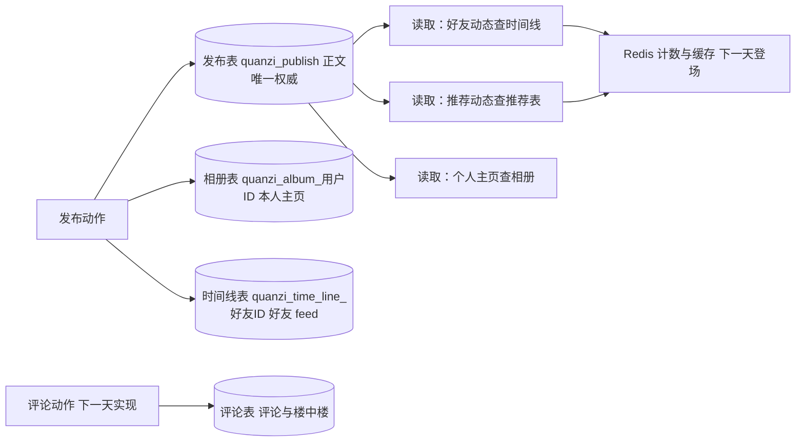
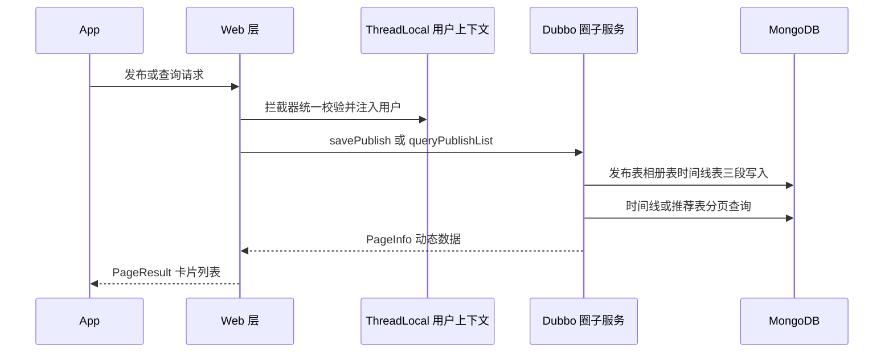

# day03 复盘：四张表撑起圈子，从发布到两种读取的全链路收官

day03 的原计划里还有评论功能，实际代码量远超预估，评论顺延到下一天，留出的时间刚好把圈子主线打磨完整：实现方案分析、表结构设计、发布动态、查询好友动态、查询推荐动态，外加一次统一 token 的收口。复盘这一天，最有价值的不是某段代码，而是那条被反复验证的设计决策：读路径决定存储结构，写的时候多做的每一分功夫，都是在给读的时候还债。

## 先给结论

- 圈子的实现方案核心是四张表：发布表存正文，相册表管自己的主页，时间线表管好友的 feed，评论表预留结构待下一天实现，全部落在 MongoDB。
- 技术选型的分工是 MongoDB 负责主存储，Redis 负责缓存；评论功能落地时 Redis 才正式登场，点赞数与评论数这两处 TODO 届时填实。
- 好友动态查询的本质是查自己的时间线分表：发布时写扩散已经把指针投进每个好友的表，读取永远只碰一张小集合。
- 推荐动态与好友动态共用同一套查询逻辑，数据来源不同：推荐时间线表等推荐系统写入结果，现阶段由测试数据占位。
- 统一 token 处理让登录用户从 ThreadLocal 一取即得，各业务接口不再重复编写解析与校验代码。

## 一、方案先行：四张表与两种存储的分工

把 day03 的顺序倒过来看会更清楚：不是先写代码再找理由，而是方案分析在前、表结构设计在后，代码只是方案的忠实翻译。方案分析的三个判断决定了后面的一切：动态数据量大且持续增长，适合文档型存储；圈子是典型的读多写少场景，存储结构要为读取服务；非好友看不到内容，可见性控制要落在数据模型上。由此得出 MongoDB 加 Redis 的组合：MongoDB 承担全部主数据，Redis 在需要高频读写的计数与缓存场景补位。

四张表各司其职，职责边界值得再确认一遍：



读图的抓手是三条读取路径全部指向发布表的正文，但入口各不相同：好友动态走时间线指针，推荐动态走推荐表指针，个人主页走相册指针。发布表只存一份正文，其他表全是轻量指针，这个「正文一份、指针多处」的结构让存储不冗余、读取不扫全表。表结构设计这一讲产出的文档可以直接移植到任何类似的社交 feed 项目，字段口径如 `seeType` 的可见性枚举、时间字段统一存时间戳，都是通用的工程约定。day03 实际落进 MongoDB 的集合收拢成一份清单，排查数据问题时按名字对号入座：

```bash
quanzi_publish                 # 发布表，动态正文唯一权威，全局一份
quanzi_album_<userId>          # 相册表，本人动态指针，服务个人主页
quanzi_time_line_<friendId>    # 时间线表，好友投递指针，服务好友 feed
quanzi_time_line_recommend     # 推荐时间线表，推荐动态数据来源，全局一份
tanhua_users                   # 好友关系集合，投递时间线时按它圈定收件人
```

## 二、全链路复盘：一次发布，两种读取

实现环节按链路串起来看。发布动态走三次落库加一轮投递：正文进发布表，指针进相册表，再查好友列表逐个投进时间线分表，集合名按用户动态拼接是分表设计落地的关键一行；投递语义是写对方的表，集合名取好友 ID，这个现场写错过一次的细节是理解写扩散方向的最佳注脚。异常兜底用 try-catch 包住三段写入，完整事务因为单机环境与分表跨度的现实约束留作演进，失败补偿的思路记进了工程笔记。

读取侧两条路。好友动态：接口服务从 ThreadLocal 取登录用户，Dubbo 服务按用户分表查时间线，按日期倒序分页，收集 publishId 批量捞正文，再回 MySQL 批量补昵称头像标签，App 的好友页签就亮了。推荐动态：同一套查询逻辑，userId 为空即查推荐时间线表，数据由测试用例从用户 2 的时间线复制而来；等推荐系统落地，它只须遵守「往推荐表写 Timeline 结构数据」的约定即可接入，读取侧一行不改。

统一 token 是本日容易被低估的产出。此前的接口各自解析请求头、各自校验登录态，代码散落在每个 Controller 与 Service 里；收口之后，拦截器统一校验并把用户对象放进 ThreadLocal，业务代码一取即得。全链路可以收拢成一张总图：



图的骨架就是「一个入口、两种查询、三段写入」。测试环节的价值也在复盘之列：REST 客户端断点逐层验证执行路径，App 端用第二个账号做真实视角验收，中途经历 token 超时、断点致超时、注解挂错方法的三次现场排查，环境问题与代码问题在证据链上被逐一分开。

## 三、留到明天的与留到更后的

评论功能顺延到下一天，这不是计划失败而是节奏管理：发布的三段写入与两条读取链路已经足够填满一天，硬塞进评论只会两头都讲不透。评论落地时配套的还有 Redis 的正式登场，评论数、点赞数、喜欢数这些本日先填假值并留 TODO 的字段，届时由计数能力填实，结构在实体上早已就位。下一天的资料范围还覆盖小视频功能，圈子的交互闭环之后就是内容形态的扩展。

更远的两处伏笔值得记下。其一是内容审核：动态发布后通常还要过一道内容安全审核，合规图文才真正可见，这类旁路处理一般用 RocketMQ 之类的消息队列异步衔接，发布链路只管落库与投递，审核结果通过回调改变动态的可见状态，本阶段先把主链路跑通。其二是推荐系统：推荐表的结构与接口约定已立，后续课程用推荐算法算出结果写入同一张表，App 的推荐页签自动从占位数据切换为真实推荐，消费方驱动的接口设计在这一天完成了一次完整示范。

## 常见误区

- **把复盘做成代码清单。** 错例：总结时只罗列写了哪些类、调了哪些方法。正解：复盘的对象是设计决策与验证证据，四张表的职责、写扩散的取舍、假阳性的教训，才是能迁移到下个项目的资产。
- **TODO 假值上线前不清理。** 错例：点赞数 100、评论数 30 这类占位值随代码一路带到生产。正解：TODO 标记集中登记，评论功能落地时逐项填实，发布前全局搜索 TODO 复核。
- **测试数据当生产数据用。** 错例：推荐表里复制来的 7 条动态被当作真实推荐效果向业务方演示。正解：造数数据明确标注来源与有效期，推荐系统接入前不做效果类结论。
- **统一 token 之后仍在业务代码里解析请求头。** 错例：新写的接口又从 request 里手动取 token 解析。正解：登录态一律走 ThreadLocal 上下文，解析与校验只存在于拦截器一处。

## 面试可能被问到的问题

1. 面试官追问：「用四张表实现一个朋友圈，各自的职责和读写路径是什么？」
   答：发布表是正文唯一权威，全量一份；相册表按用户分表存本人动态指针，服务个人主页；时间线表按好友分表存投递指针，服务好友 feed；评论表挂发布 ID 存评论与楼中楼。读路径三条互不干扰，各查各的指针表再回发布表取正文；写路径一次发布多次落库，用写扩散把读取代价前置。
2. 面试官追问：「为什么动态类数据选 MongoDB 而不是 MySQL？」
   答：动态数据量大且字段形态灵活，媒体列表、位置、可见性这类结构用文档模型表达自然；读多写少且按用户维度访问的模式与分表设计契合，天然分散热点；时间线用 ObjectId 与时间戳组织，倒序分页高效。MySQL 在体系里继续承担用户资料等强关系数据，两者分工而不是替代。
3. 面试官追问：「写扩散和读扩散怎么选？」
   答：写扩散在发布时投递到每个好友的时间线，读取只查自己的表，读路径极简，代价是发布变重且大 V 发布成本失控；读扩散发布只写一份，读取时按好友列表聚合多路查询，写轻读重。熟人社交好友数有限、读远多于写，写扩散合适；粉丝体量悬殊的场景用推拉结合，普通用户推、大 V 拉读时合并。
4. 面试官追问：「统一 token 处理解决了什么问题，怎么实现的？」
   答：解决的是登录态解析代码在每个接口里重复出现的问题。实现是拦截器统一校验 token，合法后把用户对象写入 ThreadLocal，业务代码通过工具方法直接获取；请求结束时清理 ThreadLocal 防止线程池串号。收益是解析与校验收口一处、业务代码干净、新增接口零成本获得登录态。
5. 面试官追问：「推荐系统还没做，推荐动态功能怎么先上线的？」
   答：消费者驱动的契约设计：先定推荐表结构与查询接口，用测试数据占位跑通 App 展示与联调，推荐系统作为写入方后期接入，只需遵守写入约定。这样读取侧的表设计、分页、封装与页面验收先得到验证，推荐算法的迭代不会冲击接口契约，两边完全解耦。

## 配套资料

- 原型：`materials/code/07/day01 探花交友-项目搭建以及登录完善个人信息/day01/资料/探花交友移动端原型V1.2/圈子.html`，圈子全功能的交互原型，发布、好友动态、推荐动态及点赞评论入口均出自这里。
- 数据库：`materials/code/07/day01 探花交友-项目搭建以及登录完善个人信息/day01/代码/mytanhua.sql`，用户与用户信息表结构，动态封装阶段批量补齐昵称头像的数据来源。
- 说明：day03 资料包未解出工程源码与讲义文件，方案与代码均按课程画面与讲解过程复盘整理，包名与引用按规范改写为 `com.study.tanhua` 系；评论功能与推荐系统的落地安排以课程后续日程为准。
