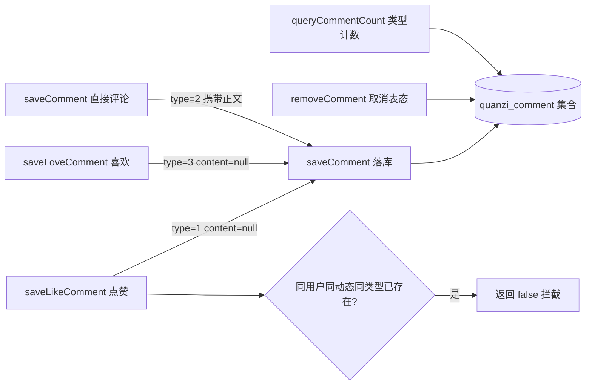
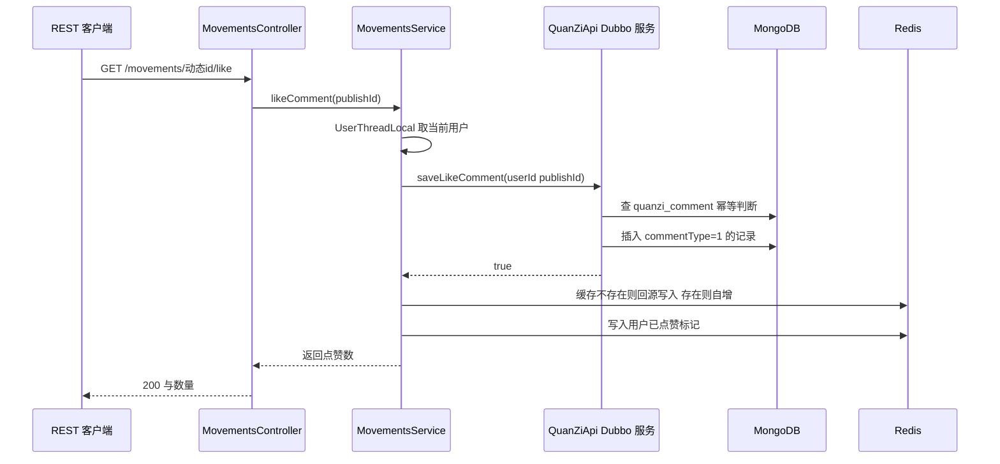
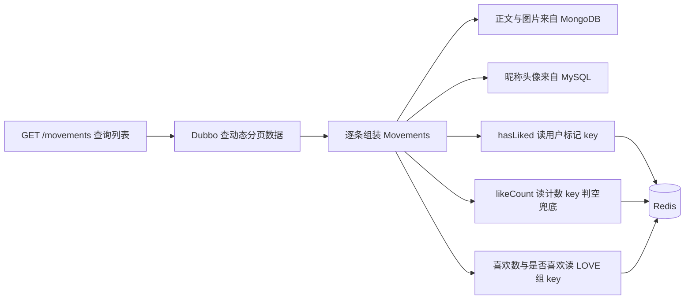
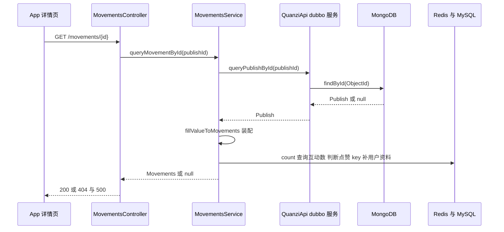
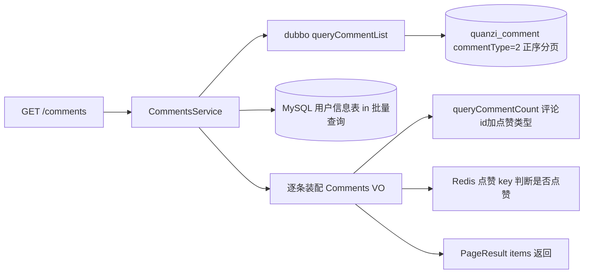
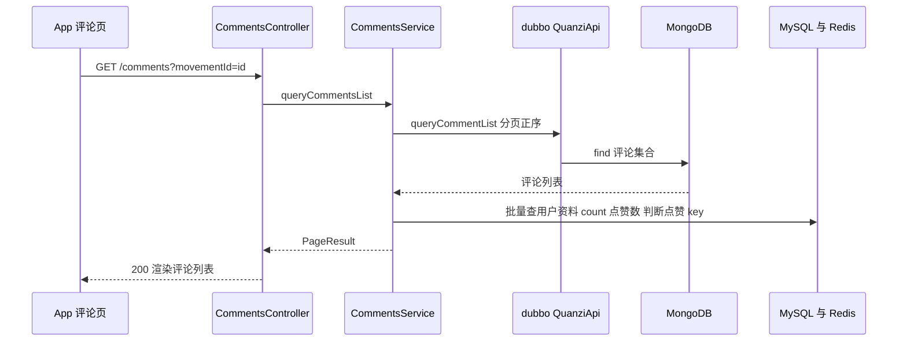
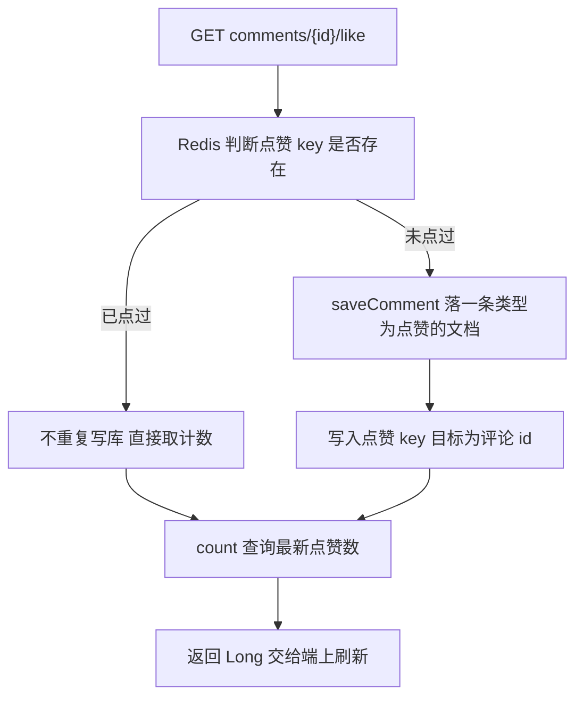

# 圈子动态信息互动实现：点赞、喜欢与评论共用一张评论表

## 先给结论

- 点赞、喜欢、评论统一理解为「用户对动态的一次表态」，三种表态共用 `quanzi_comment` 集合，`commentType` 1 是点赞、2 是评论、3 是喜欢。
- Dubbo 层 `QuanZiApi` 承载数据能力：保存表态、取消表态、按类型计数、按 id 查发布、分页查评论都在这里；幂等靠先查后写，取消以真实删除条数定成败。
- HTTP 层契约清晰：`GET /movements/{id}/like` 与 dislike 的响应体直接带操作后的数量，`POST /comments` 收 JSON 请求体，`GET /comments` 分页查评论；成败多靠状态码表达。
- Redis 用双 key 承接互动：动态维度的计数 key 存总数，用户维度的标记 key 存「我点过」；列表点赞数据全读 Redis，一条动态两次 O(1) 读取，key 取值要判空兜底 0。
- 缓存分支的纪律：key 不存在先回源查真实数量再写入，已存在才自增；讲义把两个分支写反过，课堂实现现场翻回来。
- 详情与列表的装配集中在抽出的 `fillValueToMovements`：点赞数、评论数、是否点赞、是否喜欢一次补齐，单条与列表共用同一套装配。
- 评论分页按 created 正序，`PageRequest` 一行同时解决分页与排序，页码从 1 基转 0 基；评论点赞完全复用动态点赞的 Service 实现，只换一条路径。
- 测试节奏三步：REST 客户端打空态、MongoDB 客户端找真实 id 打有数据态、模拟器端上联动验收；现场 bug 多半出在复制改造时的变量管理。

## 第1部分：一张评论表承接三种表态：动态点赞的 Dubbo 服务设计与实现

App 上一个点赞按钮，看似只是发一条请求的事，落到服务层要回答三个问题：表态记录存在哪，重复点赞怎么拦，取消表态怎么判成败。day03 已经把动态主体存进了 `quanzi_publish`，这一天先从 Dubbo 服务层动工，把点赞、喜欢、评论共用的地基打出来，接口服务与 App 的接入留到后面的环节。

### 广义评论：把三种操作看成一件事

评论功能容易看成三个孤立功能，实现前先做一个模型上的合并：点赞是没有文字的评论，喜欢是没有文字的表态，评论是携带观点的表态，三者都是用户对一条动态发出的动作。既然主体相同、对象相同，存储就不必分家，一张表加一个类型字段即可。这样合并的收益立刻可见：计数只有一个入口，去重只有一套条件，取消只有一条删除语句，后续 Redis 缓存的 key 体系也因此整齐。

类型字段的取值约定为 `commentType`：1 对应点赞，2 对应评论，3 对应喜欢。取消操作不必再拆成取消点赞、取消喜欢两个方法，把类型作为参数传进来就能复用同一条删除逻辑，这是接口设计里以参数代替方法的典型手法。

### QuanZiApi 的五个新方法

`QuanZiApi` 在 day03 的保存动态与查询动态之外，追加五个与表态相关的方法，定义如下。

```java
package com.study.tanhua.dubbo.server.api;

import com.study.tanhua.dubbo.server.pojo.Publish;
import com.study.tanhua.dubbo.server.vo.PageInfo;

public interface QuanZiApi {

    // day03 已实现：保存动态、查询动态列表
    boolean savePublish(Publish publish);
    PageInfo<Publish> queryPublishList(Long userId, Integer page, Integer pageSize);

    /** 点赞：哪个用户给哪条动态点赞 */
    boolean saveLikeComment(Long userId, String publishId);

    /** 取消点赞、取消喜欢，按 commentType 区分 */
    boolean removeComment(Long userId, String publishId, Integer commentType);

    /** 喜欢：哪个用户喜欢哪条动态 */
    boolean saveLoveComment(Long userId, String publishId);

    /** 保存评论：type 为表态类型，content 为评论正文 */
    boolean saveComment(Long userId, String publishId, Integer type, String content);

    /** 按动态与类型查询数量：点赞数、喜欢数、评论数共用一个入口 */
    Long queryCommentCount(String publishId, Integer type);
}
```

五个方法的分工关系如下图，保存类方法最终都汇聚到 `saveComment`，查询与删除则各自直达集合。



关键路径在于 `saveLikeComment` 与 `saveLoveComment` 并不自己写库，它们先做幂等判断，再委托 `saveComment` 完成保存，类型与内容是仅有的两点差异，代码重复被压缩到最小。

### Comment 实体：字段里藏着三个设计决定

评论实体落在 MongoDB 的 `quanzi_comment` 集合上，字段如下。

```java
package com.study.tanhua.dubbo.server.pojo;

import lombok.AllArgsConstructor;
import lombok.Data;
import lombok.NoArgsConstructor;
import org.bson.types.ObjectId;
import org.springframework.data.mongodb.core.mapping.Document;

/**
 * 评论表：点赞、喜欢、评论共用一个集合
 */
@Data
@NoArgsConstructor
@AllArgsConstructor
@Document(collection = "quanzi_comment")
public class Comment implements java.io.Serializable {
    private static final long serialVersionUID = -291788258125767614L;

    private ObjectId id;              //表态记录id
    private ObjectId publishId;       //发布id，关联 quanzi_publish
    private Integer commentType;      //评论类型，1-点赞，2-评论，3-喜欢
    private String content;           //评论内容，点赞与喜欢时为 null
    private Long userId;              //表态人
    private Boolean isParent = false; //是否为父节点，楼中楼回复使用，默认为否
    private ObjectId parentId;        //父节点id
    private Long created;             //创建时间，毫秒时间戳
}
```

字段清单里有三个值得咀嚼的设计决定。**第一，`publishId` 用 ObjectId 类型而不是字符串。** 动态的主键在 MongoDB 里本来就是 ObjectId，保持类型一致才能做关联查询；接口参数传进来的是字符串，落库前要 `new ObjectId(publishId)` 做一次转换，漏掉这一步是新手最常见的翻车点，存进去的类型不对，查询条件永远匹配不上。**第二，`isParent` 与 `parentId` 是给楼中楼预留的结构。** 回复一楼、回复二楼这类嵌套互动暂不实现，当前所有表态都作为父节点写入，结构先行、功能后到。**第三，没有为点赞、喜欢单独建集合。** 所有用户的表态都写进 `quanzi_comment`，`@Document` 注解已经声明了集合名，`mongoTemplate` 保存时无须再指定。

### 实现：saveComment 打底，幂等判断前置

`saveComment` 是三个保存方法的公共底座，负责装配字段并落库。

```java
@Override
public boolean saveComment(Long userId, String publishId, Integer type, String content) {
    try {
        Comment comment = new Comment();
        comment.setId(ObjectId.get());                 //新记录生成新id
        comment.setContent(content);                   //点赞、喜欢时为null
        comment.setPublishId(new ObjectId(publishId)); //字符串转ObjectId
        comment.setCommentType(type);                  //1-点赞，2-评论，3-喜欢
        comment.setUserId(userId);
        comment.setIsParent(true);                     //当前全部按父节点处理
        comment.setCreated(System.currentTimeMillis());
        this.mongoTemplate.save(comment);
        return true;
    } catch (Exception e) {
        e.printStackTrace();
    }
    return false;
}
```

点赞方法在委托保存之前先做幂等判断，条件由用户、动态、类型三部分组成，缺一不可。

```java
@Override
public boolean saveLikeComment(Long userId, String publishId) {
    //判断是否已经点赞，如果已经点赞就返回失败
    Criteria criteria = Criteria.where("userId").is(userId)
            .and("publishId").is(new ObjectId(publishId))
            .and("commentType").is(1);
    Query query = Query.query(criteria);
    long count = this.mongoTemplate.count(query, Comment.class);
    if (count > 0) {
        return false;
    }
    //类型传1表示点赞，点赞没有文字内容
    return this.saveComment(userId, publishId, 1, null);
}
```

幂等判断对点赞是必需品，对评论却不是，差别在于操作的性质：点赞是状态型操作，同一个用户对同一条动态的点赞状态只有「点过」和「没点过」两种，重复点赞毫无意义；评论是事件型操作，同一用户连发多条评论是合法行为。App 端网络抖动重发请求、按钮连点触发的 bug，都会造成重复提交，服务端的这道拦截是最后一道闸门。喜欢方法的实现与点赞只差一个类型值，把查询与保存里的 1 换成 3 即可，不再重复贴出。

### 取消与计数：看删除条数说话

取消表态复用同一条删除逻辑，类型作为参数传入。

```java
@Override
public boolean removeComment(Long userId, String publishId, Integer commentType) {
    Criteria criteria = Criteria.where("userId").is(userId)
            .and("publishId").is(new ObjectId(publishId))
            .and("commentType").is(commentType);
    Query query = Query.query(criteria);
    //以真实删除的文档数作为成败依据
    DeleteResult deleteResult = this.mongoTemplate.remove(query, Comment.class);
    return deleteResult.getDeletedCount() > 0;
}
```

这里用 `DeleteResult` 的 `getDeletedCount()` 判断成败，而不是看 remove 有没有抛异常，原因很实际：MongoDB 的删除操作即使一条文档都没匹配到，也会正常执行返回，没有异常不代表删掉了东西。删除 0 条意味着用户本来就没点过赞，这次取消是无效操作，上层据此返回失败。计数方法则更进一步做减法，查询条件里不再有用户。

```java
@Override
public Long queryCommentCount(String publishId, Integer type) {
    //计数与用户无关，只与动态和类型有关
    Criteria criteria = Criteria.where("publishId").is(new ObjectId(publishId))
            .and("commentType").is(type);
    Query query = Query.query(criteria);
    return this.mongoTemplate.count(query, Comment.class);
}
```

这个方法就是后续接口服务里 Redis 计数的回源出口：缓存不存在时，点赞数的真实值从这里查出来再写回 Redis。到这里 Dubbo 服务层的五个方法全部就位，接口服务如何接上 HTTP 请求、Redis 如何接管计数，交给下一篇展开。

## 第2部分：动态点赞全链路：HTTP 接口、Redis 计数与一次现场纠错

Dubbo 服务已经能回答「这次点赞能不能落库」，但 App 端关心的是另一件事：点了赞，按钮变亮，数字要立刻加一。这个数字从哪来？直接对 MongoDB 做计数查询当然可行，但点赞数会出现在列表的每张卡片上，是典型的热点高频读，每次都压给数据库撑不住。于是接口服务的任务变成两段：把 HTTP 请求接到 Dubbo 服务上，再用 Redis 把数量接住。本课把点赞、点赞测试、取消点赞三个环节连成一条完整链路，包括课堂现场纠正讲义里一个写反的缓存分支。

### 接口契约：路径、参数与必须带回的数量

接口文档对点赞的定义很简洁：请求路径 `GET /movements/{id}/like`，路径中的 `id` 就是动态 id，即落库时的 `publishId`；请求头带上登录 token；响应数据是一个数量值。取消点赞接口与之同构，路径换成 `/movements/{id}/dislike`，同样返回操作后的数量。

响应为什么是数量而不是一个简单的成功标志？站在 App 的角度看，用户点完赞的瞬间，界面要同时刷新两处：按钮的点亮状态和计数数字。如果接口只回一个 ok，App 还得再发一次查询请求才能拿到数字，交互上多一次往返，服务端多一次并发。把数量塞进响应体，一次请求办完两件事，这是接口设计里「按消费方的下一步需要返回数据」的直接体现。文档中的 Mock 地址只在前端脱离后端开发时有意义，联调以真实服务为准，路径与参数才是要记住的部分。

请求头的部分也有约定可循：登录态通过 Authorization 头携带 token，接口服务里的拦截器统一解析校验后放进 ThreadLocal，业务代码不再关心请求头长什么样；内容类型按文档标注为 JSON。所有请求经 Nginx 统一入口转发到接口服务，App 侧不需要感知后端有几个工程在协作，这个入口约定从 day02 延续至今，点赞接口是它的又一任租客。

### Controller：成功给数量，失败给 500

控制器代码很短，姿态却定得很清楚。

```java
@GetMapping("/{id}/like")
public ResponseEntity<Long> likeComment(@PathVariable("id") String publishId) {
    try {
        Long count = this.movementsService.likeComment(publishId);
        if (null != count) {
            return ResponseEntity.ok(count);
        }
    } catch (Exception e) {
        e.printStackTrace();
    }
    return ResponseEntity.status(HttpStatus.INTERNAL_SERVER_ERROR).build();
}
```

三个设计点值得逐一说清。**第一，路径参数用 `@PathVariable` 接住。** 类级映射是 `movements`，方法级映射 `/{id}/like` 拼起来就是接口文档里的完整路径，`publishId` 从路径里取，不走请求体，这个 id 从头到尾都只是字符串，转 ObjectId 的活留给 Dubbo 服务层。**第二，用 null 表达失败。** Service 层不抛业务异常，成功返回数量、失败返回 null，Controller 把 null 统一翻译成 500。数量本身就是返回值，拿 0 表示失败会误伤（取消到零再取消的场景里 0 是合法数字），null 与 Long 的组合干净地避开了这个歧义。**第三，异常与失败殊途同归。** try-catch 把未预期异常也压到 500，暂时牺牲了错误粒度，「已点过赞」和「服务不可用」在响应上还分不开，先保证链路通，错误码细分留给后续演进。

### Service：先落库，再算数

服务类沿用 day03 的依赖结构，Dubbo 消费端用 `@Reference` 接入，Redis 模板直接注入。

```java
@Service
public class MovementsService {

    @Reference(version = "1.0.0")
    private QuanZiApi quanZiApi;
    @Autowired
    private RedisTemplate<String, String> redisTemplate;

    public Long likeComment(String publishId) {
        //方法体见下文
    }
}
```

声明的是 `RedisTemplate<String, String>`，Spring 实际注入的实例是 `StringRedisTemplate`，它继承自 `RedisTemplate<String, String>`，泛型恰好吻合，序列化全是字符串，存计数数字正合适。

`likeComment` 的第一段只有三行，却是整条链路的地基。

```java
public Long likeComment(String publishId) {
    User user = UserThreadLocal.get();
    //先让 Dubbo 服务落库，幂等判断在那一层完成
    boolean bool = this.quanZiApi.saveLikeComment(user.getId(), publishId);
    if (!bool) {
        return null;
    }
    //计数维护见下文
}
```

`UserThreadLocal.get()` 一取就有当前用户，这是 day03 统一 token 处理的红利：拦截器已经把用户塞进了 ThreadLocal，业务代码不再碰请求头。紧随其后的 `saveLikeComment` 承担两重职责：真正把表态记录写进 MongoDB，以及做幂等拦截。重复点赞时 Dubbo 侧查到已有记录返回 false，这里的 `!bool` 分支直接返回 null，Controller 兑现 500。缓存的任何操作都发生在落库成功之后，这个顺序决定了整套逻辑的正确性，后面还会专门展开。

### 双 key 体系：总数归动态，标记归用户

点赞在 Redis 里要回答两个不同的问题，「这条动态被赞了多少次」和「当前这个用户点过没有」。前者是公共数据，列表里每个人看到的数字一样；后者是个人数据，每个人的答案不同。一个 key 装不下两个问题，于是有了双 key 设计：

```bash
QUANZI_COMMENT_LIKE_<动态id>              # 动态维度的点赞总数
QUANZI_COMMENT_LIKE_USER_<用户id>_<动态id> # 用户维度的已点赞标记，值为 1
```

计数 key 随点赞自增、随取消自减；标记 key 在点赞时写入 1、在取消时整 key 删除。App 渲染卡片时，数字读计数 key，按钮亮不亮读标记 key，两个问题各答各的，互不干扰。

标记 key 的值写成字符串 1，只是「存在即点亮」的占位，程序里从不读它的内容，只关心它有没有。这类布尔语义的标记不必设计复杂数据结构，也不必设置过期时间：用户对动态的表态关系在业务上长期有效，过期反而会让已点赞的按钮莫名变灰，正确的回收时机是用户主动取消，那一步会整 key 删除。给 key 定生命周期时先想清楚业务语义要它活多久，是缓存设计里比选数据结构更优先的一步。

### 缓存分支：讲义写反了，课堂现场翻回来

计数维护的核心是一个 if-else，讲义原稿把它写成了这样：

```java
//讲义原稿：分支条件写反，仅作反面示例
String key = "QUANZI_COMMENT_LIKE_" + publishId;
if (this.redisTemplate.hasKey(key)) {
    Long count = this.quanZiApi.queryCommentCount(publishId, 1);
    likeCount = count;
    this.redisTemplate.opsForValue().set(key, String.valueOf(likeCount));
} else {
    likeCount = this.redisTemplate.opsForValue().increment(key);
}
```

把这段代码放进真实场景推演，两个分支都是坑。缓存不存在时走自增，Redis 对不存在的 key 自增是从 0 开始计数，假设库里已经攒了 5 个赞，缓存恰好过期或被清，第 6 次点赞走 else 分支，数字从无到有变成 1，前 5 个赞凭空蒸发。缓存存在时走回源，每次点赞都要回 MongoDB 数一遍再覆盖写回，缓存完全失去了挡在数据库前面的意义，而且覆盖的值虽然正确，性能上的白干却一分不少。

课堂实现把条件翻转过来，顺序就顺了。

```java
public Long likeComment(String publishId) {
    User user = UserThreadLocal.get();
    //先让 Dubbo 服务落库，幂等判断在那一层完成
    boolean bool = this.quanZiApi.saveLikeComment(user.getId(), publishId);
    if (!bool) {
        return null;
    }
    Long likeCount = 0L; //点赞数
    //保存点赞到 redis
    String likeCommentKey = "QUANZI_COMMENT_LIKE_" + publishId;
    if (!this.redisTemplate.hasKey(likeCommentKey)) {
        //缓存不存在，回源查询最新数量并写入
        Long count = this.quanZiApi.queryCommentCount(publishId, 1);
        likeCount = count;
        this.redisTemplate.opsForValue().set(likeCommentKey, String.valueOf(likeCount));
    } else {
        //缓存已存在，直接自增
        likeCount = this.redisTemplate.opsForValue().increment(likeCommentKey);
    }
    //记录当前用户已经点赞
    String likeUserCommentKey = "QUANZI_COMMENT_LIKE_USER_" + user.getId() + "_" + publishId;
    this.redisTemplate.opsForValue().set(likeUserCommentKey, "1");
    return likeCount;
}
```

还有一个容易想错的细节藏在回源分支里：查出来的数量直接赋值，不需要再加一。直觉上「刚点了一个赞，数量应该加一」，但落库发生在回源之前，`queryCommentCount` 数出来的已经是包含本次点赞的最新值，再自增一次就翻倍了。讲义里那个多余的加一，正是被现场点出并划掉的地方。「先写库，再算数，回源即真值」十二个字就是这套逻辑的全部骨架，后面「喜欢」功能的代码是它的改名版，这里想通一次，后面就是机械劳动。

### 全链路测试：断点走进每一次表态

测试前先交代环境：Dubbo 服务注册在 ZooKeeper 上，接口服务通过 `@Reference` 消费，服务启动日志里能看到 ZooKeeper 客户端连接的输出，Dubbo 调用链路通了才算就绪。测试数据是 MongoDB 里 day03 发布的动态，取一条的 `_id` 作为测试对象，测试动作与数据变化如下图。



具体步骤从取数开始。测试环境里 Dubbo 服务与接口服务先后启动，接口服务的日志里能看到 ZooKeeper 客户端建立连接的输出，Dubbo 2.6.4 的消费端对上注册中心里的提供者，`@Reference` 注入的代理才算真正可用；哪一步没就绪，调用会在 Failover 重试后抛出 RpcException，这也是排查「接口 500 但日志看不出业务错误」时先要排除的一层。

```bash
db.getCollection('quanzi_publish').find({})   # 选一条动态，复制 _id 作为 publishId
db.getCollection('quanzi_comment').find({})   # 点赞后再来查，见证新记录
```

REST 客户端按接口文档拼请求，带上登录 token 发出去。

```http
GET /movements/5d7ceedb48ac9d14503f03ac/like HTTP/1.1
Host: api.example.com
Authorization: Bearer <登录token，此处打码>
```

请求进入 Controller 时打断点跟下去，调试器窗格里的变量就是最好的旁证：`publishId` 已经从路径里解出来，单步进入 Service，`UserThreadLocal.get()` 取到当前登录用户；执行到 `saveLikeComment` 返回后，布尔变量是 true，说明 Dubbo 侧的幂等查询没有命中、落库成功。切到 MongoDB 查看 `quanzi_comment` 集合，多了一条文档，`userId` 是当前登录用户，`publishId` 对应测试动态，`commentType` 为 1，点赞记录落库无误。继续往下走，调试器里能看到拼出来的缓存 key 形如 `QUANZI_COMMENT_LIKE_5d7ceedb48ac9d14503f03ac`，`hasKey` 返回 false，这是这条动态第一次被点赞，回源查询数量得到 1，写进缓存，标记 key 也写入 1，接口最终响应 200 和数字 1，App 卡片上的点赞数从零变一。

幂等验证不需要换数据，原地再发一次同样的请求：这次 Dubbo 侧的幂等查询数到已有记录，`saveLikeComment` 返回 false，Service 返回 null，响应变成 500。同一个用户对同一条动态，点赞这个动作被硬生生限制成只能成功一次，防重复提交的目标在服务端闭环，不依赖前端按钮置灰这种软约束。最后清断点把服务交还给 App 端，模拟器里点一次真实按钮，亮灯与计数同步变化，链路验收完成。

### 取消点赞：对称但不相同

取消接口与点赞接口共用一套 Controller 姿态，路径换成 `/{id}/dislike`，方法换调 Service 的 `dislikeComment`，try-catch 与 500 一字不差。差异全部藏在 Service 里。

```java
public Long dislikeComment(String publishId) {
    User user = UserThreadLocal.get();
    boolean bool = this.quanZiApi.removeComment(user.getId(), publishId, 1);
    if (!bool) {
        return null;
    }
    //redis 中的点赞数需要减1
    String likeCommentKey = "QUANZI_COMMENT_LIKE_" + publishId;
    Long count = this.redisTemplate.opsForValue().decrement(likeCommentKey);
    //删除该用户的点赞标记
    String likeUserCommentKey = "QUANZI_COMMENT_LIKE_USER_" + user.getId() + "_" + publishId;
    this.redisTemplate.delete(likeUserCommentKey);
    return count;
}
```

与点赞保持一致的是顺序，仍然先动库再动缓存：`removeComment` 真实删掉一条 `commentType` 为 1 的记录才放行，用户没点过就取消时删除条数为 0，方法返回 false，Service 返回 null，响应 500，缓存不会被无效请求碰脏。与点赞不同的是缓存动作，总数做减法用 `decrement`，个人标记不是减一而是整 key 删除，标记是「点过没点过」的布尔语义，删掉即回到未点赞状态，按钮随之变灰。返回值取 `decrement` 之后的数量，App 拿到就能把数字减一刷新，与点赞接口的返回契约完全对称。

测试同样在断点下进行：对刚才点过赞的动态发 `dislike` 请求，断点依次走过删除、递减、删标记三步，响应里的数量比之前少一；紧接着再发一次取消，`removeComment` 删除零条返回 false，响应 500。取消也只能生效一次，与点赞共同构成完整的幂等闭环。这两个 500 在 App 侧各有解释：重复点赞的 500 会被界面处理成「保持已点亮状态」，重复取消的 500 对应「保持灰色」，用户感知不到失败，因为请求到达之前界面状态就已经是对的，服务端拦截的真正价值是让脏数据没有机会进库。

### 双写的边界：这版实现没兜住的地方

MongoDB 与 Redis 是两套独立存储，中间没有事务，这版实现用「先库后缓存」换取了基本可靠：库是权威数据，缓存脏了也有自愈通道，key 被清掉后下一次回源会重新算出真值。但有两个边界它没有兜住，值得在工程笔记里记账。其一是取消时缓存 key 恰好不存在，`decrement` 会把不存在的 key 当零来减，凭空造出一个 -1，正确做法是取消路径也先判断 key 存在性，miss 时回源赋值；其二是缓存存在期间库侧数据被旁路修改（手工删数据、其他服务写入），自增路径会带着偏差一路走下去，直到下一次回源矫正。课程为了聚焦主线没有展开这两处，生产实现里应该补上，这也是「缓存与库双写」这类方案永恒的功课。给计数 key 设置过期时间是一个低成本的缓解手段，过期后下次写入自然回源重建，代价是过期瞬间多一次数据库计数查询，对点赞这种低频写、高频读的数据，这笔账通常划算。

## 第3部分：列表卡片上的真数据：查询点赞数填实 TODO，喜欢与点赞分道扬镳

day03 查询好友动态与推荐动态时，卡片上的点赞数、喜欢数、是否点赞、是否喜欢全是 TODO 假值，数字固定、状态写死。点赞与取消点赞的写入链路已经打通，查询侧现在是时候把假值换掉了：列表接口不再回数据库数数，而是直接读 Redis 里的计数与标记。喜欢功能也在这一个环节补齐，它与点赞共用底层服务，却各有各的 key、各有各的语义。这一环节还顺带留下两处现场排查的空指针异常，都是复制改造代码时的经典翻车，值得记进工程笔记。

### 列表里的四个 TODO

day03 组装 `Movements` 视图对象时，留了一排占位赋值。

```java
movements.setHasLiked(0);      //TODO 是否点赞
movements.setLikeCount(80);    //TODO 点赞数
movements.setLoveCount(100);   //TODO 喜欢数
movements.setHasLoved(1);      //TODO 是否喜欢
movements.setCommentCount(30); //TODO 评论数
movements.setDistance("1.2公里"); //TODO 距离
```

点赞环节完成后，`hasLiked` 与 `likeCount` 具备了填实的条件，读取的答案全在上一环节写入的 Redis 双 key 里。

```java
//是否点赞
String likeUserCommentKey = "QUANZI_COMMENT_LIKE_USER_" + user.getId() + "_" + movements.getId();
movements.setHasLiked(this.redisTemplate.hasKey(likeUserCommentKey) ? 1 : 0);
//点赞数
String likeCommentKey = "QUANZI_COMMENT_LIKE_" + movements.getId();
String value = this.redisTemplate.opsForValue().get(likeCommentKey);
if (StringUtils.isNotEmpty(value)) {
    movements.setLikeCount(Integer.valueOf(value));
} else {
    movements.setLikeCount(0);
}
```

读缓存而不是回库，理由在 day03 就已经铺垫过：列表一次返回十几条动态，每条要一个计数加一个状态，回库就是几十次计数查询，Redis 的读取是常数级，热点数据的账要算在查询频率最高的路径上。「是否点赞」用 `hasKey` 的存在性判断加三元表达式，一行解决。`likeCount` 的判空则是硬要求：这条动态从未被点赞、或者缓存 key 被清掉，`get` 拿回来的是 null，`Integer.valueOf(null)` 直接抛异常，整页列表跟着挂掉，所以空值兜底为 0，注释里的 TODO 也随之摘掉。顺带记录一处取舍：查询路径发现缓存缺失并不回源补数，此时若库里已有历史点赞，列表会短暂显示 0，等下一次点赞走写入路径时才重建缓存，读路径保持纯净、写入路径负责重建，是这个方案划下的界线。

### 测试：点赞前后，列表数字动起来

重启接口服务后从查询列表接口验证。测试对象是之前环节用过的那条动态，它刚刚被取消过点赞，列表里它的 `likeCount` 显示 0、`hasLiked` 为 0，与预期一致；对它重新点赞，再查一次列表，这条动态的 `likeCount` 变成 1、`hasLiked` 变成 1。写入与读取两个环节的数据在列表上对上了账。一条列表请求的数据拼装过程如下图，三个存储各供各的数据。



图中 Redis 供出四个字段，MongoDB 供动态正文，MySQL 供用户资料，一天之内接的两个存储加上早前的关系库，在一张卡片上完成会师。

### 喜欢：点赞的镜像实现

喜欢功能的两个接口是点赞的翻版：`GET /movements/{id}/love` 表达喜欢，`GET /movements/{id}/unlove` 取消喜欢。Service 层把点赞代码整体复制过来，动三处地方：Dubbo 调用换成 `saveLoveComment` 与 `removeComment`（类型传 3），key 前缀换成 LOVE，变量名从 like 全量替换成 love。

```java
public Long loveComment(String publishId) {
    User user = UserThreadLocal.get();
    boolean bool = this.quanZiApi.saveLoveComment(user.getId(), publishId);
    if (!bool) {
        return null;
    }
    //保存成功，获取喜欢数
    Long loveCount = 0L;
    String loveCommentKey = "QUANZI_COMMENT_LOVE_" + publishId;
    if (!this.redisTemplate.hasKey(loveCommentKey)) {
        //缓存不存在，回源查询真实喜欢数并写入
        Long count = this.quanZiApi.queryCommentCount(publishId, 3);
        loveCount = count;
        this.redisTemplate.opsForValue().set(loveCommentKey, String.valueOf(loveCount));
    } else {
        loveCount = this.redisTemplate.opsForValue().increment(loveCommentKey);
    }
    //记录当前用户已经喜欢
    String loveUserCommentKey = "QUANZI_COMMENT_LOVE_USER_" + user.getId() + "_" + publishId;
    this.redisTemplate.opsForValue().set(loveUserCommentKey, "1");
    return loveCount;
}
```

取消喜欢的逻辑与之对称：先调 `removeComment` 删除类型为 3 的表态记录，删除零条返回失败；成功后 `decrement` 喜欢计数、`delete` 删除用户标记，返回减完之后的数量。至此 Redis 里躺着四组 key，点赞与喜欢各占一半。

```bash
QUANZI_COMMENT_LIKE_<动态id>                # 点赞总数
QUANZI_COMMENT_LIKE_USER_<用户id>_<动态id>   # 已点赞标记
QUANZI_COMMENT_LOVE_<动态id>                # 喜欢总数
QUANZI_COMMENT_LOVE_USER_<用户id>_<动态id>   # 已喜欢标记
```

列表查询侧同样补上喜欢的读取，`hasLoved` 读标记 key 存在性，`loveCount` 读计数 key 判空兜底，写法与点赞完全一致。App 测试走一遍真实链路：模拟器用测试账号登录进入圈子，点一次点赞，亮灯加数字加一；点一次喜欢，再点一次取消，状态回退；杀掉应用重新进入，点过赞与喜欢过的卡片状态原样呈现，个人标记 key 的持久性得到验证。

### 点赞与喜欢：同表不同命

数据层看，两者几乎是一个东西：同在 `quanzi_comment` 集合，字段结构完全一致，只靠 `commentType` 的 1 与 3 区分。语义层看，它们是两种不同的社交动作。点赞面向动态内容，表达「这条内容不错」，好友都看得见，数字越大动态越热，是内容维度的社交反馈；喜欢面向发布者，表达「对这个人有意思」，在探花交友的产品语境里，它更像用户维度的兴趣表达，后续消息模块的「喜欢我的人」列表与配对玩法都要以这些记录为数据源。语义不同决定了接口与数据组织必须分开：独立的接口路径、独立的 key 前缀、`Movements` 上独立的 `likeCount`、`hasLiked`、`loveCount`、`hasLoved` 四个字段。底层共表省掉了重复实现，上层分开为将来各自的演化留足空间，这个「存储合一、语义分家」的搭配是最值得带走的设计判断。

### 两处现场 bug：复制改造的经典翻车

第一处出在喜欢的复制改造上。判空分支判断的是一个变量，取值转换用的却是另一个变量，改名没有成对替换，Redis 里查不到对应 key 时取出 null，`Integer.valueOf` 对 null 做转换直接抛空指针，好友动态列表加载失败。异常栈指向转换那一行，对照代码才发现两个变量名差了一个前缀。教训很具体：复制代码改功能时，变量改名要么全改要么不改，判空与使用必须是同一个变量。

第二处更隐蔽。点击推荐页签报空指针，好友页签却正常。原因藏在 `queryPublishList` 的复用逻辑里：查询推荐动态时 `user` 被置为 null，以 `userId` 为 null 作为「查推荐时间线」的开关，查询完成之后代码又要用 `user.getId()` 拼点赞标记 key，null 上调方法必然炸。修复是一行补丁，查询结束后重新取当前用户。

```java
//查询好友动态或推荐动态
PageInfo<Publish> pageInfo = this.quanZiApi.queryPublishList(userId, page, pageSize);
user = UserThreadLocal.get(); //查询完成后，依然还是需要获取到当前的登录用户
```

这一行的价值超出补丁本身：`user` 变量同时承载了「业务开关」与「运行时对象」两种身份，null 既是合法的业务输入又是危险的对象引用，两种含义混在一个变量里，用完之后要立刻恢复它作为登录用户的本职。调试时好友页签正常、推荐页签报错的现象差异，正好把问题范围锁定在这条复用分支上。

## 第4部分：点开评论入口之前：单条动态详情接口的聚合组装

圈子里每条动态的下方都有「评论」两个小字，点击之后跳出的并不只是一个评论输入框，而是一个完整的详情页：上半屏展示这条动态的正文、图片、发布者与互动数据，下半屏才是评论列表。端上这一次跳转要向服务端要两份数据，对应两个接口：查询单条动态信息，以及查询评论列表。day04 的评论功能就从这里开工，先把第一个接口补出来。

### 一、详情页的两个接口与整条调用链

接口文档里两个接口并排摆放：单条动态接口的路径是 `moments` 后面跟一个动态 id，返回结构与列表卡片一致，仍是 `Movements` 对象；评论列表接口的路径是 `comments`，属于下一课的内容。两个接口谁先谁后无所谓，缺了任何一个，详情页都会残缺。

整个查询链路横跨四层，装配阶段还要再碰两处存储：



读图的抓手在倒数第三步：dubbo 只负责把 `Publish` 原始文档取回来，真正的「详情页数据」是在接口服务层装配出来的。这个设计和 day03 的列表装配一脉相承，单条详情只是把「一页卡片」缩成了「一张卡片」，装配的每一个动作都不变。

### 二、dubbo 侧：补一个按 id 查发布的方法

装配要复用，前提是先把数据拿到。已有的圈子 API 里只有列表查询，没有按 id 查单条的方法，所以先在 dubbo 接口上补齐契约：

```java
/**
 * 根据id查询发布
 */
Publish queryPublishById(String publishId);
```

实现落在 `QuanziApiImpl` 里，`MongoTemplate` 的 `findById` 正好对得上这个场景：

```java
@Override
public Publish queryPublishById(String publishId) {
    //主键查询：字符串转 ObjectId 后按 _id 取文档
    return this.mongoTemplate.findById(new ObjectId(publishId), Publish.class);
}
```

两处细节值得停一下。`Publish` 的主键在 MongoDB 里是 `ObjectId` 类型，接口契约收的是字符串，`new ObjectId(publishId)` 负责转换；如果调用方传来的不是合法的 24 位十六进制串，构造函数会直接抛 `IllegalArgumentException`，这个异常不会变成空结果，而是沿着 dubbo 一路上抛。另外 `findById` 查无数据时返回 null 而不是抛异常，id 存在与否要用返回值判断。

### 三、接口服务层：Controller 接路径参数

接口形态是 GET 请求加路径占位，`MovementsController` 里新增方法，路径变量由 `@PathVariable` 接住：

```java
/**
 * 查询单条动态信息
 */
@GetMapping("{id}")
public ResponseEntity<Movements> queryById(@PathVariable("id") String publishId) {
    try {
        Movements movements = this.movementsService.queryMovementById(publishId);
        if (null != movements) {
            return ResponseEntity.ok(movements);
        }
        //查询成功但动态不存在，资源未找到
        return ResponseEntity.notFound().build();
    } catch (Exception e) {
        e.printStackTrace();
    }
    return ResponseEntity.status(HttpStatus.INTERNAL_SERVER_ERROR).build();
}
```

这里有一个可以两说的分支：动态不存在时回 404 还是 500。讲义给的是 404，资源语义更精确；现场编码把判空交给 Service 返回 null 后统一走异常兜底，响应 500。对端上而言两者都表示「这条动态没取到」，工程上更推荐 404，让「不存在」与「出错了」在状态码层面就被区分开。

Service 方法把两个动作连起来，查数据加装配：

```java
public Movements queryMovementById(String publishId) {
    Publish publish = this.quanziApi.queryPublishById(publishId);
    if (null == publish) {
        //动态不存在，直接交出 null
        return null;
    }
    //查询到动态数据，做数据填充
    List<Movements> movementsList = this.fillValueToMovements(Arrays.asList(publish));
    return movementsList.get(0);
}
```

`Arrays.asList(publish)` 是这个方法的关键一笔：手头只有一条数据，装配方法要的却是集合，包一层单元素集合就能复用整套逻辑，结果里取第 0 个元素交出去。

### 四、装配复用：抽出 fillValueToMovements

列表接口的装配代码原先长在查询方法体内，单条详情要用它，就必须先抽出来。抽的粒度以「一段完整可共用的逻辑」为界，方法签名收 `List<Publish>`、吐 `List<Movements>`：

```java
private List<Movements> fillValueToMovements(List<Publish> records) {
    User user = UserThreadLocal.get();
    List<Movements> movementsList = new ArrayList<>();
    for (Publish record : records) {
        Movements movements = new Movements();
        //基础字段：ObjectId 转 String，正文与媒体直接映射
        movements.setId(record.getId().toHexString());
        movements.setUserId(record.getUserId());
        movements.setTextContent(record.getText());
        movements.setImageContent(record.getMedias().toArray(new String[]{}));
        //互动数据：点赞数与评论数按动态 id 与互动类型统计，1-点赞 2-评论 3-喜欢
        String pid = record.getId().toHexString();
        movements.setLikeCount(this.quanziApi.queryCommentCount(pid, 1));
        movements.setCommentCount(this.quanziApi.queryCommentCount(pid, 2));
        //是否点赞与是否喜欢：Redis 中存有对应的互动 key 即点过
        String likeKey = "QUANZI_COMMENT_LIKE_USER_" + user.getId() + "_" + pid;
        movements.setHasLiked(this.redisTemplate.hasKey(likeKey) ? 1 : 0);
        String loveKey = "QUANZI_COMMENT_LOVE_USER_" + user.getId() + "_" + pid;
        movements.setHasLoved(this.redisTemplate.hasKey(loveKey) ? 1 : 0);
        movementsList.add(movements);
    }
    //按 userId 去重后批量补昵称头像，逻辑沿用列表装配的做法
    this.fillUserInfo(movementsList);
    return movementsList;
}
```

列表查询的方法体里，原先内联的装配段替换成一次 `fillValueToMovements(records)` 调用，行为一字不差。抽象带来的收益看得见：详情接口的 Service 只有三行核心代码，装配的全部细节留在私有方法里，两处消费、一处维护。

**互动字段的三个来源在这里汇齐。** 点赞数与评论数走评论表的 count 统计，day03 设计表结构时把点赞、评论、喜欢合并成一张评论集合、靠 `commentType` 区分的决策，在这里兑现成一条查询就能聚合一个数字；是否点赞与是否喜欢不查表，查 Redis 的互动 key，key 里带着用户 id 与动态 id，存在即有过该互动。查询页本身就是登录态请求，`UserThreadLocal.get()` 一取就有，装配方法内部不需要额外传参。

## 第5部分：评论列表三连：dubbo 分页查评论、接口服务组装与联调测试

详情页的两个接口，单条动态信息已经就位，剩下的是下半屏那串评论。把评论列表做出来要跨三层：dubbo 服务负责从评论集合里按条件分页捞数据，接口服务层负责把裸数据翻译成端上要展示的字段，测试环节负责证明三个服务一启动，整条链路就活了。三段视频正好对应这三步，一条功能从契约到验收的完整节奏都在里面。

### 一、dubbo 侧：带排序的分页查询

评论列表的数据源是评论集合。day03 的表结构设计里，点赞、评论文字、点喜欢三类互动共用一张全局评论表，靠 `commentType` 区分：1 是点赞，2 是评论，3 是喜欢。评论列表只要类型 2 的文档，且这些文档的 `publishId` 都指向同一条动态。这个统一的模型让列表查询的条件收得极窄，一条 Criteria 两个等值条件就够。

先立契约，接口定义加在 dubbo 工程的圈子 API 里：

```java
/**
 * 查询评论
 * @param publishId 动态id
 * @param page 页码，从 1 开始
 * @param pageSize 页大小
 * @return 分页评论数据
 */
PageInfo<Comment> queryCommentList(String publishId, Integer page, Integer pageSize);
```

返回值不是裸 List 而是 `PageInfo`，这个自定义 VO 在查询好友动态时已经立过：页码、页大小、数据列表打包一起走网络，消费方拿到一个自解释的分页结构。它在 dubbo 接口模块的 vo 包里，消费方与提供方共用，因此必须可序列化并提供无参构造。

实现里最有信息量的是那一行分页排序。MongoDB 的分页靠 `skip` 加 `limit`，Spring Data MongoDB 把它包成 `PageRequest`，排序条件直接挂在构造参数上：

```java
@Override
public PageInfo<Comment> queryCommentList(String publishId, Integer page, Integer pageSize) {
    //评论按发布时间正序：旧评论在前，页码从 1 开始转 0 基
    PageRequest pageRequest = PageRequest.of(page - 1, pageSize,
            Sort.by(Sort.Order.asc("created")));
    //条件：目标动态 + 类型为评论
    Query query = Query.query(Criteria.where("publishId").is(new ObjectId(publishId))
            .and("commentType").is(CommentType.COMMENT));
    query.with(pageRequest);
    List<Comment> commentList = this.mongoTemplate.find(query, Comment.class);

    PageInfo<Comment> pageInfo = new PageInfo<>();
    pageInfo.setTotal(0);        //总条数本期不提供
    pageInfo.setPageSize(pageSize);
    pageInfo.setPageNum(page);
    pageInfo.setRecords(commentList);
    return pageInfo;
}
```

**排序方向是产品语义，不是随手写的技术参数。** 评论列表在端上长得像聊天记录，最早的评论在最上面，往后翻页看到更新的，所以按 `created` 正序。这与好友动态的倒序刚好相反，动态是新内容优先，评论是会话顺序优先。方向写反，页面不报错、数据也不缺，只是新旧颠倒，这类问题功能测试不细看很难发现。

查询条件与索引的关系也值得对齐一下。这条查询等值条件有两个，`publishId` 与 `commentType`，day03 的表结构设计里给评论表补过复合索引建议，索引列的顺序正是 `publishId` 在前、`commentType` 在后。现在这条查询就是那个建议的目标场景：先按动态定位，再按类型收窄，热门动态的评论越多，这把索引省下的扫描越多。条件顺序与索引列顺序一致，是 MongoDB 查询设计里「写查询时回头看一眼索引」的基本功。

评论集合的增长速度也要有数。动态发布是低频动作，评论是高频动作，一条热门动态的评论量轻松超过它所在的整个时间线页签的数据量。好在评论集合全局一张不分表，查询永远带着 `publishId` 等值条件，数据再大也只扫这一个动态的子集，分表设计与查询条件的配合在这里又一次兜住了增长。

**total 置 0 是有意的占位。** 精确总数要对评论集合再发一次 count，而端上评论区的交互是上拉加载下一页，页码递增就能翻页，不依赖总数渲染任何东西。与时间线查询同样的取舍：不值得为没人消费的字段多付一次查询，口径统一记在 `PageInfo` 的使用约定里。

### 二、点赞数的统计：同一张表的第二次消费

列表里每条评论要显示获赞数。点赞在这个体系里不是独立存在的数据，它也是一条评论集合里的文档：`commentType` 取点赞值，`publishId` 存着被点赞的目标 id。动态的点赞，目标是动态 id；评论的点赞，目标是评论 id。于是「某条评论有多少个赞」就被翻译成「目标为这条评论 id、类型为点赞的文档有多少条」，一次 count 查询得到答案。

这个能力在 day04 前半程做动态点赞的时候已经写成 dubbo 方法：`queryCommentCount(publishId, type)` 按目标 id 与互动类型计数。评论列表装配时直接复用它，把目标 id 从动态 id 换成评论 id 即可，一行代码都不用新增。一张评论集合，先被列表查询消费一次，再被计数查询消费一次，统一的互动模型在查询侧的红利就是这样一点点兑现的。

这个设计里有一处字段名与语义的偏差要心里有数：评论点赞的文档里，`publishId` 字段存的不是某条发布的 id，而是被点赞那条评论的 id。字段名没变，语义跟着场景走，读代码时看到 `publishId` 要先确认场景是动态互动还是评论互动。改名是最彻底的解法，但会牵动已有文档与两条写入链路，课程选择了沿用字段名、靠文档注释与类型条件约定语义，这也是存量系统里最常见的务实取舍。

写入侧同样有约定在先：评论点赞写入时 `commentType` 取点赞值，与真正的文字评论（类型 2）天然隔开，评论列表的查询条件里有类型过滤，点赞记录绝不会混进评论列表。统一表的前提是每个查询都带着类型条件，漏写条件的事故后果在后面的误区清单里单独立了一条。



整张图的骨架是「一次 dubbo 取数，三处旁路补齐」：MongoDB 出评论正文，MySQL 出评论人资料，Redis 出当前用户的点赞状态，计数再回 dubbo 补一个数字。四个数据源在装配循环里汇成一行列表数据。

### 三、接口服务层：契约与 Comments VO

端上的评论列表接口长得朴素：GET 方式，路径 `comments`，query 参数三个，分别是 `movementId`、`page`、`pagesize`，后两个带默认值 1 和 10。返回结构沿用全项目统一的 `PageResult`，重点在 `items` 数组的元素里。接口文档列出的字段是：评论 id、头像、昵称、评论内容、评论时间、点赞数、是否点赞。接口服务层新建 `Comments` VO 承接：

```java
package com.study.tanhua.server.vo;

import lombok.Data;

@Data
public class Comments {

    private String id;          //评论 id
    private String avatar;      //评论人头像
    private String nickname;    //评论人昵称
    private String content;     //评论内容
    private String createDate;  //评论时间，如 2019年09月15日 10:30
    private Integer likeCount;  //评论获赞数
    private Integer hasLiked;   //当前用户是否已点赞（1是 0否）
}
```

参数名里埋着一个名实之差：端上叫 `movementId`，它指向的其实是评论挂靠的那条动态的 id，落到 Controller 里就改名 `publishId`。接口层的职责是照单全收契约里的名字，注解字符串与文档逐字符对齐，进了方法内部再用后端自己的语义命名，两套名字在 `@RequestParam` 上完成交接。

Controller 的写法延续项目惯例，try-catch 兜底统一映射 500，查询成功直接 200：

```java
@RestController
@RequestMapping("comments")
public class CommentsController {

    @Autowired
    private CommentsService commentsService;

    /**
     * 查询评论列表
     */
    @GetMapping
    public ResponseEntity<PageResult> queryCommentsList(
            @RequestParam("movementId") String publishId,
            @RequestParam(value = "page", defaultValue = "1") Integer page,
            @RequestParam(value = "pagesize", defaultValue = "10") Integer pageSize) {
        try {
            PageResult pageResult = this.commentsService.queryCommentsList(publishId, page, pageSize);
            return ResponseEntity.ok(pageResult);
        } catch (Exception e) {
            e.printStackTrace();
        }
        return ResponseEntity.status(HttpStatus.INTERNAL_SERVER_ERROR).build();
    }
}
```

默认值的作用藏在细节里：端上首次进入只传 `movementId`，页码页大小不传，defaultValue 让接口在缺参时也能按第一页十条工作，省掉端上的重复传参。

### 四、Service 组装：一次 dubbo 调用与四处旁路

Service 的骨架分三段：取数、空态、装配。取数通过 dubbo 引用完成：

```java
@Service
public class CommentsService {

    @Reference(version = "1.0.0")
    private QuanziApi quanziApi;
    @Autowired
    private UserInfoService userInfoService;
    @Autowired
    private RedisTemplate<String, String> redisTemplate;

    public PageResult queryCommentsList(String publishId, Integer page, Integer pageSize) {
        //登录用户已由拦截器放入当前线程
        User user = UserThreadLocal.get();
        PageInfo<Comment> pageInfo = this.quanziApi.queryCommentList(publishId, page, pageSize);
        List<Comment> records = pageInfo.getRecords();

        PageResult pageResult = new PageResult();
        pageResult.setCounts(0);   //总数本期不提供
        pageResult.setPages(0);
        pageResult.setPage(page);
        pageResult.setPagesize(pageSize);
        if (CollectionUtils.isEmpty(records)) {
            //没有评论也返回结构完整的空对象，前端不必特判
            return pageResult;
        }
        //……装配见下
    }
}
```

`@Reference` 注解表明这不是本地 Bean，而是注册中心里的 dubbo 消费引用，版本号 `1.0.0` 与提供方发布时声明的一致，dubbo 2.6.4 配合 ZooKeeper 3.4.13 的注册中心按接口全限定名加版本定位到提供者。本地注入 `userInfoService` 与 `redisTemplate`，远程消费 `quanziApi`，一个方法里三种依赖各走各的路，这正是接口服务层的常态：远程拿业务数据，本地补展示数据。

空态值得单独一提：动态刚发布还没有评论是常态，此时返回的 `PageResult` 依旧带着页码与页大小，只是 items 为空。前端拿到结构完整的对象做统一的空视图渲染，比 null 安全得多，这个约定与好友动态、推荐动态两处一致，三个接口对空态的理解完全对齐。

装配前的准备是批量取用户资料。一页评论可能来自同一个用户连发多条，收集 userId 时先做 contains 去重，再用 MyBatis-Plus 的 `QueryWrapper` 拼一次 `in` 查询：

```java
        //收集评论人 id，去重后一次批量查询
        List<Long> userIds = new ArrayList<>();
        for (Comment record : records) {
            if (!userIds.contains(record.getUserId())) {
                userIds.add(record.getUserId());
            }
        }
        QueryWrapper<UserInfo> queryWrapper = new QueryWrapper<>();
        queryWrapper.in("user_id", userIds);
        List<UserInfo> userInfoList = this.userInfoService.queryUserInfoList(queryWrapper);
```

SQL 次数从「每条评论查一次」收敛到「每页查一次」，N+1 问题在写代码时就被摁住。评论人规模小的时候去重收益不明显，热门动态下前几页评论高度集中在少数活跃用户时，省掉的就是实打实的重复条件。

主体装配是逐字段翻译，每一行都有讲究：

```java
        List<Comments> commentsList = new ArrayList<>();
        for (Comment record : records) {
            Comments comments = new Comments();
            //ObjectId 转 String，端上拿到的是干净的 id 文本
            comments.setId(record.getId().toHexString());
            //评论时间格式化为年月日时分
            comments.setCreateDate(new DateTime(record.getCreated())
                    .toString("yyyy年MM月dd日 HH:mm"));
            comments.setContent(record.getContent());
            //双层循环匹配评论人资料
            for (UserInfo userInfo : userInfoList) {
                if (record.getUserId().longValue() == userInfo.getUserId().longValue()) {
                    comments.setNickname(userInfo.getNickName());
                    comments.setAvatar(userInfo.getLogo());
                    break;
                }
            }
            //评论获赞数：目标为该评论、类型为点赞的互动数
            comments.setLikeCount(this.quanziApi.queryCommentCount(
                    record.getId().toHexString(), CommentType.LIKE));
            //是否点赞：Redis 存有该用户对该评论的点赞 key 即点过
            String likeKey = "QUANZI_COMMENT_LIKE_USER_" + user.getId() + "_"
                    + record.getId().toHexString();
            comments.setHasLiked(this.redisTemplate.hasKey(likeKey) ? 1 : 0);
            commentsList.add(comments);
        }
        pageResult.setItems(commentsList);
        return pageResult;
```

**时间格式化是把毫秒时间戳翻译成人话。** 存库的 `created` 是 Long 时间戳，评论列表展示的是绝对时间「2019年09月15日 10:30」，与动态卡片上的「10分钟前」相对时间不同口径：评论会话要能回溯，绝对时间更合适。转换用 joda-time 的 `DateTime`，模式串写 `yyyy年MM月dd日 HH:mm`，其中月份是两个大写 M、分钟是两个小写 m，大小写一旦写错，月份位就会显示成分钟数，这类错误页面照样渲染，只是数字离谱。

**与动态卡片装配的差别只在两个 id。** 点赞数与是否点赞的逻辑和动态装配完全同构：计数走 dubbo 的 count 方法，点赞状态走 Redis key 的存在性判断，唯一的变化是 key 与计数的拼接目标从动态 id 换成评论 id。这也解释了为什么评论的点赞可以整体复用动态点赞的服务方法，目标不同，数据模型相同。

### 五、测试：空态、真实数据与端上联动

三个服务（注册中心、dubbo 服务、接口服务）依次启动，测试按由静到动的顺序推进。

静态验证用 REST 客户端直接打接口。请求头带上 token，query 参数先随便给一个动态 id，响应是结构完整的空 `PageResult`，counts 与 pages 为 0、items 为空，空态先过。有数据的请求需要一条真实动态的 id，id 去哪拿？开 MongoDB 客户端翻 `quanzi_publish` 集合，任取一条文档复制它的 `_id` 十六进制串，塞进 query 参数重发，返回的 items 里就能看到逐条评论的完整字段。

动态这条链路交给模拟器。App 进圈子点开某条动态的评论按钮，详情页拉起，上半屏的单条动态信息与下半屏的评论列表同时出现，这说明两个接口都被正确消费了；列表里有评论时头像昵称正常填充，无评论时显示空视图。结合 day04 前半程已经就位的点赞功能，评论后面的点赞按钮、点赞数也都呈现了真实状态。

有一个联调现象要提前打好预防针。`GET /comments` 同样落在 day02 统一缓存拦截器的管辖范围内，拦截器按 URI、参数串与 token 拼 key 做摘要，同一用户携带同样的参数重复请求，命中的是 Redis 里上一次的响应，Controller 与 Service 都不会执行，断点打在 Service 里也不会进。刚发了一条评论立刻刷新列表，新评论却迟迟不出现，多半不是代码错了，而是旧缓存还在生效。功能联调时把配置里的 `tanhua.cache.enable` 关掉，验证完业务再打开，这个开关在 day02 的缓存课程里留的就是这个用途。评论列表属于高频变化的数据，正式启用缓存时要配较短的过期时间，让「新评论及时可见」与「重复查询走缓存」两端都能接受。



整条时序收下来，测试的验证点与实现的分工是一一对应的：dubbo 层验证条件与分页是否正确，Service 层验证装配字段是否齐全，Controller 层验证状态码语义，端上验证的是前两层共同产出的最终视图。哪一层出了问题，断点打在哪一层，证据链是清晰的。

## 第6部分：发表评论与评论点赞：往同一张评论表里写两种数据

评论列表能展示了，但页面还只是个「只读视图」：用户发不了评论，评论后面的点赞按钮点了也没反应。这一课补上两个写动作，发表评论与评论点赞。有意思的是，这两个动作在数据层最终都落进同一张评论表，区别只是类型字段与内容字段的有无，读取侧立的统一模型，写入侧马上要兑现。

### 一、发表评论：POST 与 JSON 请求体的接法

接口文档上「评论提交」的形态是 POST 请求，路径 `comments`，请求体是 JSON 对象，键名两个：`movementId` 与 `comment`。响应没有内容，只看状态码。请求体是 JSON，这在本项目的登录、发布动态接口里已经用过接法，`@RequestBody` 挂一个 Map 直接接住键值对：

```java
/**
 * 发表评论
 */
@PostMapping
public ResponseEntity<Void> saveComments(@RequestBody Map<String, String> param) {
    try {
        //movementId 名下其实是动态的 publishId
        String publishId = param.get("movementId");
        String content = param.get("comment");
        Boolean bool = this.commentsService.saveComments(publishId, content);
        if (bool) {
            return ResponseEntity.ok(null);
        }
    } catch (Exception e) {
        e.printStackTrace();
    }
    return ResponseEntity.status(HttpStatus.INTERNAL_SERVER_ERROR).build();
}
```

返回值声明为 `ResponseEntity<Void>`，成功就是 200 空体，失败进 catch 落 500。发布类接口不需要回传数据，端上要的只是一个「成了」的信号，随后靠重新拉列表刷新视图，这与发布动态接口的返回设计一脉相承。

Service 层薄得像一层转接板：

```java
public Boolean saveComments(String publishId, String content) {
    //登录用户已由拦截器放入当前线程
    User user = UserThreadLocal.get();
    //互动类型取 COMMENT，与点赞、喜欢共用一张评论表
    return this.quanziApi.saveComment(user.getId(), publishId, CommentType.COMMENT, content);
}
```

四个参数各就各位：评论人 id 从线程上下文取，服务端绝不信任前端传的身份；目标动态 id 就是那个名为 `movementId` 的字符串；类型取 `CommentType.COMMENT`；content 是评论文字。dubbo 侧的 `saveComment` 在点赞功能落地时已经把「互动落库」的整套动作写好，把一条互动翻译成评论集合里的文档：字符串目标 id 转 `ObjectId`、类型、内容、评论人、`created` 时间戳，各字段一次填齐。发表评论没有新增任何存储逻辑，只是把类型参数从点赞值换成了评论值，一张表承载三类互动的设计在写入侧同样只是换个常量。

### 二、评论点赞：拷贝两个方法，换一条路径

评论后面的小按钮就是评论点赞。它的数据形态与动态点赞完全一样，都是往评论表写一条类型为点赞的文档，差别只在目标：动态点赞的 `publishId` 存动态 id，评论点赞存评论 id。数据模型一致，服务方法就可以整体复用；接口路径不同，Controller 这一层只能把动态模块的点赞与取消点赞两个方法拷过来，挂到 `CommentsController` 的路径下：

```java
@Autowired
private MovementsService movementsService;

/**
 * 评论点赞
 */
@GetMapping("{id}/like")
public ResponseEntity<Long> likeComment(@PathVariable("id") String publishId) {
    try {
        //路径变量此时收到的是评论 id
        Long count = this.movementsService.likeComment(publishId);
        if (null != count) {
            return ResponseEntity.ok(count);
        }
    } catch (Exception e) {
        e.printStackTrace();
    }
    return ResponseEntity.status(HttpStatus.INTERNAL_SERVER_ERROR).build();
}

/**
 * 取消评论点赞
 */
@GetMapping("{id}/dislike")
public ResponseEntity<Long> disLikeComment(@PathVariable("id") String publishId) {
    try {
        Long count = this.movementsService.disLikeComment(publishId);
        if (null != count) {
            return ResponseEntity.ok(count);
        }
    } catch (Exception e) {
        e.printStackTrace();
    }
    return ResponseEntity.status(HttpStatus.INTERNAL_SERVER_ERROR).build();
}
```

两个方法体与动态模块逐字一致，只有类上的路径前缀从 `movements` 变成了 `comments`。IDE 会提示两个 Controller 里存在重名方法，这属于跨类的正常重载，不用理会。返回值是点赞后的最新计数，端上拿到直接把数字刷到按钮上，不用再发一次查询。

这里出现了名实之差的第二次露面：路径变量在注解里叫 `id`，方法签名里叫 `publishId`，它装的实际是评论的 id。Service 一侧完全无感知，因为它处理的目标 id 本来就可能是任何互动对象，数据模型统一的好处到这一步已经不需要解释了。

### 三、计数与幂等：一次点赞在数据层发生了什么

把一次点赞拆开看，动作串在两个存储上：



**幂等的抓手是 Redis key，不是前端按钮。** key 里带着用户 id 与目标评论 id，存在即「这个人点过这条」。重复的点赞请求进到服务端，第一步就被 key 拦下，不会再往评论表插文档，计数也就不会虚高。取消点赞是对称的逆操作：删除对应的评论文档与 Redis key，计数自然回落。如果去掉这层判断，连续点两下就是两条点赞文档，取消只能删掉其中一条，账目永远对不上，所以幂等必须放在服务端，前端按钮的置灰只是体验优化。

计数返回的口径与评论列表装配一致：count 查询按目标 id 加点赞类型统计。列表页的获赞数、点赞后的最新数，两处数字同源，不会出现「按钮上加了 1，列表里还是旧值」的尴尬。

评论场景没有喜欢。动态模块里点赞与喜欢是两个独立动作，数据模型上只是两个不同的类型值；评论的交互设计里只有点赞，端上没有喜欢按钮，接口自然也就不必拷贝。模型留有余地，接口按需接入，这是统一互动表给出的伸缩空间。

### 四、测试：发一条评论，点一次赞

服务重启后先测发表。模拟器进详情页，输入文字点发送，页面提示成功；再发一条带表情的评论同样通过。回到列表刷新，两条评论按时间正序挂在下面，昵称头像齐全，绝对时间的格式化输出也一并得到了验证。发布是写动作，不经过统一缓存拦截器，列表短暂滞后来自 GET 查询的缓存过期，联调时留意即可。

点赞测试看三个状态变化：点一下，数字加一并高亮；再点取消，数字回落、高亮消失；退出详情页重新进入，点赞状态与数字保持不变。第三步最关键，它验证的不是前端内存里的临时状态，而是 Redis key 与评论文档里的持久痕迹，两个字段在装配阶段被重新读出来，状态才会跨会话保持。

## 常见误区

- **幂等条件漏掉 commentType。** 错例：只按用户和动态查记录，点过赞的用户连评论都被拦下。正解：用户、动态、类型三个条件组成完整幂等键，一个都不能少。

- **publishId 不转 ObjectId 直接存。** 错例：把接口传入的字符串原样塞进 `publishId` 字段，后续按 ObjectId 查询永远查不到。正解：落库前 `new ObjectId(publishId)` 统一类型。

- **用 remove 不抛异常当删除成功。** 错例：删除方法直接返回 true，用户没点过赞时取消操作也「成功」了。正解：判断 `getDeletedCount() > 0`，以真实删除条数为准。

- **计数条件里带上 userId。** 错例：查询点赞数时把用户也当条件，同一动态每个人看到的数量都不一样。正解：计数与表态人无关，条件只有动态与类型。

- **缓存 miss 时用自增兜底。** 错例：key 不存在就直接 `increment`，历史点赞全部清零重算。正解：miss 分支回源查真值后 set 写入，自增只用于缓存已存在的场景。

- **回源之后再加一。** 错例：查到数量后 `count + 1` 当作本次点赞后的值。正解：落库在回源之前，查到的已经是最新值，直接赋值，再加必翻倍。

- **用 0 表示点赞失败。** 错例：Service 失败时返回 0L，Controller 判断 0 走失败分支。正解：0 可能是合法数量，失败用 null 表达，由 Controller 统一翻译成 500。

- **取消点赞只删计数不删标记。** 错例：`decrement` 之后忘了删用户标记 key，库已取消、App 上按钮却还亮着。正解：计数与标记是两个 key，取消要成对处理。

- **把幂等寄托在前端置灰上。** 错例：只靠按钮点击后禁用防重复。正解：网络重试会绕过前端，服务端先查后写的幂等拦截才是硬保证。

- **计数取值不判空直接转数字。** 错例：`Integer.valueOf(redisTemplate.opsForValue().get(key))`，key 不存在时对 null 转换抛异常，整页列表失败。正解：取值后先 `StringUtils.isNotEmpty` 判断，空值兜底为 0。

- **用点赞数大于零推断当前用户是否点赞。** 错例：`hasLiked` 按 `likeCount > 0` 计算。正解：点赞数是公共数据，别人点过不代表我点过，「我点过没」必须查用户维度的标记 key。

- **喜欢与点赞共用一组 Redis key。** 错例：复用 `QUANZI_COMMENT_LIKE_` 前缀存喜欢数据，两个数字互相污染。正解：LOVE 独立前缀，计数与标记四组 key 各司其职。

- **复制改造时判空与取值变量不同步改名。** 错例：判断的是 `value`，转换的是 `loveValue`，空指针在运行期才暴露。正解：改名全局成对替换，改造完编译并跑一遍主路径。

- **推荐查询复用的 user 对象用完不恢复。** 错例：置 null 当查询开关后，后续代码继续 `user.getId()`。正解：查询完成后重新 `UserThreadLocal.get()`，业务开关用完即还原。

- **把脏 id 直接喂给 ObjectId 构造函数。** 错例：路径里拼进来的字符串没校验就 `new ObjectId(publishId)`，非法串抛出异常落到 500，排查时还以为是服务挂了。正解：确认上游契约只传合法 id，必要时捕获转换异常按 404 处理。

- **把查无数据当异常处理。** 错例：`findById` 返回 null 后抛运行时异常，让全局兜底回 500。正解：null 是主键查询的正常结果，Service 返回 null，Controller 翻译成 404，语义分层才干净。

- **装配复用后遗漏登录用户。** 错例：把装配方法设计成静态工具方法，是否点赞算不准，因为它依赖当前用户。正解：装配里有「谁在看」的语义，用户从 `UserThreadLocal` 取，随线程走。

- **联调时被统一缓存拦截。** 错例：改了装配代码重启再发同一个请求，断点不进 Controller。正解：GET 查询命中了统一缓存拦截器，key 含路径 id 与 token，联调期先把 `tanhua.cache.enable` 关掉，验证完再打开。

- **排序方向随手写 desc。** 错例：从动态列表复制查询代码，`Sort.Order.desc("created")` 原样保留，评论新旧颠倒。正解：评论列表按 `created` 正序，动态列表倒序，方向跟着产品语义走。

- **页码忘了转 0 基。** 错例：`PageRequest.of(page, pageSize, …)` 直接用页码，第一页拿到的是第二页的数据。正解：`page - 1` 显式转换，并把「契约页码从 1 开始」写进接口注释。

- **参数名按后端习惯改写。** 错例：`@RequestParam("publishId")` 自以为更准确，端上传的 `movementId` 接收不到，列表永远查不到数据。正解：注解里的名字与接口文档逐字符对齐，包括 `pagesize` 的全小写。

- **时间格式串大小写写混。** 错例：月份写成小写 `mm`，评论时间显示成「2019年09分15日」。正解：`MM` 是月，`mm` 是分，格式串逐字符核对。

- **用 == 比较 Long。** 错例：`record.getUserId() == userInfo.getUserId()`，数值超出缓存范围时是不同对象，恒为不等，用户资料填不上。正解：`longValue()` 后比较基本类型。

- **请求体键名按后端习惯改写。** 错例：`param.get("content")` 取评论文字，端上传的键是 `comment`，取出来是 null，评论内容空落库。正解：JSON 键名与接口文档逐字符对齐，进了方法内部再改语义命名。

- **Boolean 返回值直接拆箱。** 错例：`if (bool)` 里 bool 是 dubbo 返回的 null，拆箱抛 NPE，落进 catch 回 500，保存成功却报错。正解：先判 `null != bool` 再判断值，或让 dubbo 契约保证不返回 null。

- **幂等托付给前端。** 错例：认为按钮点了就置灰，服务端不设防，脚本或双击照样写出两条点赞。正解：Redis key 的存在性判断在服务端先行，重复请求不产生新文档。

- **把动态 id 传给评论点赞。** 错例：路径参数接错，点赞文档的目标写成了动态 id，评论的赞记到了动态头上，两边计数一起失真。正解：确认路径变量是评论 id，列表装配的评论 id 从 `record.getId()` 来。

## 面试可能被问到的问题

1. 面试官追问：「点赞、喜欢、评论为什么能共用一张表，什么情况下不能？」
   答：三者的主体都是用户、对象都是动态、行为都是一次表态，差别只在类型与是否携带内容，用类型字段区分后字段结构与读写逻辑完全同构。当不同操作的属性差异变大时就要拆分，比如评论需要楼中楼、图片、审核状态，而点赞永远只有一个状态位，硬塞一张表会让大部分字段长期为空，此时按类型拆表更合理。

2. 面试官追问：「先查后写做幂等有什么漏洞，怎么补？」
   答：先查后写不是原子操作，两个相同请求并发时可能都查到不存在、然后各插一条，窗口极小但存在。课程场景单节点低并发够用；严格场景可以在集合上建用户加动态加类型的唯一索引，靠插入时报重复键错误来兜底，或者用原子操作把判断与写入合并。

3. 面试官追问：「取消点赞为什么用删除条数判断成败？」
   答：MongoDB 的 remove 对未命中条件也正常返回，不抛异常，只看执行状态会误判。`DeleteResult` 的删除条数是唯一可信证据，大于 0 说明真的删掉了表态记录，等于 0 说明用户本来就没有这个表态，属于无效取消，上层接口可以据此返回失败。

4. 面试官追问：「publishId 用字符串还是 ObjectId 存，有什么影响？」
   答：与被关联集合的主键保持同类型才能做关联查询和 `$lookup`，动态主键是 ObjectId，评论表的 `publishId` 也应是 ObjectId。接口层传输用字符串（ObjectId 转十六进制），落库前转换。类型不一致时写入能成功但查询条件永远匹配不上，属于隐蔽 bug。

5. 面试官追问：「计数为什么单独提供一个 Dubbo 方法，而不是保存后顺手返回？」
   答：计数的使用方不止保存动作，列表查询、动态详情、缓存回源都要按动态与类型取数量，独立方法让调用方与写入动作解耦。保存接口只关心这次表态成没成功，数量由调用方按需再取，两层各自演进互不牵连。

6. 面试官追问：「点赞接口的响应为什么设计成返回最新点赞数？」
   答：App 点赞后的下一步动作就是刷新按钮状态和计数，接口直接带回数量，客户端一次请求完成表态与刷新，省掉一次查询往返。返回数量还隐含校验意义，数量是 Dubbo 层落库成功后基于真实数据算出来的，拿到数字即代表表态生效。

7. 面试官追问：「点赞计数的缓存读写策略是什么，怎么保证与数据库一致？」
   答：写入时同步维护：落库成功后，缓存存在则自增、不存在则回源查询真值后写入。一致性建立在两个机制上，一是库永远是权威数据、缓存只是加速层，二是缓存丢失后的回源逻辑天然重建正确值。这是最终一致而非强一致，缓存存在期间库被旁路修改会出现短暂偏差。

8. 面试官追问：「重复点赞是怎么被拦住的？」
   答：拦截在 Dubbo 服务层，落库前按用户、动态、类型三个条件查询已有表态记录，命中即返回 false，接口服务收到 false 后不写缓存、返回失败。前端置灰只能防正常操作，网络重试和并发点击要靠服务端幂等，必要时还可以升级为数据库唯一索引兜底并发窗口。

9. 面试官追问：「为什么点赞和取消都先操作数据库再操作缓存？」
   答：顺序决定了失败时的污染范围。先库后缓存时，库操作失败直接返回，缓存一个字节都不会被碰；反过来先改缓存，一旦库操作失败，缓存里已经多出来或减掉的数字没有任何依据，还要额外做回滚。库是权威，让不确定的风险留在缓存一侧，用回源机制兜底。

10. 面试官追问：「取消点赞时 Redis 计数 key 不存在，decrement 会发生什么？」
   答：Redis 对不存在的 key 做递减会当作 0 处理，结果变成 -1 并把 key 创建出来，出现负数点赞数。健壮的写法是取消路径也先判断 key 存在，miss 时回源查真值赋值，命中才递减。这是先查后写幂等逻辑在缓存侧的镜像，课程实现未覆盖，属于生产要补的边界。

11. 面试官追问：「点赞用 GET 请求符合 REST 规范吗？」
   答：严格说不符合，GET 语义是安全且幂等的读操作，点赞会改变资源状态，应该用 POST。课程选 GET 是为了用 REST 客户端和浏览器直接测试，属于教学取舍。工程实践中写操作一律 POST 或 PUT，且真正的幂等要由服务端逻辑保证，与请求方法无关。

12. 面试官追问：「列表页的点赞数为什么读 Redis 而不查 MongoDB？」
   答：列表一次渲染十几条动态，每条都要计数与状态，回库是几十次计数查询，而点赞数是典型热点高频读。Redis 读取常数级，写入时同步维护，读路径零压力。代价是缓存缺失时短暂显示 0，由写入路径的下一次回源重建，属于读性能与实时性之间的取舍。

13. 面试官追问：「是否点赞为什么单独建一个标记 key，不用点赞数推导？」
   答：点赞数是动态维度的公共数据，所有人看到的相同；是否点赞是用户维度的个人状态，每人不同。用计数推导会把别人的表态误认成自己的，语义就不成立。独立的标记 key 让公共数据与个人数据各走各的读写路径，取消点赞时递减计数、删除标记，两者生命周期也不同。

14. 面试官追问：「点赞和喜欢底层共表，怎么避免将来互相拖累？」
   答：存储合一靠类型字段区分，读写逻辑与计数入口都只有一套；上层完全分开，接口路径、Redis key 前缀、视图字段都是成对独立的。将来喜欢要挂配对推荐、点赞要挂热度统计，各自的演化只动各自那一层，公共底座不感知。

15. 面试官追问：「从列表接口看，一次请求动了几个存储，各自承担什么？」
   答：三个。Dubbo 服务查 MongoDB 拿动态分页数据，MySQL 补用户昵称头像等资料，Redis 供点赞与喜欢的计数和个人标记。多存储拼装视图是这类社交 feed 的常态，难点不在单点而在口径一致，谁权威、谁兜底要在设计期定好。

16. 面试官追问：「把一个变量既当业务开关又当对象引用，会埋什么雷？」
   答：null 值有了双重含义，既是合法的查询分支条件，又是调用方法即崩的引用，复用路径上的任何新代码都可能踩中。排查时表现为部分入口正常、部分入口报空指针，定位成本高。更好的做法是拆成两个变量，或用枚举参数表达查询类型，让 null 回归纯粹的「无对象」语义。

17. 面试官追问：「MongoTemplate 的 findById 和按条件 find 有什么区别？」
   答：findById 走主键 `_id`，是 MongoDB 天然支持的点查，命中唯一文档或返回 null；find 按条件扫描，需要索引支撑。主键查询的复杂度与数据总量无关，详情类接口应当优先走 id 点查，条件过滤留给列表场景。

18. 面试官追问：「详情接口和列表接口共用装配逻辑，抽公共方法的粒度怎么定？」
   答：以「一段独立完整的转换语义」为界，输入输出都是稳定类型就值得抽。这个例子里收 `List<Publish>` 吐 `List<Movements>`，单条场景用 `Arrays.asList` 包一层即可复用，不必为单条再造一个单对象版本；粒度过细会把循环和填充拆得到处都是，过粗则两边各留一份重复代码。

19. 面试官追问：「ObjectId 有什么构成上的讲究，为什么它适合做分布式主键？」
   答：ObjectId 由 4 字节时间戳、5 字节随机值、3 字节递增计数器组成，单机即可生成全局唯一 id，不依赖数据库自增，且自带时间信息，按时间排序的列表能直接利用这一点。它的十六进制串可以在 URL 与接口间安全传递。

20. 面试官追问：「详情页的点赞数、评论数每次实时统计，会不会成为瓶颈，怎么优化？」
   答：会。count 查询每次都要扫评论集合，热点动态的详情页 QPS 高时开销放大。常见优化是冗余计数字段，点赞评论时原子自增，读取零成本；或者用 Redis 计数、定时回写。代价是写路径变复杂且要处理一致性，课程先取实时统计保证正确，优化路径留作演进。

21. 面试官追问：「动态不存在返回 404 还是 500，依据是什么？」
   答：404 表达「资源不存在」，500 表达「服务端处理出错」，两者语义不同应当区分。查询成功但 id 无对应文档是客户端请求层面的无资源，回 404；查询过程抛异常才是 500。把「不存在」混进 500 会让监控与排查都失真。

22. 面试官追问：「MongoDB 的分页是怎么实现的，深分页有什么问题？」
   答：Spring Data MongoDB 的 PageRequest 映射为 skip 加 limit，页码越深跳过的文档越多，扫描成本线性上涨。常规优化是按排序字段做游标分页，记住上一页最后一条的 created 与 _id，下一页用范围条件代替 skip；本项目的评论区单条动态的评论量有限，skip 加 limit 足够，游标方案是量大后的演进方向。

23. 面试官追问：「评论列表为什么按时间正序，动态列表却倒序？」
   答：动态列表是 feed 场景，新内容优先，倒序让用户刷新即见最新；评论列表是会话场景，阅读顺序要从头开始，正序像聊天记录一样旧在前。两者都是产品语义驱动，技术实现只是一个 Sort 方向，选错的代价是数据不缺但体验错乱。

24. 面试官追问：「每条评论的点赞数都实时 count 一次，一页十条就是十次统计，怎么权衡？」
   答：实时 count 保证强一致，代价是读放大，一页评论对评论集合发起十次计数。优化路径有两条，一是冗余计数字段，点赞时对目标文档原子自增，读取零成本；二是 Redis 计数加定时回写。本项目先用实时 count 保证正确性，热点动态的评论数上去后再演进，这也是「先正确后高效」的常见落地顺序。

25. 面试官追问：「dubbo 接口返回自定义的 PageInfo，有什么约束？」
   答：它要跨网络传输，必须实现 Serializable 并显式声明 serialVersionUID，同时提供无参构造供反序列化使用；泛型元素 Comment 同样要满足。字段变更要兼顾新旧版本共存期，删字段比加字段危险，消费方可能还在读旧字段。

26. 面试官追问：「评论列表要补用户资料，怎么避免 N+1 查询？」
   答：先收集本页所有评论人的 userId 并 contains 去重，一次 `in` 查询批量取回，再双层循环按 userId 匹配填充，SQL 从 N 次降为 1 次。进一步可把列表转成 userId 到 UserInfo 的 Map，匹配从 O(n×m) 降为 O(n)；本页数据量小，双层循环够用，Map 方案留给规模化之后。

27. 面试官追问：「点赞、评论、喜欢共用一张评论表，查询侧怎么隔离三类数据？」
   答：靠 commentType 等值条件隔离，评论列表固定过滤类型 2，点赞计数按类型 1 统计目标文档，喜欢同理。一张表三种数据在写入侧结构统一，在读取侧各取所需，条件里漏写类型是最典型的事故，评论列表会混进点赞记录，因此复合索引与查询条件里 commentType 都是必备项。

28. 面试官追问：「点赞功能的幂等性一般怎么设计？」
   答：核心是服务端持有「某人是否点过某物」的唯一判断。轻量做法是 Redis key，key 由用户 id 加目标 id 拼成，存在即点过，写库前先查，取消时同步删除；更严格的方案在存储层建用户加目标的唯一索引，靠插入冲突兜底。两层配合，Redis 挡高频重复，唯一索引保最终一致。

29. 面试官追问：「用 GET 请求做点赞这类写操作合适吗？」
   答：REST 语义上不合适，GET 应当安全幂等，写动作应该用 POST 或 PUT，浏览器与代理对 GET 的预取、缓存都可能误触发写操作。项目里沿用契约用 GET 实现点赞，工程上能跑，但要知道这是对规范的妥协；对外发布的接口建议按规范调整方法语义，至少保证服务端幂等，误触发也不产生副作用。

30. 面试官追问：「发表评论为什么从 ThreadLocal 取用户，而不是前端传 userId？」
   答：身份必须以服务端凭证为准。前端传 userId 等于把身份认证交给客户端，任何人改个参数就能冒充他人发言。token 在拦截器解析后放入 ThreadLocal，业务代码一取即得，凭证与身份的对应关系只在拦截器一处建立，业务接口无从造假。

31. 面试官追问：「点赞接口为什么返回最新计数，而不是只返回成功？」
   答：端上点完赞要立刻显示新数字，返回计数省掉一次「再查一遍」的往返，接口少一次 RTT，页面数字即时更新。这也要求计数来源与列表装配同源，都走同一条 count 逻辑，否则两处数字会出现不一致。成功标志与业务数据同时给出，是高频交互接口的常见设计。

32. 面试官追问：「评论与点赞落同一张表，写入侧怎么区分？」
   答：写动作携带类型参数，发表评论的类型是 COMMENT，点赞是 LIKE，喜欢是 LOVE，dubbo 服务按类型统一落库，评论填 content，点赞喜欢不填。读取侧每个查询都带类型等值条件做隔离。一张表换来结构与逻辑的复用，代价是所有查询不能漏类型条件，字段语义随场景漂移要靠文档注释与约定守住。

## 配套资料

- 资料包：`materials/code/07/day04 探花交友-实现评论、小视频/day04/`（内含本日学习目标清单，「独立完成圈子的点赞功能」「独立完成圈子的喜欢功能」即出自此处；day04 资料包未解出工程源码，正文接口与实现代码为按课程画面与讲解过程整理，包名按规范改写为 `com.study.tanhua` 系）。

- 原型：`materials/code/07/day01 探花交友-项目搭建以及登录完善个人信息/day01/`（内含移动端原型，圈子页签中动态卡片的点赞、喜欢按钮交互即点赞 Dubbo 服务的消费方）。

- 资料包：`materials/code/07/day04 探花交友-实现评论、小视频/day04/`（内含本日学习目标清单，「独立完成圈子的点赞功能」对应上述点赞全链路；day04 资料包未解出工程源码，正文接口与实现代码为按课程画面与讲解过程整理补全，包名按规范改写为 `com.study.tanhua` 系，其中讲义错误分支已按课堂纠正后的写法呈现）。

- 原型：`materials/code/07/day01 探花交友-项目搭建以及登录完善个人信息/day01/`（内含移动端原型，圈子页签动态卡片上的点赞按钮交互与计数展示即点赞接口的消费方）。

- 资料包：`materials/code/07/day04 探花交友-实现评论、小视频/day04/`（内含本日学习目标清单，「独立完成圈子的点赞功能」「独立完成圈子的喜欢功能」对应上述查询与喜欢实现；day04 资料包未解出工程源码，正文代码为按课程画面与讲解过程整理补全，包名按规范改写为 `com.study.tanhua` 系）。

- 原型：`materials/code/07/day01 探花交友-项目搭建以及登录完善个人信息/day01/`（内含移动端原型，动态卡片上的点赞、喜欢两组按钮与计数展示即上述字段的服务对象）。

- 原型：`materials/code/07/day01 探花交友-项目搭建以及登录完善个人信息/day01/资料/探花交友移动端原型V1.2/圈子.html`，详情页布局与评论入口的交互形态出自这里。

- 数据库：`materials/code/07/day01 探花交友-项目搭建以及登录完善个人信息/day01/代码/mytanhua.sql`，装配补齐的昵称、头像字段结构见用户信息表。

- 说明：`materials/code/07/day04 探花交友-实现评论、小视频/` 目录内仅存学习目标清单，资料包未解出工程源码，文中代码按课程画面与讲解逐段整理，包名统一改写为 `com.study.tanhua` 系；`fillUserInfo` 为批量补用户资料的方法，与列表装配共用同一套实现。

- 原型：`materials/code/07/day01 探花交友-项目搭建以及登录完善个人信息/day01/资料/探花交友移动端原型V1.2/圈子.html`，详情页评论区与点赞按钮的交互形态出自这里。

- 数据库：`materials/code/07/day01 探花交友-项目搭建以及登录完善个人信息/day01/代码/mytanhua.sql`，评论人昵称、头像所属的用户信息表结构与种子数据。

- 说明：`materials/code/07/day04 探花交友-实现评论、小视频/` 目录内仅存学习目标清单，资料包未解出工程源码，dubbo 接口、`Comments` VO、Controller 与 Service 装配代码按课程画面与讲解逐段整理，包名统一改写为 `com.study.tanhua` 系；`PageInfo` 为查询好友动态课程中定义的自定义分页 VO，`CommentType` 常量类沿用表结构设计的口径（1-点赞 2-评论 3-喜欢）。

- 原型：`materials/code/07/day01 探花交友-项目搭建以及登录完善个人信息/day01/资料/探花交友移动端原型V1.2/圈子.html`，评论输入框、发送按钮与评论点赞按钮的交互形态出自这里。

- 数据库：`materials/code/07/day01 探花交友-项目搭建以及登录完善个人信息/day01/代码/mytanhua.sql`，装配评论人昵称头像的用户信息表结构。

- 说明：`materials/code/07/day04 探花交友-实现评论、小视频/` 目录内仅存学习目标清单，资料包未解出工程源码，Controller 与 Service 代码按课程画面与讲解逐段整理，包名统一改写为 `com.study.tanhua` 系；`saveComment` 与 `likeComment` 的 dubbo 侧实现沿用本日前半程点赞功能立下的口径，评论点赞的目标 id 存入 `publishId` 字段。
