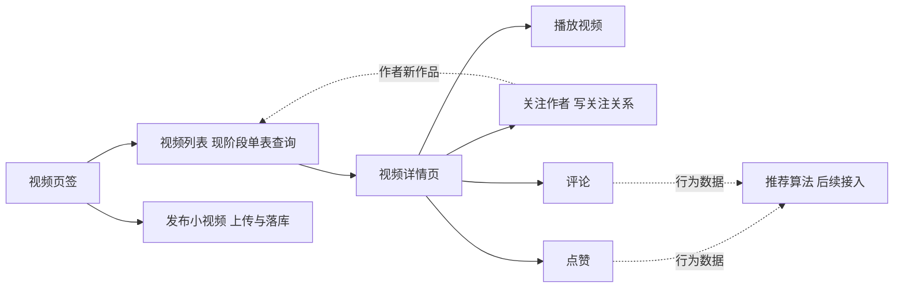

# 小视频功能说明：从短视频形态拆需求，给 day04 收个尾

评论功能收工，day04 的下半场翻开第二块内容：小视频。App 底部导航的「视频」页签点进去，是一个对标抖音、快手这类短视频平台的功能区，用户可以上传小视频分享，可以浏览别人分享的视频，也可以对视频点赞、评论。这一讲不写代码，把需求、交互与依赖的技术面盘清楚，后面的发布、列表、点赞才有落点。

## 先给结论

- 小视频模块含六块能力：视频列表、发布、详情播放、关注作者、点赞、评论，交互形态对标主流短视频平台。
- 关注的对象是作者而不是视频，这个设计为推荐铺路：关注了谁，谁的新作品将来就能进你的推荐。
- 视频列表现阶段先从一张表查询占位，推荐课程讲完后结合用户行为与喜好做推荐，列表接口的契约保持不变。
- 视频文件的存储与播放是本模块的新技术面，学习目标里排了 FastDFS 环境搭建与发布、查询的实操。
- day04 至此收官：圈子的互动闭环（点赞、喜欢、评论的查询与写入）全部完成，小视频作为内容形态的扩展开篇。

## 一、功能全景：一个页签装下的六件事

从 App 的视角把功能串一遍。底部导航切到「视频」页签，进入的是小视频列表页，一屏排开视频缩略图；页面上有一个发布按钮，点击即上传自己的小视频；点列表里的任意一个视频，跳进详情页，视频开始播放，详情页里有作者的头像昵称、一个关注按钮，下方还有点赞与评论两组操作。列表、发布、播放、关注、点赞、评论，六件事各就各位：



虚线是这张图的真正看点：关注关系与点赞、评论的行为数据，都朝列表回流。小视频列表不是静态的「最新发布」，而是按用户喜好组织的推荐流，现阶段先用单表查询把页面跑起来，等推荐能力就位再让行为数据说话，这与圈子推荐动态先占位、后接推荐的节奏完全同构。

## 二、关注作者：把关系留在人身上

详情页的关注按钮值得单独一节，因为它关注的是作者，不是这条视频。视频是内容，看完就过去了；作者才是持续产出内容的主体。关注作者的意义在推荐的闭环里：你关注了谁，说明你对他的内容感兴趣，他发布的新作品就会进入你的推荐列表，喜好的表达被沉淀成一条关系数据，反过来喂养下次的推荐。

这个设计对后端意味着两件事。其一，关注是一张关系数据，记录谁关注了谁，与视频本身无关，一个作者发一百条视频，关注关系只有一条；其二，推荐阶段要按「我关注的作者」去拉新作品，查询路径是先取关注列表，再按作者取视频，关系数据要先于内容数据就位。交互原型里这个按钮的位置摆在作者信息旁边，产品语义与技术设计在这里对上了。

## 三、列表与推荐：先占位，后接算法

小视频列表的最终形态是推荐流，实现路径分两步走。现阶段从一张表里做查询，把列表页、详情页、互动操作整条链路先跑通；后续推荐课程（Spark 与 MLlib 的推荐系统）讲完，把用户的浏览、点赞、评论、关注这些行为数据喂给推荐算法，算出结果回填到列表的取数来源上，端上的列表接口不用改一行代码。

先立契约后填实现，是本项目反复验证过的开发顺序。行为数据的积累从现在就开始：每一次点赞、每一条评论、每一个关注，都是将来推荐模型的输入。今天看起来只是两个互动按钮，在数据视角下它们是推荐系统的样本来源，这也是为什么互动功能的落库动作要做得干净、目标 id 要存得准确。

## 四、技术准备与 day04 收官

小视频对后端提出的真正新问题在文件这一侧。视频文件动辄几兆到几十兆，播放要持续吐流量，关系型数据库与 MongoDB 都不擅长存这种大文件，视频内容需要专门的文件存储来承接，元数据（作者、时长、播放地址）才进集合。学习目标清单把这条技术线列得很清楚：

```text
- 了解圈子交互相关功能
- 独立完成圈子的点赞功能
- 独立完成圈子的喜欢功能
- 独立完成圈子的评论功能
- 了解小视频的功能
- 独立完成FastDFS环境的搭建
- 独立完成小视频的发布
- 独立完成小视频的查询
- 独立完成小视频的点赞
- 独立完成小视频的评论
- 独立完成小视频的关注
```

FastDFS 的环境搭建与文件读写是接下来几讲的硬菜，发布与查询两个功能会围着它展开。把模块的能力拆解与依赖收拢成一张清单，后续小节按图施工：

```bash
# 小视频模块能力拆解与依赖（按原型与学习目标整理，示例为按本课写法补全）
视频列表   -> 分页查询返回列表，现阶段单表读，后续接推荐结果
视频发布   -> 视频文件上传到文件存储，元数据落集合
视频播放   -> 端上拿播放地址拉流播放，服务端只出地址不吐流
点赞/评论  -> 复用评论集合的互动模型，目标 id 换成视频 id
关注作者   -> 写关注关系数据，供推荐阶段拉取作者新作品
```

到这里，day04 的主线全部落地。圈子的互动闭环补完：动态的点赞与喜欢在前半程就位，评论的四件事（查单条动态、查评论列表、发表评论、评论点赞）在这一天补齐，评论集合的三类互动类型在读写两侧全部用上了。小视频作为内容形态的扩展刚刚开篇，视频存储、发布、列表、互动依次排队，课程进入以文件与推荐为主的新段落。

## 常见误区

- **把关注理解成收藏视频。** 错例：给视频表加一个关注标记，点谁的关注就存谁的视频 id。正解：关注是用户与作者的关系数据，与具体视频无关，作者的新作品通过这层关系进入推荐。
- **视频文件直接进数据库。** 错例：把视频二进制塞进 MongoDB 的文档里，集合膨胀、备份变慢、播放吞吐上不去。正解：文件走 FastDFS 这类分布式文件存储，数据库只存元数据与播放地址。
- **小视频复用圈子的发布表。** 错例：往动态集合里塞视频条目，可见性、时间线投递、互动展示全部跟着错。正解：小视频是独立的业务形态，单独建集合，互动可以复用评论集合，内容主体不复用。
- **低估播放侧的成本。** 错例：只考虑存储空间，不考虑播放带宽与码率，用户一多出口流量打满。正解：容量规划把播放流量算进去，文件存储与带宽的选型要按「读远多于写」的短视频消费模型来。

## 面试可能被问到的问题

1. 面试官追问：「设计一个短视频模块，存储上怎么分工？」
   答：视频文件与封面图进分布式文件存储，数据库只存元数据：作者、时长、封面地址、播放地址、状态。元数据按查询模式建索引，列表查询走分页或游标，播放时客户端拿地址直连文件存储或经 CDN。文件与元数据分离，两边各自独立扩容。
2. 面试官追问：「小视频列表的推荐怎么做，先上线的版本怎么处理？」
   答：完整形态是把用户行为（浏览、点赞、评论、关注）与视频特征喂给推荐算法，算出按人排序的结果写进推荐存储，列表接口读推荐结果。未接入前用单表查询占位，接口契约不变，推荐系统作为数据来源的替换方后期接入，端上无感。
3. 面试官追问：「关注关系怎么建模，关注列表和粉丝列表各怎么查？」
   答：一张关系表存关注人与被关注人成对出现，按关注人建索引查「我关注了谁」，按被关注人建索引查「谁的粉丝」。两个查询方向都要快，索引按方向各建一个；大 V 的粉丝列表规模大，翻页要游标化，缓存热点名单也是常见优化。
4. 面试官追问：「小视频的点赞评论能复用动态的互动模型吗？」
   答：能，且应该复用。互动的本质是「某人以某类型作用于某目标」，目标换成视频 id，类型仍是点赞、评论几类，存储结构与计数逻辑原样可用。要注意目标 id 的命名与取值在文档里注明场景，避免查询时混入动态的互动数据。

## 配套资料

- 原型：`materials/code/07/day01 探花交友-项目搭建以及登录完善个人信息/day01/资料/探花交友移动端原型V1.2/小视频.html`，视频页签、列表、详情播放、关注与互动按钮的交互形态出自这里。
- 目标：`materials/code/07/day04 探花交友-实现评论、小视频/day04/学习目标.md`，本讲引用的 day04 官方学习目标清单原文，FastDFS 与小视频各功能的排期以此为准。
- 说明：day04 资料包未解出工程源码，本讲为需求说明课无代码画面，能力拆解清单为按原型与学习目标整理的示例；推荐系统的接入安排以课程后续日程（Spark 与 MLlib 推荐课程）为准。
