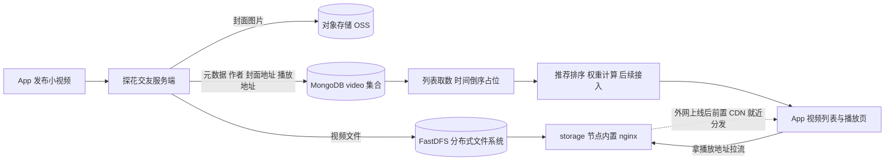

# 小视频技术方案：把存储、推荐与加载速度三道题想清楚再动手

功能说明课把「视频」页签的六块交互盘完之后，动手写代码之前还差一张技术地图。小视频与前面做过的功能都不太一样：它的主体不是一条动态、一个用户，而是一个几兆到几十兆的文件，这个文件还要被成千上万次地拉流播放。方案分析把这块内容收拢成三道题：数据怎么存，内容怎么推，页面怎么快。三道题各有备选路线，选型的理由比选型的结果更值得记住。

## 先给结论

- 小视频的核心矛盾集中在三处：存储量大，视频个数多且单个文件远大于图片；推荐要准，列表按用户兴趣组织才留得住人；加载要快，点开等半天就是体验灾难。
- 存储选型两条路：买阿里云 OSS 省心但成本高；自建分布式文件系统 FastDFS，探花交友选后者。
- 推荐走权重计算：关注了谁，谁的权重就高；点赞了什么，同类型内容权重就高，用行为数据猜测用户喜好。
- 加载速度三条路：加大服务器带宽、多机房就近服务、购买 CDN 就近分发，三条路都要真金白银，开发阶段先立方案不实现。
- 落到编码侧的准备只有一件：搭起 FastDFS 环境，发布与列表两个功能都围着它展开。

## 一、为什么是这三道题

三道题不是拍脑袋列的，它们分别对应小视频产品的三种成本。**第一，存储成本。** 一张头像几百 KB，一条动态配图一两兆，而一个视频动辄几十兆，视频个数还随时间无限增长，存储量与容量双双爆炸，任何为文本与图片设计的存储方案都接不住它。

**第二，计算成本。** 视频列表如果只是「最新发布的倒序」，用户刷十条不感兴趣就会离开。推荐的任务是让「推荐的都是他感兴趣的」，这件事的输入是行为数据：关注、点赞、评论。方案里的权重规则很直白，关注了一个用户，这个用户在推荐里权重高；给某个视频点了赞，同类型视频权重就高。短视频平台就是这套逻辑的放大版，经常看汽车或装修类内容，首页很快全是同类视频，平台在猜你的喜好，猜得越准停留越久。

**第三，流量成本。** 视频播放是持续吐流量的动作，服务端带宽是硬约束。用户打开一条视频要等半天，再准的推荐也救不回来，所以「加载速度」被单独立为一道题。

## 二、存储选型：买存储还是建存储

存储有两条主流路线。路线一是直接采购对象存储服务，例如阿里云 OSS，文件传上去拿地址就用，容量、可靠性、带宽全部由云厂商兜底。它的代价是持续计费：存储按容量算，流量按下行算，视频这种「读远多于写、单文件巨大」的内容形态，账单会随着用户量一起膨胀，成本压力不小。

路线二是自建分布式文件系统，探花交友选的是 FastDFS。它是一个专门为文件场景设计的分布式系统，文件切块后分散存到一组 storage 节点上，tracker 节点负责调度，容量不够就加机器横向扩容，自身不产生按量计费的账单，付出的代价是要自己运维这套环境。

方案页上点名 FastDFS 的同时，画面里已经给出了下一讲要用的环境命令，Docker 两条指令把 tracker 容器先跑起来：

```bash
# 拉取 FastDFS 镜像
docker pull delron/fastdfs

# 创建 tracker 容器，host 网络模式，挂载数据目录
docker run -d --network=host --name tracker -v /var/fdfs/tracker:/var/fdfs delron/fastdfs tracker
```

存储分工的完整口径是：视频文件与封面这类大文件进 FastDFS，作者、时长、播放地址这类元数据才进 MongoDB 的 video 集合。数据库只存「文件在哪」，不存「文件本身」，这条边界后面每一讲都在兑现。

## 三、推荐与加速：猜喜好和就近取

推荐算法在本项目里排在日程后段，现阶段先把权重思想立住：多种权重叠加计算，关注关系加一分，点赞同类加一分，行为越密集权重越高，最终按用户生成一份他大概率感兴趣的列表。这也是小视频列表接口先做单表查询占位的原因，契约不变，将来把取数来源从「按时间倒序」换成「按推荐得分」即可，端上无感。

加载速度的方案有三条，按花钱多少排列。**第一条是加大带宽**，把服务器带宽从 10 兆提到 100 兆，出口瞬间宽了，但单位流量成本高，治标。**第二条是多机房**，在上海建机房服务周边省市，在北京建一个服务北方用户，物理距离短了，延迟就低了，代价是数据同步与运维复杂度翻倍。**第三条是 CDN**，内容分发网络在全国铺节点，用户就近取资源，不再回源站拉流量，速度提升最明显，但属于额外购买的服务。

CDN 的接入方式反而最简单：项目发布到外网，在 CDN 服务里配置自己的域名即可，源站资源会自动分发到各节点。方案课的收尾很坦诚：带宽与 CDN 都要购买服务器或服务才能落地，开发阶段只提出方案不做实现，能立刻动手的是 FastDFS 环境。

## 四、整体数据流：从发布到播放

把三道题拼成一张全景图，看小视频从上传到播放的完整旅程。



这张图的关键路径是「一写两读」：发布时一次写，文件进 FastDFS、元数据进集合；消费时两次读，列表从集合取元数据，播放端拿地址向 storage 节点的 nginx 拉流。CDN 虚线接在播放链路前面，将来上线时插进去，源站侧的代码一行不改。推荐与缓存未接入前，列表查询直接读集合，接口契约先行，实现按阶段演进。

## 常见误区

- **把视频文件塞进数据库。** 错例：视频二进制直接存 MongoDB 文档或 MySQL 的 BLOB 字段，集合膨胀、备份变慢、播放吞吐上不去。正解：大文件进 FastDFS，数据库只存元数据与播放地址，两边各自独立扩容。
- **存储选型只看单价。** 错例：对比 OSS 与自建的成本时只算存储费，漏掉下行流量费与带宽费，视频场景下行流量才是大头。正解：按「读远多于写」的消费模型算总账，量小用 OSS 省心，量大自建更划算。
- **把推荐理解成上线才准备的事。** 错例：发布、点赞、评论功能随便落库，id 存得潦草，等做推荐时发现行为数据对不上目标。正解：从第一行写入代码开始就保证行为数据的准确性，它们是将来推荐模型的样本。
- **加载慢就只会加带宽。** 错例：出口拥堵一味提带宽规格，成本线性上涨。正解：按「带宽、多机房、CDN」三条路分层规划，用户规模到哪一层用哪一层。

## 面试可能被问到的问题

1. 面试官追问：「短视频的文件存储为什么不用数据库直接存？」
   答：数据库强项是结构化查询，不是大文件的持续读吞吐。视频几十兆且要求流式播放，放数据库里集合与备份膨胀，缓存命中率低，播放时挤占连接池。正确分工是文件进分布式文件系统或对象存储，数据库只存元数据与地址，两边独立扩容。
2. 面试官追问：「FastDFS 和直接买 OSS 怎么选型？」
   答：OSS 免运维、按量付费，流量与容量都计费，适合初创期快速上线；FastDFS 自建免费但要自己运维 tracker 与 storage，适合视频体量大、下行流量高的场景摊薄成本。选型核心是把存储量与下行流量按预估规模算总账，再叠加团队运维能力一起权衡。
3. 面试官追问：「CDN 为什么能加速，接入要改业务代码吗？」
   答：CDN 把源站内容分发到全国各边缘节点，用户请求被调度到最近的节点，物理链路短所以快，同时源站出口带宽压力被卸掉。业务代码不用改，只需把域名指向 CDN 并配置回源规则，播放地址仍是同一个域名，静态资源类内容天然适合。
4. 面试官追问：「视频推荐系统上线前，功能设计上要提前做什么？」
   答：先把行为数据攒干净：关注关系、点赞、评论、浏览都要落库，目标 id 与用户 id 存准确，这是推荐模型的原始样本；列表接口契约按最终形态设计，先用时间倒序占位，推荐结果作为取数来源的替换方接入，端上不用改版。

## 配套资料

- 原型：`materials/code/07/day01 探花交友-项目搭建以及登录完善个人信息/day01/资料/探花交友移动端原型V1.2/小视频.html`，视频页签、列表与发布按钮的交互形态出自这里。
- 目标：`materials/code/07/day04 探花交友-实现评论、小视频/day04/学习目标.md`，FastDFS 环境搭建与小视频发布、查询的排期依据。
- 说明：day04 资料包未解出工程源码，本讲为方案分析课无代码画面，整体数据流为按讲解与学习目标整理的示例；Docker 命令出自课程画面，FastDFS 环境从下一讲开始实操。
