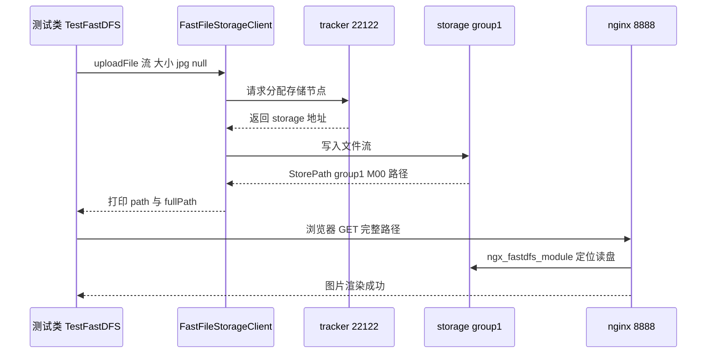

# FastDFS Java client：一次真实上传打通环境验证的全链路

tracker 与 storage 两个容器已经跑起来了，但环境是否真的可用，要由一次成功的上传说了算。这一讲在 server 工程里引入 FastDFS 的 Java 客户端，写一个 Spring Boot 测试类把本机的一张图片传上去，再用浏览器访问返回的路径。上传通了，环境验证闭环，后面小视频的发布功能才有底气调用它。

## 先给结论

- 客户端选 `com.github.tobato:fastdfs-client:1.26.7`，它是 Spring Boot 风格的封装，配置写在 `application.properties`，客户端直接注入使用。
- 引入时必须排除它传递依赖的 `logback-classic`，否则与 Spring Boot 自带的日志体系冲突。
- 核心配置只有一条 `fdfs.tracker-list`，指向 tracker 的 IP 加 22122 端口；超时与缩略图参数按默认口径补齐。
- 上传调用 `FastFileStorageClient.uploadFile`，传流、大小、扩展名、元数据四个参数，返回 `StorePath`，`getFullPath()` 拼出带卷组名的完整路径。
- 浏览器访问 `http://IP:8888/` 加完整路径能看到图片，说明 nginx 到 FastDFS 的读取链路同样通了。

## 一、引入 client：一个依赖与一次排除

`application.properties` 的配置风格决定了选哪个客户端。tobato 版 FastDFS client 把连接、连接池、tracker 地址全部做成 Spring Boot 配置项，`FastFileStorageClient` 直接作为 Bean 注入，与工程现有写法严丝合缝。Maven 依赖带着一个需要处理的传递依赖：

```xml
<dependency>
    <groupId>com.github.tobato</groupId>
    <artifactId>fastdfs-client</artifactId>
    <version>1.26.7</version>
    <exclusions>
        <exclusion>
            <groupId>ch.qos.logback</groupId>
            <artifactId>logback-classic</artifactId>
        </exclusion>
    </exclusions>
</dependency>
```

**排除 `logback-classic` 不是可做可不做的事。** Spring Boot 的 starter 已经带了同一套日志实现，客户端再拖进来一份，类路径上出现重复绑定，轻则启动时刷一大片警告，重则绑定错乱直接起不来。客户端只关心文件协议，日志统一交给工程自己管理，这是引入第三方库时看一眼依赖树的基本功。

## 二、四行配置把 client 指向环境

依赖进了 server 工程的 pom，接下来在 `application.properties` 里把客户端指向刚搭好的环境：

```properties
# 分布式文件系统 FDFS 配置
fdfs.so-timeout = 1501
fdfs.connect-timeout = 601
# 缩略图生成参数
fdfs.thumb-image.width = 150
fdfs.thumb-image.height = 150
# TrackerList 参数，支持多个
fdfs.tracker-list=192.168.31.81:22122
```

真正关键的只有 `fdfs.tracker-list` 一行，客户端的一切请求都从这里列出的地址开始：IP 换成自己宿主机的，端口是 tracker 的 22122。它是复数形式的 list，生产环境写多个地址逗号分隔，tracker 挂一台还有备用。上面的两行超时是毫秒级的读超时与连接超时，避免网络抖动时请求吊死；缩略图参数是预留的生成规格，后续业务要用缩略图时直接取用。

## 三、测试类：把一张图片传上去

验证代码放在 server 工程的测试包里，注入客户端后一次上传：

```java
package com.study.tanhua.server;

import com.github.tobato.fastdfs.domain.fdfs.StorePath;
import com.github.tobato.fastdfs.service.FastFileStorageClient;
import org.apache.commons.io.FileUtils;
import org.junit.Test;
import org.junit.runner.RunWith;
import org.springframework.beans.factory.annotation.Autowired;
import org.springframework.boot.test.context.SpringBootTest;
import org.springframework.test.context.junit4.SpringRunner;

import java.io.File;
import java.io.IOException;

@RunWith(SpringRunner.class)
@SpringBootTest
public class TestFastDFS {

    @Autowired
    private FastFileStorageClient storageClient;

    @Test
    public void testUpload() {
        String path = "C:\\Users\\demo\\Desktop\\pics\\1.jpg";
        File file = new File(path);
        try {
            //参数依次为：输入流 文件大小 扩展名 元数据（不设置传 null）
            StorePath storePath = this.storageClient.uploadFile(
                    FileUtils.openInputStream(file), file.length(), "jpg", null);
            System.out.println(storePath);
            //StorePath [group-group1, path-M00/00/00/wKgfUV2GJsuAOUd_AAHnjh7KpOc1.1.jpg]
            System.out.println(storePath.getFullPath());
            //group1/M00/00/00/wKgfUV2GJsuAOUd_AAHnjh7KpOc1.1.jpg
        } catch (IOException e) {
            e.printStackTrace();
        }
    }
}
```

测试先确认被上传的文件真实存在，浏览器里能打开本地这张图再执行。`uploadFile` 的四个参数各有用处：流是文件本体，大小供 FastDFS 分配存储与校验，扩展名决定存储路径的收尾与访问时的响应类型，元数据是可选的键值对，不设就传 null，要存也可以把宽、高这类信息塞进去随文件一起落库。执行用例，控制台给出结果：卷组是 group1，路径是一串哈希目录加新文件名，`getFullPath()` 把卷组拼在前面。

**返回的文件名已经和原文件没有任何关系。** FastDFS 不会保留上传时的文件名，它按算法生成新名字，再用两级哈希目录摊开存储，天然防重名。业务侧的原始文件名、宽高等信息想留，就走元数据或业务库，这正是下一讲 video 集合存在的理由。

## 四、浏览器验证与完整链路

上传成功的最后一环是访问验证。取 `getFullPath()` 的输出拼上 web 地址：`http://192.168.31.81:8888/group1/M00/00/00/wKgfUV2GJsuAOUd_AAHnjh7KpOc1.1.jpg`，浏览器里图片原样渲染出来。这个地址走的是 storage 内置 nginx 的 8888 端口，nginx 把 group 开头的路径交给 `ngx_fastdfs_module` 模块去文件系统里定位读取。整条链路收成时序图：



上半段是写链路，客户端经 tracker 调度把流写给 storage；下半段是读链路，浏览器经 nginx 的 8888 端口把文件读回来。两段都绿，FastDFS 环境才算真正交付，小视频的发布功能随后就能把这四行调用抄进业务代码。

## 常见误区

- **依赖照抄不带排除。** 错例：pom 里只加 fastdfs-client，启动时日志绑定冲突报错或刷屏警告。正解：exclusions 里明确排除 `logback-classic`，日志实现交给 Spring Boot 统一管理。
- **tracker 地址配成 8888。** 错例：把文件访问端口当服务端口写进 `fdfs.tracker-list`，上传请求打不到调度中心，报连接超时。正解：tracker 服务端口是 22122，8888 是 nginx 的下载端口。
- **以为返回路径里的文件名还是原名。** 错例：上传后按原文件名去拼访问地址，404。正解：FastDFS 重新命名并按哈希分目录，访问地址只能用返回的 `StorePath`，原始文件名想保留要走元数据或业务集合。
- **访问地址漏拼卷组名。** 错例：只拿 path 段去访问，nginx 匹配不上 group 开头的规则，请求进不了 FastDFS 模块。正解：用 `getFullPath()` 的输出，卷组与路径缺一不可。

## 面试可能被问到的问题

1. 面试官追问：「tobato 版 FastDFS 客户端和原生的 fastdfs-client-java 有什么区别？」
   答：原生客户端要加载 conf 配置文件、手动创建 tracker 与 storage 连接管理器，代码侵入性强；tobato 版按 Spring Boot 风格重新封装，配置走 properties 前缀自动绑定，客户端是容器里的 Bean，直接注入使用，还内置了连接池管理。项目是 Spring Boot 技术栈时，前者与工程风格更贴合。
2. 面试官追问：「上传时为什么要传文件大小和扩展名？」
   答：大小供 storage 预分配与完整性校验，流式传输靠它判断是否收完；扩展名参与生成存储文件名的后缀，访问时 HTTP 响应按它给出 Content-Type，浏览器才知道按图片还是按视频渲染。两者都从文件本身取，不让调用方手填，避免流与元数据不一致。
3. 面试官追问：「FastDFS 的文件名生成规则有什么好处？」
   答：文件名由 storage 按 base64 编码的元信息加随机串生成，不依赖原名，天然防重名与路径猜测；配合按文件名散列的两级目录，海量文件均匀摊开，单个目录条目数可控，文件系统查找不退化。业务语义信息放元数据或数据库，与物理路径解耦。
4. 面试官追问：「生产环境把 FastDFS 客户端接进业务，还要考虑什么？」
   答：tracker-list 配多个地址防单点；上传异常要有降级与重试，文件传不上去时业务给出明确提示；大文件上传考虑流式处理避免内存峰值；访问地址前缀做成配置项，环境迁移或上 CDN 时只改配置不改代码。
5. 面试官追问：「上传成功返回的 StorePath 和业务库里该存什么？」
   答：StorePath 是客户端对象，业务库存它的字符串形态，通常是 getFullPath 的完整路径加原始文件名、宽高等元数据。存完整路径而不是只存哈希段，访问时直接拼 web 前缀；文件迁移或换卷组时按业务库记录逐条处理，而不是反推物理路径。

## 配套资料

- 目标：`materials/code/07/day04 探花交友-实现评论、小视频/day04/学习目标.md`，「独立完成 FastDFS 环境的搭建」的验证环节对应本讲。
- 数据库：`materials/code/07/day01 探花交友-项目搭建以及登录完善个人信息/day01/代码/mytanhua.sql`，后续文件地址与业务数据关联时参考的用户库结构。
- 说明：day04 资料包未解出工程源码，Maven 依赖、properties 配置与测试类按课程画面逐段整理，包名改写为 `com.study.tanhua` 系，测试文件路径与示例 IP 为占位值；`@RunWith(SpringRunner.class)` 注解为按 JUnit 4 运行 Spring Boot 测试的必要写法补全。
