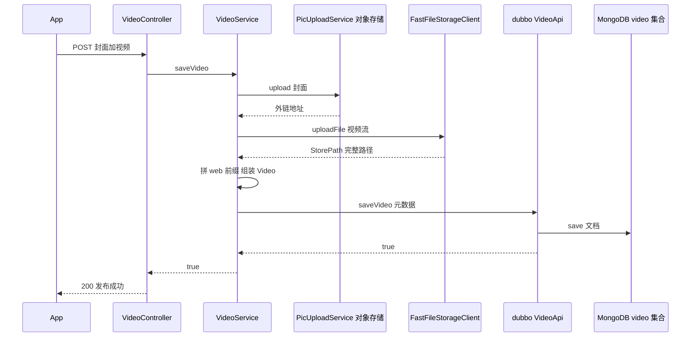
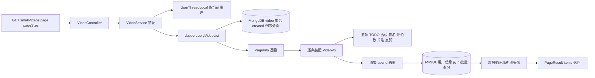

# 发布小视频与小视频列表：两路文件上传、dubbo 落库与列表装配全链路

FastDFS 环境验证通过，client 的四行调用还在测试类里躺着，现在把它们搬进业务代码。发布小视频是整个项目到目前为止 IO 最重的一条链路：一个请求里要同时处理封面图片、视频文件和元数据三个对象，分别流向三个存储，中间还要跨一次 dubbo 远程调用。列表查询则是熟悉的装配型接口，dubbo 取数、接口服务组装，只是这次多出五个人为留下的 TODO 占位。两讲合并成一篇，从 pojo 写到联调验收。

## 先给结论

- 发布链路拆三段：封面走 day01 就位的 PicUploadService 进对象存储 OSS，视频文件走 FastFileStorageClient 进 FastDFS，元数据经 dubbo 的 VideoApi 进 MongoDB 的 video 集合。
- Video 实体的权限与位置字段直接沿用动态的设计，seeType 本讲统一填 1（公开），其余位置信息暂不填。
- 列表接口 `GET /smallVideos`，dubbo 侧 `PageRequest.of(page - 1, pageSize, created 倒序)` 一行完成分页排序；接口侧把裸数据装成 VideoVo，昵称头像批量查询补齐。
- 签名、评论数、是否关注、是否点赞、点赞数五个字段全部以固定值加 TODO 占位，接口契约先立住，功能在后续小节逐个回填。
- 联调踩三个坑：内嵌 Tomcat 默认上传大小限制把流提前关闭；dubbo 提供方改完没重启；`@Reference` 的 version 写错导致注入失败。

## 一、数据模型：Video 实体与 dubbo 契约

发布的第一块拼图是数据模型。视频在 MongoDB 里落在独立的 video 集合，与小视频的内容形态对应，互动数据后面复用评论集合，内容主体不复用动态的集合。实体的核心字段是六个：id、userId、text、picUrl、videoUrl、created，从 picUrl 开始值得逐个对齐语义：

```java
package com.study.tanhua.dubbo.server.pojo;

import lombok.AllArgsConstructor;
import lombok.Data;
import lombok.NoArgsConstructor;
import org.bson.types.ObjectId;
import org.springframework.data.mongodb.core.mapping.Document;

import java.util.List;

@Data
@NoArgsConstructor
@AllArgsConstructor
@Document(collection = "video")
public class Video implements java.io.Serializable {
    private static final long serialVersionUID = -311673283680493387L;
    private Object id;              //主键id
    private Long userId;            //发布用户id
    private String text;            //文字
    private String picUrl;          //视频封面图片
    private String videoUrl;        //视频地址
    private Long created;           //创建时间
    //以下字段沿用动态（圈子）的实体设计
    private Integer seeType;        //查看权限，1-公开，2-私密
    private List<Long> seeList;     //部分可见列表
    private List<Long> notSeeList;  //不给谁看列表
    private String longitude;       //经度
    private String latitude;        //纬度
    private String locationName;    //位置名称
}
```

**权限与位置字段直接抄动态的作业，是一次有意识的复用。** 小视频与动态同为用户创作内容，可见性模型、地理位置语义完全一致，抄过来之后将来做按人可见、按位置推荐时，两张集合的数据结构是齐平的。画面里截到的核心字段收在 created，权限与位置这一组由讲解口述补齐，语义与动态实体同款。id 声明为 Object 而不是 ObjectId，是为了让服务端塞入 ObjectId、消费侧转字符串都留有余地，代价是取出时要做类型处理，这个细节在列表装配一节会再次出现。

dubbo 契约两个方法，一写一读：

```java
package com.study.tanhua.dubbo.server.api;

import com.study.tanhua.dubbo.server.pojo.Video;
import com.study.tanhua.dubbo.server.vo.PageInfo;

public interface VideoApi {

    /**
     * 保存小视频
     * @param video 视频元数据
     * @return 是否保存成功
     */
    Boolean saveVideo(Video video);

    /**
     * 分页查询小视频列表，按时间倒序排列
     * @param page 页码，从 1 开始
     * @param pageSize 页大小
     * @return 分页视频数据
     */
    PageInfo<Video> queryVideoList(Integer page, Integer pageSize);
}
```

`PageInfo` 是查询好友动态时立下的自定义分页 VO，页码、页大小、数据列表打包过网络，消费方拿到自解释的结构，这里直接复用，两边的分页口径保持一致。

## 二、实现 dubbo 服务：写入校验与分页排序

实现类落在 dubbo 工程的 api 包里，注入 MongoTemplate 完成读写。这里有一个 import 级别的坑要先说破：注解 `@Service` 有两个同名者，Spring 的与 dubbo 的，这里要的是 dubbo 的 `com.alibaba.dubbo.config.annotation.Service`，它才是把类发布成 dubbo 提供者的开关，导错包服务就悄悄发布不出去，IDE 不会报任何错：

```java
package com.study.tanhua.dubbo.server.api;

import com.alibaba.dubbo.config.annotation.Service;
import com.study.tanhua.dubbo.server.pojo.Video;
import com.study.tanhua.dubbo.server.vo.PageInfo;
import org.bson.types.ObjectId;
import org.springframework.beans.factory.annotation.Autowired;
import org.springframework.data.domain.PageRequest;
import org.springframework.data.domain.Pageable;
import org.springframework.data.domain.Sort;
import org.springframework.data.mongodb.core.MongoTemplate;
import org.springframework.data.mongodb.core.query.Query;

import java.util.List;

@Service(version = "1.0.0")
public class VideoApiImpl implements VideoApi {

    @Autowired
    private MongoTemplate mongoTemplate;

    @Override
    public Boolean saveVideo(Video video) {
        if (null == video.getUserId()) {
            //发布人为空，数据不合法，保存失败
            return false;
        }
        video.setId(ObjectId.get());
        video.setCreated(System.currentTimeMillis());
        this.mongoTemplate.save(video);
        return true;
    }

    @Override
    public PageInfo<Video> queryVideoList(Integer page, Integer pageSize) {
        //页码从 1 开始转 0 基，按 created 倒序，新视频在前
        Pageable pageable = PageRequest.of(page - 1, pageSize,
                Sort.by(Sort.Order.desc("created")));
        Query query = new Query();
        query.with(pageable);
        List<Video> videoList = this.mongoTemplate.find(query, Video.class);
        PageInfo<Video> pageInfo = new PageInfo<>();
        pageInfo.setPageNum(page);
        pageInfo.setPageSize(pageSize);
        pageInfo.setTotal(0); //总条数本期不提供
        pageInfo.setRecords(videoList);
        return pageInfo;
    }
}
```

saveVideo 里有三处决定数据质量的动作。**userId 非空校验站在 dubbo 门口。** 任何调用方传来的数据都先过这道闸，发布人不明的视频直接拒绝，脏数据进不了集合。**id 与 created 都由服务端生成。** ObjectId 在服务端 new 出来保证唯一，时间戳用服务端时钟，端上时间不可信，这两件事交给提供方统一裁定。**save 之后返回 true**，调用方拿布尔值判断成败，异常语义不藏在 void 里。

queryVideoList 的骨架与圈子评论列表同款：`PageRequest.of` 的第一个参数做页码 0 基转换，第三个参数把排序挂进去，created 倒序让新视频排在最前，这正是短视频 feed 的阅读顺序。total 置 0 沿用既定取舍，端上上拉翻页只依赖页码递增，不为没人消费的数字多付一次 count。列表最终形态是推荐流，现阶段时间倒序占位，将来只换 dubbo 内部的取数逻辑，契约不动。

## 三、发布链路：两路上传与一次远程落库

接口服务侧先立契约再进代码。mock 文档给出发布接口的两个参数：一个视频封面文件，一个视频文件。封面不必服务端操心截帧，App 端会从视频里自动截一张图一并传上来，服务端照单收下即可。业务逻辑收进 VideoService：

```java
@Service
public class VideoService {

    @Autowired
    private PicUploadService picUploadService;
    @Autowired
    private FastFileStorageClient storageClient;
    @Autowired
    private FdfsWebServer fdfsWebServer;
    @Reference(version = "1.0.0")
    private VideoApi videoApi;

    /**
     * 发布小视频
     * @param pic 封面图片，App 端已自动截取
     * @param videoFile 视频文件
     */
    public Boolean saveVideo(MultipartFile pic, MultipartFile videoFile) {
        try {
            //封面图片上传 OSS，复用 day01 的图片上传服务
            PicUploadResult picUploadResult = this.picUploadService.upload(pic);
            //构建 video 对象
            Video video = new Video();
            video.setUserId(UserThreadLocal.get().getId());
            video.setSeeType(1); //公开，谁都可以看
            video.setPicUrl(picUploadResult.getName());
            //视频文件上传 FastDFS：流 大小 扩展名 元数据（不设置传 null）
            String filename = videoFile.getOriginalFilename();
            StorePath storePath = this.storageClient.uploadFile(
                    videoFile.getInputStream(), videoFile.getSize(),
                    StringUtils.substringAfterLast(filename, "."), null);
            //web 前缀自带尾斜杠，直接拼完整路径
            video.setVideoUrl(fdfsWebServer.getWebServerUrl() + storePath.getFullPath());
            //调用 dubbo 服务保存元数据，结果原样返回
            return this.videoApi.saveVideo(video);
        } catch (IOException e) {
            e.printStackTrace();
        }
        return false;
    }
}
```

方法体四个动作，节奏与上一讲的测试类完全一致，只是把打印换成了落库。**封面是三路 IO 里的轻量一路。** PicUploadService 是 day01 完善个人信息时写好的 OSS 上传服务，返回结果对象的 name 字段就是外链地址，发布小视频时原样复用，一行没改。**Video 对象在这里只填端上带来的事实。** 用户身份从 UserThreadLocal 取，拦截器已经把登录用户放进了当前线程；seeType 先统一公开；文字与位置本讲没有输入来源，留空。**视频上传是真正的重量级动作。** `uploadFile` 的四个参数在测试类里见过：流、大小、扩展名与元数据，扩展名从原始文件名里截取，元数据暂不设置，FastDFS 会重新命名文件并返回 StorePath。**FdfsWebServer 解决的是地址前缀问题。** 配置项里的 web 前缀拼上 StorePath 的完整路径才是可访问地址，前缀写在配置里带尾斜杠，代码里拼接时不再补斜杠；将来环境迁移或前置 CDN，改一处配置即可，业务代码不动。

整个方法体包在 try-catch 里，任何一路 IO 失败都返回 false，端上拿到明确的失败信号，不会拿到半成品地址。落库放在两个上传都成功之后，video 集合里的每条文档都保证封面与视频真实存在，这是先文件后元数据的顺序价值。



时序图把发布链路收成一条直线：两个文件各自上传拿到地址，元数据带着地址走 dubbo 落集合，任何一环断掉，后面的环节不发生。

## 四、Controller 与接口契约

Controller 很薄，POST 接收两个文件字段转手 Service：

```java
@RestController
@RequestMapping("smallVideos")
public class VideoController {

    @Autowired
    private VideoService videoService;

    /**
     * 发布小视频
     * @param videoThumbnail 封面图片
     * @param videoFile 视频文件
     */
    @PostMapping
    public void saveVideo(MultipartFile videoThumbnail, MultipartFile videoFile) {
        this.videoService.saveVideo(videoThumbnail, videoFile);
    }
}
```

方法无返回值，端上只关心 HTTP 状态码，200 即发布成功，Service 内部已经把业务失败折算成 false 对应的异常路径。参数名 `videoThumbnail` 与 `videoFile` 是契约名，multipart 表单的字段名必须与之逐字符对齐，顺序不敏感，名字敏感，这一点和评论区 `movementId` 的教训同源。

## 五、发布联调：三个报错的完整排查链

测试流程与圈子的接口一致：REST 客户端先以 JSON 发验证码、登录拿 token，再以 multipart 表单发起 POST，带上传许可的头与 token，两个文件字段分别塞入一张封面图与一段本地视频。三连报错都在这一段发生，每一条都值得复盘。

**第一坑：流被提前关闭。** 请求发出后断点进入，控制台抛 IOException，信息指向流已关闭。原因不在代码：Spring Boot 内嵌 Tomcat 对上传大小有默认限制，视频还没传完，容器已经把流掐了。修复是显式放开两项配置后重启：

```properties
# 放开上传大小限制，视频文件动辄十几兆
spring.servlet.multipart.max-file-size = 30MB
spring.servlet.multipart.max-request-size = 30MB
```

**第二坑：提供方没有重启。** 放开限制后请求进入断点，封面与视频先后上传成功，dubbo 调用似乎也过去了，但 MongoDB 里翻不到 video 集合，接口返回 500，日志里是空指针。排查发现 dubbo 服务是新写的，提供方工程一直没重启，注册中心里根本没有这个服务。把 dubbo 工程重启后再次测试，问题依旧存在，空指针还在。

**第三坑：version 对不上。** 继续追空指针的位置，落在 `videoApi` 的调用上，检查注解发现 `@Reference` 的 version 属性值写错了，与提供方 `@Service(version = "1.0.0")` 声明的版本不匹配，注册中心按接口加版本定位服务，版本对不上就找不到提供者，注入进来的引用是空壳，一调用即空指针。修正 version、重启 server 服务，第三次测试一路走通：方法返回 true，响应 200，MongoDB 的 video 集合出现第一条文档。

验收动作跟着文档走：复制文档里的 picUrl 到浏览器，封面正常显示，这一路是 OSS；复制 videoUrl，视频正常播放，这一路是 FastDFS 的 nginx 8888 端口。两个字段各自印证了各自的链路，发布功能闭环。

## 六、小视频列表：契约、占位与装配

列表的 dubbo 侧已经就位，接口侧从 mock 契约开始。接口 `GET /smallVideos`，query 参数 page 与 pageSize，默认 1 与 10，返回熟悉的 PageResult 结构，看点全在 items 数组的元素里：视频 id、发布用户 id、头像、昵称、封面、视频地址、签名、点赞数、是否点赞、是否关注、评论数。端上一屏要展示的字段比 dubbo 返回的裸数据多出用户资料与互动状态，接口服务层新建 VideoVo 承接：

```java
package com.study.tanhua.server.vo;

import lombok.AllArgsConstructor;
import lombok.Data;
import lombok.NoArgsConstructor;

@Data
@AllArgsConstructor
@NoArgsConstructor
public class VideoVo {
    private String id;            //视频id
    private Long userId;          //用户id
    private String avatar;        //头像
    private String nickname;      //昵称
    private String cover;         //封面
    private String videoUrl;      //视频URL
    private String signature;     //签名
    private Integer likeCount;    //点赞数量
    private Integer hasLiked;     //是否已点赞（1是 0否）
    private Integer hasFocus;     //是否已关注（1是 0否）
    private Integer commentCount; //评论数量
}
```

Controller 侧与评论列表同构：try-catch 兜底映射 500，查询成功返回 200，page 传非正数时修正为 1：

```java
    /**
     * 查询小视频列表
     */
    @GetMapping
    public ResponseEntity<PageResult> queryVideoList(
            @RequestParam(value = "page", required = false, defaultValue = "1") Integer page,
            @RequestParam(value = "pageSize", required = false, defaultValue = "10") Integer pageSize) {
        try {
            if (page <= 0) {
                page = 1;
            }
            PageResult pageResult = this.videoService.queryVideoList(page, pageSize);
            if (null != pageResult) {
                return ResponseEntity.ok(pageResult);
            }
        } catch (Exception e) {
            e.printStackTrace();
        }
        return ResponseEntity.status(HttpStatus.INTERNAL_SERVER_ERROR).build();
    }
```

Service 的装配分三段：置空态、取数、逐条翻译。这是本讲代码量最大的方法，也是「先立契约、后填实现」策略最直观的展示：

```java
    @Autowired
    private UserInfoService userInfoService;

    public PageResult queryVideoList(Integer page, Integer pageSize) {
        //当前登录用户，后续判断是否点赞、是否关注要用，本讲先取出
        User user = UserThreadLocal.get();
        PageResult pageResult = new PageResult();
        pageResult.setPage(page);
        pageResult.setPageSize(pageSize);
        pageResult.setPages(0);
        pageResult.setCounts(0);

        PageInfo<Video> pageInfo = this.videoApi.queryVideoList(page, pageSize);
        List<Video> records = pageInfo.getRecords();
        if (CollectionUtils.isEmpty(records)) {
            //结构完整的空对象，端上按空视图渲染
            return pageResult;
        }
        List<VideoVo> videoVoList = new ArrayList<>();
        List<Long> userIds = new ArrayList<>();
        for (Video record : records) {
            VideoVo videoVo = new VideoVo();
            videoVo.setUserId(record.getUserId());
            videoVo.setCover(record.getPicUrl());
            videoVo.setVideoUrl(record.getVideoUrl());
            //ObjectId 转 String，端上拿到干净的 id 文本
            videoVo.setId(record.getId().toString());
            videoVo.setSignature("我就是我"); //TODO 签名，字段暂未设计
            videoVo.setCommentCount(10); //TODO 评论数，评论功能后续接入
            videoVo.setHasFocus(0);      //TODO 是否关注（1是 0否），关注功能后续接入
            videoVo.setHasLiked(0);      //TODO 是否点赞（1是 0否），点赞功能后续接入
            videoVo.setLikeCount(40);    //TODO 点赞数，点赞功能后续接入
            //收集发布用户 id，不包含才加入
            if (!userIds.contains(record.getUserId())) {
                userIds.add(record.getUserId());
            }
            videoVoList.add(videoVo);
        }
        //批量查询用户信息，一次 in 查询
        QueryWrapper<UserInfo> queryWrapper = new QueryWrapper<>();
        queryWrapper.in("user_id", userIds);
        List<UserInfo> userInfos = this.userInfoService.queryUserInfoList(queryWrapper);
        //双层循环按 userId 匹配填充昵称与头像
        for (VideoVo videoVo : videoVoList) {
            for (UserInfo userInfo : userInfos) {
                if (videoVo.getUserId().longValue() == userInfo.getUserId().longValue()) {
                    videoVo.setNickname(userInfo.getNickName());
                    videoVo.setAvatar(userInfo.getLogo());
                    break;
                }
            }
        }
        pageResult.setItems(videoVoList);
        return pageResult;
    }
```

五个 TODO 占位是这段代码最值得停顿的地方。签名、评论数、是否关注、是否点赞、点赞数，端上的契约里这五个字段现在就要有，对应的功能却还没有写：签名字段压根没设计，评论、点赞、关注排在后续小节。占位值加 TODO 注释是一种工程妥协：契约字段永远有值（哪怕是假的），端上渲染不炸，后端功能就位后把对应的 set 行换掉即可，接口结构零改动。占位值选择上也有讲究，hasLiked 与 hasFocus 填 0 表示「未点赞未关注」是无害默认态，commentCount 与 likeCount 填 10 与 40 只是让页面别太空，这些数字上线前必须全部清零换真值。

`User user = UserThreadLocal.get()` 这一当前取到的用户，本讲没有参与任何逻辑，因为视频 id 全部来自 records，与当前用户无关。变量保留不删，等点赞与关注功能接入后，判断「我是否点赞过」「我是否关注过」都要拿它做 key 的组成部分，届时这行代码会复活。

userId 收集处埋过一个真实错误：初版代码的条件写成了 `if (userIds.contains(...))`，少了取反，列表为空时 contains 恒为 false，userIds 永远收集不到人，批量查询查了个寂寞，所有视频的昵称头像一片空白。讲解现场把取反补上，这个条件也是 N+1 问题的闸门：一页十条视频去重后往往只有三五个作者，一次 in 查询顶掉十次单查，与评论列表装配的思路完全一致。双层循环里 userId 用 `longValue()` 比较，Long 对象直接用等号比较在数值超出缓存范围时会失效，这个坑在评论区装配时踩过一次，这里按老规矩写。



整张图的取数与装配两段泾渭分明：dubbo 一趟取回视频本体，接口服务补上用户资料与互动占位，一页列表在一个方法里组装完成。

## 七、列表测试与一个联调提醒

server 服务重启后，REST 客户端带 token 发起 `GET /smallVideos`，响应的 items 里出现上一讲发布的视频：封面、昵称头像填充正常，videoUrl 指向 FastDFS 的路径，签名与点赞数是占位值。端上模拟器同步验证：视频页签拉出列表，缩略图、作者信息、互动数字按契约渲染，点进详情能播放，列表闭环。

一个与评论区同款的提醒：`GET /smallVideos` 同样落在统一缓存拦截器的管辖范围内，同一用户带同样参数重复请求，命中的是 Redis 里的旧响应，Service 断点不进。刚发布了视频立刻刷新列表却看不到新内容，先怀疑缓存再怀疑代码，联调期间把缓存开关关掉，业务验证完再打开，这条经验在缓存课程里立过规矩，列表类高频变化的数据正式启用缓存时要配短过期时间。

## 常见误区

- **dubbo 的 `@Service` 导成 Spring 的。** 错例：注解自动提示顺手一导，类只是个普通 Spring Bean，注册中心里永远查不到服务，消费方报找不到提供者。正解：`com.alibaba.dubbo.config.annotation.Service` 带上 version，与 `@Reference` 的版本严格一致。
- **上传大小不放开就联调。** 错例：默认 1MB 单文件、10MB 单请求的限制下传视频，容器把流提前关闭，报 IOException 还以为是代码问题。正解：`max-file-size` 与 `max-request-size` 按业务上限显式设置，本课口径是 30MB。
- **元数据先落库再传文件。** 错例：先 save 文档再上传文件，上传失败时集合里留下指向不存在文件的死链。正解：两个文件都上传成功拿到真实地址后，才调用 dubbo 服务落库，顺序就是一致性。
- **userId 收集条件忘了取反。** 错例：`if (userIds.contains(record.getUserId()))` 少了叹号，空列表永远装不进人，批量查询形同虚设，整页视频没有昵称头像。正解：不包含才加入，去重与收集一个条件完成。
- **占位值当成真值上线。** 错例：评论数 10、点赞数 40、签名「我就是我」原样带到生产。正解：TODO 注释与占位值一起管理，对应功能落地时逐个替换，上线检查清单里专门列一项。

## 面试可能被问到的问题

1. 面试官追问：「发布一个小视频，服务端要处理哪几类数据，顺序为什么这样安排？」
   答：三类：封面图片进对象存储，视频文件进分布式文件系统，元数据（作者、封面地址、视频地址）进 MongoDB。顺序是先传文件后落元数据，文件全部成功才有真实地址可写，元数据集合里不会出现指向不存在文件的记录；任何一步失败整体返回失败，端上重试即可。
2. 面试官追问：「ObjectId 和 created 为什么在 dubbo 服务端生成，而不是让调用方传？」
   答：提供方是数据进入存储的最后一道关口，在这里生成能保证所有调用方拿到同一套规则：id 全局唯一不依赖端上时钟与随机数质量，created 用服务端时钟保证排序基准一致。顺带做 userId 非空校验，把数据质量闸门放在入口，脏数据进不了集合。
3. 面试官追问：「dubbo 服务发布的 version 起什么作用？」
   答：version 是同一接口多版本共存时的路由标识，注册中心按接口全限定名加版本定位提供者，消费方 `@Reference` 声明的版本必须与提供方一致才能匹配上。灰度发布时新版本用新 version 并行上线，逐步切流量；版本写错或不写，轻则路由不到，重则注入空引用，调用即空指针。
4. 面试官追问：「Spring Boot 的 multipart 上传限制怎么配，超过限制会发生什么？」
   答：`spring.servlet.multipart.max-file-size` 限制单个文件，`max-request-size` 限制整个请求，默认值很小，视频场景必须显式放开。超限时容器在读流阶段就中断连接，业务代码拿到的是流被关闭的 IO 异常而不是明确的大小提示，所以配置要在联调前完成，错误信息才不会被误判成代码缺陷。
5. 面试官追问：「列表里五个占位字段，功能逐个上线时怎么演进不影响端上？」
   答：契约字段从第一天就存在且始终有值，端上按契约渲染不感知后端进度。点赞上线后，是否点赞改为查 Redis 的点赞 key，点赞数改为计数查询或冗余计数；评论上线后评论数按目标视频统计；关注上线后按关注关系表判断。每一步都只替换 Service 里对应的一行 set，接口结构与端上代码不动。
6. 面试官追问：「一页视频补作者资料，怎么把数据库压力降到最低？」
   答：先收集本页全部作者 userId 并去重，一次 in 查询批量取回，再在内存里双层循环或建 Map 匹配填充，SQL 次数从 N 次收敛到 1 次。规模化后再演进：作者资料加 Redis 缓存，列表接口整体纳入统一缓存拦截器，热点列表的数据库压力进一步卸载。

## 配套资料

- 目标：`materials/code/07/day04 探花交友-实现评论、小视频/day04/学习目标.md`，「独立完成小视频的发布」「独立完成小视频的查询」对应本讲两条主线。
- 原型：`materials/code/07/day01 探花交友-项目搭建以及登录完善个人信息/day01/资料/探花交友移动端原型V1.2/小视频.html`，列表、发布按钮与详情互动区的契约形态出自这里。
- 数据库：`materials/code/07/day01 探花交友-项目搭建以及登录完善个人信息/day01/代码/mytanhua.sql`，装配昵称头像所用的用户信息表结构与种子数据。
- 说明：day04 资料包未解出工程源码，Video 实体、VideoApi、VideoApiImpl、VideoVo、VideoController 与 VideoService 的代码按课程画面与讲解逐段整理（画面截断的字段与注解按讲解口径补全），包名统一改写为 `com.study.tanhua` 系；`PicUploadService` 与 `PageInfo`、`PageResult`、`UserThreadLocal` 均为此前课程已就位的组件，示例 IP 与占位数据为演示值。
