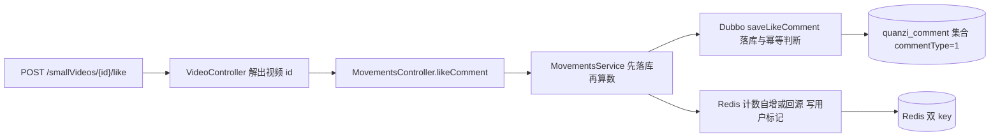
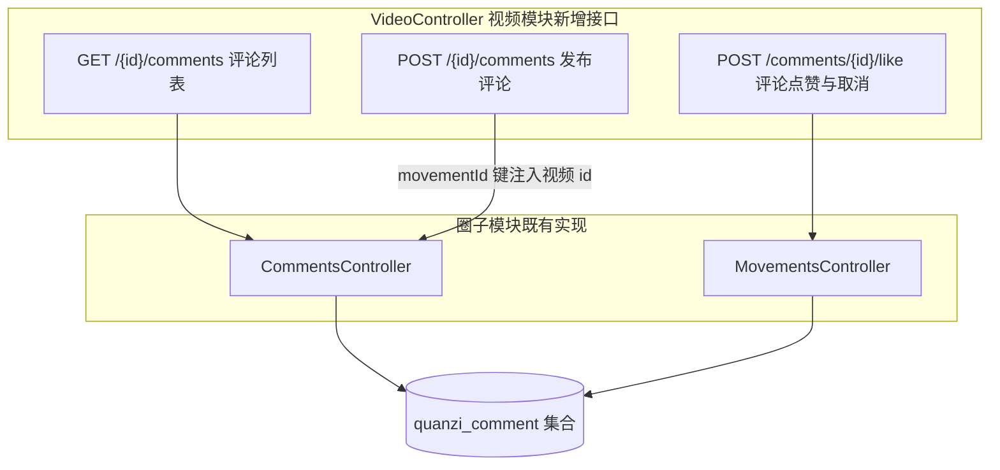

# 小视频点赞与评论：一套互动底座，两个模块复用

视频列表能翻页之后，详情页里的互动按钮还是一排摆设：点赞数字是写死的占位值，评论区拉不出一条数据。动手之前先看一眼数据模型，会发现一件非常省力的事：小视频的点赞与评论，和圈子动态的点赞与评论在数据上完全同构，都是「某个用户、以某种互动类型、作用于某个目标」的一次表态。目标从动态 id 换成视频 id，类型在点赞与评论之间切换，其余链路一个字都不用改。

这一讲因此格外聚焦：把圈子模块已经打磨好的互动链路接到视频上，Controller 一层转发即可；再把视频列表装配里遗留的点赞与评论 TODO 摘掉，让列表上的数字与真实数据对上账。写下来的代码量不大，但「复用到底层模型」这个判断，比任何一段代码都更值得带走。

## 先给结论

- 视频点赞的契约是 `POST /smallVideos/{id}/like`，实现整体复用圈子的点赞链路：`VideoController` 注入 `MovementsController` 直接转发，唯一的差别是路径变量从动态 id 换成视频 id。
- 数据侧不新增任何集合：视频 id 写进评论集合的 `publishId` 字段，`commentType` 取 1；在统一互动模型里，一条视频在互动层面「就是一条动态」。
- 评论三件事（评论列表、发布评论、评论点赞）同样靠转发复用：列表与发布走 `CommentsController`，点赞走 `MovementsController`，发布评论时把视频 id 塞进 `movementId` 键，沿用既有契约。
- 列表装配摘掉两个 TODO：是否点赞读用户标记 key 的存在性，点赞数读计数 key 并判空兜底，评论数用 count 查询按类型 2 统计。
- 评论点赞的路径变量是评论 id 不是视频 id，这是本课最容易踩的坑；重复点赞与重复取消依旧由 Dubbo 层幂等拦截，响应 500。

## 一、点赞：注入圈子控制器，转发过去

接口文档对视频点赞的定义是 `POST /smallVideos/{id}/like`，路径变量为视频 id，响应体携带操作后的最新点赞数；取消点赞与之同构，路径换成 `/smallVideos/{id}/dislike`。与圈子动态点赞的 GET 契约相比，视频侧把请求方法换成了 POST，写操作用 POST 在语义上更站得住，两套接口各照各的文档实现即可，不必强行对齐。

实现思路在讲解里只有一句话：点赞逻辑与圈子一样，实现也一样，直接拿来用。落地方式是跨控制器复用，`VideoController` 注入 `MovementsController`，把请求原样转发过去：

```java
@RestController
@RequestMapping("smallVideos")
public class VideoController {

    @Autowired
    private VideoService videoService;

    //圈子模块的动态控制器，点赞链路整体复用
    @Autowired
    private MovementsController movementsController;

    /**
     * 视频点赞
     */
    @PostMapping("/{id}/like")
    public ResponseEntity<Long> likeComment(@PathVariable("id") String videoId) {
        //与动态点赞共用一套实现，目标换成视频 id
        return this.movementsController.likeComment(videoId);
    }

    /**
     * 取消视频点赞
     */
    @PostMapping("/{id}/dislike")
    public ResponseEntity<Long> dislikeComment(@PathVariable("id") String videoId) {
        return this.movementsController.dislikeComment(videoId);
    }
}
```

三个细节值得逐一留意。**第一，转发的只有路径变量。** 方法体一行，视频 id 从 `@PathVariable` 解出来后原样交给圈子的点赞方法，命名从 `publishId` 换成 `videoId` 只是语义标注，数据层那个名为 `publishId` 的字段此刻装的就是视频 id。**第二，请求方法换成 POST。** 圈子侧的点赞当年为了方便 REST 工具测试选了 GET，视频侧的接口文档直接给 POST，按文档来，顺带把「写操作应该用 POST」这个规范要求在新接口上兑现。**第三，Controller 调 Controller 是一个可议的取舍。** 更规范的做法是把点赞逻辑下沉到 Service 或者直接消费 Dubbo 接口，让控制器各管各的 HTTP 姿态；课程为了「一个字不改地复用」选择了注入控制器直接转发，胜在零改动、行为与圈子完全一致，代价是 HTTP 层与业务层的边界被打通了一次，参数校验与异常处理跟随被转发的方法走。工程上这笔账两种算法都成立，重要的是知道自己在选什么。

一次视频点赞在后端的完整流转如下图，请求从视频模块进入，业务与数据全部发生在圈子那一套实现里：



图里值得看的是后半段：落库、幂等、计数、标记，全是动态点赞环节定下的既有动作，视频只是给这套动作换了一个目标 id。复用不是复制粘贴代码，而是连数据契约一起继承。

## 二、落库验证：视频在互动集合里「成为」一条动态

服务重启后先用 REST 工具测点赞。请求按文档拼装，路径带上视频 id，方法 POST，登录 token 走请求头；不需要上传文件那些表单字段，点赞是一个纯参数请求：

```bash
# 对视频 id 尾号 cad 的视频点赞，响应 200 与数字 1
POST http://api.example.com:18080/smallVideos/5dc432a45459672c7492cad/like
Authorization: Bearer <登录token，此处打码>
```

响应拿到数字 1，接口层算是通了，但这次点赞到底落在了哪里，要翻进 MongoDB 才能作数。打开评论集合，按创建时间倒序取最后一条：

```bash
# 点赞后查看评论集合的最后一条记录
db.getCollection('quanzi_comment').find({}).sort({created: -1}).limit(1)
# 记录形态：publishId 即视频 id，commentType 为 1
```

那条新文档的 `publishId` 尾号正是刚才点赞的视频 id，`commentType` 为 1，是一条标准的点赞表态记录。也就是说，视频在互动集合里被当成了一条动态：动态的 id 换成了视频的 id，其余字段一视同仁。统一互动模型的设计红利在这里兑现得最彻底，发布视频、发布动态、发表评论，对互动层来说都只是「产生了可以被表态的目标」，点赞链路根本不关心目标背后是什么内容。

取消点赞同样一句话：把请求里的 like 换成 dislike。响应的数字回到 0，再看集合，最后那条点赞文档已经消失，计数与标记两个 Redis key 也随之递减和删除。再点一次、再取消一次，数字与记录的增减每次都精确对账。幂等的表现也和动态点赞一致：连续发两次 like，第二次被 Dubbo 层的查重拦下，响应 500；取消一个没点过的赞，同样 500。表态动作被硬性限制成一次有效，这套约束从圈子模块原封不动继承过来，一行代码都没多写。

## 三、列表装配：摘掉点赞相关的两个 TODO

写入链路通了，查询侧还欠着账。视频列表装配 `VideoVo` 时留过占位：点赞数固定写死，是否点赞永远是 0。装配逻辑与圈子动态的填数方法同构，把那边的代码拷进 `VideoService`，换掉 key 里的目标 id 就能用。`VideoService` 此前没有 Redis 依赖，先注入模板：

```java
@Autowired
private RedisTemplate<String, String> redisTemplate;
```

然后在装配循环里逐条填数：

```java
//是否点赞：用户维度的标记 key，存在即点过
String likeUserCommentKey = "QUANZI_COMMENT_LIKE_USER_" + user.getId() + "_" + record.getId();
videoVo.setHasLiked(this.redisTemplate.hasKey(likeUserCommentKey) ? 1 : 0);
//点赞数：目标维度的计数 key，判空兜底为 0
String likeCommentKey = "QUANZI_COMMENT_LIKE_" + record.getId();
String value = this.redisTemplate.opsForValue().get(likeCommentKey);
if (StringUtils.isNotEmpty(value)) {
    videoVo.setLikeCount(Integer.valueOf(value));
} else {
    videoVo.setLikeCount(0);
}
```

两段读取对应 Redis 里的两组 key，语义泾渭分明。标记 key 拼进了当前用户 id 与视频 id，回答「我点过没有」，用 `hasKey` 的存在性判断加三元表达式一行解决；计数 key 只带视频 id，回答「这条视频被赞了多少」，所有人看到的数字一样，取值后必须判空：视频从没被点过、或缓存 key 被清掉，`get` 拿回来是 null，直接 `Integer.valueOf` 转换就抛异常，整页列表跟着挂掉，空值兜底为 0 是硬要求。

装配代码是拷贝改造来的，最容易犯的错就是两组 key 拿串：把标记 key 的值当成点赞数读，或者把计数 key 拿去做存在性判断，编译不报错、数字却完全不对。区分的办法只有一个，读代码时先问这个字段是「公共数据」还是「个人状态」，公共数据走计数 key，个人状态走标记 key。

重启服务后把整条链路对账：对尾号 cad 的视频点赞，再查列表接口，这条视频的点赞数返回 1、是否点赞返回 1；取消之后两边一起归零。写入侧落的账与读取侧报的账完全一致，列表上的数字从占位假值变成了真实数据，注释里的 TODO 正式摘掉。

## 四、评论：三接口的第二次复用

评论区是同一套底座的第二次复用，接口有三个，覆盖评论的全部生命周期。

评论列表的契约是 `GET /smallVideos/{id}/comments`，带 page 与 pagesize 两个分页参数，返回结构与圈子评论列表完全一致。实现在 `VideoController` 里注入 `CommentsController`，把视频 id 与分页参数原样转发：

```java
/**
 * 评论列表
 */
@GetMapping("/{id}/comments")
public ResponseEntity<PageResult> queryCommentsList(@PathVariable("id") String videoId,
        @RequestParam(value = "page", defaultValue = "1") Integer page,
        @RequestParam(value = "pagesize", defaultValue = "10") Integer pagesize) {
    //评论按目标 id 查询，视频 id 与动态 id 在数据层等价
    return this.commentsController.queryCommentsList(videoId, page, pagesize);
}

/**
 * 发布评论
 */
@PostMapping("/{id}/comments")
public ResponseEntity<Void> saveComments(@RequestBody Map<String, String> param,
        @PathVariable("id") String videoId) {
    //既有契约认 movementId 这个键，视频 id 从这里注入
    param.put("movementId", videoId);
    return this.commentsController.saveComments(param);
}
```

发布评论的方法体里藏着一个必讲的数据适配。`CommentsController` 的既有契约从请求体的 Map 里取 `movementId` 与 `comment` 两个键，这套契约是为圈子设计的；视频发布评论的请求体里只有评论内容，视频 id 在路径上。于是在转发之前先做一步适配，`param.put("movementId", videoId)` 把视频 id 装进那个约定的键。键名与语义在这里出现了第二层名实之差：`movementId` 名下先后装过动态 id、评论 id，现在又装视频 id。适配层的这一行 put 保住了下游零改动，代价是读代码的人必须知道这个键名是历史契约，不代表内容；配套的注释与团队约定，是这种复用方式必须支付的成本。

评论点赞与取消是第三次转发，路径是 `/smallVideos/comments/{id}/like` 与 `/smallVideos/comments/{id}/dislike`：

```java
/**
 * 评论点赞
 */
@PostMapping("/comments/{id}/like")
public ResponseEntity<Long> commentsLikeComment(@PathVariable("id") String publishId) {
    //路径变量此时是评论 id，不是视频 id
    return this.movementsController.likeComment(publishId);
}

/**
 * 取消评论点赞
 */
@PostMapping("/comments/{id}/dislike")
public ResponseEntity<Long> disCommentsLikeComment(@PathVariable("id") String publishId) {
    return this.movementsController.dislikeComment(publishId);
}
```

三个接口的复用关系可以画成一张结构图，视频模块的三个入口，全部通向圈子模块的两个既有实现：



图里三条实线就是三次转发，目标只有一个集合。互动数据全部沉淀在 `quanzi_comment`，靠目标 id 与类型字段天然分区：类型 2 是评论本体，类型 1 是点赞表态，目标 id 指向谁，表态就归谁。

## 五、评论数装配与全链路测试

列表上还剩最后一个数字：每条视频卡片上的评论数。这个数字不能从评论列表接口倒推，列表是分页的，一页十条评论不代表评论只有十条，正确姿势是按目标 id 与类型直接 count。`VideoService` 通过 Dubbo 消费圈子 API：

```java
@Reference(version = "1.0.0")
private QuanZiApi quanZiApi;
```

装配循环里补上统计：

```java
//评论数：按目标 id 与类型 2 统计，空值兜底为 0
Long count = this.quanZiApi.queryCommentCount(videoVo.getId(), 2);
videoVo.setCommentCount(count == null ? 0 : count.intValue());
```

查询结果判空再转 int，口径与点赞数的兜底一致：统计方法在无数据时的返回形态以实现为准，装配层自己兜住空值，列表才不会因为一条冷门视频而整体失败。

测试按评论的生命周期走一遍。发布评论用 POST，请求体是 JSON，内容键名照文档取 `comment`，提交一条「good」，响应空体状态 200。翻进评论集合，新文档的类型为 2、内容为 good、目标 id 是视频 id，发布落库无误。改用 GET 请求查评论列表，刚发的评论带着用户昵称头像返回，列表装配正常。评论点赞是本节的看点：从集合里复制那条 good 评论的 id 填进路径，发 POST 请求，响应返回数字 1；再看集合，多了一条 `publishId` 为该评论 id、类型为 1 的表态记录，赞记在了评论头上而不是视频头上。接着验证幂等与取消：原地再点一次，响应 500， Dubbo 层查重生效；把 like 换成 dislike，表态记录删除、数字归零；重新点赞，数字回到 1。最后查视频列表，这条视频的评论数字段显示 1，与刚才的一条评论对上账。

到这里，小视频的互动闭环全部落地：点赞与取消走圈子的点赞链路，评论的发布、列表、点赞走圈子的评论链路，列表装配的点赞数、是否点赞、评论数从占位假值换成真实读取。三个模块、三类目标、一套集合，统一互动模型在 day04 走完最后一次验证。

## 常见误区

- **把视频 id 填进评论点赞的路径。** 错例：测评论点赞时顺手用视频 id 发请求，表态记录落库后评论的赞记在视频头上，视频点赞数虚高一截。正解：评论点赞的路径变量是评论 id，从评论集合或列表响应里取，发请求前先确认目标是谁。
- **发布评论自造请求体键名。** 错例：请求体写成 `{"videoId": "...", "content": "..."}`，下游取不到 `movementId` 与 `comment` 两个键，评论内容空落库。正解：请求体只带 `comment`，视频 id 从路径取，由适配层 `param.put("movementId", videoId)` 注入既有契约。
- **装配时两组 key 拿串。** 错例：点赞数读成标记 key 的值，或是否点赞去判断计数 key，数字与状态完全错位。正解：公共数据读 `QUANZI_COMMENT_LIKE_<目标id>`，个人状态读 `QUANZI_COMMENT_LIKE_USER_<用户id>_<目标id>`，先分清字段语义再抄 key。
- **计数取值不判空直接转数字。** 错例：`Integer.valueOf(this.redisTemplate.opsForValue().get(key))`，key 不存在时对 null 转换抛异常，整页列表 500。正解：取值先 `StringUtils.isNotEmpty` 判断，空值兜底为 0，评论数的 count 查询同理。

## 面试可能被问到的问题

1. 面试官追问：「视频点赞为什么能直接复用动态点赞的整套实现？」
   答：因为底层是统一互动模型，一次表态由用户 id、目标 id、互动类型三个要素构成，存储只有一张评论集合。动态与视频对互动层来说都是「目标」，类型字段区分表态种类，链路里的落库、幂等、计数逻辑一个都不用改。复用的真正成本不在代码而在契约，目标 id 的字段名叫 publishId，这个历史命名要靠注释与约定守住。
2. 面试官追问：「Controller 里注入另一个 Controller 转发，这样做好不好？」
   答：好处是零改动复用，行为与原实现完全一致，适合快速验证；问题在于打穿了 HTTP 层与业务层的边界，被转发方法的参数校验、异常语义、返回契约都会原样带过来，后续任何一方改动都可能影响另一方。更规范的做法是把公共逻辑下沉到 Service，或直接消费 Dubbo 接口，让控制器只管各自的协议姿态。知道取舍比记住结论重要。
3. 面试官追问：「动态、视频、评论的互动都落在同一张评论集合，查询怎么隔离？」
   答：两个维度天然分区。目标 id 决定表态归属于谁，指向动态就是动态的赞，指向评论就是评论的赞；互动类型决定表态是什么，点赞、评论、喜欢各占一个类型值。所有查询都带目标 id 与类型两个等值条件，配合索引过滤，互不串数据。风险在于目标 id 字段语义随场景漂移，需要靠文档约定与枚举管理。
4. 面试官追问：「视频卡片上的评论数为什么用 count 查询，而不是拿评论列表的长度？」
   答：评论列表是分页接口，一次只返回一页数据，长度最多等于页大小，不是总数；要拿总数就得把所有页拉完，代价不可接受。count 按目标 id 加类型在存储层统计，一条聚合出结果，配合 Redis 缓存热点计数，列表装配的成本是常数级。列表负责「内容」，count 负责「数量」，两个接口各司其职。
5. 面试官追问：「发布评论时把视频 id 塞进名为 movementId 的键，这种历史包袱怎么处理？」
   答：短期靠适配层与注释，转发前显式 put，键名的历史语义写在注释里，让改动集中在一处；长期要做契约演进，把泛化的字段名改成 targetId 之类的中性命名，新旧字段并行一段时间，消费端逐步迁移。复用能省大量代码，但契约的债务要记账，等到第二次、第三次复用还带着旧名字，改造成本只会更高。
6. 面试官追问：「视频点赞的幂等和动态点赞是同一套吗？还缺什么？」
   答：是同一套，落库前按用户、目标、类型查重，命中返回 false，接口层翻译成 500，重复请求不产生新文档也不虚增计数。生产环境还值得补两手：并发窗口内的唯一索引兜底，防止两个同时到达的请求都通过查重；计数 key 与落库结果的对账机制，缓存被旁路修改时能自动矫正。

## 配套资料

- 目标：`materials/code/07/day04 探花交友-实现评论、小视频/day04/学习目标.md`，本日官方学习目标清单，「独立完成小视频的点赞」「独立完成小视频的评论」对应上述点赞与评论实现。
- 原型：`materials/code/07/day01 探花交友-项目搭建以及登录完善个人信息/day01/资料/探花交友移动端原型V1.2/小视频.html`，视频详情页的点赞按钮、评论入口与评论区交互形态出自这里。
- 说明：day04 资料包未解出工程源码，正文代码按课程画面与讲解逐段整理补全，包名统一改写为 `com.study.tanhua` 系；Redis key 命名沿用本阶段圈子互动环节的既有口径，示例站点以 example.com 占位。
