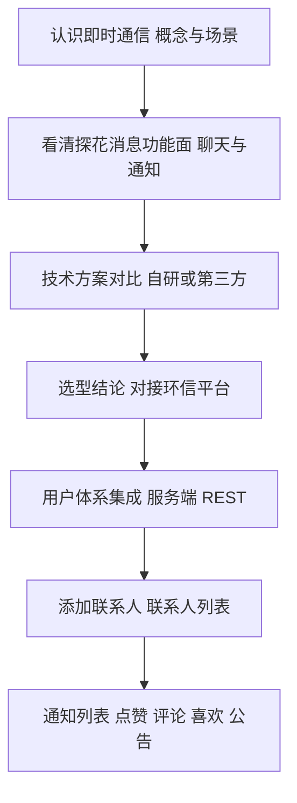

# day05 开篇：消息功能的学习路线与技术点地图

day04 收官时，项目已经具备完整的互动能力：动态可点赞、可评论、可喜欢，小视频跑通了 FastDFS 的存储与互动复用。互动数据落了库，却还没有一条「送达」的通路，用户 A 点赞了用户 B，B 只能自己刷新列表才能感知。day05 要补的正是这条通路：把消息做成一个功能面完整的模块，聊天走即时通信，通知走聚合列表。开工之前先看这一天的路线图，后面的每一步编码才有对照物。

## 先给结论

- day05 的目标分三层：理解什么是即时通信，看清探花交友的消息功能面，选定技术方案并把第三方 IM 平台集成进项目。
- 功能清单按课程口径包括：添加联系人、联系人列表，以及点赞列表、评论列表、喜欢列表、公告列表四类通知，再加好友单聊。
- 技术路线在两套方案之间选了方案二：不自研长连接网关，直接对接第三方 IM 云服务环信。
- 本日真正的攻坚点是用户体系集成：自有用户如何映射成 IM 平台账号、由谁注册、用什么凭证，这部分走服务端 REST API。
- 四类通知列表不是聊天消息，数据源是 day04 落库的互动记录，消息模块是统一互动模型的第一个直接消费方。

## 一、day05 要做什么：三层目标递进

资料包的 `day05/学习目标.md` 给出了官方清单：

```text
- 了解即时通讯以及功能
- 了解即时通信的技术方案
- 独立实现环信的用户体系集成
- 独立实现添加联系人
- 独立实现联系人列表
- 独立实现点赞列表
- 独立实现评论列表
- 独立实现喜欢列表
- 独立实现公告列表
```

十条目标归并之后其实是三层递进：认识层、选型层、实现层。认识层解决「即时通信是什么，它和普通 HTTP 接口的差别在哪」；选型层解决「高并发的聊天能力从哪来」，做法是对比自研与第三方托管后给出结论；实现层是六件具体的事，环信用户体系集成打头，联系人与四类通知列表收尾。

目标清单里「了解」与「独立实现」的动词差异值得留意：概念与方案部分重在建立判断框架，代码部分的环信集成和五张列表都是要亲手落地的量，前者决定后面排错的方向，后者决定这一天的工作时长。

## 二、功能路线：从概念到集成再到五张列表

day05 的内容编排是一条依赖链，先概念、再选型、后实现：



前四步是铺垫，后两步是代码主战场。环信集成之所以排在联系人之前，是因为「添加联系人」本身横跨两边：好友关系要写进自有存储，IM 侧的联系人能力又依赖环信的好友体系，两边的用户对不上号，后面的功能全是空中楼阁。

## 三、技术点映射：每个功能背后的题目

把功能清单与技术点对齐来看，每个条目都有明确的落点：

```yaml
# day05 功能与技术点映射（按课程编排整理）
单聊聊天:
  承载方: 环信 IM 云，客户端走 SDK 长连接
添加联系人 / 联系人列表:
  技术点: 环信用户体系集成，服务端 REST 注册与查询
  本地侧: 好友关系落自有存储
点赞列表 / 评论列表 / 喜欢列表:
  技术点: 查询 day04 的统一评论集合，按类型字段过滤
公告列表:
  技术点: 系统消息的独立查询，不走 IM 通道
```

这张映射表里藏着 day05 最重要的一个分野：聊天是「消息送达」问题，归环信；通知是「记录查询」问题，归自有数据库。点赞、评论、喜欢三类列表与 day04 建立的统一评论集合直接衔接，查询时按类型字段过滤即可；公告是新增的系统消息来源。把这个分野想清楚，day05 后半程的编码就只剩常规的 Dubbo 服务与装配工作。

## 四、开工前的两个背景判断

**第一，为什么消息模块先讲概念再动工。** 聊天类功能的实现形态与本项目此前所有功能都不同：前面的接口都是「请求、响应」模型，客户端发起、服务端应答、连接即断；聊天要求服务端能把消息主动推给在线的接收方，连接要长住，连接数量等于在线用户数。模型层面的差异决定了技术选型为什么存在，不先建立这个认识，「为什么不直接写个 Controller」的疑问就消不掉。

**第二，为什么选第三方而不是自研。** 自研一套高并发 IM 需要长连接网关、注册中心、多套存储集群与容灾设计，投入大、周期长；探花交友是中小型量级的项目，用第三方云服务按 API 对接，成本与周期都可控，团队把精力集中在业务功能上。方案对比与架构细节在即时通信的技术架构一篇展开，这里先给定论。

## 常见误区

- **把四类通知列表当成聊天消息去实现。** 错例：给点赞、评论、喜欢各建一条 IM 消息通道，靠推送送达。正解：通知列表是互动记录的查询视图，数据源在自有集合，按类型过滤查询即可；只有人与人的单聊才走 IM 通道。
- **把「了解即时通信」当成可跳过的过场。** 错例：直接跳到集成环节照抄配置，遇到连接保活、离线消息一类的问题无从下手。正解：先弄清长连接与请求响应模型的差异，选型依据与排错方向都在这一层。
- **低估用户体系集成的工作量。** 错例：以为接第三方就是调两个发消息接口。正解：集成的第一步是让自有用户在 IM 平台侧有账号、有凭证，注册模式与凭证管理都是服务端的活，这正是目标清单里「独立实现」的第一条。

## 面试可能被问到的问题

1. 面试官追问：「你们项目的聊天功能是怎么实现的，为什么没有自研 IM？」
   答：聊天能力对接第三方 IM 云服务，客户端用平台 SDK 建长连接收发消息，服务端通过 REST API 做用户体系集成与消息管理。不自研的原因是项目量级中小型，自研长连接网关与集群化存储的成本远超业务本身，第三方托管能快速上线，代价是底层不可控。
2. 面试官追问：「消息中心里的点赞列表和聊天消息是一回事吗？」
   答：不是。聊天消息走 IM 通道实时送达；点赞列表是互动记录的查询视图，数据源是互动集合里类型为点赞的记录，用户打开消息中心时按类型查询装配。前者解决及时送达，后者解决记录回看，存储与通道都不同。
3. 面试官追问：「day05 的功能里哪一个最考验设计，为什么？」
   答：用户体系集成。自有用户与 IM 平台账号是两套体系，要定注册模式、定映射规则、管服务端凭证，好友关系还要在自有存储与 IM 好友体系之间保持一致。这层做扎实，联系人与聊天才成立；做糊了，后面全是账号对不上的疑难杂症。
4. 面试官追问：「项目做到 day05，整体的数据流你能串一下吗？」
   答：登录注册与用户资料在 MySQL 与 MongoDB，圈子的动态与互动在 MongoDB 的统一评论集合加 Redis 计数，小视频文件在 FastDFS、元数据在 MongoDB。消息模块是消费端：四类通知列表直接查互动集合，聊天走第三方 IM 云，好友关系进入自有存储。互动数据先积累、后消费，是贯穿 day04 到 day05 的主线。

## 配套资料

- 目标：`materials/code/07/day05 探花交友-实现消息功能/day05/学习目标.md`，day05 官方学习目标清单，这一天的功能路线以它为准。
- 原型：`materials/code/07/day01 探花交友-项目搭建以及登录完善个人信息/day01/资料/探花交友移动端原型V1.2/消息.html`，消息模块的页面形态与「聊一下」入口出处。
- 数据库：`materials/code/07/day01 探花交友-项目搭建以及登录完善个人信息/day01/代码/mytanhua.sql`，用户表结构，用户体系集成的自有侧基础。
- 说明：day05 资料包仅含学习目标清单，未含工程源码，正文映射表为按本课讲解整理。
