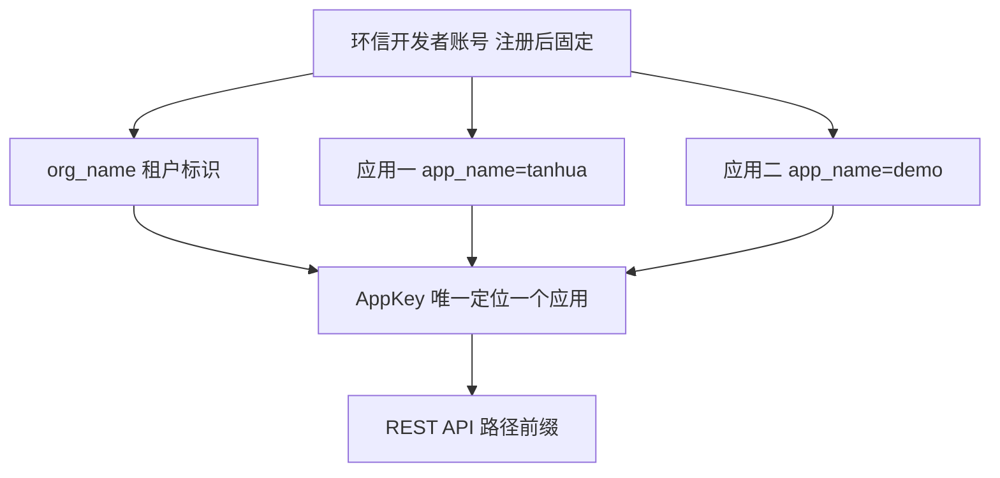
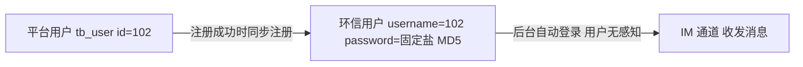

# 环信用户体系集成：AppKey 结构与环信 ID 的映射规则

> 🔒 安全提示：文中示例的口令/密钥均为课程教学环境演示口径，生产环境的安全要求见《安全与合规须知》。

探花交友的消息模块把即时通信托管给了环信：长连接维护、消息投递、离线消息这些重活由环信的云服务承担，平台自己的服务只在合适的时机调用它的接口。动手之前有一个绕不开的前置问题，平台的用户登记在自己的 `tb_user` 表里，而环信侧的用户登记在环信的账号体系里，两套体系各管各的，消息功能要跑起来，必须先把它们对齐。对齐要用的两个基础概念就是本节的主角：AppKey 与环信 ID。

## 先给结论

- AppKey 是应用在环信侧的唯一标识，格式为 `org_name#app_name`，井号分隔的两段分别定位租户与应用。
- `org_name` 在注册环信账号后固定下来，`app_name` 是该账号下每个应用的唯一标识，同一账号可以创建多个应用。
- 环信 ID 就是 IM 用户名，与密码两个字段构成一个环信用户；它在 AppKey 范围内唯一，不同应用之间相互隔离。
- 集成的映射策略：平台用户注册时同步注册环信用户，环信 ID 取平台用户 id，形成一一对应。
- 登录环信对用户无感知，由系统在后台自动完成，但这一步必须做，不登录就无法收发消息。

## 一、AppKey：两段结构定位一个应用

注册环信账号并创建应用之后，控制台会给出一个形如 `org_name#app_name` 的字符串，这就是 AppKey。环信对外的接口体系按多租户设计，一个开发者账号就是一个租户，租户下面可以开多个应用，AppKey 的两段正好对应这两级定位：



图里要抓住的重点是层级：`org_name` 由账号决定，注册完成即固定；`app_name` 由开发者起名，账号下每个应用各不相同。两段用井号拼起来就是 AppKey，拼进 REST API 的路径里就是接口的定位前缀：

```text
AppKey 结构：  example-org#tanhua
                │           │
              org_name    app_name

REST 路径规则：/{org_name}/{app_name}/具体资源
示例：         /example-org/tanhua/token
```

也就是说，后续所有对环信 REST API 的调用，无论是取 token、注册用户还是发消息，路径开头都是这两段，AppKey 从概念落地为每个请求 URL 的固定前缀。环信 ID 的数据结构表格也说明了同一件事的另一面，username 字段的注释写着「在 AppKey 的范围内唯一」，唯一性是有作用域的，作用域就是 AppKey。

一个容易忽略的运维细节：目前通过环信注册得到的 AppKey 不能由开发者自行删除，应用确实要下线时需要联系环信后台处理。创建应用时名字起清楚，避免测试应用堆积。

## 二、环信 ID：两个字段装下一个 IM 用户

环信在系统里的角色是一个聊天通道，通道不关心用户的昵称、头像、性别这些业务属性，它只认两个字段，环信 ID 与密码。按官方的定义，环信 ID 也就是 IM 用户名，这两个说法指同一个东西：

```java
public class HuanXinUser {

    // 环信 ID，即 IM 用户名，在 AppKey 范围内唯一
    private String username;

    // 用户登录环信使用的密码
    private String password;
}
```

映射策略随之而来。平台在 `tb_user` 表里注册了一个用户，就得同时在环信体系里注册一个对应的环信用户，两边用同一个标识串起来。探花交友的做法非常直接：拿平台用户的自增 id 当环信 ID，用户 id 是 102，环信用户名就是字符串 `102`，一一对应，不需要任何额外的映射表。这样选的好处有两个，id 是数字长串转成字符串必然满足环信 ID 的字符规则，且 id 唯一天然满足 AppKey 范围内的唯一性要求。

映射关系如下图：



密码这一侧同样由系统托管。环信用户的密码由注册逻辑统一生成，用户本人不知道也不需要知道，端上要登录环信时由服务端接口把这个用户名与密码下发给 APP，APP 拿着凭证去登录环信 SDK。整个登录过程发生在应用的内部链路里，用户完全感知不到自己「登录了另一个系统」，但流程上这一步不能省，环信通道只有登录之后才可用。

## 三、环信 ID 的使用规则：给映射方案划边界

环信对 ID 本身有一套明确的限制，定映射方案之前先把规则过一遍：

```text
字符范围：大小写字母、数字、下划线、横线、英文句点
禁止内容：中文、email 地址、UUID、井号等特殊字符
长度限制：不超过 255 字节
大小写：不敏感，大写字母自动转为小写
```

几条规则里对工程影响最大的是大小写不敏感与字符白名单。大小写不敏感意味着 `Tom` 与 `tom` 是同一个用户，映射方案里不要指望用大小写区分两个账号；字符白名单意味着手机号、纯数字 id、字母数字组合都能通过，但带中文昵称、带空格的字符串不能直接当环信 ID 用。用平台用户 id 做映射恰好落在白名单内，这也是这个方案省心的原因。

规则背下来并不难，关键是把它当成设计输入：今后任何想把业务字段直接扔给环信当用户名的想法，先对着这张清单过一遍，中文昵称、邮箱、带井号的复合键全部出局，不合格就做一层转换再注册。

## 常见误区

- **把环信 ID 和平台账号混为一谈。** 错例：以为用户在平台改了昵称，环信侧的用户名也跟着变。正解：环信 ID 注册后即固定，平台侧的业务属性变更与环信无关，映射关系靠约定的 id 对应维护。
- **用业务字符串直接当环信 ID。** 错例：拿昵称「小张张」或邮箱当 username 注册。正解：中文字符、邮箱地址都在禁用名单里，注册会失败，用平台用户 id 这类满足规则的值。
- **忽视唯一性的作用域。** 错例：以为环信 ID 全局唯一，跨应用随意复制用户数据。正解：唯一性限定在单个 AppKey 范围内，测试应用与生产应用互不可见，验证数据要在正确的应用里查。
- **认为用户必须手动登录环信。** 错例：给用户做一个「登录聊天系统」的入口。正解：环信登录由系统在后台自动完成，凭证由服务端接口下发，用户全程无感知。

## 面试可能被问到的问题

1. 面试官追问：「你们项目怎么把自有用户体系和第三方 IM 的用户体系打通的？」
   答：注册时机对齐加 ID 映射。用户在平台注册成功后，服务端同步调用环信的注册接口，把平台用户 id 作为环信 ID 注册到环信，密码用统一规则生成，两侧用户形成一一对应。用户登录环信由系统自动完成，凭证由服务端接口下发，用户无感知。
2. 面试官追问：「AppKey 的结构是什么，两段各代表什么？」
   答：AppKey 由井号分隔的两段组成，前一段 org_name 是多租户体系下的租户标识，注册环信账号后固定；后一段 app_name 是账号下每个应用的唯一标识。REST API 的路径以这两段开头，拼起来唯一定位一个应用，同一账号可以创建多个相互隔离的应用。
3. 面试官追问：「环信 ID 有哪些限制，你们为什么选用户 id 做环信 ID？」
   答：限制包括只能用字母、数字、下划线、横线、英文句点，不能用中文、邮箱、UUID，长度不超过 255 字节，大写自动转小写。选用户 id 是因为它必然满足字符规则，自增唯一天然满足 AppKey 内的唯一性，而且两侧映射零成本，不需要额外维护映射表。
4. 面试官追问：「用户不知道环信的密码，那他是怎么登录环信的？」
   答：环信用户的密码由服务端在注册时按固定规则生成并托管，用户不接触它。端上需要登录环信 SDK 时，调用服务端提供的查询接口拿到当前用户的环信用户名与密码，由 APP 内部完成自动登录，整个过程对用户透明。凭证按需下发、不在端上持久保存。
5. 面试官追问：「如果两个环境共用一个环信账号，用户数据会互相影响吗？」
   答：不会，环信用户的唯一性限定在单个 AppKey 范围内，不同应用的用户完全隔离。测试环境建测试应用、生产环境建生产应用，同名环信 ID 在两边各是各的用户。要注意 AppKey 目前不能自助删除，应用规划要在创建前想清楚。

## 配套资料

- 学习目标：`materials/code/07/day05 探花交友-实现消息功能/day05/学习目标.md`，「独立实现环信的用户体系集成」是本日的目标项，本节是其概念基础。
- 说明：day05 资料包仅含学习目标，无工程源码，正文代码按课程画面与讲解整理补全，包名统一改写为 `com.study.tanhua` 系；AppKey、client_id、client_secret 等敏感值已打码为 `example-*` 占位。
