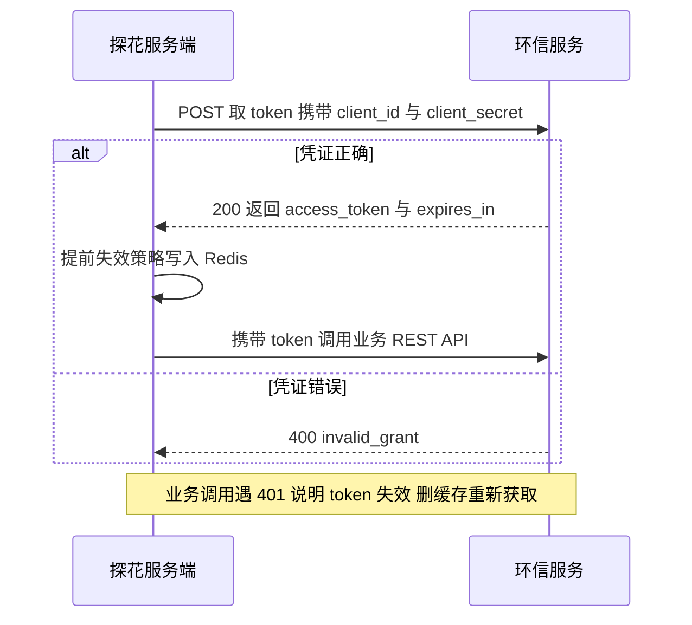
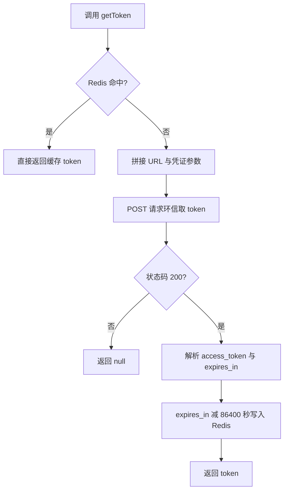

# 获取环信管理员权限：REST 取 token、Redis 缓存与两次执行的验证

环信用户体系集成动手的第一步不是注册用户，而是先解决「凭什么调你的接口」。环信提供的 REST API 全部需要权限才能访问，权限的载体就是一个 token，请求不带它或者带了一个过期的，接口直接拒绝。这件事在模型上与探花交友自己的登录逻辑完全同构：用户访问圈子数据要先登录拿 token，服务端调用环信接口也要先凭证换 token。区别只在一点，自家 token 是给用户颁发的，环信这个 token 是管理员级别的，它换来的是整个应用对 REST API 的操作权。这一节把取 token 的契约、配置、代码与验证四个环节一次走通。

## 先给结论

- 环信 REST API 统一鉴权：向 `POST /{org_name}/{app_name}/token` 发请求，用 `client_id` 与 `client_secret` 换取 `access_token`。
- 响应里的 `expires_in` 是有效期秒数，课程实测返回 518400 秒即六天；`application` 是应用 UUID，单应用场景用不上。
- 官方明确要求不要频繁请求取 token 接口，同一账号超过频率限制会被服务端拒绝，所以 token 必须缓存复用。
- 缓存的过期时间不能原样用 `expires_in`，课程做法是减去 86400 秒提前一天失效，留出网络延迟与状态不同步的缓冲。
- 实现落点在 SSO 工程：`huanxin.properties` 存凭证，`HuanXinConfig` 装载配置，`HuanXinTokenService.getToken()` 先查 Redis 命中即返回，未命中才请求环信并回写缓存。

## 一、为什么先要 token：与登录逻辑同构的鉴权模型

把环信的鉴权和项目里已经写过的登录放在一起看，几乎可以逐句对应。探花交友里，用户想访问圈子接口，必须携带登录后拿到的 token，服务端校验通过才处理业务；环信这里，应用想访问 REST API，必须携带事先换取的 token，环信校验通过才放行。取 token 的凭证 `client_id` 与 `client_secret` 相当于应用级的账号密码，在环信管理后台的应用详情页可以查到，应用创建成功后这两个值就固定了。

还要分清这个 token 的级别。自家登录颁发的是用户级 token，每个用户各拿各的，权限边界是单个人；环信这个 token 是应用级的，一个 AppKey 一套凭证，换来的 token 能操作这个应用下的用户管理、消息管理全部 REST 能力，级别上接近管理员，所以文档把这一节叫「获取管理员权限」。也正因为它权限大，后续注册环信用户、给客户端发消息这些所有 REST 调用都从它起步，它是整个集成的入场券，把它做扎实，后面每一节都站在这个方法上。

它的效力范围也值得记一笔：同一个 AppKey 下，取到的 token 对用户、群组、消息、文件等全部 REST 资源通用，不是按接口逐个授权的。这既是便利，也是它必须被严格看管的原因，凭证加 token 构成的组合一旦泄露，等于交出了应用内所有资源的读写权。环信文档把这类参数标注为「需要管理员权限」正是这个含义，本节标题里的管理员权限指的就是这把万能通行证。

这套模型用一张时序图表达更直观：



官方文档里有一段加粗级别的提醒值得逐字理解：获取 token 时服务端会返回有效期，参考 `expires_in` 字段值；由于网络延迟等原因，系统不保证 token 在这个时段内绝对有效，如果发现 token 使用异常请重新获取，比如 HTTP 响应码返回 401。也就是说 `expires_in` 是个参考值而非承诺值，工程上要按「可能提前失效」来设计。

更硬的一条约束是频率：不要频繁向服务端发送获取 token 的请求，同一账号发送此请求超过一定频率会导致服务端拒绝。这条限制针对的正是常见的新手写法，每次调 REST API 之前都先取一次 token 再调接口。这种用法本身能跑，但它把环信的取 token 服务当成了高频前置依赖，一个日活百万的应用等于给环信多制造了一倍的请求量。限制倒逼出来的才是正确姿势：token 拿到后存起来，有效期内反复使用，到期再刷新。

## 二、接口契约：一次取 token 请求长什么样

取 token 是一个标准的 POST 请求。地址由配置项拼接：`/{org_name}/{app_name}/token`，请求头声明 `Content-Type: application/json`，请求体三个参数，其中 `grant_type` 固定为 `client_credentials`，这是 OAuth2 里的客户端凭证模式，客户端以自己的身份而非某个用户的身份换取访问权：

```json
{
  "grant_type": "client_credentials",
  "client_id": "example-client-id",
  "client_secret": "example-client-secret"
}
```

用 curl 验证最直接，路径中的两段对应 AppKey 的两段：

```bash
curl -X POST "http://a1.easemob.com/example-org/tanhua/token" \
  -H "Content-Type: application/json" \
  -H "Accept: application/json" \
  -d '{
    "grant_type": "client_credentials",
    "client_id": "example-client-id",
    "client_secret": "example-client-secret"
  }'
```

凭证正确时返回三个字段：

```json
{
  "access_token": "YWMt...（完整 token 字符串，此处打码）",
  "expires_in": 518400,
  "application": "8be024f8-example-8be0-24f8-000000000001"
}
```

`access_token` 是要拿走的字符串，`expires_in` 是有效期秒数，518400 换算过来正好六天；`application` 是当前应用的 UUID，一个应用一套凭证的场景下用不到，多应用管理时才有意义。凭证错误时返回 400：

```json
{
  "error_description": "client_id does not match",
  "error": "invalid_grant"
}
```

契约里的两个状态码后面代码里都要用：200 走成功分支解析响应体，400 说明凭证不匹配，先查 `client_id` 是否抄错、应用是否选对，401 则出现在业务调用阶段，含义是当前 token 已失效，重新获取即可。

顺带把请求地址里的主机名说清楚。文档示例与课程配置里的 `a1` 是环信 REST 集群的入口之一，实际以控制台应用详情里给出的 REST API 地址为准，不同批次开通的应用可能指向不同主机；生产环境应当走 HTTPS，避免凭证与 token 在链路上裸奔。请求头里的 `Accept: application/json` 属于声明性字段，省略通常也能拿到 JSON 响应，但要写就与文档一致，别在联调时引入变量。`expires_in` 的单位是秒，拿到手先换算再使用，直接当成毫秒或分钟写进代码是真实出现过的事故。

## 三、配置先行：huanxin.properties 与 HuanXinConfig

集成逻辑写入 SSO 工程，第一步建配置文件 `huanxin.properties`，五个属性对应契约里的五样东西：

```properties
tanhua.huanxin.url=http://a1.easemob.com/
tanhua.huanxin.orgName=example-org
tanhua.huanxin.appName=tanhua
tanhua.huanxin.clientId=example-client-id
tanhua.huanxin.clientSecret=example-client-secret
```

取值来源逐项对着控制台就能核完：`url` 来自文档给出的 REST API 请求地址，尾部自带斜杠；`orgName` 与 `appName` 就是 AppKey 两段的内容，前者在应用概览里直接给出，后者是创建应用时起的名字；`clientId` 与 `clientSecret` 在应用详情页，鼠标悬停即可查看复制。这几个值属于应用级机密，`client_secret` 尤其要按敏感信息对待，示例中已打码。

配置文件要进 Spring 容器，写一个配置类把它装载成对象：

```java
package com.study.tanhua.sso.config;

import lombok.Data;
import org.springframework.boot.context.properties.ConfigurationProperties;
import org.springframework.context.annotation.Configuration;
import org.springframework.context.annotation.PropertySource;

@Configuration
@PropertySource("classpath:huanxin.properties")
@ConfigurationProperties(prefix = "tanhua.huanxin")
@Data
public class HuanXinConfig {
    private String url;
    private String orgName;
    private String appName;
    private String clientId;
    private String clientSecret;
}
```

三个注解各干一件事：`@PropertySource` 指定读取 classpath 下的 `huanxin.properties`，`@ConfigurationProperties` 按前缀 `tanhua.huanxin` 把同名属性注入同名字段，`@Data` 生成 getter 供外部取值。配好之后，工程里任何 Bean 注入 `HuanXinConfig` 就能拿到全部属性，后续的 token 服务与用户服务都从它取值，凭证集中一处，改配置不用翻代码。

凭证的存放位置另有讲究。`huanxin.properties` 放在 resources 下便于课程演示，真实项目里 `client_secret` 这类值不宜提交进代码仓库，更稳妥的做法是配置文件只留结构，敏感值由部署环境的配置中心或启动参数注入。配套的习惯是测试与生产各建一个环信应用，两套 AppKey、两套凭证、两份配置，测试期间的注册与消息不会打扰生产用户，反过来生产凭证也永远不会出现在开发机里。

控制台里还有一个与下一节相关的开关要提一句：应用的用户注册模式有「授权注册」与「开放注册」两种，开放注册不校验 token，授权注册必须携带有效 token 才能注册用户。课程保持授权注册不动，服务端全程持凭证操作，权限边界收得干净。

## 四、代码实现：getToken 的完整链路

进入 `HuanXinTokenService`，先看决策全貌再读代码：



整条链路是一个带缓存旁路的远程调用，代码如下：

```java
package com.study.tanhua.sso.service;

import com.fasterxml.jackson.databind.JsonNode;
import com.fasterxml.jackson.databind.ObjectMapper;
import com.study.tanhua.sso.config.HuanXinConfig;
import org.springframework.beans.factory.annotation.Autowired;
import org.springframework.data.redis.core.RedisTemplate;
import org.springframework.http.ResponseEntity;
import org.springframework.stereotype.Service;
import org.springframework.util.StringUtils;
import org.springframework.web.client.RestTemplate;

import java.util.HashMap;
import java.util.Map;
import java.util.concurrent.TimeUnit;

@Service
public class HuanXinTokenService {

    private static final ObjectMapper MAPPER = new ObjectMapper();

    // token 在 Redis 中的缓存键
    private static final String tokenRedisKey = "HUANXIN_TOKEN";

    @Autowired
    private HuanXinConfig huanXinConfig;

    @Autowired
    private RestTemplate restTemplate;

    @Autowired
    private RedisTemplate<String, String> redisTemplate;

    public String getToken() {
        // 先从 Redis 命中，命中直接返回，避免频繁请求环信
        String cacheData = this.redisTemplate.opsForValue().get(tokenRedisKey);
        if (StringUtils.isNotEmpty(cacheData)) {
            return cacheData;
        }

        // 拼接请求地址，配置的 url 尾部已带斜杠，不再重复补
        String url = this.huanXinConfig.getUrl()
                + this.huanXinConfig.getOrgName() + "/"
                + this.huanXinConfig.getAppName() + "/token";

        // 组装请求参数，grant_type 固定为 client_credentials
        Map<String, Object> param = new HashMap<>();
        param.put("grant_type", "client_credentials");
        param.put("client_id", this.huanXinConfig.getClientId());
        param.put("client_secret", this.huanXinConfig.getClientSecret());

        try {
            ResponseEntity<String> responseEntity =
                    this.restTemplate.postForEntity(url, param, String.class);
            if (responseEntity.getStatusCodeValue() != 200) {
                // 非 200 一律视为获取失败，交由调用方处理
                return null;
            }

            // 解析响应体，取出 token 与有效期
            String body = responseEntity.getBody();
            JsonNode jsonNode = MAPPER.readTree(body);
            String accessToken = jsonNode.get("access_token").asText();
            // 过期时间，提前一天失效
            Long expiresIn = jsonNode.get("expires_in").asLong() - 86400;

            // 将 token 存入 Redis，时间单位为秒
            this.redisTemplate.opsForValue()
                    .set(tokenRedisKey, accessToken, expiresIn, TimeUnit.SECONDS);
            return accessToken;
        } catch (Exception e) {
            e.printStackTrace();
        }
        return null;
    }
}
```

几个实现细节值得停下来看。URL 拼接时配置的 `url` 尾部已经带了斜杠，所以 `orgName` 直接续在后面，中间的斜杠在两处各补一次，多一个少一个斜杠请求就 404，这是接口对接最廉价的坑。`RestTemplate.postForEntity` 传入 Map 会自动序列化成 JSON 请求体，响应用 `String.class` 接回来再解析。解析用 `ObjectMapper.readTree` 转成 `JsonNode`，`access_token` 取 `asText()`，`expires_in` 取 `asLong()`，字段名与文档一字不差。状态码判断用「不等于 200 即失败」的口径，401、400、500 全部收敛到返回 null，调用方只看返回值就知道这次没拿到 token。

## 五、缓存策略：为什么要提前一天失效

存 Redis 的那一行是本节最值得琢磨的代码。`set` 的第四个参数是过期时间，课程没有直接用环信给的 `expires_in`，而是减了 86400 秒，正好一天的量。

道理在文档那句「网络延迟等原因，系统不保证绝对有效」里。环信侧的有效期以它的时钟与链路为准，本地以 Redis 的时钟为准，两边天然存在误差，再加上请求排队、重试耗时，如果本地把 token 用到最后一秒才丢弃，很可能最后几次调用实际已经越过了环信侧的失效线，返回 401 才发现晚了。提前一天失效等于主动留出一整天的安全垫，本地判断「还没过期」时，环信侧大概率也认可。

提前多少可以再权衡。文档返回六天，减一天后本地实际可用五天；讲义里给出了另一种写法，直接把过期时间写死为五天的秒数 432000。两种方式各有取舍：写死五天代码更直白，依赖「文档说六天」这个事实不变，哪天环信调整了有效期就埋雷；实时计算减一天自适应任何有效期返回值，代价是多一步运算且过期逻辑藏在表达式里需要注释说明。课程两种都写了，选哪种看团队口味，重要的是两条底线不破，本地过期必须早于远端过期，过期之后必须能自动重新获取。

还有一条配套逻辑要心里有数：提前失效只是让本地抢先淘汰，如果线上真出现了 401，说明出现了意料之外的失效（比如环信侧主动刷新了凭证体系），处理方式是删除 Redis 里的缓存键再调一次 `getToken()`，拿到新 token 后重发业务请求。调用方做一次透明重试即可，不要把 401 直接抛给业务层。

## 六、测试验证：两次执行看缓存命中

写个测试用例，把「未命中取新、命中复用」两个分支都跑一遍：

```java
package com.study.tanhua.sso.service;

import org.junit.Test;
import org.junit.runner.RunWith;
import org.springframework.beans.factory.annotation.Autowired;
import org.springframework.boot.test.context.SpringBootTest;
import org.springframework.test.context.junit4.SpringRunner;

@SpringBootTest
@RunWith(SpringRunner.class)
public class TestHuanXinTokenService {

    @Autowired
    private HuanXinTokenService huanXinTokenService;

    @Test
    public void testGetToken() {
        String token = this.huanXinTokenService.getToken();
        System.out.println(token);
    }
}
```

在 `getToken()` 的 Redis 查询处打断点，debug 启动测试。第一次执行，缓存未命中拿到 null，继续往下走，拼出的 URL 就是配置三段加 `/token` 的完整地址，请求返回的响应体里能看到 `access_token` 与六天的 `expires_in`，减去 86400 后写入 Redis，方法返回 token，控制台打印出完整字符串。

紧接着再执行一次。断点再次停下时，`cacheData` 已经有值，判断非空直接 return，全程没有发起任何 HTTP 请求。两次执行一对比，缓存的意义就落在明面上：同一进程内无论多少处业务要 token，六天里实际只有一次（或者缓存失效后的一次）真正打到环信，频率限制再也不会被触发，这正是官方那条「拿到 token 存起来用」提醒想要的效果。

Redis 里还能做一次独立的核对：`HUANXIN_TOKEN` 这个键应当存在，剩余存活时间在五天上下，比环信侧的六天有效期恰好少一天，提前失效的设置在缓存里肉眼可见。上线后的巡检也可以借用这个键，键不存在说明缓存被清或刷新失败，连续取不到就值得告警了。

## 常见误区

- **每次调 REST API 都先取一次 token。** 错例：把取 token 写成每个接口方法的第一行。正解：token 缓存到 Redis，命中直接用，未命中才取，同账号高频取 token 会被环信限流拒绝。
- **过期时间原样使用 `expires_in`。** 错例：`expires_in` 是多少秒就存多少秒，把有效期用到最后一刻。正解：减去一段缓冲（课程用一天），本地先于远端失效，到期自动重取，规避时钟与延迟误差。
- **遇到 401 只会重试不会清缓存。** 错例：401 后再调一次 `getToken()`，拿回来的还是 Redis 里的旧 token，反复 401。正解：401 说明缓存里的 token 已失效，先删缓存键再重新获取，必要时对原请求做一次透明重试。
- **凭证硬编码或打进日志。** 错例：`client_secret` 直接写在代码里，调试时把请求体整段打印进日志。正解：凭证进配置文件并打码管理，日志里对 token 与凭证脱敏，泄露等于把整个应用的管理权交出去。
- **URL 拼接多补或少补斜杠。** 错例：`url` 配置尾部带了斜杠，代码里又拼了一个，请求 404 还以为是凭证问题。正解：统一约定配置里 `url` 带尾斜杠，代码按固定模板拼接，联调时先打印完整 URL 核对。

## 面试可能被问到的问题

1. 面试官追问：「调用第三方 REST API 取到的 token，你们是怎么管理的？」
   答：按「缓存复用加提前失效」管理。token 取回后写入 Redis 并设置过期时间，过期时间在服务端返回的有效期基础上减去一段缓冲，保证本地先于远端失效；所有业务调用先查缓存，命中直接用，未命中才请求换取并回写。这样既满足服务方的频率限制，也规避了时钟与网络延迟带来的边界失效。
2. 面试官追问：「为什么不能每次请求前都现取一个 token？」
   答：一是性能，每次业务调用都多一次远程换取，延迟翻倍；二是服务方的限制，取 token 接口有同账号频率上限，超限直接拒绝，会拖垮所有业务调用；三是没必要，token 在有效期内是长期凭证，缓存一次用几天，只需保证到期自动刷新。
3. 面试官追问：「服务端返回的 expires_in 直接设置成缓存过期时间有什么风险？」
   答：服务端承诺的有效期受网络延迟与时钟差异影响，文档会声明不保证绝对有效。本地按原值倒计时，可能本地还没到点、远端已经失效，请求 401。工程上取一个提前量，比如减去一天或按比例缩短，把误差吸收掉，同时对 401 做清缓存重取的兜底。
4. 面试官追问：「grant_type 里的 client_credentials 是什么模式？」
   答：OAuth2 的客户端凭证模式，客户端以自己的身份而不是代某个用户去换取访问权，凭证是 client_id 与 client_secret。服务对服务调用的典型选择，本项目里探花服务端以应用身份访问环信的管理接口，用这个模式语义正好。用户身份的场景则应该走授权码等用户参与的模式。
5. 面试官追问：「401 之后你们的处理链路是怎样的？」
   答：先认定缓存 token 已失效，删除 Redis 缓存键，重新调 getToken 换新 token，然后对失败的业务请求做一次透明重试，重试仍失败才向上抛错。整个过程对业务调用方收敛成一个可用性判断，日志里记录 401 发生时间与次数，频率异常说明凭证被服务端吊销或时钟严重漂移，要人工介入。
6. 面试官追问：「token 缓存选 Redis 而不是 JVM 内存，为什么？」
   答：服务是多实例部署，JVM 内存缓存意味着每个实例各自取一次 token，实例一多仍然可能触碰频率限制，而且某个实例重启就丢失缓存。Redis 是共享存储，全集群一份 token、一份倒计时，刷新与失效全局一致，排查问题时也只有一个地方可查。

## 配套资料

- 学习目标：`materials/code/07/day05 探花交友-实现消息功能/day05/学习目标.md`，「独立实现环信的用户体系集成」为本日目标，获取管理员 token 是其中的第一步。
- 说明：day05 资料包仅含学习目标，无工程源码，正文代码按课程画面与讲解逐段整理补全，包名统一改写为 `com.study.tanhua` 系；`client_id`、`client_secret`、AppKey 组织段等敏感值已打码为 `example-*` 占位。
