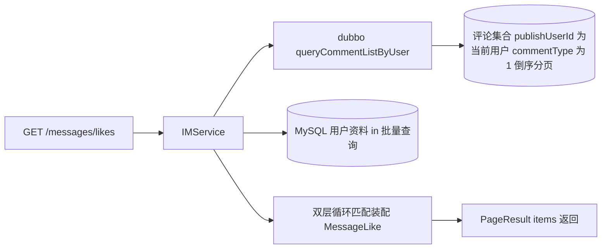

# 点赞列表：从评论集合捞出「谁赞了我」

消息模块的「点赞」页签回答一个具体问题：谁赞了我的动态。点赞动作在圈子模块早已落库，本课不新增任何写入，只做一次新的消费：把指向我的互动记录按时间翻出来，补上操作人资料，按消息卡片的结构交给端上。数据源、查询方式、装配套路在这个接口里集齐，后面评论与喜欢两个列表直接换元复用。

## 先给结论

- 接口契约 `GET /messages/likes`，参数 `page`、`pageSize`，返回 `PageResult`，元素为 `MessageLike`（id、avatar、nickname、createDate）。
- 数据源就是圈子的评论集合，条件是 `publishUserId` 等于当前用户、`commentType` 等于 1，按 `created` 倒序分页。
- dubbo 的圈子 API 新增 `queryCommentListByUser(userId, type, page, pageSize)`，一次实现，评论与喜欢列表后续换 type 直接复用。
- 装配固定三步：收集互动人 userId 批量查资料，双层循环匹配，ObjectId 转 `toHexString`、时间戳格式化。
- 查询主体是 `publishUserId`：这个列表是「我被动收到的赞」，与详情页按 `publishId` 查某条动态的互动是两个方向。

## 一、数据从哪来：一张评论表的又一次消费

统一互动模型在 day03 定型：点赞、评论、喜欢三类互动共用一张评论集合，`commentType` 区分 1-点赞、2-评论、3-喜欢。一条点赞文档的字段语义是：

```text
publishUserId  被赞动态的发布人，即我
userId         点赞的人
publishId      被赞的动态 id
commentType    1
created        点赞时间
```

于是「谁赞了我」被翻译成一句查询：`publishUserId` 是我、`commentType` 是 1 的文档集合，按时间倒序分页。它与圈子详情页的查询构成两个方向，详情页问「这条动态被谁互动过」，条件主体是 `publishId`；消息页问「我名下的动态被谁互动过」，条件主体是 `publishUserId`。同一个集合，写入一次，消费多次，统一模型的查询红利正在兑现：



## 二、dubbo 侧：queryCommentListByUser

接口定义加在 dubbo 工程的圈子 API 里：

```java
/**
 * 查询用户的评论数据（点赞、评论、喜欢按 type 区分）
 * @param userId 目标用户，即互动的接收人
 * @param type   评论类型：1-点赞 2-评论 3-喜欢
 */
PageInfo<Comment> queryCommentListByUser(Long userId, Integer type, Integer page, Integer pageSize);
```

实现里分页与条件各有说法：

```java
@Override
public PageInfo<Comment> queryCommentListByUser(Long userId, Integer type, Integer page, Integer pageSize) {
    //消息列表最新互动排最前，页码从 1 转成 0 基
    PageRequest pageRequest = PageRequest.of(page - 1, pageSize,
            Sort.by(Sort.Order.desc("created")));
    //条件：动态发布人是我，且类型匹配
    Query query = Query.query(Criteria.where("publishUserId").is(userId)
            .and("commentType").is(type));
    query.with(pageRequest);
    List<Comment> commentList = this.mongoTemplate.find(query, Comment.class);
    PageInfo<Comment> pageInfo = new PageInfo<>();
    pageInfo.setTotal(0);
    pageInfo.setPageSize(pageSize);
    pageInfo.setPageNum(page);
    pageInfo.setRecords(commentList);
    return pageInfo;
}
```

两个条件都是等值匹配，day03 表结构设计时给评论集合建议的复合索引（`publishUserId` 加 `commentType`）在这里正是目标场景：先按人定位，再按类型收窄，互动量再大也只扫自己的子集。类型参数做进方法签名而不是写死，是给后面两个列表留的口子，写一次条件与分页，三类互动共同受益。

## 三、接口服务组装 MessageLike

消息卡片元素按契约新建 `MessageLike`：

```java
@Data
public class MessageLike {

    //互动记录 id，三类列表通用
    private String id;
    //操作人头像
    private String avatar;
    //操作人昵称
    private String nickname;
    //操作时间，如 2019-10-10 10:21
    private String createDate;
}
```

IMService 的装配主干如下：

```java
@Reference(version = "1.0.0")
private QuanziApi quanziApi;

@Autowired
private UserInfoService userInfoService;

/**
 * 查询点赞列表
 */
public PageResult queryMessageLikeList(Integer page, Integer pageSize) {
    User user = UserThreadLocal.get();
    //type 为 1 是点赞数据
    PageInfo<Comment> pageInfo =
            this.quanziApi.queryCommentListByUser(user.getId(), 1, page, pageSize);
    List<Comment> records = pageInfo.getRecords();

    PageResult pageResult = new PageResult();
    pageResult.setPage(page);
    pageResult.setPageSize(pageSize);
    pageResult.setPages(0);
    pageResult.setCounts(0);

    //收集点赞人 id，一次批量查资料
    List<Long> userIds = new ArrayList<>();
    for (Comment record : records) {
        userIds.add(record.getUserId());
    }
    QueryWrapper<UserInfo> queryWrapper = new QueryWrapper<>();
    queryWrapper.in("user_id", userIds);
    List<UserInfo> userInfoList = this.userInfoService.queryUserInfoList(queryWrapper);

    //双层循环匹配，把资料填进卡片
    List<MessageLike> messageLikeList = new ArrayList<>();
    for (Comment record : records) {
        for (UserInfo userInfo : userInfoList) {
            if (userInfo.getUserId().longValue() == record.getUserId().longValue()) {
                MessageLike messageLike = new MessageLike();
                messageLike.setId(record.getId().toHexString());
                messageLike.setAvatar(userInfo.getLogo());
                messageLike.setNickname(userInfo.getNickName());
                messageLike.setCreateDate(
                        new DateTime(record.getCreated()).toString("yyyy-MM-dd HH:mm"));
                messageLikeList.add(messageLike);
                break;
            }
        }
    }
    pageResult.setItems(messageLikeList);
    return pageResult;
}
```

控制器入口极薄，默认参数交给注解：

```java
/**
 * 查询点赞列表
 */
@GetMapping("likes")
public ResponseEntity<PageResult> queryMessageLikeList(
        @RequestParam(value = "page", defaultValue = "1") Integer page,
        @RequestParam(value = "pageSize", defaultValue = "10") Integer pageSize) {
    PageResult pageResult = this.imService.queryMessageLikeList(page, pageSize);
    return ResponseEntity.ok(pageResult);
}
```

三处装配细节对应三种典型错误。**id 用 `toHexString`。** MongoDB 的 `_id` 是 ObjectId，直接序列化会拖出一串内部字段，端上要的是干净的十六进制文本。**时间是 Long 时间戳。** 存库的 `created` 是毫秒数，展示用 joda-time 的 `DateTime` 格式化成年月日时分，格式串里 `MM` 是月、`mm` 是分，写混页面照样渲染，只是数字离谱。**资料批量查。** 一页十次互动可能来自少数几个人，先收集 userId 再 `in` 查询，SQL 次数与每条记录解耦，匹配阶段 Long 比较必须 `longValue()` 后进行，直接 `==` 比较对象会随机失配。

## 四、测试：接口返回与页签呈现

测试用第一个测试用户登录（名下有被赞的动态；手机号打码，固定验证码登录），拿 token 后发 `GET /messages/likes`，返回一条记录，id、头像、昵称、时间四字段齐全，与库里那条点赞文档一致。数据量小不是问题，点赞记录本就一条，列表按页翻的逻辑与数据多少无关。

端上联动在同一用户下进行：模拟器登录，进消息模块点「点赞」页签，呈现的正是接口里那条数据。接口验证与页签呈现对上了，点赞列表从评论集合到消息卡片的一条消费链路闭合。

## 常见误区

- **条件主体写反。** 错例：`Criteria.where("userId").is(user.getId())`，查出来的是我赞了谁。正解：「谁赞了我」的主体是 `publishUserId`，即互动接收人。
- **漏掉 commentType 条件。** 错例：只按 `publishUserId` 查，评论与喜欢记录混进点赞列表。正解：统一表的前提是每个查询都带类型条件。
- **ObjectId 直接给端上。** 错例：`setId(String.valueOf(record.getId()))`，得到的是包装信息而非十六进制串。正解：`toHexString()`。
- **时间戳不格式化。** 错例：`setCreateDate(String.valueOf(record.getCreated()))`，端上显示一串毫秒数。正解：`DateTime` 按展示口径格式化。
- **Long 比较用 `==`。** 错例：`userInfo.getUserId() == record.getUserId()`，超出整型缓存范围后恒不等。正解：`longValue()` 后比较。

## 面试可能被问到的问题

1. 面试官追问：「谁赞了我」和「我赞了谁」在查询上差在哪？
   答：同一张评论集合，条件主体不同。谁赞了我按 `publishUserId` 等于当前用户加类型条件查，我赞了谁按 `userId` 等于当前用户加类型条件查。字段语义要看写入场景，读代码时先确认这条文档的 `publishUserId` 指的是动态发布人。
2. 面试官追问：「三类互动共用一张表，读侧怎么隔离？」
   答：靠 `commentType` 等值条件隔离，每条查询必须带类型过滤，配合以 `publishUserId` 打头的复合索引，隔离与性能都成立。漏写类型条件是这类设计的头号事故，点赞列表会混进评论。
3. 面试官追问：「互动文档里既有 publishId 又有 publishUserId，为什么？」
   答：`publishId` 指向被互动的具体动态，用于跳转与按动态聚合；`publishUserId` 是动态发布人，用于按人聚合的消息类查询。一个定位内容，一个定位人，消息模块按人消费，详情页按内容消费。
4. 面试官追问：「这种消息类列表要不要做缓存或已读机制？」
   答：列表数据适合短 TTL 缓存应对高频刷新，但互动发生后列表要尽快可见，过期时间要短。已读是另一个维度，通常存每个页签的已读时间戳或最后读取的记录 id，把其后新增的记录标记为未读，不动列表本身的查询逻辑。
5. 面试官追问：「互动数据量大了之后，这个列表的瓶颈在哪？」
   答：瓶颈在深分页与资料装配。深分页靠 skip 加 limit 成本线性上涨，可换按 created 的游标分页；资料装配已经批量 in 查询，再往上可以把昵称头像冗余进互动文档或走缓存。当前单用户互动量有限，等值条件加索引足够。

## 配套资料

- 学习目标：`materials/code/07/day05 探花交友-实现消息功能/day05/学习目标.md`，「独立实现点赞列表」为本日目标。
- 原型：`materials/code/07/day01 探花交友-项目搭建以及登录完善个人信息/day01/资料/探花交友移动端原型V1.2/消息.html`，点赞页签与消息卡片的页面形态出处。
- 数据库：`materials/code/07/day01 探花交友-项目搭建以及登录完善个人信息/day01/代码/mytanhua.sql`，操作人昵称头像所属的 `tb_user_info` 表结构与种子数据。
- 说明：day05 资料包仅含学习目标，无工程源码，正文代码按课程画面与讲解逐段整理补全，包名统一改写为 `com.study.tanhua` 系；`commentType` 的 1-点赞 2-评论 3-喜欢口径沿用 day03 表结构设计；测试手机号已打码。
