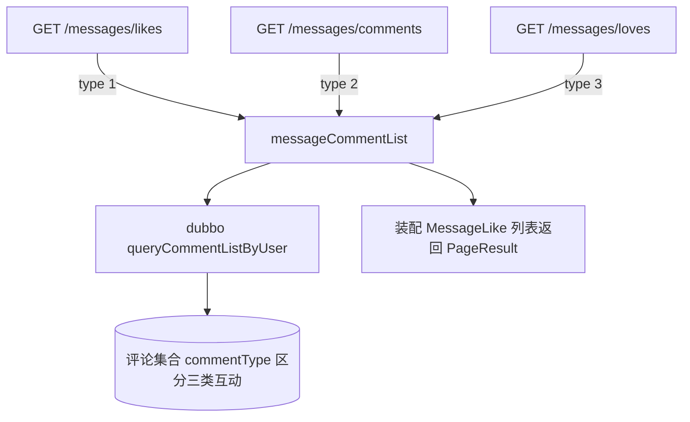

# 评论与喜欢列表：一个 type 参数收编三类互动查询

点赞列表跑通之后，评论列表与喜欢列表是同一道题的换元：数据还是那张评论集合，条件只差 `commentType` 取 2 还是 3。此刻最诱人的动作是复制粘贴，把点赞的方法抄两份改一个数字，五分钟完工。课程的选择是把装配逻辑抽成一个私有方法，type 作为参数，三个公开方法各传各的值。两种做法当下都能跑，差别在改动成本：装配逻辑将来修一个 bug，一处生效三处受益。

## 先给结论

- 评论列表 `GET /messages/comments`、喜欢列表 `GET /messages/loves`，参数与返回结构跟点赞列表完全一致。
- 服务层抽私有方法 `messageCommentList(type, page, pageSize)`，点赞传 1、评论传 2、喜欢传 3，装配代码只有一份。
- 三类列表共用 `MessageLike` VO：mock 契约里三者字段一致，结构相同就不必造三个对象。
- 复用的底气来自统一互动模型：写入同表同结构，读取只换类型条件。
- 评论列表若日后要展示评论内容，字段出现分化，届时再评估是否拆分 VO。

## 一、从三份复制到一个参数

重构后的服务层结构一眼见底，三个公开方法全部退化为一行委托：

```java
/**
 * 查询点赞列表
 */
public PageResult queryMessageLikeList(Integer page, Integer pageSize) {
    return this.messageCommentList(1, page, pageSize); //1-点赞
}

/**
 * 查询评论列表
 */
public PageResult queryMessageCommentList(Integer page, Integer pageSize) {
    return this.messageCommentList(2, page, pageSize); //2-评论
}

/**
 * 查询喜欢列表
 */
public PageResult queryMessageLoveList(Integer page, Integer pageSize) {
    return this.messageCommentList(3, page, pageSize); //3-喜欢
}
```

原 `queryMessageLikeList` 的方法体整体下移，type 从写死变成入参，其余一行不动：

```java
private PageResult messageCommentList(Integer type, Integer page, Integer pageSize) {
    User user = UserThreadLocal.get();
    //type 决定取哪类互动：1-点赞 2-评论 3-喜欢
    PageInfo<Comment> pageInfo =
            this.quanziApi.queryCommentListByUser(user.getId(), type, page, pageSize);
    List<Comment> records = pageInfo.getRecords();

    PageResult pageResult = new PageResult();
    pageResult.setPage(page);
    pageResult.setPageSize(pageSize);
    pageResult.setPages(0);
    pageResult.setCounts(0);

    //收集互动人 id，批量查资料
    List<Long> userIds = new ArrayList<>();
    for (Comment record : records) {
        userIds.add(record.getUserId());
    }
    QueryWrapper<UserInfo> queryWrapper = new QueryWrapper<>();
    queryWrapper.in("user_id", userIds);
    List<UserInfo> userInfoList = this.userInfoService.queryUserInfoList(queryWrapper);

    //双层循环匹配装配，逻辑与点赞列表一致
    List<MessageLike> messageLikeList = new ArrayList<>();
    for (Comment record : records) {
        for (UserInfo userInfo : userInfoList) {
            if (userInfo.getUserId().longValue() == record.getUserId().longValue()) {
                MessageLike messageLike = new MessageLike();
                messageLike.setId(record.getId().toHexString());
                messageLike.setAvatar(userInfo.getLogo());
                messageLike.setNickname(userInfo.getNickName());
                messageLike.setCreateDate(
                        new DateTime(record.getCreated()).toString("yyyy-MM-dd HH:mm"));
                messageLikeList.add(messageLike);
                break;
            }
        }
    }
    pageResult.setItems(messageLikeList);
    return pageResult;
}
```

共用 `MessageLike` 不是偷懒，是契约使然：mock 接口文档里评论列表与喜欢列表的返回字段就是 `id`、`avatar`、`nickname`、`createDate`，与点赞列表一字不差。端上三个页签渲染同一张卡片样式，后端造三个字段相同的对象只会让解析代码翻倍。三个入口真正变化的信息只有一个：这张列表属于哪类互动，把变化收进一个参数，是这次重构的全部含义。



## 二、控制器补两个入口

IMController 按契约加两个 GET 端点，默认值与点赞列表对齐：

```java
/**
 * 查询评论列表
 */
@GetMapping("comments")
public ResponseEntity<PageResult> queryMessageCommentList(
        @RequestParam(value = "page", defaultValue = "1") Integer page,
        @RequestParam(value = "pageSize", defaultValue = "10") Integer pageSize) {
    PageResult pageResult = this.imService.queryMessageCommentList(page, pageSize);
    return ResponseEntity.ok(pageResult);
}

/**
 * 查询喜欢列表
 */
@GetMapping("loves")
public ResponseEntity<PageResult> queryMessageLoveList(
        @RequestParam(value = "page", defaultValue = "1") Integer page,
        @RequestParam(value = "pageSize", defaultValue = "10") Integer pageSize) {
    PageResult pageResult = this.imService.queryMessageLoveList(page, pageSize);
    return ResponseEntity.ok(pageResult);
}
```

至此消息模块的互动三页签全部有接口可依，路径语义与页签名一一对应：`likes` 对点赞，`comments` 对评论，`loves` 对喜欢。

## 三、验证：三个接口一次测完

服务重启后用 REST 客户端按同一姿势连打三个接口。`/messages/likes` 返回上一课见过的那条点赞；`/messages/comments` 返回的条数明显更多，day04 评论功能造的那批数据全在这里；`/messages/loves` 按库中喜欢记录的实际情况返回。三个接口的差异只剩数据集不同，结构与字段完全一致，这正是参数化想要的效果。

端上联动同样一次走完：模拟器登录，进消息模块，依次点「点赞」「评论」「喜欢」三个页签，各页签呈现与对应接口一致。三个页签同时生效，因为它们吃的是同一份实现，类型条件在 dubbo 层分流。

## 四、统一查询模式的边界

统一不是无边界。当前三类列表只回答「谁、在什么时候、做了什么」，字段天然同构，共用 VO 稳稳当当。一旦产品要求评论页签展示评论内容、喜欢页签展示对方的城市年龄，字段分化出现，决策点就来了：差异字段少，往 `MessageLike` 加可空字段，端上按类型取值；差异大，拆独立 VO 各自演进。判断标准是端上解析的成本，而不是后端写代码的快慢，避免为省一个类把可选字段堆成大而全。

魔数治理也要跟上。1、2、3 裸写在委托方法里，靠行内注释撑着，工程化做法是定义 `CommentType` 常量类（沿用 day03 口径：1-点赞、2-评论、3-喜欢），dubbo 接口、服务层、文档引用同一份常量，改值或加类型时编译器先替你把所有引用点找出来。

## 常见误区

- **复制三份装配代码。** 错例：点赞方法抄两份改数字，修 bug 要同步三处。正解：type 参数化，装配逻辑只留一份。
- **type 魔数散落无解释。** 错例：代码里到处是裸 1/2/3，改错一位页面就串数据。正解：`CommentType` 常量类统一管理，调用处用具象名。
- **为评论列表另造一套 VO 却字段照抄。** 错例：新建 CommentVo 字段与 MessageLike 完全相同，端上出现两套等价解析。正解：契约字段确有差异再拆，结构相同就共用。
- **验证前忘了重启服务。** 错例：dubbo 或 server 没重启，新接口 404，误判代码写错。正解：涉及 dubbo 提供方与消费方两侧的改动，两边都要重启。
- **忽略统一缓存拦截器。** 错例：同一参数反复请求看到旧数据，以为列表没更新。正解：联调期关掉缓存开关，验证完再开。

## 面试可能被问到的问题

1. 面试官追问：「三类互动查询共用一套实现，设计上是怎么考虑的？」
   答：写入侧三类互动同表同结构，读取侧唯一变化是类型条件，于是把变化收进 type 参数，装配逻辑只留一份。判断能否共用的标准是输出结构是否一致，本例三个页签的 mock 契约字段完全相同，共用是契约驱动的结果，不是凭感觉合并。
2. 面试官追问：「如果评论列表要带评论内容，怎么演进？」
   答：先看差异规模。一两个字段就在共用 VO 上加可空字段，评论类填充 content，端上按类型取值；差异多了就拆独立 VO，各自对着自己的 mock 契约。同时评论内容存在互动文档里，dubbo 返回的 Comment 本来就带 content，装配时多取一个字段的事，数据层不需要动。
3. 面试官追问：「type 这类状态值怎么管理才不会乱？」
   答：定义常量类或枚举，值与语义单一出处，dubbo 接口注释、服务层调用、文档都引用它。新增互动类型时只改常量类与调用点，编译器保证引用一致。裸魔数的风险在于改值无感知，排查时还要靠猜。
4. 面试官追问：「消息页签数据量大了之后有什么优化方向？」
   答：三个方向：条件主体加复合索引保证等值查询稳定；深分页从 skip 加 limit 换成按 created 的游标分页；未读数与列表分离，用计数器记录各页签新增互动，列表本体按需加载。当前单用户互动量小，等值条件加分页已够。
5. 面试官追问：「如果产品要求评论列表按时间正序、点赞列表倒序，参数化还成立吗？」
   答：成立，把排序方向也做成参数，私有方法加一个 Sort 方向入参即可；若差异继续膨胀，比如评论要带分页总数而点赞不用，就把方法按语义拆开，共享的部分再下沉成更小的私有方法。参数化是手段，边界跟着需求走。

## 配套资料

- 学习目标：`materials/code/07/day05 探花交友-实现消息功能/day05/学习目标.md`，「独立实现评论列表」「独立实现喜欢列表」为本日目标。
- 原型：`materials/code/07/day01 探花交友-项目搭建以及登录完善个人信息/day01/资料/探花交友移动端原型V1.2/消息.html`，点赞、评论、喜欢三个页签的页面形态出处。
- 数据库：`materials/code/07/day01 探花交友-项目搭建以及登录完善个人信息/day01/代码/mytanhua.sql`，操作人资料所属的 `tb_user_info` 表结构。
- 说明：day05 资料包仅含学习目标，无工程源码，正文代码按课程画面与讲解逐段整理补全，包名统一改写为 `com.study.tanhua` 系；`commentType` 的 1-点赞 2-评论 3-喜欢口径沿用 day03 表结构设计。
