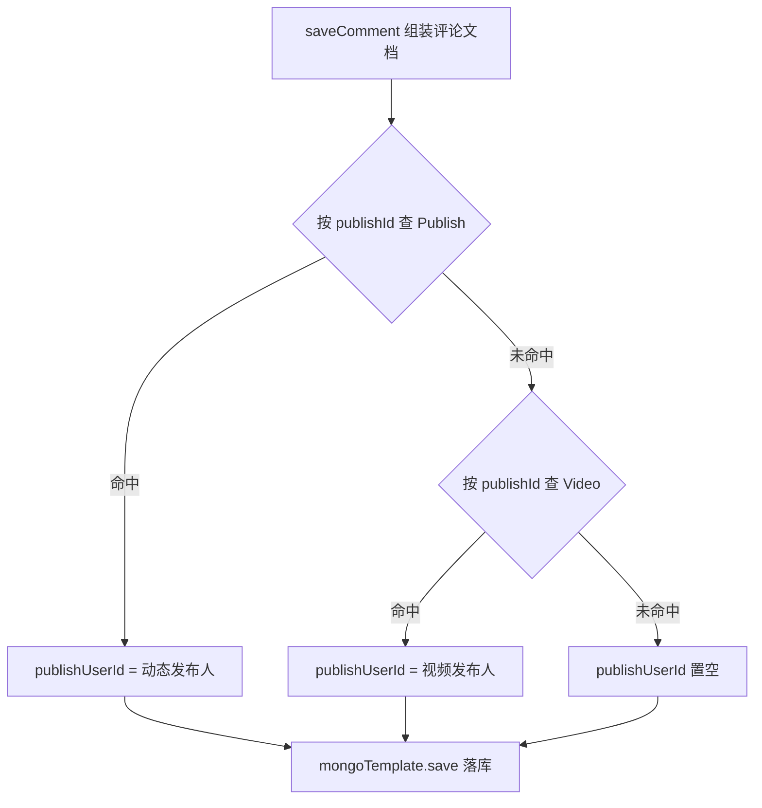
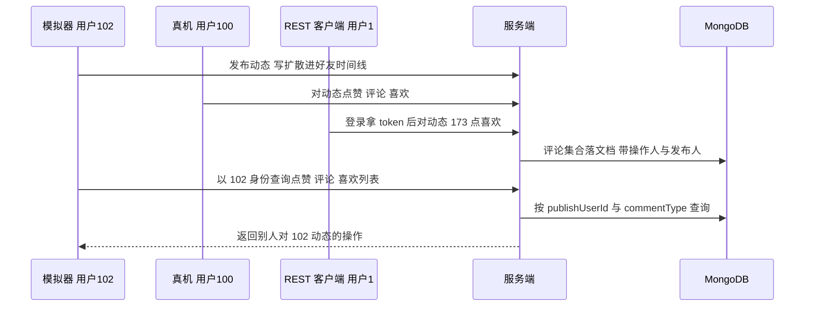

# 点赞评论喜欢列表查反了：用 publishUserId 把「别人对我的操作」查出来

> 🔒 安全提示：文中示例的口令/密钥均为课程教学环境演示口径，生产环境的安全要求见《安全与合规须知》。

消息页的点赞、评论、喜欢三个列表联调时露了馅：页面显示的全是自己给别人动态点的赞、写的评论，而产品语义恰恰相反，这三个列表展示的应该是别人对我发布的内容做了什么。顺着接口往回查，问题不在查询语句本身，而在数据模型：评论集合的文档里只记了操作人，从来没记过发布人，查询条件只能挂在操作人字段上，方向自然就反了。这一讲从定位到修复再到回归测试，把这类「列表语义反了」的 bug 完整走一遍。

## 先给结论

- 根因是数据模型缺字段：`Comment` 只有 `userId`（操作人），没有发布人字段，列表查询条件误挂在操作人上，查出来的数据方向与需求相反。
- 修复三步：给 `Comment` 增加 `publishUserId` 字段；保存评论时回查发布人并写入文档；查询条件从 `userId` 改为 `publishUserId`。
- 回查发布人要查两张集合：`publishId` 先查圈子动态 `Publish`，查不到再查小视频 `Video`，因为点赞、喜欢这套保存逻辑是两个模块共用的；都查不到说明 id 非法，置空即可。
- 存量评论文档没有发布人字段，只改代码救不了旧数据，测试前删掉发布表与时间线表重建数据。
- 回归测试靠多端配合：真机与 REST 客户端用其他账号制造点赞、评论、喜欢操作，模拟器登录发布人查看列表，数据库文档与页面数据双重核对。

## 一、bug 现场：列表的语义被读反了

消息模块里，点赞、评论、喜欢三类操作在存储上共用一份评论集合，用 `commentType` 区分类型，1 是点赞、2 是评论、3 是喜欢。这个设计本身没问题，问题出在字段构成上。一次操作落一条文档，文档里记录的是 `userId`，即谁做了这次操作；至于这条动态是谁发布的，文档里没有任何痕迹。

查询列表时接口手头只有当前登录人的 id，开发者顺手把它当成了查询条件：

```java
// 修复前的查询条件：挂在操作人上，语义是「查我给别人做的操作」
Query query = new Query(Criteria.where("userId").is(userId)
        .and("commentType").is(type)).with(pageRequest);
```

这条查询本身能跑，返回的数据也「看起来像消息」，唯独业务方向是反的。要查「谁操作了我」，条件就必须落在发布人上，而发布人在文档里根本不存在，所以这不是改一行查询就能收场的事，得先把缺的字段补进模型。

## 二、修复三步：补字段、写发布人、改条件

**第一步，给 `Comment` 增加 `publishUserId` 字段。** 实体上补一个发布人字段，语义与 `userId` 严格区分：

```java
@Data
@AllArgsConstructor
@NoArgsConstructor
@Document(collection = "quanzi_comment")
public class Comment implements java.io.Serializable {
    private static final long serialVersionUID = -291788238125767614L;
    private ObjectId id;
    private ObjectId publishId;        // 发布 id
    private Integer commentType;       // 评论类型，1-点赞，2-评论，3-喜欢
    private String content;            // 评论内容
    private Long userId;               // 操作人，即点赞、评论、喜欢的人
    private Long publishUserId;        // 发布人，本次修复新增
    private Boolean isParent = false;  // 是否为父节点
    private ObjectId parentId;         // 父节点 id
    private Long created;              // 发表时间
}
```

**第二步，保存评论时回查发布人。** 点赞、评论、喜欢都走同一个 `saveComment` 方法，发布人的设置写在这里就能覆盖三个场景。困难在于保存时只知道 `publishId`，发布人 id 得拿它去查内容数据；而 `publishId` 是个逻辑外键，可能指向圈子动态，也可能指向小视频，因为两个模块的点赞与喜欢共用这一套保存逻辑。于是回查要分两段：

```java
public boolean saveComment(Long userId, String publishId, Integer type, String content) {
    try {
        Comment comment = new Comment();
        comment.setContent(content);
        comment.setIsParent(true);
        comment.setCommentType(type);
        comment.setPublishId(new ObjectId(publishId));
        comment.setUserId(userId);
        comment.setId(ObjectId.get());
        comment.setCreated(System.currentTimeMillis());

        // 回查发布人：publishId 可能指向圈子动态，也可能指向小视频
        Publish publish = this.mongoTemplate.findById(comment.getPublishId(), Publish.class);
        if (null != publish) {
            comment.setPublishUserId(publish.getUserId());
        } else {
            Video video = this.mongoTemplate.findById(comment.getPublishId(), Video.class);
            if (null != video) {
                comment.setPublishUserId(video.getUserId());
            } else {
                // 两边都查不到，说明 publishId 非法或来自未知业务，置空
                comment.setPublishUserId(null);
            }
        }

        this.mongoTemplate.save(comment);
        return true;
    } catch (Exception e) {
        e.printStackTrace();
    }
    return false;
}
```

回查的判定顺序画出来是这样：



两张集合都落空在正常业务里不该出现，真出现只可能是 `publishId` 被非法传入，或者后续新增了别的业务类型还没接进来，置空是合理的兜底，不需要抛异常打断主流程。

**第三步，把查询条件换成发布人。** 列表查询方法里唯一的改动就是条件字段：

```java
@Override
public PageInfo<Comment> queryCommentListByUser(Long userId, Integer type, Integer page, Integer pageSize) {
    PageRequest pageRequest = PageRequest.of(page - 1, pageSize, Sort.by(Sort.Order.desc("created")));
    // 条件挂发布人：查别人对我发布内容的操作
    Query query = new Query(Criteria.where("publishUserId").is(userId)
            .and("commentType").is(type)).with(pageRequest);
    List<Comment> commentList = this.mongoTemplate.find(query, Comment.class);
    PageInfo<Comment> pageInfo = new PageInfo<>();
    pageInfo.setPageNum(page);
    pageInfo.setPageSize(pageSize);
    pageInfo.setRecords(commentList);
    pageInfo.setTotal(0); // 总数暂未提供
    return pageInfo;
}
```

方法名与入参都没动，`userId` 的含义从「操作人」变成了「发布人」，这正是这类 bug 隐蔽的地方：签名完全合理，语义却悄悄换了主语。

## 三、回归测试：多端配合把操作造出来

存量评论文档没有发布人字段，改完代码它们依然查不出来，测试的第一步是清库重建：删掉发布表与时间线表，重启服务，重新走一遍发布流程。时间线表是好友动态投递的落点，用户 102 发布动态时会写进好友 100 与用户 1 的时间线，这两个好友才能在动态页看到并操作这条内容，造数正是利用了这条写扩散链路。

操作编排用到三个身份：模拟器登录用户 102 负责发布与查看列表；真机登录用户 100 执行点赞、评论与喜欢；用户 1 用手机尾号 6868 的账号经 REST 客户端登录，课程环境的验证码固定为 123456，拿到 token 后对动态 173 再发起一次喜欢。整个验证链路如下：



验证分两层。数据库层用 Robo 3T 展开评论集合的文档，每条都同时带着 `userId` 与 `publishUserId`，前者是操作人（用户 100 或用户 1），后者是发布人 102，两个字段齐了，模型修复才算落了地。页面层看三个列表的数字：喜欢列表 2 条，来自用户 100 与用户 1；评论列表 1 条，点赞列表 1 条，都来自用户 100。列表里显示的昵称是操作人的昵称，页面呈现的正是「别人对我做了什么」，bug 收口。

## 常见误区

- **只改查询条件，不动存量数据。** 错例：代码改成按 `publishUserId` 查询就宣布修复，旧文档里没有这个字段，列表一夜变空。正解：上线前用迁移脚本按 `publishId` 回查并回填发布人，开发环境直接清库重建。
- **回查只查圈子动态，漏了小视频。** 错例：`saveComment` 里只查 `Publish`，小视频的点赞与喜欢落库后发布人为空。正解：圈子与小视频共用这套保存逻辑，`Publish` 未命中必须再查 `Video`。
- **把 `publishId` 当作用户 id 直接写入发布人字段。** 错例：`comment.setPublishUserId(Long.valueOf(publishId))`，发布 id 是内容主键，不是用户主键。正解：发布人必须回查内容数据获得。
- **分页总数恒为 0 直接上线。** 错例：`setTotal(0)` 是修复过程中的占位写法，App 端永远显示不了真实条数。正解：用同条件的 `countDocuments` 补上总数再返回。

## 面试可能被问到的问题

1. 面试官追问：「这个 bug 的根因是什么，怎么定位的？」
   答：根因是数据模型缺字段，评论文档只记了操作人没记发布人，查询条件只能挂在操作人上，导致列表语义反了。定位方法是拿页面现象对接口语义：列表显示「我操作了谁」而需求是「谁操作了我」，再顺着查询条件追到存储层，发现模型里根本没有发布人字段。
2. 面试官追问：「发布人为什么不设计成接口入参，而要在服务端回查？」
   答：点赞与喜欢这类操作的调用方只知道内容 id，不知道也不应该知道发布人是谁；发布人是内容数据的属性，由服务端按 `publishId` 回查最可靠。把发布人做成入参等于把数据一致性责任推给客户端，一旦传错，消息列表会张冠李戴。
3. 面试官追问：「publishId 为什么要查两张集合？」
   答：点赞、评论、喜欢的保存逻辑是圈子动态与小视频两个模块共用的，`publishId` 是逻辑外键，可能指向动态也可能指向视频。回查按 `Publish`、`Video` 的顺序先后试探，命中即写入，都落空则置空兜底，保证任何模块的调用都能正常落库。
4. 面试官追问：「线上已经有大量历史评论数据，怎么修复？」
   答：写迁移脚本分批扫历史文档，对每条按 `publishId` 回查内容集合回填 `publishUserId`，无法回查的打标待清理。迁移期间新旧查询逻辑并存灰度，回填完成后再切查询条件，避免列表在切换瞬间出现空洞。
5. 面试官追问：「MongoDB 给已有集合加字段，对旧文档和查询有什么影响？」
   答：MongoDB 无强制 schema，新写入的文档带新字段，旧文档没有；用新字段做查询条件时旧文档天然不命中，这正是清库重建再测的原因。工程上要么迁移回填，要么查询时用 `$exists` 之类的条件做兼容，团队要明确字段的填充时点再定口径。

## 配套资料

- 学习目标：`materials/code/07/day05 探花交友-实现消息功能/day05/学习目标.md`，「独立实现点赞列表」「独立实现评论列表」「独立实现喜欢列表」对应的 bug 修复与回归环节。
- 原型：`materials/code/07/day01 探花交友-项目搭建以及登录完善个人信息/day01/资料/探花交友移动端原型V1.2/消息.html`，点赞、评论、喜欢列表的入口与页面形态出处。
- 说明：day05 资料包仅含学习目标，无工程源码，正文代码按课程画面与讲解逐段整理补全，包名统一改写为 `com.study.tanhua` 系，评论集合名沿用圈子模块已建立的 `quanzi_comment`；测试用的账号、动态 id 均为课程环境造数数据。
