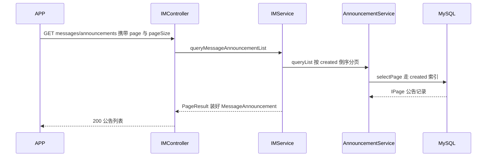

# 实现公告列表：一张 MySQL 表与一个免登录接口撑起的全员广播

> 🔒 安全提示：文中示例的口令/密钥均为课程教学环境演示口径，生产环境的安全要求见《安全与合规须知》。

消息页里的消息大多带主语：谁给我点了赞、谁加了我好友、谁评论了我。公告是例外，它没有收件人，是平台对全体用户的单向广播，系统升级、新功能上线这类通知都走它。广播类数据天然适合「一份存储、人人可读」，这一讲把它从建表到接口再到 App 联调一次做完，顺带给这类公开数据开一个免登录的口子。

## 先给结论

- 公告存 MySQL，表 `tb_announcement`，核心业务字段只有 `title` 与 `description`，`created` 单独建索引支撑按时间倒序分页。
- 公告由后台管理系统发布，课程此阶段尚未开发后台，先以 SQL 插入 3 条占位数据跑通链路，后台就绪后同一张表直接接管。
- 实现是标准四层：实体 `Announcement` 继承 `BasePojo`，`AnnouncementMapper` 继承 MyBatis-Plus 的 `BaseMapper`，`AnnouncementService` 按 `created` 倒序 `selectPage`，`IMController` 暴露 `GET /messages/announcements`。
- 出参用 `MessageAnnouncement` 承接，日期格式化为 `yyyy-MM-dd HH:mm:ss` 字符串，不把 `Date` 对象直接抛给 App。
- 公告是全员数据，查询接口加 `@NoAuthorization` 注解跳过登录校验，不携带 token 也能访问；注解只允许用于真正公开的数据。

## 一、表结构与数据来源

广播数据的表设计极简，业务字段就是标题加描述：

```sql
CREATE TABLE `tb_announcement` (
  `id` bigint(20) NOT NULL AUTO_INCREMENT,
  `title` varchar(200) DEFAULT NULL COMMENT '标题',
  `description` text COMMENT '描述',
  `deleted` int(11) DEFAULT '0' COMMENT '是否删除',
  `created` datetime DEFAULT NULL,
  `updated` datetime DEFAULT NULL,
  PRIMARY KEY (`id`),
  KEY `created` (`created`)
) ENGINE=InnoDB AUTO_INCREMENT=4 DEFAULT CHARSET=utf8 COMMENT='公告表';
```

两个设计点值得停留一下。`deleted` 是逻辑删除标记，公告下线时不物理清行，置 1 保留痕迹；`created` 单独建了索引，因为列表页永远按发布时间倒序翻页，没有这个索引，数据量一大排序就会退化。

数据来源上要交代清楚一个现实：公告的发布入口在后台管理系统，课程此阶段还没有开发后台，所以先手写 insert 造 3 条占位数据把链路跑起来，示例按课程画面口径补全：

```sql
INSERT INTO `tb_announcement` (`title`, `description`, `deleted`, `created`, `updated`)
VALUES ('系统升级公告', '平台将于近期升级消息服务，升级期间聊天功能不受影响。', 0, NOW(), NOW());
```

这个占位策略其实是接口设计正确性的试金石：只要写入方遵守同一张表同一套字段，App 端查询接口一行不改，就能从「手插数据」平滑切到「后台发布」，面向表结构编程换来的正是这种解耦。

## 二、编码实现：从实体到控制器一次铺通

实体继承公共父类，业务字段只有三个：

```java
package com.study.tanhua.server.pojo;

@Data
@NoArgsConstructor
@AllArgsConstructor
public class Announcement extends BasePojo {
    private Long id;
    private String title;
    private String description;
}
```

`BasePojo` 提供 `created` 与 `updated` 两个公共时间字段；后续转换日期时如果父类字段取不到 getter，在实体上补一个 `Date` 类型的 `created` 字段即可。Mapper 一行继承：

```java
public interface AnnouncementMapper extends BaseMapper<Announcement> {
}
```

MyBatis-Plus 的 `BaseMapper` 自带单表 CRUD 与分页能力，Service 里连 SQL 都不用写：

```java
@Service
public class AnnouncementService {

    @Autowired
    private AnnouncementMapper announcementMapper;

    public IPage<Announcement> queryList(Integer page, Integer pageSize) {
        QueryWrapper<Announcement> queryWrapper = new QueryWrapper<>();
        queryWrapper.orderByDesc("created");
        return this.announcementMapper.selectPage(new Page<>(page, pageSize), queryWrapper);
    }
}
```

出参按接口文档定义 VO，日期转成格式化字符串：

```java
@Data
@NoArgsConstructor
@AllArgsConstructor
public class MessageAnnouncement {
    private String id;
    private String title;
    private String description;
    private String createDate;
}
```

接口挂在已有的消息控制器上，路径是 `messages` 下的 `announcements`：

```java
@GetMapping("announcements")
public ResponseEntity<PageResult> queryMessageAnnouncementList(@RequestParam("page") Integer page,
                                                              @RequestParam("pageSize") Integer pageSize) {
    PageResult pageResult = this.imService.queryMessageAnnouncementList(page, pageSize);
    return ResponseEntity.ok(pageResult);
}
```

业务编排放在 IMService：查分页、遍历记录、补日期格式化、装进 `PageResult`：

```java
public PageResult queryMessageAnnouncementList(Integer page, Integer pageSize) {
    IPage<Announcement> announcementPage = this.announcementService.queryList(page, pageSize);
    List<MessageAnnouncement> messageAnnouncementList = new ArrayList<>();
    for (Announcement record : announcementPage.getRecords()) {
        MessageAnnouncement messageAnnouncement = new MessageAnnouncement();
        messageAnnouncement.setId(record.getId());
        messageAnnouncement.setTitle(record.getTitle());
        messageAnnouncement.setDescription(record.getDescription());
        messageAnnouncement.setCreateDate(new DateTime(record.getCreated()).toString("yyyy-MM-dd HH:mm:ss"));
        messageAnnouncementList.add(messageAnnouncement);
    }
    PageResult pageResult = new PageResult();
    pageResult.setPage(page);
    pageResult.setPageSize(pageSize);
    pageResult.setItems(messageAnnouncementList);
    return pageResult;
}
```

一次请求的完整链路：



链路短得近乎奢侈：单表、无关联、无缓存，广播数据一次写入换来了读取侧的最简形态。

## 三、App 联调与免登录优化

App 端验证走正常登录流程：课程环境用固定验证码 123456 登录任意账号，进入消息页点击公告入口，列表数据到位。联调时发现长描述在 App 上溢出了显示区域，这是前端布局的展示问题，接口返回的数据结构与内容都正确，两端职责边界要分清，服务端不为前端的渲染缺陷买单。

真正的优化点是登录校验。公告没有个人维度，所有用户看到的是同一份内容，让它走 token 校验属于白耗一次解析。统一登录校验的拦截器在 day03 的 token 机制里就预留了口子：方法上带 `@NoAuthorization` 注解的请求直接放行。给公告接口加上注解：

```java
@NoAuthorization
@GetMapping("announcements")
public ResponseEntity<PageResult> queryMessageAnnouncementList(@RequestParam("page") Integer page,
                                                              @RequestParam("pageSize") Integer pageSize) {
    PageResult pageResult = this.imService.queryMessageAnnouncementList(page, pageSize);
    return ResponseEntity.ok(pageResult);
}
```

重启服务后用 REST 客户端验证：请求头里不带 Authorization，直接 GET 该接口，数据照常返回，免登录链路生效。

## 常见误区

- **把公告做成按用户推送。** 错例：给每个用户复制一条公告记录或逐个推送，数据量随用户数膨胀。正解：公告是全员共享的单份数据，人人可读即可，页面拉取代替推送。
- **免登录注解撒到用户私有数据上。** 错例：图方便给所有消息接口都加 `@NoAuthorization`，未登录用户能拉到联系人等隐私数据。正解：注解只允许用于真正无个人维度的公开数据，加之前先问一句「这条数据泄露了要不要负责」。
- **把 Date 对象直接序列化给客户端。** 错例：VO 里用 `Date` 承接时间，格式与时区交给序列化器决定。正解：出参统一格式化为 `yyyy-MM-dd HH:mm:ss` 字符串，展示口径由服务端锁定。
- **倒序分页不建索引或排序字段选错。** 错例：按 `updated` 排序却只在 `created` 上建了索引，公告更新后顺序错乱。正解：业务语义是按发布时间倒序，排序字段与索引字段必须一致。

## 面试可能被问到的问题

1. 面试官追问：「公告这种全员数据为什么放 MySQL 单表，而不是 MongoDB 或消息推送？」
   答：公告数据量小、结构稳定、读多写极少，单表加索引就是最优解，连缓存都未必需要。推送适合时效性强的私有消息，公告是被动拉取的常态数据；MongoDB 的文档模型在这里没有用武之地，MySQL 的成熟度与事务保障反而更省心。
2. 面试官追问：「@NoAuthorization 免登录是怎么实现的？」
   答：自定义注解标记在控制器方法上，拦截器在请求进来时反射检查处理方法是否带该注解，命中就跳过 token 校验直接放行，未命中才走解析与校验流程。注解本身只做标记，放行逻辑收口在拦截器一处，新增免登录接口零成本。
3. 面试官追问：「MyBatis-Plus 的 selectPage 分页是怎么生效的？」
   答：靠分页插件拦截器。插件拦截底层执行的 SQL，先按查询条件发一条 count 拿总数，再在原 SQL 上拼接数据库方言的 limit 语句完成物理分页，结果与总数装进 IPage 返回。调用方只传 Page 对象与 QueryWrapper，分页 SQL 全程手写为零。
4. 面试官追问：「公告接口免登录，安全边界怎么守？」
   答：免登录接口必须满足两个条件：数据无个人维度、无写入能力；同时要防滥用，接口做限流，返回内容保持脱敏，避免公开接口被批量拉取。任何带个人维度的查询都不允许进入免登录范围，这是硬约束。
5. 面试官追问：「后台系统发布一条公告后，App 端怎么看到？」
   答：写的是同一张 `tb_announcement` 表，后台插入即生效，App 下次拉取自然可见，不需要任何通知链路。如果产品要求即时触达，才在公告发布时追加全员推送或站内信，那是附加能力，与列表查询本身解耦。

## 配套资料

- 学习目标：`materials/code/07/day05 探花交友-实现消息功能/day05/学习目标.md`，「独立实现公告列表」为本日收尾目标。
- 原型：`materials/code/07/day01 探花交友-项目搭建以及登录完善个人信息/day01/资料/探花交友移动端原型V1.2/消息.html`，消息页公告入口的形态出处。
- 数据库：`materials/code/07/day01 探花交友-项目搭建以及登录完善个人信息/day01/代码/mytanhua.sql`，课程基础库表；公告表 `tb_announcement` 为本日新增，建表语句按课程画面整理。
- 说明：day05 资料包仅含学习目标，无工程源码，正文 SQL 与代码按课程画面与讲解逐段整理补全，包名统一改写为 `com.study.tanhua` 系；insert 示例数据为按课程口径补全的样例。
