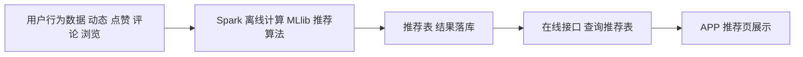
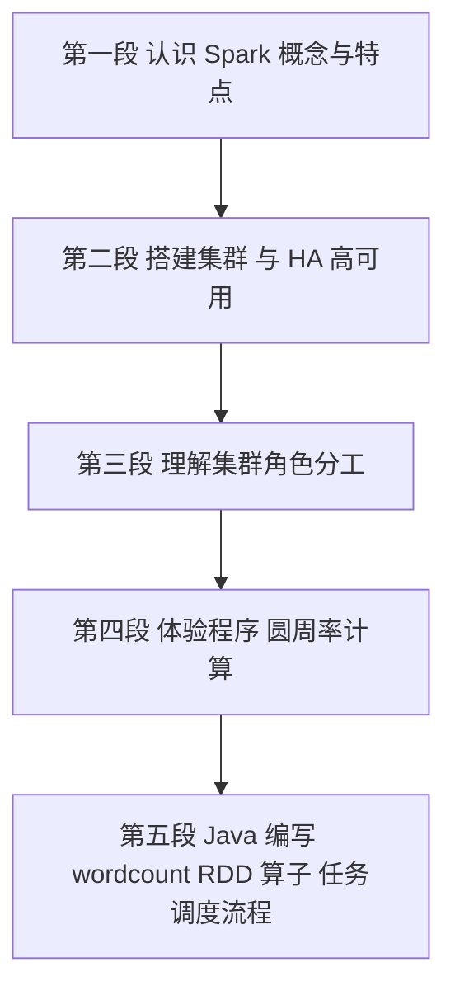

# Spark 快速入门开篇：推荐系统为什么绕不开 Spark

探花交友的路线图上，消息模块之后是推荐系统，而推荐系统的技术选型在立项之初就定了调：Spark 加 MLlib。对纯业务出身的 Java 工程师来说，Spark 常被当成大数据岗位的专属技能，实际它在业务项目里早已是常客，凡是要对全量数据做批量计算的场合都能见到它。day06 用一天时间做 Spark 快速入门，为后面的推荐算法落地备好地基。

## 先给结论

- 推荐计算属于离线批量数据分析，Spark 是这一领域的主流引擎，探花交友的推荐系统选型就是 Spark 加 MLlib，Spark 是绕不开的前置知识。
- 本日路线五段：概念与特点、集群搭建、高可用集群、角色分工与程序体验、编程进阶加任务调度原理。
- Spark 不是大数据岗位专属，Java 工程师可以用熟悉的 Java 直接编写并提交 Spark 应用。
- 验收口径：独立搭建 Spark 集群与 HA 集群、跑通圆周率计算与单词统计、理解 RDD 语义与任务调度流程。
- 已掌握 Spark 基本使用的读者可以跳过本日，直接进入推荐系统环节。

## 一、为什么推荐计算落在 Spark

先把「推荐」这件事拆开看。App 上的推荐页看起来是即时查询，背后其实是两段分工：离线计算段对全量用户行为数据跑推荐算法，把算出的结果写进推荐表；在线查询段只负责把推荐表里的结果取出来返回给 App。推荐结果不需要毫秒级的新鲜度，真正耗时的算法计算完全可以放到离线段按天批量跑，这就是推荐系统的典型形态：重计算与业务查询解耦。

重计算段为什么轮到 Spark 上场。数据规模上，探花交友要分析的是全体用户的历史行为，动态、点赞、评论、浏览一路铺开，单机 Java 进程读一遍都吃力，更别提在内存里跑算法；Spark 的分布式计算把这些数据切片摊到集群多台机器上并行处理，规模问题交给加机器解决。算法供给上，MLlib 是 Spark 自带的机器学习库，推荐、分类、聚类这些常用算法开箱即用，不必从零实现。工程衔接上，Spark 应用可以用 Java 编写，团队现有的 Java 技能直接复用，学习曲线平缓。



图里能看出关键设计：Spark 只出现在离线段，与在线接口之间隔着一张推荐表，两段各跑各的节奏，算法重算不影响线上服务。本阶段先把 Spark 学扎实，后面再把算法接上来，结构基础就在这张图里。

## 二、课程路线：五段推进

本日的学习路径排布有明确的依赖关系，先认物、再搭环境、后动手、最后探原理：



五段各解决一个问题。概念段回答「Spark 是什么、凭什么流行」，重点在基于内存的计算模型与一站式技术栈。集群段回答「环境怎么立起来」，从标准集群起步再升级到 HA 高可用集群，Spark 集群对单点故障敏感，HA 是生产环境的底线。角色段回答「集群里都有谁」，Master 与 Worker、Driver 与 Executor 的分工搞不清，后面的报错排查就无从下手。体验段用圆周率计算验证环境，一条提交命令跑通，相当于计算世界的 Hello World。编程段是重头：用 Java 编写单词统计应用，把 RDD 的创建与 map、filter、flatMap、reduceByKey 这批高频算子练熟，再打包提交到集群运行，收尾在任务调度流程，搞清一个应用从提交到拆成任务在集群上执行的完整链路。

## 三、目标清单与达成标志

资料包里的学习目标逐条如下：

```text
- 了解Spark的概述
- 了解Spark的特点
- 独立搭建Spark的集群
- 独立搭建Spark的HA集群
- 了解Spark的角色
- 独立完成圆周率计算的运行
- 独立完成单词统计的入门案例
- 掌握RDD弹性分布式数据集
- 掌握RDD的常用的算子操作
- 掌握RDD的依赖关系
- 掌握Spark的任务调度流程
```

把每条目标翻成可检验的动作，学习时就有抓手。搭建类目标的达成标志是集群进程起齐、监控页面可见节点；体验类目标是提交命令执行完、终端打印出圆周率近似值；编程类目标是 Java 工程打包后提交到集群、单词统计结果正确输出；原理类目标是能不看资料讲清 RDD 的弹性与分布式语义、依赖关系宽窄之分，以及任务调度从 DAG 到 Stage 再到 Task 的拆解过程。目标措辞里「了解」与「掌握」的差异也提示了深度要求：概念可以广而浅，RDD 与调度流程要落到机制层面。

## 常见误区

- **把 Spark 当成大数据岗位的专属技能。** 错例：业务开发跳过大数据组件，等项目要接推荐、报表、用户画像时无从下手。正解：凡出现全量数据批量计算的需求，Spark 都是候选方案，业务工程师具备使用能力即可，不必先转岗大数据。
- **把 Spark 与 Hadoop 理解成二选一的对手。** 错例：以为学 Spark 就要抛弃 Hadoop 全家桶。正解：Spark 是计算引擎，替代的是 MapReduce 的计算层，存储与资源调度仍可与 HDFS、YARN 协作，二者是拼积木的关系。
- **跳过集群与角色直接背算子 API。** 错例：本地 IDE 里能跑示例就算会了，提交集群后 Master、Worker、Driver、Executor 的报错完全看不懂。正解：先把角色分工与提交流程摸透，算子调试才有排障的地基。
- **把 RDD 学成 API 背诵。** 错例：记住几十个算子签名，说不清 RDD 为什么惰性求值、依赖关系如何影响执行。正解：先建立分布式数据集与血缘的语义模型，算子只是语义的表达方式。

## 面试可能被问到的问题

1. 面试官追问：「推荐系统为什么选 Spark，而不是在业务服务里直接算？」
   答：推荐要对全量用户行为数据跑算法，数据量与计算量都超出单个服务进程的承受范围，也不该占用线上资源。Spark 用分布式并行与内存计算把批量算得动，MLlib 直接供给推荐算法，算完的结果写进推荐表，在线服务只查表，计算与服务互不拖累。
2. 面试官追问：「Spark 和 Hadoop 是什么关系？」
   答：Spark 是新一代分布式计算引擎，与 Hadoop 是互补而非替代。Hadoop 生态提供 HDFS 存储与 YARN 资源调度，Spark 可以跑在其上，替换的是 MapReduce 这一层计算模型；基于内存的计算与 DAG 执行引擎是它快的主要原因。
3. 面试官追问：「一句话解释 RDD？」
   答：RDD 是弹性分布式数据集，把一份大数据抽象成可分区、可并行处理、可容错恢复的不可变集合。弹性体现在内存与磁盘间灵活调度、分区可动态调整，分布式体现在数据横跨集群节点。
4. 面试官追问：「Spark 应用能用哪些语言开发？」
   答：官方支持 Scala、Java、Python、R，探花交友项目用 Java 编写，原因是团队技术栈统一、业务代码可复用既有工程能力。Scala 是 Spark 的原生语言，语法更简洁，Java 版本在表达力上略啰嗦但完全够用。
5. 面试官追问：「为什么要专门学任务调度流程？」
   答：排障与调优都挂在调度链路上。一个应用提交后经历 DAG 构建、切分 Stage、生成 Task 分发 Executor 执行，哪个环节出问题对应哪类报错；理解了血缘与宽窄依赖，才知道什么时候触发 Shuffle、怎么减少代价，算子写法的选择依据也在这里。

## 配套资料

- 学习目标：`materials/code/07/day06 探花交友-Spark快速入门/day06/学习目标.md`，Spark 快速入门的全部目标清单，与课程路线一一对应。
- 说明：day06 资料包仅含学习目标，无工程源码与讲义文件，路线与目标解读按课程画面与讲解整理；推荐系统的选型与后续安排以课程后续章节为准。
