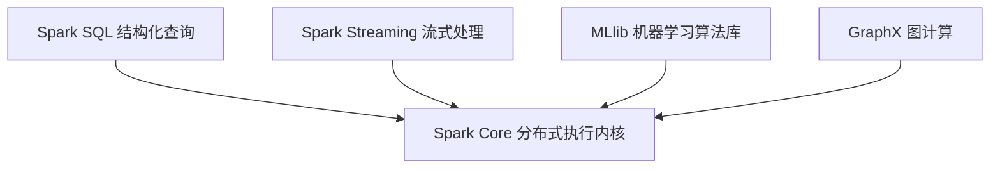
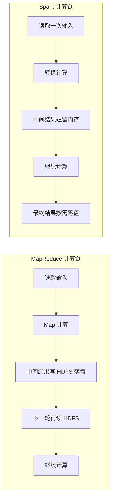

# 什么是 Spark：从官网一句话到推荐系统的计算引擎

推荐系统的选型在 day06 之前就已定调：Spark 加 MLlib。可对一个写惯了 Spring Boot 的 Java 工程师来说，Spark 这个名字常年和「大数据岗位」绑在一起，真要回答「Spark 是什么」，多数人只能憋出一个「快」字。打开官网 spark.apache.org，首页那句「统一的分析引擎」也帮不上忙：分析引擎到底管什么、和 Hadoop 是什么关系、凭什么敢说自己快，都得一条条弄清楚。把这几个问题想透，后面搭建集群、写代码、看调度流程才有判断的锚点。

## 先给结论

- Spark 的官方定位是「用于大规模数据处理的统一分析引擎」，它诞生于加州大学伯克利分校的 AMP 实验室，2014 年成为 Apache 顶级项目。
- 它是生态而不只是单个框架：Spark SQL、Spark Streaming、GraphX、MLlib 等子项目共用一个核心引擎，一站式覆盖批处理、流处理、图计算与机器学习；探花交友的推荐算法就跑在 MLlib 上。
- 与 MapReduce 的最大分野在中间结果的去处：MapReduce 每一步都写回 HDFS 落磁盘，Spark 让中间结果驻留内存，迭代式算法因此快出一个量级。
- Spark 本体用 Scala 实现，但官方提供 Java、Python 等语言 API，探花交友全程用 Java 编写 Spark 应用，不必先学 Scala。
- Spark 替代的只是 MapReduce 这层计算模型，存储与生态仍可与 HDFS、Hive、YARN 协作，已有 Hadoop 集群不必推倒重来。

## 一、官网一句话：用于大规模数据处理的统一分析引擎

打开 `spark.apache.org`，域名本身就在传递第一条信息：这个项目挂在 Apache 基金会名下，是一个顶级开源项目，代码、文档、版本发布全部公开。官网首页最关键的信息是那句定位：统一的分析引擎，用于大规模数据处理。这句话值得拆成三段来读。

**「大规模数据处理」划定了服务对象。** 单机内存装不下、单进程算不完的数据量，才是它的主场。几十 MB 的日志用 Excel 都能凑合，几个 TB 的用户行为数据就必须换分布式引擎。

**「分析」划定了职责边界。** 它做的是计算与统计，不管存储、不管资源分配，数据可以躺在 HDFS 里，机器可以由 YARN 分配，Spark 只负责把算子高效地跑完。它与 MySQL 这类数据库的分工也在这里：数据库面向在线业务的事务与查询，一条 SQL 动到的只是少量行；Spark 面向全量数据的离线分析，一次作业扫的是整表整库，两者各管一段，不互相取代。

**「统一」说的是适用面。** 一套引擎同时覆盖批量计算、交互式查询、流处理、机器学习等多种场景，不用按场景各学一套框架，这一点在后面的生态部分展开。

官网首页还放了一段三行代码，最能体现它的使用体验：

```python
df = spark.read.json("logs.json")
df.where("age > 21").select("name_first").show()
```

读一个 json 文件成分布式表、按条件过滤、挑出一列、打印结果，四步动作浓缩在两行里。写代码的人感知不到集群的存在：数据被切了几份、落在哪台机器、如何汇总，全由 Spark 负责。这正是它自称引擎的含义，把分布式计算的复杂性封装起来，开发者只描述「做什么」，不操心「怎么并行」。

## 二、出身与成名：伯克利 AMP 实验室的六年

Spark 诞生于加州大学伯克利分校的 AMP 实验室。AMP 是三个单词的首字母：Algorithms 算法、Machines 机器、People 人。实验室的愿景是把这三者做大规模的集成并落地应用：算法负责从数据里提炼规律，机器提供算力，人负责提出问题、解读结果，最终把大数据转化为有用的信息。一个处理大数据的通用框架，正是这个愿景里「机器」那一环的底座。

发展时间线不长：2010 年开源，2013 年 6 月进入 Apache 基金会孵化，2014 年转正为 Apache 顶级项目，孵化期只有约 8 个月。Apache 的孵化期动辄一两年，8 个月转正在历史上相当罕见，侧面说明产业界对它的需求有多迫切。

理解 Spark 还有一个更贴近 Java 工程师的视角：它是一个生态，而不是一个孤立框架。Spring 全家桶就是先例，除了 Spring Framework 本体，还有 Spring Boot、Spring Cloud、Spring Data 等一众子项目，各管一摊、共用一个内核，人们习惯说「Spring 生态系统」。Spark 的展开方式与此一模一样，生态位上也取代了 MapReduce 那种单一计算模型。

## 三、生态一览：一个内核，四驾马车

下面这张图把 Spark 生态的分层画了出来，四个方向的子项目都压在同一个内核上。



图中四个子项目各自对应一类典型需求：Spark SQL 负责结构化数据的交互式查询，写 SQL 就能对分布式数据做分析；Spark Streaming 负责实时流处理，把持续到达的数据按小批切开后复用同一套引擎；GraphX 负责图计算，社交关系、传播路径这类问题归它；MLlib 是机器学习算法库，分类、聚类、回归、推荐等常用算法开箱即用。

这张图的解读重点在最下层的 Spark Core：所有子项目最终都落到同一个分布式执行内核上，学透 Core 的编程模型，四种场景共享同一套底座，这就是「一站式解决方案」的实质。批处理是 Core 的本行，加上 SQL、流、图、机器学习四个方向，大数据的主要场景一套 Spark 全部接住。对学习者是好事，学一种编程模型四处通用；对团队更是好事，不必为每个场景单独引入并运维一个框架，开发和维护的人力成本、部署平台的物力成本一起降下来。

对本项目而言，四驾马车里最重要的是 MLlib：探花交友的推荐算法将用它实现，day07 起的推荐系统课程就是 Spark 加 MLlib 的组合落地。算法本身不需要从零推导，MLlib 已经把常用的机器学习算法封装成了可以直接调用的库，课程要练的是把业务数据喂给它、把结果取出来的工程能力，这也决定了 day06 的学习重心：先搭好集群、跑通程序，算法是后面几天的事。

## 四、关键定位：基于内存的并行计算框架

课程给 Spark 下定义时用了两个最值得抠的定语：基于内存、并行计算。

**基于内存，说的是数据加工的主战场放在内存里。** 传统方案每算一步就把中间结果写回磁盘，下一步再从磁盘读回来，磁盘的读写速度比内存慢几个数量级，大量时间耗在 IO 上。Spark 让中间结果尽量驻留内存，相邻的计算步骤之间零落盘衔接，大数据环境下处理的实时性因此显著提高。

**并行计算，说的是一份大数据被切成多个分区，摊到集群多台机器上同时算。** 单机内存装不下、单进程算不完的量，靠加机器解决。官方同时强调高容错性与高可伸缩性：机器坏了任务能恢复，数据涨了加机器就能扩容。容错的实现思路值得预告一句：Spark 会记录数据是怎么一步步算出来的，某台机器上的分区丢了，不备份也能按这条记录重算出来，这套机制到 RDD 一篇再展开。部署上允许把 Spark 铺在大量廉价硬件上组集群，普通服务器就能跑，不必采购专用高端设备，企业成本因此可控。

把两个定语合起来，Spark 的完整画像是：一个跑在普通服务器集群上、以内存为主要计算介质、能随数据量水平扩容的分布式计算引擎。

## 五、产业背书：谁在生产环境用它

框架靠不靠谱，生产环境的真实用量最说明问题。国外，IBM、英特尔等公司在 Spark 社区持续投入；国内，百度、阿里、腾讯、京东等头部公司均有大规模应用。课程讲义里点名的几处：百度将 Spark 用于大搜索、直达号与大数据业务；阿里用 Spark 构建大规模的图计算与图挖掘系统，支撑了多种推荐场景；腾讯用 Spark 组建了约 8000 台规模的集群，在当时的公开信息里是全球已知最大的 Spark 集群。

这些案例的共同点是全量数据的批量分析，与推荐系统的工作性质完全一致。产业实践先于课程验证了这条路，学习它的投资回报是可预期的：掌握 Spark 不只为这一个项目，用户画像、行为报表、特征工程这类需求背后都是同一套引擎。

## 六、用什么语言写：Scala 实现，Java 开发

Spark 本体不是用 Java 写的，而是 Scala。Scala 运行在 JVM 之上，底层依赖的还是 Java 那一套，只是在其上做了更高层的抽象与封装，代码写起来更简洁。它最大的卖点是函数式风格配合集合操作，可以像操作本地集合一样操作分布式数据集：

```scala
// 示例：按本课写法补全，Scala 一行过滤出包含 ERROR 的日志行
val errors = sc.textFile("hdfs://node1:9000/app.log").filter(_.contains("ERROR"))
```

一行 `filter` 配合下划线占位的谓词，等价于 Java 里带匿名内部类的一小段循环。简洁是 Scala 的优势，语法门槛也随之而来。课程的选择是绕开：不安排 Scala 语法的教与学，全程用 Java 编写 Spark 应用。Spark 对 Java 提供了功能对等的 API，表达上比 Scala 啰嗦一些，但完全够用。对已有 Java 功底的团队，复用既有技能的收益远大于语法简洁的收益，这笔账在工程上很划算。真有性能或表达力需求再补 Scala 也不迟，到那时读 Scala 写的 Spark 源码反而更容易，因为语言只是外壳，内核里的编程模型是共通的。

## 七、为什么非学不可：与 MapReduce 的正面比较

要理解 Spark 的价值，绕不开它的前辈 MapReduce，这里补一段前置知识。Hadoop 的能力由两大块构成：HDFS 是分布式文件系统，负责把大文件切块存到多台机器上；MapReduce 是计算框架，负责在存储之上做数据处理，写好一个应用提交进去，它就能调度到集群各台机器上执行。MapReduce 的名字来自它的两段式流程：Map 阶段把输入数据按键值对的形式读入并分发计算，Reduce 阶段把相同键的结果归并汇总，输入与输出都落在 HDFS 上。拿统计单词出现次数举例：Map 阶段把每行拆成一个个单词，输出「单词，1」这样的键值对；Reduce 阶段把同一个单词的 1 全部加起来，得到词频；中间结果与最终结果都写 HDFS。

讲义给 Spark 的定义是：一个开源的类 Hadoop MapReduce 的通用并行计算框架，基于 MapReduce 算法实现分布式计算，拥有 Hadoop MapReduce 的所有优点。两代引擎高度相像，分野只有一个：中间结果的去处。MapReduce 把作业产生的中间结果写回 HDFS，而 HDFS 最终要落磁盘，一条多轮的计算链路意味着反复的磁盘 IO；Spark 把中间结果保存在内存里，链路上的后续步骤直接从内存取数。下图把两条计算链并排摆出来看。



对比两条链的关键差异在中间环节：MapReduce 每跨一步都要经 HDFS 走一趟磁盘，Spark 的中间结果全程在内存里流转，只在开头读一次、结尾按需写一次。

对数据挖掘、机器学习这类迭代式算法，这个差异是决定性的。训练一个模型往往要对着同一份数据反复算几十轮，MapReduce 每一轮都读写 HDFS，磁盘 IO 随迭代轮数线性叠加；Spark 的迭代中间态全程驻内存，速度优势随轮数放大。Spark 能更好地用于数据挖掘与机器学习，根源就在这里。

定位上，Spark 是 MapReduce 的替代方案，但替代的只是计算层：它可以兼容 HDFS，可以兼容 Hive 等已有组件，完整融入 Hadoop 生态圈，恰好弥补 MapReduce 在迭代计算上的不足。存储还是那个 HDFS，计算引擎换成更快的 Spark，存量集群不需要推倒重来。

回到探花交友：推荐系统的离线计算段要对全体用户的行为数据跑推荐算法，属于典型的迭代式批量计算，Spark 加 MLlib 承担这段，算出的结果写进推荐表，在线接口只查表返回，重计算与线上服务互不拖累。

## 常见误区

- **把 Spark 与 Hadoop 当成二选一的对手。** 错例：以为上了 Spark 就要抛弃 Hadoop 全家桶。正解：Spark 替代的只是 MapReduce 这一层计算模型，HDFS 存储与生态组件照常配合，二者是拼积木的关系。
- **认为 Spark 只能用 Scala 开发。** 错例：因为 Spark 用 Scala 实现，就先去啃 Scala 语法再碰 Spark。正解：官方提供 Java、Python、R 等 API，Java 是一等公民，探花交友全程用 Java 编写 Spark 应用。
- **把「基于内存」理解成数据永远不落盘。** 错例：以为 Spark 运行期间磁盘完全闲置。正解：内存是中间结果的优先去处，内存放不下或最终输出时仍会按需落盘，容错恢复也依赖重算机制，内存计算省的是不必要的中间落盘，不是全部磁盘。
- **把「统一分析引擎」理解成自带存储。** 错例：以为用 Spark 前要先把数据灌进它自己的存储。正解：引擎只管计算，数据可以留在 HDFS、Hive 表等原有存储里，Spark 直接读取后开算。

## 面试可能被问到的问题

1. 面试官追问：「一句话说清 Spark 是什么？」
   答：Spark 是基于内存计算的分布式并行计算框架，官方定位是面向大规模数据处理的统一分析引擎。它以 Spark Core 为内核，向上提供 Spark SQL、Spark Streaming、MLlib、GraphX 等子项目，一站式覆盖批处理、流处理、机器学习与图计算。
2. 面试官追问：「Spark 和 MapReduce 最大的区别是什么？」
   答：中间结果的去处不同。MapReduce 每个作业的中间结果都写回 HDFS，多轮计算就是反复的磁盘 IO；Spark 让中间结果驻留内存，配合 DAG 执行引擎减少落盘与调度开销，在迭代式计算上快出一个量级。
3. 面试官追问：「Spark 为什么适合机器学习和数据挖掘？」
   答：这类算法天然是迭代式的，同一份数据要被反复计算几十轮。MapReduce 每轮迭代都要读写 HDFS，代价随轮数叠加；Spark 的中间结果在内存里流转，迭代轮数越多优势越明显，所以它更适合需要迭代式计算的场景。
4. 面试官追问：「Spark 和 Hadoop 是替代关系吗？」
   答：是互补而非整体替代。Spark 替换的是 MapReduce 这层计算引擎，同时兼容 HDFS、Hive 等生态组件，也能跑在 YARN 资源调度之上。已有 Hadoop 集群可以保留存储层，只把计算层换成 Spark，不需要数据迁移。
5. 面试官追问：「Spark 用什么语言实现？业务开发必须学 Scala 吗？」
   答：Spark 本体用 Scala 实现，Scala 运行在 JVM 上，能像操作本地集合一样操作分布式数据集。但官方对 Java、Python、R 提供完整 API，业务开发不必先学 Scala；探花交友项目全程用 Java 编写 Spark 应用，团队 Java 技能直接复用。
6. 面试官追问：「你们项目里 Spark 承担什么角色？」
   答：探花交友的推荐计算放在离线段，由 Spark 加 MLlib 对全量用户行为数据跑推荐算法，结果写入推荐表；在线接口只查询推荐表返回结果。重计算与在线服务解耦，算法重算不影响线上响应。

## 配套资料

- 学习目标：`materials/code/07/day06 探花交友-Spark快速入门/day06/学习目标.md`，day06 全部目标清单，「了解 Spark 的概述」对应上述内容。
- 说明：day06 资料包仅含学习目标清单，无工程源码与讲义文本；官网定位、发展时间线、生态构成、产业案例与官网代码示例出自课程画面与讲解，Scala 示例为按本课写法补全。
- 前置知识对照：阶段四 Hadoop 课程资料在 `materials/code/04/day02-HDFS/`（引用截至 day 目录层级），HDFS 与 MapReduce 概念可作为对比段的延伸阅读。
