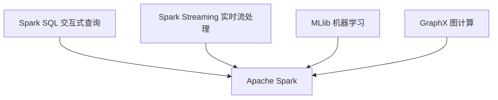

# Spark 的四大特点：快、易用、通用、随处运行

选型评审的时候，架构师对着 Spark 通常问四个问题：比 MapReduce 快多少、Java 工程师上手要多久、除了批处理还能干什么、跟现有 Hadoop 集群怎么共处。这四个问题恰好对应 Spark 官方宣传页上的四个特点：运行速度快、易用性好、通用性强、兼容性强。把每个特点背后的支撑机制弄清楚，面试里被追问「凭什么」的时候才接得住。

## 先给结论

- 快：基于内存的运算比 MapReduce 快 100 倍以上，同样基于硬盘的运算也快 10 倍以上，支撑点是内存计算加 DAG 执行引擎。
- 易用：提供 Java、Python、Scala 的 API，内置超过 80 种高级算法，另有 Python 与 Scala 的交互式 shell 可以即写即验。
- 通用：批处理、交互式查询、实时流处理、机器学习、图计算五类场景一套技术栈，能在同一个应用里无缝混用。
- 兼容：可接 Hadoop YARN、Apache Mesos、Kubernetes 做资源调度，可读 HDFS、HBase、Cassandra 等数据源，也内置 Standalone 调度器零依赖起步。

## 一、运行速度快：内存计算加 DAG 执行引擎

官方给的对比口径很具体：与 Hadoop 的 MapReduce 相比，Spark 基于内存的运算要快 100 倍以上，基于硬盘的运算也要快 10 倍以上。官网的性能图用同一负载演示过这组数字，Hadoop 跑了 110 秒，Spark 跑了 0.9 秒，图上标注的就是那句 Run workloads 100x faster。

**第一层支撑在内存计算。** MapReduce 的中间结果每一步都写 HDFS、再从 HDFS 读回来，磁盘 IO 反复叠加；Spark 让中间结果驻留内存，相邻步骤之间直接在内存里交接数据。上一篇已经把这个机制讲透，这里不再重复。

**第二层支撑在 DAG 执行引擎。** DAG 是有向无环图，Spark 会把一串计算步骤连成这样一张依赖图，先看清整张图再统一规划怎么跑：哪些步骤可以合并、哪些数据不用落盘、哪些传输可以省掉，都由引擎统一安排。MapReduce 的执行模型只有 Map 和 Reduce 两段，多步计算只能拆成多个作业串行排队，作业之间强制读写 HDFS，引擎层面没有整体优化的机会。


上面这张图就是一个典型的计算链：四个步骤首尾相接、没有回路，构成一张有向无环图。Spark 引擎拿到整张图后统一调度，前三步在内存里连续流转，省掉了每步之间的落盘。DAG 如何切分 Stage、如何生成任务，属于任务调度原理的内容，本日稍后的课程会专门展开，这里先记住结论：内存计算与 DAG 执行引擎共同构成 Spark 快的基础。

## 二、易用性好：三种语言 API 与交互式 shell

Spark 支持 Java、Python 和 Scala 的 API，还内置了超过 80 种高级算法，用户可以快速构建不同类型的应用。官网放的示例只有两行，读 json、过滤、取列、展示一气呵成：

```python
df = spark.read.json("Tags.json")
df.where("Age > 21").select("name_first").show()
```

易用性的另一个体现是交互式 shell。Spark 提供了 Python 和 Scala 的 shell，命令一敲就连上集群，边写边看结果，做数据探索、验证解题思路时效率极高。shell 没有提供 Java 版本，Java 开发者也不吃亏：把想验证的逻辑写成单元测试跑一遍，效果等价，只是少了边敲边看的那种即时感。三种语言里选哪个不改变引擎的行为，团队按既有技能栈选就好，探花交友选 Java 的理由上一节已经说过。

## 三、通用性强：五类场景一套技术栈

下面这张图对应官网的 Generality 页面，四个组件压在同一个 Spark 内核上，构成一套统一的解决方案。



图里的分层是解读关键：批处理、交互式查询（Spark SQL）、实时流处理（Spark Streaming）、机器学习（MLlib）、图计算（GraphX）这些不同类型的处理，底层是同一个引擎，可以在同一个应用中无缝使用。过去没有统一方案时，交互式查询选 A 家的产品，流处理选 B 家，比如老牌的 Storm，机器学习再选 C 家，三套技术栈三套运维，想把它们整合到一条数据链路里，技术成本非常高。统一方案把这一串选择压成一个，开发和维护的人力成本、部署平台的物力成本一起降下来。

对本项目，通用性意味着扩展空间：推荐计算用 MLlib 跑批，将来要加实时特征、实时统计，Spark Streaming 在同一套集群上就能接上，不必换引擎。阶段六冷链监控平台的实时计算用的是 Flink，资料在 `materials/code/06/day4 Flink基础与流数据处理/`（引用截至 day 目录层级），它与 Spark Streaming 同属流计算赛道，学完本阶段可以对照着看两者的取舍。

## 四、兼容性强：随处运行、随源可读

兼容性说的是 Spark 与既有系统的融合能力，分调度与数据两层。

**调度层，Spark 几乎无处不在。** 它可以使用 Hadoop 的 YARN 和 Apache Mesos 作为资源管理与调度器，也能跑在 Kubernetes 上；这些都没有也行，Spark 自身实现了 Standalone 作为内置的资源管理和调度器，不依赖任何第三方就能把集群跑起来，进一步降低了使用门槛，让所有人都可以非常容易地部署和使用。官方还提供了在 EC2 云环境上部署 Standalone 集群的工具。课程后面搭建的正是 Standalone 模式，学习环境最省事。

**数据层，Hadoop 支持的它都能读。** HDFS、HBase、Cassandra 等数据源都在支持之列。这一点对已经部署了 Hadoop 集群的用户特别重要：存量数据一条不用搬，Spark 直接对接既有存储开始计算，避免了数据迁移对业务的影响和迁移本身的风险，切换技术方案的成本被压到了最低。

## 常见误区

- **把「快 100 倍」当成普适结论。** 错例：所有作业都预期百倍加速。正解：官方口径是内存运算快 100 倍以上、硬盘运算快 10 倍以上，收益取决于作业形态，迭代越多收益越大，一次扫表式作业的差距会小得多。
- **以为易用性等于有 Java shell。** 错例：想用交互式 shell 却找不到 Java 版，怀疑环境装错了。正解：官方只提供 Python 与 Scala 的 shell，Java 的验证走单元测试或本地模式提交。
- **以为通用性强就不用分组件学。** 错例：觉得一套 API 走天下。正解：五类场景共用的是底层引擎与部署，SQL、Streaming、MLlib 各有自己的编程模型，仍要按场景分别学习。
- **以为兼容性强就不需要 Standalone。** 错例：认为没有 Hadoop 集群就没法玩 Spark。正解：Standalone 是内置调度器，独立部署即可运行，生产环境再按需接 YARN 或 Kubernetes。

## 面试可能被问到的问题

1. 面试官追问：「Spark 为什么比 MapReduce 快？」
   答：两个层面。内存计算让中间结果驻留内存，省掉每步之间读写 HDFS 的磁盘 IO；DAG 执行引擎把整条计算链连成有向无环图统一调度，可以合并步骤、减少落盘与传输。官方口径是内存运算快 100 倍以上，硬盘运算也快 10 倍以上。
2. 面试官追问：「DAG 是什么，它带来什么好处？」
   答：DAG 是有向无环图，Spark 把一串算子连成依赖图后从整体视角规划执行。好处是能做全局优化：合并可以合并的操作、避免不必要的落盘与洗牌，而 MapReduce 只有 Map 与 Reduce 两段，多步计算只能拆作业串行，没有整体优化的空间。
3. 面试官追问：「Spark 的统一技术栈包含哪些组件？」
   答：以 Spark Core 为内核，向上是 Spark SQL 做交互式查询、Spark Streaming 做实时流处理、MLlib 做机器学习、GraphX 做图计算，不同类型的处理可以在同一个应用中无缝混用，这就是它通用性强的来源。
4. 面试官追问：「Spark 能不能脱离 Hadoop 运行？」
   答：能。Standalone 是 Spark 内置的资源管理和调度器，不依赖任何第三方就能组集群跑应用；数据层也可以不接 HDFS，按需读本地文件或其他存储。接 Hadoop 的 YARN 与 HDFS 只是兼容性的一种选择，不是前提。
5. 面试官追问：「已有 Hadoop 集群的公司引入 Spark，成本高吗？」
   答：不高。Spark 可以直接使用 YARN 调度、直接读 HDFS、HBase 等既有存储，不需要做数据迁移，存量业务不受影响，相当于只换计算引擎这一层，这正是它兼容性强的价值所在。

## 配套资料

- 学习目标：`materials/code/07/day06 探花交友-Spark快速入门/day06/学习目标.md`，day06 全部目标清单，「了解 Spark 的特点」对应上述四大特点。
- 说明：day06 资料包仅含学习目标清单，无工程源码与讲义文本；四大特点的口径、性能数字与官网图表出自课程画面与讲解，Python 示例按课程画面原样收录。
- 对照资料：阶段六流计算资料在 `materials/code/06/day4 Flink基础与流数据处理/`（引用截至 day 目录层级），可用于对照 Spark Streaming 与 Flink 的定位差异。
