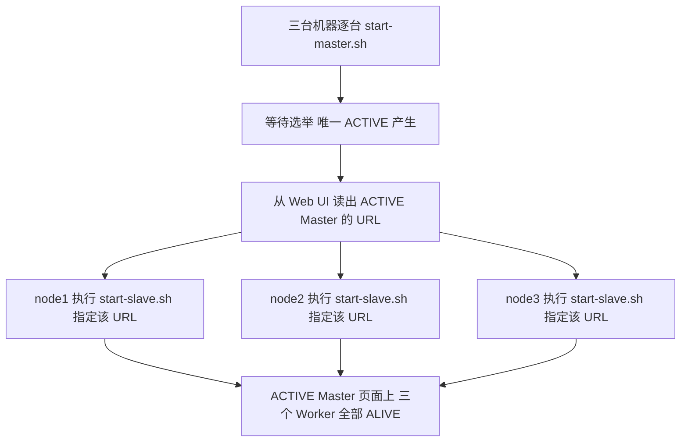

# Spark HA 集群搭建实录：配置 ZooKeeper 恢复模式、逐台起 Master、验证自动切换

方案选定了基于 ZooKeeper 的选举，动手时才会发现一个反直觉的坑：把单点集群时代的 `start-all.sh` 照搬过来一键启动，Master 确实起来了三个，可 Worker 反而注册不上，日志里全是连接 Master 失败。原因藏在启动方式与 Master 地址的配合上。这一篇按搭建顺序走完配置、分发、启动、验证四步，把坑的位置和正确的启动姿势一起交代清楚。

## 先给结论

- 配置三步：三台机器的 hosts 加 ZooKeeper 域名映射，`spark-env.sh` 注释 `SPARK_MASTER_HOST` 并追加恢复模式参数，再把配置分发到所有节点。
- `SPARK_MASTER_HOST` 必须注释掉：HA 模式下谁是主由 ZooKeeper 选举决定，Master 地址写死等于把选举架空。
- 三个参数各管一件事：`spark.deploy.recoveryMode` 定恢复模式，`spark.deploy.zookeeper.url` 定 ZooKeeper 地址与端口，`spark.deploy.zookeeper.dir` 定元数据在 ZooKeeper 里的目录，注意它是 ZooKeeper 命名空间下的路径，不是任何一台机器的本地目录。
- 启动姿势：逐台 `start-master.sh` 起满三个 Master，等唯一 Active 选出，再逐台用 `start-slave.sh` 显式指定 Active Master 的 URL 启动 Worker；课程环境里沿用一键启动会让 Worker 拿着旧地址连到 Standby。
- 验证收口：`kill -9` 当前 Active Master，等约 1 分钟，某个 Standby 转正并接管全部 Worker，即为切换成功。

## 一、前置条件与 hosts 映射

HA 的前提是有一套可用的 ZooKeeper 服务。课程演示环境为求简单使用单节点 ZooKeeper（前置课程已装好），生产环境建议部署 ZooKeeper 集群。单节点服务的地址是 `192.168.31.81`，三台 Spark 机器都要在 hosts 文件里加上域名映射，后续配置里就统一用 `zk` 这个名字引用它：

```bash
# 三台机器的 /etc/hosts 末尾各追加一行
192.168.31.81 zk

# 验证解析与连通性
ping zk
# PING zk (192.168.31.81) ... 1 packets transmitted, 1 received, 0% packet loss
```

映射配好之后，改配置、迁移 ZooKeeper 时都不用再碰 Spark 的配置文件。

## 二、修改 spark-env.sh：注释写死的 Master，追加恢复参数

进入 Spark 安装目录的 `conf` 子目录，编辑运行环境配置文件 `spark-env.sh`：

```bash
# 注释掉单点模式写死的 Master 主机名，HA 模式下由 ZooKeeper 选举决定谁是主
# export SPARK_MASTER_HOST=node1

# 追加 Master 恢复参数，通过 Spark 守护进程的 JVM 启动参数注入
export SPARK_DAEMON_JAVA_OPTS="-Dspark.deploy.recoveryMode=ZooKeeper \
-Dspark.deploy.zookeeper.url=zk:2181 \
-Dspark.deploy.zookeeper.dir=/spark"
```

三个参数逐条拆开：

**`spark.deploy.recoveryMode=ZooKeeper`。** 恢复模式，即 Master 重新启动时采用的恢复方式，取值有 ZooKeeper、FileSystem、NONE 三种，这里选 ZooKeeper，走选举路线。

**`spark.deploy.zookeeper.url=zk:2181`。** ZooKeeper 服务地址，`zk` 就是刚在 hosts 里配的域名映射，`2181` 是 ZooKeeper 的默认服务端口。

**`spark.deploy.zookeeper.dir=/spark`。** Spark 元数据在 ZooKeeper 里的保存目录。要特别留意：它是 ZooKeeper 命名空间下的 znode 路径，不是任何一台机器的本地磁盘目录，Worker 注册信息与 Application 信息都存在这里，供新 Master 恢复时读取。

**为什么 `SPARK_MASTER_HOST` 必须注释掉。** 单点模式下这一行把 Master 固定在 node1，Worker 与应用都拿这个静态地址找主。HA 模式下谁是主由选举决定，地址不能写死；留着这行，集群仍会按旧地址找 Master，选举机制形同虚设。

## 三、分发配置并清场

改好的配置要同步到另外两台机器，然后停掉现有 Spark 进程，从干净状态开始：

```bash
# 把 spark-env.sh 分发到另外两台机器的 conf 目录
scp spark-env.sh node2:$SPARK_HOME/conf/
scp spark-env.sh node3:$SPARK_HOME/conf/

# 停掉现有 Spark 集群，三台机器分别用 jps 确认没有 Master 与 Worker 残留
./stop-all.sh
jps
```

任何一台机器上残留旧进程，都会干扰后面的启动与选举观察，清场要彻底。

## 四、一键启动的坑：Worker 连错了 Master

按惯性先试一键启动：`start-all.sh` 跑完后，再在 node2、node3 上补执行 `start-master.sh`，三个 Master 就位。此时浏览器里看三台机器的 8080 页面，一个 ACTIVE、两个 STANDBY，看着一切正常。等到 kill 掉 Active 验证切换时，问题才暴露：新 Active 上只有两个 Worker，第三台的 Worker 始终没注册上来。翻第三台机器 Worker 的日志，在 Spark 安装目录的 `logs` 子目录里能看到明确的报错：

```text
WARN Worker: Failed to connect to master <master-host>:7077
org.apache.spark.SparkException: Exception thrown in awaitResult
at org.apache.spark.rpc.RpcEnv.setupEndpointRefByURI(RpcEnv.scala:101)
```

Worker 尝试连接的 Master 地址还是配置里遗留的静态地址，而那个地址对应的 Master 处于 Standby 状态，根本不接注册请求，于是这台 Worker 从头到尾没找到真正的主。排查这类问题的口诀是：Worker 注册不上，先看它日志里连的是哪个 Master 地址。另外注意 Standby 的页面上本来就显示 0 个 Worker，别把它误判成 Worker 挂了。

## 五、正确的启动姿势

清掉所有进程重来，HA 集群按下面的顺序启动：

```bash
# 1. 三台机器分别单独启动 Master，不要用 start-all.sh
./start-master.sh

# 2. 浏览器确认唯一 ACTIVE：node1 显示恢复中并转 ACTIVE，node2 与 node3 为 STANDBY

# 3. 三台机器分别启动本机 Worker，显式指定当前 ACTIVE Master 的 URL
./start-slave.sh spark://node1:7077
```

`start-slave.sh` 与 `start-slaves.sh` 一字之差要分清：带 s 的按 slaves 文件批量启动集群里配置的全部 Worker，不带 s 的只启动本机一个 Worker，并且可以在命令行跟上 Master URL。第三步里 URL 要指向当时真正 ACTIVE 的那台机器，别照抄任何固定主机名，因为切换发生后 ACTIVE 会变。



这张图的验收点在最底部：三个 Worker 全部出现在 Active Master 的页面上，说明注册链路通了，HA 集群才算真正立起来。

## 六、kill 主 Master 验证切换

集群就位后做最终验证，在当前 Active Master 所在机器上强杀 Master 进程，模拟一次真实宕机：

```bash
jps
kill -9 2608
```

观察三步：Active 所在节点的页面连接被拒绝，符合宕机预期；另外两个 Standby 的页面仍是 STANDBY，说明选举正在进行；等待约 1 分钟后刷新，node2 的状态变成 ACTIVE，并且三个 Worker 全部出现在它的页面上，Worker 无需重新注册，状态直接从 ZooKeeper 恢复，切换完成。此时把 node1 的 `start-master.sh` 重新执行，它会以 Standby 身份回归集群。还可以继续杀掉 node2 的 Master，验证选举会在 node1 与 node3 之间再进行一轮。

## 常见误区

- **HA 模式忘注释 `SPARK_MASTER_HOST`。** 错例：只追加了恢复参数，静态 Master 主机名还留着。正解：两处改动是一套动作，地址写死会让选举失效，Worker 与应用仍按旧地址找主。
- **改完配置忘了分发。** 错例：只改了 node1 的 `spark-env.sh`，node2、node3 还是旧配置。正解：配置文件是三台共用的，改完必须 scp 分发，并在每台机器上确认内容一致。
- **把 `spark.deploy.zookeeper.dir` 当成本地目录。** 错例：去 Spark 安装目录下找 `/spark` 文件夹。正解：它是 ZooKeeper 里的 znode 路径，元数据存在 ZooKeeper 服务端，可用 ZooKeeper 客户端登录查看。
- **验证切主时等不及就下结论。** 错例：kill 后十几秒看到 Standby 页面没有 Worker，判定 HA 失效。正解：选举与状态恢复约需 1 分钟，Standby 页面不显示 Worker 属于正常现象，等新 ACTIVE 出现并挂上全部 Worker 再下结论。

## 面试可能被问到的问题

1. 面试官追问：「HA 模式下为什么要注释 SPARK_MASTER_HOST？」
   答：这个变量把 Master 地址写死在配置里，单点模式下没问题；HA 模式下谁是主由 ZooKeeper 选举动态决定，地址必须随选举变化。留着它，Worker 与应用会继续拿静态地址找主，可能连到 Standby 节点，选举机制就失去了意义。
2. 面试官追问：「spark.deploy.zookeeper.dir 里存的是什么？」
   答：存的是 Spark 集群在 ZooKeeper 里的元数据，包括 Worker 的注册信息与 Application 信息。新 Master 选举上位后从这里读回旧 Master 的状态，不用等 Worker 重新注册就能恢复服务，这是自动切换能快速完成的关键。
3. 面试官追问：「HA 集群的正确启动顺序是什么？」
   答：逐台执行 start-master.sh 起满多个 Master，等待 ZooKeeper 选出唯一 ACTIVE；然后逐台执行 start-slave.sh 并显式指定当前 ACTIVE Master 的 URL 启动 Worker。不要用 start-all.sh 一键启动，它会让 Worker 按遗留的静态地址找主，连到 Standby 上导致注册失败。
4. 面试官追问：「Master 切换瞬间，正在运行的应用会受影响吗？」
   答：恢复窗口约 1 分钟，期间没有 Active Master，新应用提交会失败，需要客户端重试或配置多个 Master 地址轮询。运行中的应用依托 ZooKeeper 里保存的状态，Worker 与 Executor 向转正的新 Master 重新衔接后继续运行，这也是元数据外置到 ZooKeeper 的收益。
5. 面试官追问：「演示环境用单节点 ZooKeeper，生产环境要注意什么？」
   答：ZooKeeper 方案的高可用建立在 ZooKeeper 自身可靠的前提上，单节点 ZooKeeper 自己就是单点。生产环境应部署至少三个节点的 ZooKeeper 集群，Spark 配置里的 zookeeper.url 可以填多个地址，保证选举服务先于 Spark 集群达到可用性要求。

## 配套资料

- 学习目标：`materials/code/07/day06 探花交友-Spark快速入门/day06/学习目标.md`，其中「独立搭建 Spark 的 HA 集群」一条即为本课的验收目标。
- 说明：day06 资料包仅含学习目标，无工程源码与讲义文件；hosts 映射、参数名与启动脚本用法按课程画面还原（脚本以 Spark 安装目录 sbin 下实际文件为准），配置内容为按本课写法补全，可直接落地。
