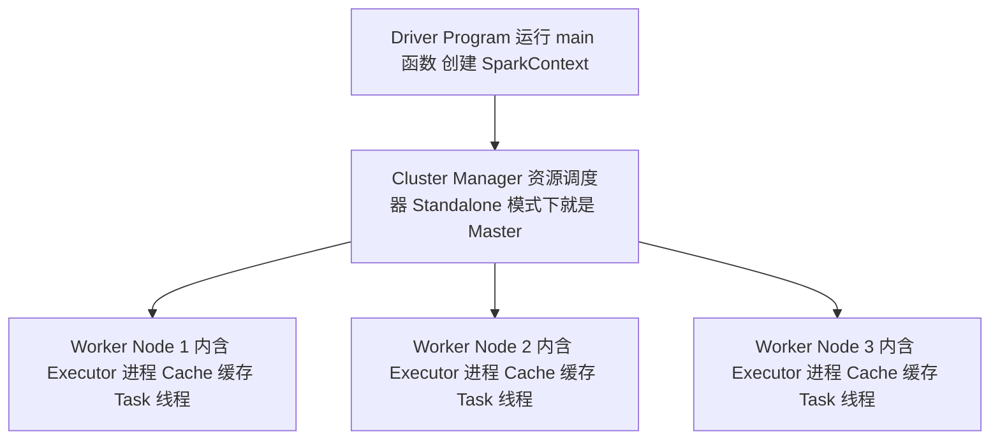

# Master、Worker、Driver、Executor：一张图分清 Spark 集群的角色分工

集群和 HA 都跑通之后，日志与监控页里的名词突然多起来：Driver Program、Cluster Manager、Executor、Task，外层还套着 Application、Job、Stage。这些角色分属不同的层，混在一起看报错根本定位不了是谁的问题。这一篇把角色按「集群资源层」与「应用执行层」两层拆开，再把一个应用从提交到拆成任务的最小执行单元的层级关系理清楚。

## 先给结论

- 角色分两层看：Master 与 Worker 是集群资源层，Driver 与 Executor 是应用执行层，Task 是最小执行单元。
- Master 只调度不计算，真正的计算发生在 Worker 节点拉起的 Executor 进程里，Executor 内部用线程跑 Task。
- Application 等于 Driver 程序加上集群上的一组 Executor；应用内部的计算再按 Job、Stage、Task 逐级切分。
- Cluster Manager 有三种实现：Standalone（Spark 原生资源管理，默认，课程集群所用）、Apache Mesos、Hadoop YARN。
- 每个应用独享自己的 Executor，一个应用崩掉不牵连别的应用，这是有意的故障隔离设计。

## 一、从一张架构图说起

Spark 架构采用的是分布式计算里经典的 Master-Slave 模型：master 是集群中含有 Master 进程的节点，slave 是含有 Worker 进程的节点。提交与执行的方向在图里看得清清楚楚：



读图的两条主线：Driver 向 Cluster Manager 提交应用并申请资源，这是调度方向；Cluster Manager 把资源分给各个 Worker Node，Worker 在进程内启动 Executor 去执行 Task，这是执行方向。Master 从头到尾不碰数据。

## 二、集群资源层：Master 与 Worker Node

**Master 是集群的主节点。** 它对应架构图里的 Cluster Manager 在 Standalone 模式下的角色：接收应用提交、登记 Worker、把核与内存分配给应用。任务提交给 Master，但 Master 不做执行，它只是调度中枢。

**Worker Node 是集群中任何可以运行应用代码的节点。** Standalone 模式下由 slaves 文件统一配置，课程集群的 slaves 内容就是三行主机名：

```text
node1
node2
node3
```

每台机器上驻守一个 Worker 进程，向 Master 汇报本机可用的核数与内存，等 Master 下达指令后在本机拉起 Executor 进程。Web UI 里 Workers 表格中的 Cores 与 Memory 数值，就是 Worker 汇报上来的资源家底。

## 三、应用执行层：Driver、Executor、Task

**Driver Program 是运行 main 函数并创建 SparkContext 的程序。** 后面用 Java 编写 Spark 代码时，main 方法里创建 SparkContext 的那个类就是 Driver。它掌握全局：把计算切分成任务、向集群申请资源、调度 Task、收集结果。

**Application 是基于 Spark 的应用程序。** 它包含 Driver 程序和集群上为这个应用启动的 Executor 们。提交一次就是一个 Application，Master 的 Web UI 里能看到每个应用的名字、提交时间与状态。

**Executor 是在 Worker 节点上为某个应用启动的一个进程。** 它有两个职责：负责运行任务，并负责把数据保存在内存或者磁盘上，也就是缓存的落地。强调一遍它的粒度：Executor 是进程，不是线程。

**Task 是被送到某个 Executor 上的工作单元。** 真正干活的就是 Task，它以线程方式在 Executor 进程里执行，多个 Task 共享所在 Executor 的内存与连接。

**为什么每个应用要独享 Executor。** 反过来看最直观：如果多个应用共用一个 Executor，它一挂，受影响的是所有共用它的应用；每个应用有独立的执行器，一个执行器当机只会波及自己的应用，故障半径被限制在应用内部。

## 四、从 Application 到 Task 的切分链路

角色之间的层级关系可以用一条切分链概括，详细的任务调度流程会在后续课程里展开，这里先建立骨架：

```text
Application  一次提交对应的完整应用
  └─ Job     遇到 action 算子触发一次，一个应用可含多个 Job
       └─ Stage   按宽窄依赖边界切分出的执行阶段
            └─ Task   每个分区对应一个，落到 Executor 的线程上执行
```

资源调度围绕核与内存展开：Master 分配的资源以 core 和 memory 计量，应用按额度在 Worker 上拉起 Executor。课程集群里每个 Worker 挂 2 个核、约 2.7 GB 可用内存，一个应用在三个 Worker 上各要一个 1024 MB、2 核的 Executor，合计就是 6 核 3 GB 的资源占用，这与 Web UI 应用详情页里 Executor 汇总的数据能一一对上。

## 常见误区

- **把 Master 当成计算节点。** 错例：看到 Master 机器配置最好，就把重计算逻辑往它身上靠。正解：Master 只做资源调度与应用管理，数据计算全部发生在 Worker 上的 Executor 进程里，监控时盯着 Worker 的资源水位才有意义。
- **把 Driver 和 Master 混为一谈。** 错例：以为提交应用后 Driver 跑在 Master 上、由 Master 代管。正解：Driver 是应用侧的进程，负责创建 SparkContext 与切分任务；Master 是集群侧的资源调度者。两者一个管应用逻辑，一个管集群资源，谁也不隶属谁。
- **把 Task 当成进程。** 错例：以为一个 Task 一条 JVM 进程。正解：Executor 才是进程，Task 是 Executor 内的线程，启动开销小、共享内存，这也是 Executor 能并发跑大量小任务的原因。
- **忽略 Cache 的宿主。** 错例：以为缓存数据独立于进程存在。正解：缓存在 Executor 进程内，Executor 一挂缓存随之丢失，需要靠血缘关系重算恢复，这是理解容错机制的入口。

## 面试可能被问到的问题

1. 面试官追问：「Spark 集群里 Master 和 Worker 各自负责什么？」
   答：Master 是 Standalone 模式的集群管理器，接收应用提交、登记 Worker、分配核与内存资源；Worker 驻守在每个从节点上，汇报本机资源，并按 Master 指令为本应用拉起 Executor 进程。Master 管调度不执行计算，计算由 Worker 上的 Executor 完成。
2. 面试官追问：「Driver Program 和 Master 是什么关系？」
   答：Driver 是应用侧进程，运行 main 函数并创建 SparkContext，负责构建计算图、申请资源、调度 Task 与收集结果；Master 是集群侧的资源管理者。Driver 通过 Cluster Manager 申请资源，但不运行在 Master 上，也不受 Master 管辖，两者分属应用与集群两个视角。
3. 面试官追问：「为什么每个应用要有独立的 Executor？」
   答：为了故障隔离。多个应用共用一个 Executor 时，Executor 崩溃会同时影响所有共用它的应用；独立 Executor 让故障半径收敛在单个应用内，同时应用之间的资源额度也天然分开，不会互相抢内存与核。
4. 面试官追问：「Executor 和 Task 的关系是什么，谁进程谁线程？」
   答：Executor 是运行在 Worker 节点上的进程，负责运行任务并把数据保存在内存或磁盘上；Task 是被送到 Executor 上的工作单元，以线程方式在 Executor 进程里执行。一个 Executor 可以并发跑多个 Task，它们共享进程的内存。
5. 面试官追问：「Cluster Manager 有哪几种实现？」
   答：三种。Standalone 是 Spark 原生的资源管理，由 Master 负责分配，默认模式，搭建最简单；Apache Mesos 是与 Hadoop MapReduce 兼容性良好的一种资源调度框架；Hadoop YARN 复用 YARN 的 ResourceManager 做资源管理。课程集群用的是默认的 Standalone。

## 配套资料

- 学习目标：`materials/code/07/day06 探花交友-Spark快速入门/day06/学习目标.md`，其中「了解 Spark 的角色」一条对应本课内容。
- 说明：day06 资料包仅含学习目标，无工程源码与讲义文件；角色定义与架构图按课程画面与讲解整理，任务切分链为按本课写法补全的概览，细节以课程后续任务调度篇为准。
