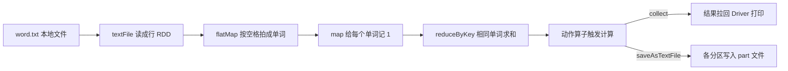

# Spark-shell 交互式体验：一行命令跑完单词统计

内置示例跑通之后，新的疑问自然出现：想验证一个算子的行为，或者拿一份小数据试探处理思路，难道每次都要新建工程、写代码、打包提交？Spark 自带交互式解释器 `spark-shell`，命令敲进去立即执行立即出结果，是上手 Spark 的第一件趁手工具。下面从本地模式起步，把单词统计在命令行里跑通，再切到集群模式让结果落盘，顺带读懂启动日志里的几行关键信息。

## 先给结论

- `spark-shell` 是 Spark 自带的交互式解释器，输入 Scala 命令立即执行立即看结果，开发测试阶段验证思路最方便；命令用 Scala 编写，看懂即可，不必先学 Scala 语法。
- 启动不带 `--master` 参数时默认 `local[*]` 本地模式，应用与集群无关；要跑在集群上必须显式指定 Master 地址。
- 启动日志交代了两个现成对象：`sc` 即 SparkContext，Spark 2.x 起还提供 `spark` 即 SparkSession，直接用它们发算子。
- 单词统计一行命令串起 `textFile`、`flatMap`、`map`、`reduceByKey`，前面都是转换算子，末尾的 `collect` 或 `saveAsTextFile` 这类动作算子才真正触发计算。
- 集群落盘的输出目录里，`_SUCCESS` 是空的成功标识文件，`part-00000`、`part-00001` 按分区各存一份，汇总后与 `collect` 的结果一致。

## 一、准备数据并启动本地 shell

登录 node1（192.168.31.82），在 root 主目录下准备测试文件 `word.txt`，内容四行，hello 出现 4 次、其余单词各 1 次：

```text
hello world
hello spark
hello spring
hello mvc
```

进入 Spark 安装目录的 bin 子目录，直接启动：

```bash
cd $SPARK_HOME/bin
./spark-shell
```

启动成功的日志值得停下来读几行：

```text
Spark context Web UI available at http://node1:4040
Spark context available as 'sc' (master = local[*], app id = local-1565347144325).
Spark session available as 'spark'.
Using Scala version 2.11.12 (Java HotSpot(TM) 64-Bit Server VM, Java 1.8.0_141)
Type in expressions to have them evaluated.
Type :help for more information.

scala>
```

三点信息。`master = local[*]` 说明当前是本地模式，应用在本机单进程里以与 CPU 核数相同的线程数执行，没有与集群发生任何联系。`sc` 已经创建完毕并以别名暴露在命令行里，它就是 SparkContext，读文件、发算子都从它出发；Spark 2.x 起还额外提供 `spark` 这个 SparkSession 对象。`http://node1:4040` 是 Driver 端自己的 Web UI，只反映当前应用的 Job 与 Stage，与 Master 的 8080 集群页面是两回事。体验完用 `:quit` 退出。

## 二、一行命令完成单词统计

在 `scala>` 提示符下输入整条算子链并回车：

```scala
scala> sc.textFile("file:///root/word.txt").flatMap(_.split(" ")).map((_,1)).reduceByKey(_+_).collect
res0: Array[(String, Int)] = Array((hello,4), (mvc,1), (world,1), (spark,1), (spring,1))
```

结果数组与文件内容完全对上。命令是 Scala 写的，逐段拆开看每个环节在做什么：

- `sc.textFile("file:///root/word.txt")`：读本地文件，`file:///` 三个斜杠后跟绝对路径，返回一个 RDD，可以理解成分布式的行集合；
- `flatMap(_.split(" "))`：下划线代表每一行数据，按空格切分后拍平，一行文本变成多个单词；
- `map((_,1))`：给每个单词配上计数 1，变成单词与数值组成的键值对；
- `reduceByKey(_+_)`：相同单词归组，计数值两两相加；
- `collect`：动作算子，触发真正的计算并把结果拉回 Driver 打印。

这张图把一行命令的数据流拆开：数据从文件出发，经三次转换逐步变形，末端由动作算子收尾。



关键路径在于前四步只登记逻辑不执行：Spark 把转换链记成血缘，`collect` 出现才从头到尾跑一遍，这就是惰性求值。敲命令时前半段回车毫无动静、`collect` 回车后日志立刻刷出 Task 执行记录，原因就在这里。

## 三、连上集群并把结果落盘

本地验证完，把 shell 切到集群。先刷新 Master 的 8080 页面确认当前 Active Master 是谁，课堂环境此刻是 node2，退出后重新启动并指定地址：

```bash
./spark-shell --master spark://node2:7077
```

启动日志会明确提示已连接 node2 的 7077 端口，之后执行的每条命令都跑在集群上。命令与本地版几乎相同，只有结尾换成落盘：

```scala
scala> sc.textFile("file:///root/word.txt").flatMap(_.split(" ")).map((_,1)).reduceByKey(_+_).saveAsTextFile("file:///root/wc")
```

执行结束回到命令行查看产物：

```bash
cd /root/wc
cat part-00000 part-00001
```

目录里三个文件：`_SUCCESS` 是 0 字节的标识文件，只声明这次计算成功完成，没有任何数据内容；`part-00000` 存着 hello、mvc、world 三个单词的计数，`part-00001` 存着 spark、spring。拆成两个文件不是异常：Spark 是分布式计算，reduceByKey 之后数据分布在多个分区，每个分区各写一个结果文件，把两个文件汇总，与此前 collect 打印的结果完全一致。

注意输出路径写的仍是 `file:///` 本机目录，不是 HDFS 目录，读写都发生在节点本地磁盘上；生产环境的结果输出一般写 HDFS，让所有节点共享同一份结果。刷新 8080 页面，Completed Applications 从 3 条变为 4 条，新增记录的 Name 是 Spark shell，点进去还能看到参与计算的 Worker 与 Executor 资源占用，这个从命令行发起的应用确实在集群上完整跑了一遍。至此边界也清楚了：shell 胜在即写即得，适合开发测试；正式的工程化提交由 `spark-submit` 承担。

## 常见误区

- **以为不指定 `--master` 也在用集群。** 错例：本地 shell 跑出了结果，认定集群链路验证通过。正解：不带 `--master` 是 `local[*]` 本地模式，日志里的 `master = local[*]` 是直接证据，只有指定 `spark://` 地址应用才会进集群。
- **把 `_SUCCESS` 当数据文件读，或误以为输出缺了内容。** 正解：它是空的成功标识，供下游判断目录完整性，数据全在 part 文件里。
- **看到两个 part 文件就怀疑算错。** 正解：part 文件数等于输出分区数，分区数不同文件数不同，把所有 part 文件汇总才是完整结果。
- **`file://` 协议头斜杠数量写错。** 错例：`file://root/word.txt`，两个斜杠会把 root 当成主机名导致读不到文件。正解：本地路径写 `file:///绝对路径`，三个斜杠后跟路径。

## 面试可能被问到的问题

1. 面试官追问：「spark-shell 和 spark-submit 分别适合什么场景？」
   答：spark-shell 是交互式解释器，即写即得，适合学习语法、验证算子行为、做小规模数据试探；spark-submit 用于提交正式应用，配合打包好的 jar 走工程化流程。生产运行一律走 spark-submit，shell 只停留在开发测试阶段。
2. 面试官追问：「不指定 --master 时 spark-shell 跑在哪里？」
   答：跑在本地，master 为 local[*]，整个应用在提交机器的单个 JVM 进程内以多线程模拟并行，不向集群申请资源，Master 与 Worker 都不参与，8080 页面上也不会出现对应应用。
3. 面试官追问：「一行单词统计命令里，哪一步才真正触发计算？」
   答：末尾的 collect 或 saveAsTextFile。textFile、flatMap、map、reduceByKey 都是转换算子，只构建血缘不执行；动作算子出现时 Spark 才沿血缘生成 Job、Stage 与 Task 真正计算，这是 Spark 惰性求值的体现。
4. 面试官追问：「collect 和 saveAsTextFile 怎么选？」
   答：collect 把全部结果拉回 Driver，数据量小才安全，结果过大会把 Driver 内存打爆；saveAsTextFile 在集群端按分区落盘，结果留在存储里，适合大结果集与下游继续消费的场景。
5. 面试官追问：「输出目录里的 _SUCCESS 文件有什么用？」
   答：0 字节的完成标识。下游任务或调度系统依据它是否存在来判断这次输出已经完整落盘，避免读到算了一半的目录；它不占空间却承担了完整性信号的角色。

## 配套资料

- 学习目标：`materials/code/07/day06 探花交友-Spark快速入门/day06/学习目标.md`，其中「独立完成单词统计的入门案例」一条对应这里的验收目标。
- 说明：day06 资料包仅含学习目标，无工程源码与讲义文件；spark-shell 启动日志与执行命令按课程画面还原，测试文件内容按运行结果补全，输出目录结构为按本课写法补全。
