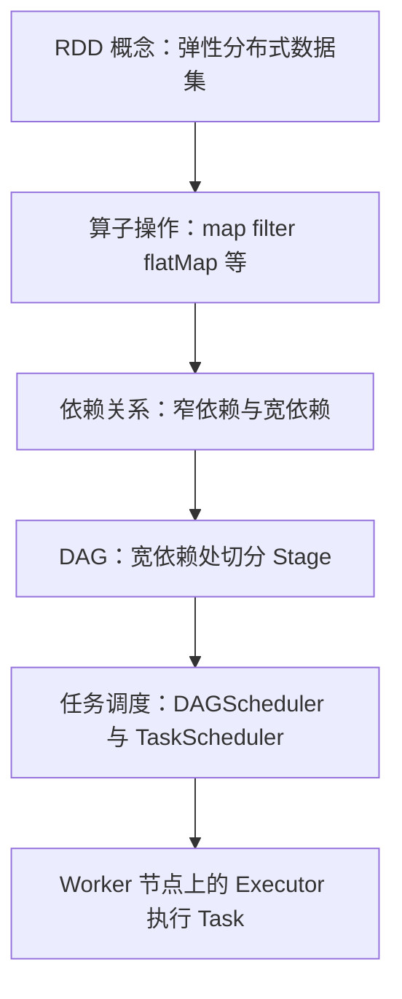

# day06 复盘：Spark 快速入门的完整拼图与 day07 衔接

一天的内容从「Spark 是什么」一路推进到「任务怎么调度」，跨度大、信息密。趁记忆新鲜做一次复盘，把散在各讲里的知识点串成一条主线，标出动手项与背诵项的差别，检验哪些真的掌握了、哪些只是混了个眼熟，同时给 day07 的 MLlib 推荐系统把台阶搭好。

## 先给结论

- day06 的主线是一串台阶：Spark 概述与特点、搭建集群、HA 高可用、角色介绍、体验程序、编写 WordCount 应用、RDD 概念与算子，最后落在依赖关系与任务调度。
- Spark 的特点记四个词：速度快、易用性好、通用性强、兼容性好；Spark SQL、Spark Streaming、MLlib、GraphX 四个模块覆盖批处理、流式、机器学习与图计算。
- HA 有两种方案：基于文件系统的单点恢复与基于 ZooKeeper 的部署，推荐 ZooKeeper。
- WordCount 是全天代码主线，Lambda 风格既简洁又高效，标准是能脱离提示独立敲出来。
- RDD 是理解 Spark 的基础与重点，宽窄依赖要能一眼判断，它直接决定 Stage 怎么切。

## 集群线复盘：三台节点与两种 HA 方案

集群搭建的目标环境是 node1 到 node3 三台机器，从环境变量、核心配置到分发、启动一气呵成，这一步的产出是一个可用的 Spark 运行底座。HA 高可用是当天的动手重点，两种方案的差异要能说清：第一种基于文件系统做单点恢复，Master 宕机后靠恢复流程拉起，恢复窗口内服务不可用；第二种基于 ZooKeeper 做主备选举，多个 Master 竞争注册，故障切换自动完成，课程明确推荐第二种。核心配置的样貌：

```bash
# spark-env.sh 关键项：Master 主机与端口
export SPARK_MASTER_HOST=node1
export SPARK_MASTER_PORT=7077
# slaves 文件列出 Worker 节点
node1
node2
node3
```

集群起来之后的体验程序是必经一步，用官方示例 SparkPi 以蒙特卡罗法求圆周率，验证的是「应用能提交、集群能调度、结果能返回」整条链路：

```bash
./run-example --master spark://node1:7077,node2:7077,node3:7077 SparkPi 10
```

角色介绍随之收尾：Driver 跑 main 方法构建协调，Master 负责资源分配，Worker 启动管理 Executor，Executor 在线程池里执行 Task，这些角色在后面的调度流程里还会逐个登场。

## 应用线复盘：WordCount 与 Lambda 风格

编写应用环节用 Java 完成 WordCount：读文本、按空格拆分、标记计数、按键汇总，最后打包提交到集群运行。案例简单，但 SparkConf 配置、JavaSparkContext 入口、textFile 读取、转换算子链、action 收口、资源释放一个不少，是后续所有 Spark 程序的模板。优化环节把匿名内部类换成 Lambda 表达式，篇幅与可读性都明显改善，课程推荐按 Lambda 风格书写。Spark-shell 里的一行版本可以当口诀记：

```scala
sc.textFile("file:///export/data/word.txt").flatMap(_.split(" ")).map((_, 1)).reduceByKey(_ + _).collect()
```

## 概念线复盘：RDD、算子与调度三件套

RDD 概念是全天理论核心：弹性分布式数据集，不可变、可分区、元素可并行计算，弹性体现在存储可内存可磁盘、出错可沿血统重算。算子部分过了 map、filter、flatMap、mapPartitions、mapToPair 五个转换算子，reduceByKey 接进按键聚合，coalesce 收尾重分区。调度部分从依赖关系出发：窄依赖独生子女、宽依赖超生，依赖链构成血统 Lineage 支撑容错；依赖关系形成 DAG，宽依赖处切 Stage；DAGScheduler 划 Stage 生成 TaskSet，TaskScheduler 把 Task 发到 Worker 执行。三件套的先后关系如下：



复盘时可以自测三个问题：给一个算子，能立刻说出它是窄依赖还是宽依赖吗？一条转换链，能手工推演出 Stage 数吗？应用提交后，Job、Stage、Task 三级粒度能对着执行界面数出来吗？三问都过关，day06 才算真正收工。

## 衔接 day07：从快速入门到 MLlib 推荐系统

day06 把 Spark 的骨架立起来，day07 开始往骨架里装第一个上层应用：Spark MLlib 推荐系统。预习条目已经列在 day07 的学习目标里：MLlib 支持的数据类型，RDD、DataSet、DataFrame 三者的区别与转化，推荐系统的业务流程，基于用户与基于商品的协同过滤算法，相似度算法，以及交替最小二乘法 ALS 的原理与实战，资料包中已经出现 ml-100k 目录，那是协同过滤实战常用的 MovieLens 电影评分数据集。到那时今天练的算子与 RDD 思维会直接复用，推荐结果本身就是一条 RDD 转换链加工出来的。

## 常见误区

- **把 HA 两种方案当成等价选项。** 错例：觉得文件系统方案配置少就用它。正解：文件系统方案存在恢复窗口，生产环境与课程都推荐基于 ZooKeeper 的主备选举方案。
- **跑通了 WordCount 就翻篇。** 错例：跟着敲完能出结果就认为掌握了。正解：WordCount 覆盖配置、上下文、读取、转换、聚合、行动、释放资源的完整骨架，标准是独立写出。
- **只背算子 API，不记依赖归属。** 错例：会用 reduceByKey 但说不出它是宽依赖。正解：宽窄归属决定 Stage 划分与 shuffle 代价，用算子必须同时知道它的调度含义。
- **把快速入门当成可以轻视的基础。** 错例：急着翻到 MLlib 写推荐。正解：day07 的协同过滤与 ALS 实战全程建立在 RDD 与算子之上，地基不牢后面处处卡壳。

## 面试可能被问到的问题

1. 面试官追问：「Spark 有哪些特点？」
   答：速度快，基于内存迭代计算；易用性好，支持 Java、Scala、Python 等多语言 API；通用性强，一套引擎覆盖批处理、流式、机器学习与图计算；兼容性好，可运行在 Standalone、YARN 等调度框架上并读写多种数据源。
2. 面试官追问：「Spark HA 有哪两种方案，推荐哪种？」
   答：一种基于文件系统做单点恢复，把元数据落盘、宕机后恢复，存在恢复窗口；另一种基于 ZooKeeper 做主备选举，多个 Master 竞争注册，故障自动切换，推荐后者。
3. 面试官追问：「WordCount 的实现思路是什么？」
   答：textFile 读入生成 RDD，flatMap 按空格拆词压扁，mapToPair 把单词标记为单词与 1 的键值对，reduceByKey 对相同单词计数求和，最后用 collect 或 saveAsTextFile 输出。
4. 面试官追问：「Spark 集群里各角色的职责？」
   答：Driver 执行 main 方法、构建 DAG 并协调任务；Master 属于 Cluster Manager，负责资源分配；Worker 节点负责启动并管理 Executor；Executor 在线程池中运行 Task 并缓存数据。
5. 面试官追问：「快速入门一天的内容里，最核心的是什么？」
   答：RDD 及其依赖关系。RDD 是 Spark 的基本数据抽象，宽窄依赖决定 Stage 划分与 shuffle 边界，任务调度、容错恢复、性能优化都从这条主线展开。

## 配套资料

- 学习目标：`materials/code/07/day06 探花交友-Spark快速入门/day06/学习目标.md`，十一条目标逐条对应全天主线。
- 衔接资料：`materials/code/07/day07 探花交友-SparkMLlib推荐系统快速入门/day07/学习目标.md`，列出 MLlib、协同过滤与 ALS 实战的预习条目。
- 说明：day06 资料包仅含学习目标文件，无工程源码；配置与命令按课程画面整理，Spark-shell 示例中的文件路径为占位写法。
