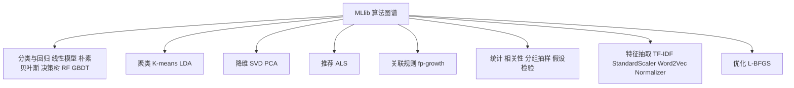
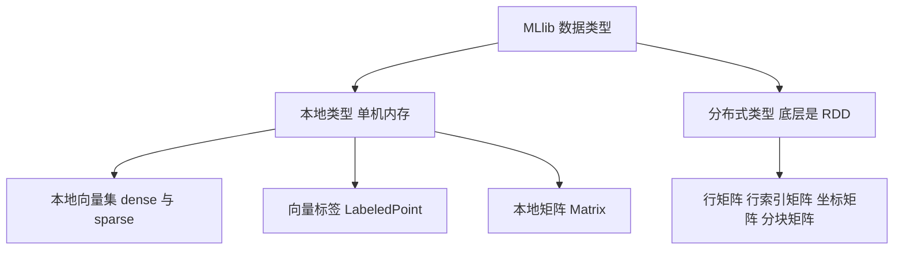
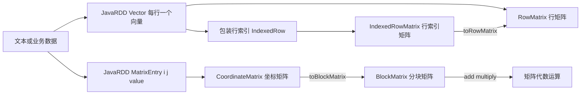

# Spark MLlib 三讲：定位与两套 API、本地向量集数据类型与分布式矩阵全解

## 先给结论

Spark MLlib 是 Spark 的机器学习库，借 Spark 平台天然获得大规模分布式运算能力。入门阶段最容易摔跤的地方是三个名字搅在一起：MLlib、spark.mllib、spark.ml 是不是一回事，import 哪个包，引哪个依赖。全系列三讲先把定位与两套 API 分清，再用两讲把数据类型一次讲透，因为算法世界的第一道门槛不是算法本身，而是数据形态。
定位讲立三件事：库的构成是分类、回归、聚类、协同过滤、降维等通用算法与工具；代码分布在 spark.mllib（基于 RDD 的原始 API）与 spark.ml（基于 DataFrame 的高层 API）两个包；推荐场景先盯住独苗算法 ALS。数据类型分两族：本地一族是密集与稀疏向量、向量标签 LabeledPoint、本地矩阵，稀疏向量只存非零下标，省下的空间在高维稀疏的推荐场景立竿见影，本地矩阵按列优先填充是最典型的坑。
分布式一族是四类矩阵：行矩阵没有行号、行索引矩阵加 Long 型行号、坐标矩阵用三元组堆稀疏、分块矩阵以子矩阵为单位做代数运算，选型第一原则是选定格式后尽量少转换，转换要引发 shuffle。
三讲依次是：
- 什么是 Spark MLlib：算法库定位、算法图谱与两套 API 的分界。
- 本地向量集：密集与稀疏向量、向量标签与按列优先的本地矩阵。
- 分布式矩阵：行矩阵、行索引矩阵、坐标矩阵、分块矩阵与选型原则。

## 第1部分：Spark MLlib 定位拆解：机器学习库、算法图谱与两套 API

MLlib、spark.ml、spark.mllib，三个名字搅在一起是初学者最常摔跤的地方：它们是一回事吗？引入哪个依赖？import 哪个包？把 MLlib 的定位与两套 API 的分界讲清楚，后面的代码才有归属感，文档也读得懂。

### 一、MLlib 的定位：算法库长在分布式底座上

用一句人话说：RDD 解决了「大数据怎么存、怎么并行算」，MLlib 解决了「并行算什么」。单机上做机器学习有大量现成工具，可一旦数据涨到全量用户的规模，读都读不进单机内存，算法必须能在集群上跑。MLlib 的价值就是把常用算法分布式化：调用方式接近单机库，底层却按分区并行、可容错、可扩容。

官方对它的组成有一句概括：由通用的学习算法和工具组成。算法指分类、回归、聚类、协同过滤、降维这些可训练的模型，工具指特征抽取、统计、优化这类支撑环节的设施，合起来覆盖机器学习工程的大半流程。

在探花交友里它的位置很明确：离线推荐计算段的算法供给方。用户行为整理成评分矩阵后，交给 MLlib 的推荐算法训练，产出的推荐结果落库。业务代码照旧写 Java，算法调用走标准 API，团队既有技能直接衔接。

### 二、算法图谱：看清推荐在哪里

MLlib 支持的算法分类如图：



图谱里值得圈出来的是推荐分支：整个推荐类别只有 ALS 一个算法。课程重点由此锁定，需求是用 MLlib 做推荐系统，而推荐系统在 MLlib 里的实现路径就是协同过滤思想加 ALS 实现，后面的篇幅都围绕它展开。其余分支按需取用：特征抽取是把原始数据转成特征向量的常用工具，统计模块提供相关性、分组抽样、假设检验等手段，评测里常见的 AUC 指标可以衡量推荐排序的质量。整个库的算法阵容还在持续扩充，新算法主要落在 spark.ml 一侧。

落到探花交友的需求上，这条路径还能再具体一步。推荐要回答的问题是「把谁推荐给谁」，协同过滤给出的思路是看群体的历史行为：偏好相似的人，喜欢的东西也相似；ALS 把这个思路变成可计算的矩阵分解问题，从评分数据里学出用户与物品的隐因子，进而推算任意一对用户与物品的匹配程度。算法图谱、两套 API、数据类型，都是在为这一步铺路，MLlib 的其余分支在这一程只当背景板。

### 三、两套 API：spark.mllib 与 spark.ml

MLlib 的代码分在两个包里，一张表分清：

| 维度 | spark.mllib | spark.ml |
| --- | --- | --- |
| 载体 | RDD | DataFrame |
| 定位 | 原始算法 API，偏底层 | 更高层次的 API，偏工程 |
| 风格 | 直接操作向量对象 | 表结构加管道，可构建机器学习 Pipeline |
| 现状 | 官方标记为维护模式 | 官方主推，算法持续扩充 |

两者并不互斥：算法思想一致，能实现的东西也一样，区别只在载体与工程化程度。spark.ml 基于 DataFrame，属于更高层次的抽象，还能用 Pipeline 把特征处理、训练、评估串成管道，这是机器学习工程化的主流形态。探花交友的课程示例走 RDD 系 API，原因很朴素：前一日的 Spark 快速入门刚铺完 RDD 地基，顺着它走曲线最缓，而两套包的分界与转化本身也是本日的学习目标之一。

包名在 import 里一眼可辨：

```java
//RDD 系：org.apache.spark.mllib
import org.apache.spark.mllib.linalg.Vector;
import org.apache.spark.mllib.linalg.Vectors;

//DataFrame 系：org.apache.spark.ml
import org.apache.spark.ml.linalg.Vector;
import org.apache.spark.ml.linalg.Vectors;
```

两个包下的类名几乎同名，全限定名不同。混用会在类型不匹配的地方编译报错，动笔前先定好走哪套，全套保持一致。

### 四、依赖怎么引

课程画面给出的依赖坐标是 Spark 2.4.3 加 Scala 2.11 的组合：

```xml
<dependency>
    <groupId>org.apache.spark</groupId>
    <artifactId>spark-core_2.11</artifactId>
    <version>2.4.3</version>
</dependency>
<!-- mllib 的 linalg 与算法类在本依赖中，按主流写法补全 -->
<dependency>
    <groupId>org.apache.spark</groupId>
    <artifactId>spark-mllib_2.11</artifactId>
    <version>2.4.3</version>
</dependency>
```

`spark-mllib_2.11` 会传递引入 spark-core，单独引它也能跑通。坐标里的 2.11 是 Scala 版本，与集群环境的 Scala 版本保持一致即可。

## 第2部分：MLlib 本地数据三件套：密集与稀疏向量、向量标签、本地矩阵

算法世界的第一道门槛不是算法本身，而是数据形态。MLlib 的算法只认向量与矩阵，业务表里的用户、评分、类别标记都得先翻译成这些类型。本课把本地一族一次讲透：先看类型全景，再逐个构造密集向量、稀疏向量、向量标签与本地矩阵，每个 API 的参数语义都要咬准，它们是后面所有算法实战的输入。

### 一、类型全景与准备

课程画面给出的类型总览如下：

| 类型名称 | 释义 |
| --- | --- |
| Local vector | 本地向量，向 Spark 提供一组可操作的数据集合 |
| Labeled point | 向量标签，让用户能够分类不同的数据集合 |
| Local matrix | 本地矩阵，将数据以矩阵形式存储在本地计算机中 |
| Distributed matrix | 分布式矩阵，将数据以矩阵形式存储在分布式集群中 |

四类的归属关系如图：



本地三件套是本节主角，分布式一族单独成篇。示例沿用课程工程的测试结构：新建 `TestMLlib` 放在 test 目录下，用 JUnit 的 `@Test` 方法逐个验证，包名统一为 `com.study.tanhua.spark`，依赖坐标用 Spark 2.4.3 加 Scala 2.11 的组合。

### 二、密集型向量：数组的镜像

密集向量与数组几乎一一对应，每个位置都存值：

```java
import org.apache.spark.mllib.linalg.Vector;
import org.apache.spark.mllib.linalg.Vectors;
import org.junit.Test;

@Test //测试密集型的数据集
public void testDense() {
    Vector dense = Vectors.dense(9, 5, 2, 7); //定义密集型数据集
    double v = dense.apply(1); //根据下标获取值
    System.out.println(v); //输出 5.0
}
```

三个细节。构造走 `Vectors.dense` 工厂方法；`apply(1)` 按下标取值，下标从 0 开始，位置 1 对应第二个元素 5；打印结果是 `5.0` 而不是 5，因为内部一律存 double，构造时写 int 只是自动拓宽。整体用法与操作一个数组没有区别。

### 三、稀疏型向量：只存非零的下标

稀疏向量需要三样东西：总长度 size、非零位置的下标数组、对应的非零值数组，两个数组按位置一一对应：

```java
@Test //测试稀疏型的数据集
public void testSparse() {
    int[] indexes = new int[]{0, 1, 5, 9};
    double[] values = new double[]{9, 5, 2, 7};
    Vector sparse = Vectors.sparse(10, indexes, values); //定义稀疏型数据集
    System.out.println(sparse.apply(0)); //9.0，下标 0 指定的值
    System.out.println(sparse.apply(2)); //0.0，未指定的位置自动补 0
    System.out.println(sparse.apply(5)); //2.0
    System.out.println(sparse.apply(7)); //0.0
}
```

总长度定为 10，但只指定了 4 个位置：下标 0 放 9，下标 1 放 5，下标 5 放 2，下标 9 放 7，其余位置全部按 0 填充，取哪个下标都能得到确定的值。同样的数据若写成密集向量，就得老实存 10 个元素，其中 6 个是 0。课程演示把长度从 4 一路改成 10 再往上加，取值始终正确，验证的就是这条填充规则。

两种形态的分工由此而来。数据稠密、几乎每个位置都有值，用 dense；维度高、绝大多数位置是 0，用 sparse。推荐场景天然偏向后者：用户对上万部内容往往只与几十部发生过评分或互动，稀疏存储只记录交互过的位置，空间开销从维度量级降到交互量级。

课程演示用 Java，同一套 API 的 Scala 写法更短，两种语言通用：

```scala
import org.apache.spark.mllib.linalg.{Vector, Vectors}

val dense: Vector = Vectors.dense(9, 5, 2, 7)  //密集型
val sparse: Vector = Vectors.sparse(10, Array(0, 1, 5, 9), Array(9, 5, 2, 7)) //稀疏型
```

### 四、向量标签：给特征挂上类别号

向量标签 `LabeledPoint` 用于给 MLlib 的机器学习算法做标记。分类问题的典型用法：把数据分成若干份，用整数 0、1、2 标记类别，例如垃圾邮件分类里正类样本标 1、非正类样本标 0。它由标签和特征向量两部分组成，密集、稀疏向量都能套：

```java
import org.apache.spark.mllib.linalg.LabeledPoint;

@Test //测试向量标签
public void testLabeledPoint() {
    //密集型标签
    Vector dense = Vectors.dense(9, 5, 2, 7); //定义密集型数据集
    LabeledPoint lp = new LabeledPoint(1, dense); //定义向量标签
    System.out.println(lp.label()); //打印标签，输出 1.0
    System.out.println(lp.features()); //打印特征，即数据集本身
    System.out.println(lp);

    //稀疏型标签
    int[] indexes = new int[]{0, 1, 2, 3};
    double[] values = new double[]{9, 5, 2, 7};
    Vector vd2 = Vectors.sparse(4, indexes, values); //定义稀疏型向量
    LabeledPoint lp2 = new LabeledPoint(2, vd2); //定义向量标签
    System.out.println(lp2.features());
    System.out.println(lp2.label());
}
```

`label()` 取类别号，`features()` 取特征向量，直接打印对象则是标签加特征的合体形态。有了标签，样本就能按类别组织起来交给分类算法训练；推荐场景里同样用得上这个思想，比如把「是否点击」作为样本标记。

### 五、本地矩阵：按列优先的存储

大数据运算中常用矩阵形式处理数据以提升计算效率。课程示例把一个六元素数组重排成两行三列的矩阵：

```java
import org.apache.spark.mllib.linalg.Matrix;
import org.apache.spark.mllib.linalg.Matrices;

@Test //测试本地矩阵
public void testMatrix() {
    double[] values = new double[]{1, 2, 3, 4, 5, 6};
    Matrix mx = Matrices.dense(2, 3, values);
    System.out.println(mx);
}
```

运行输出：

```text
1.0  3.0  5.0
2.0  4.0  6.0
```

直觉预期第一行是 1、2、3，实际却是 1、3、5。原因在填充顺序：`Matrices.dense` 按列优先（column-major）装填数组，先填满第一列再填第二列。六个元素按两行切：第 1 列装 1、2，第 2 列装 3、4，第 3 列装 5、6。构造矩阵前必须对齐这个顺序，否则数据整体错位。

## 第3部分：MLlib 分布式矩阵全解：行矩阵、行索引矩阵、坐标矩阵与分块矩阵

本地向量与本地矩阵再省空间，也还是单机内存里的对象。数据涨到全量用户的规模，单机装不下、算不动，数据的家就得搬到集群上。MLlib 的分布式矩阵就是为此准备的：矩阵本体拆开存进 RDD，由集群分区并行持有。本课把四类分布式矩阵一次讲透，每类都给出语义、构造代码与适用场景，收尾再解开一个最让人困惑的输出现象：明明只有几条数据，矩阵怎么就五行六列了。

### 一、定义与选型第一原则

把定义拆开看。长整型行列索引意味着矩阵的行列号用 Long 表示，规模天花板足够高；双精度浮点数值意味着矩阵元素一律是 double，与本地类型一致；存储在一个或多个 RDD 中意味着每行数据、每个条目都是 RDD 里的一个元素，分布式的一切特性（分区、并行、容错）随之而来。

为什么格式选择这么重要。四类矩阵之间可以互相转换，但每次转换都要按行号或坐标重新分发数据，这正是 shuffle：数据要在集群节点间搬家，网络与磁盘开销随数据量上涨。用错格式再转换，等于白付一次全量搬运的成本。所以构造之前先想清楚后续要做按行处理、按坐标取值还是矩阵代数运算，再选对应类型。

四类的构造与转换关系如图：



图里两条主线值得留意：从行向量出发可以走到行矩阵与行索引矩阵，行索引矩阵可转回行矩阵；从坐标条目出发走到坐标矩阵，再一步转换成分块矩阵。转换箭头都有代价，顺着主流程一次构造到位是最优路径。

再补一句数据视角。分布式矩阵本身不引入新的数据容器，它就是装着特定元素的 RDD：行矩阵装向量元素组成的 RDD，行索引矩阵装 IndexedRow 元素，坐标矩阵装 MatrixEntry 元素，分块矩阵装分块二元组。构造分布式矩阵的过程因此可以完全复用 RDD 的那套功夫：textFile 读入文本、map 逐行解析、filter 过滤脏数据，最后交给矩阵类的构造器。数据清洗与矩阵构造在同一套 API 里完成，这正是 MLlib 长在 Spark Core 之上的体现。

### 二、行矩阵 RowMatrix：没有行号的特征向量集合

行矩阵是最基本的一种矩阵类型，以行为基本方向的稠密存储格式，列的作用相对较小。可以把行矩阵理解成一个巨大的特征向量集合：每一行就是一个具有相同格式的向量，且每一行的内容都可以单独取出来操作。没有行索引是它与行索引矩阵的根本区别，行的位置完全由分区内部的排列决定，不承诺第几行是谁。

构造代码从一份文本出发。文件 `a.txt` 内容为两行三列的数字，空格分隔：

```text
1 2 3
2 5 6
```

读取文件、按行切分转成向量，再包装成行矩阵：

```java
@Test //测试分布式矩阵，行矩阵
public void testRowMatrix() {
    SparkConf sparkConf = new SparkConf().setMaster("local[*]").setAppName("tanhua-mllib");
    JavaSparkContext jsc = new JavaSparkContext(sparkConf);
    //读取文件，得到 RDD[String]
    JavaRDD<String> fileRdd = jsc.textFile("files/a.txt");
    //每一行文本转成一个 double 型向量
    JavaRDD<Vector> vectorJavaRDD = fileRdd.map(v -> {
        String[] ss = v.split(" ");
        double[] ds = new double[ss.length];
        for (int i = 0; i < ss.length; i++) {
            ds[i] = Double.valueOf(ss[i]);
        }
        return Vectors.dense(ds);
    });
    RowMatrix rowMatrix = new RowMatrix(vectorJavaRDD.rdd()); //行矩阵
    System.out.println(rowMatrix.numRows()); //行数，输出 2
    System.out.println(rowMatrix.numCols()); //列数，输出 3
    jsc.close();
}
```

这段代码有三个必讲的细节。其一，行矩阵的构造参数是 RDD[Vector]，直接把 RDD[String] 扔进去类型不符，必须先 map 转换；分布式矩阵存的就是这种向量元素组成的 RDD，转格式的工作发生在构造之前。其二，JavaRDD 与 Scala 的 RDD 之间用 `.rdd()` 桥接，这是 Java API 调用 MLlib 的固定动作。其三，`numRows()` 与 `numCols()` 输出 2 与 3，与文件内容一致，行数就是 RDD 的元素个数，列数取自每行向量的长度。

行数与列数的含义也值得停一下。行数就是底层 RDD 的元素个数，每个元素一行；列数取每行向量的长度，同一矩阵里每行格式必须相同，这与「巨大特征向量集合」的定位呼应：一行一个样本，样本的特征维度一致，才能拼成矩阵。也正因为每行可单独取出操作，逐行做特征变换、逐行算统计量这类以行为单位的加工，都能顺着底层 RDD 的算子直接叠加，矩阵与 RDD 的边界在实践中并不僵硬。

适用场景也随之清晰：数据天然按行组织、算法按行成批处理、不需要按行号定位时，行矩阵最省心。比如把每个用户看成一行特征向量做批量统计或相似度计算，行的业务身份由业务层另行维护。探花交友后续把用户特征整理成矩阵喂给推荐算法时，走的就是这条按行组织的路线。

### 三、行索引矩阵 IndexedRowMatrix：行矩阵加行号

行索引矩阵在行矩阵的基础上增加索引功能。每行数据从单纯的向量升级为 IndexedRow 对象，源码定义一目了然：

```java
//org.apache.spark.mllib.linalg.distributed
case class IndexedRow(index: Long, vector: Vector)
```

index 是 Long 型行索引，vector 是行数据。构造参数相应变成 RDD[IndexedRow]，所以转换代码要多包一层：

```java
@Test //测试分布式矩阵，行索引矩阵
public void testIndexedRowMatrix() {
    //rdd1 为上节的 JavaRDD<Vector>，构造路径与行矩阵相同
    //把向量包装成带索引的 IndexedRow，此处用向量长度充当索引演示
    JavaRDD<IndexedRow> rdd2 = rdd1.map(v -> new IndexedRow(v.size(), v));
    IndexedRowMatrix indexedRowMatrix = new IndexedRowMatrix(rdd2.rdd());
    System.out.println(indexedRowMatrix.numRows()); //行数
    System.out.println(indexedRowMatrix.numCols()); //列数
    //rows() 取回带索引的行，转回 JavaRDD 便于遍历
    JavaRDD<IndexedRow> rdd3 = indexedRowMatrix.rows().toJavaRDD();
    List<IndexedRow> list = rdd3.collect();
    list.forEach(indexedRow -> System.out.println(indexedRow));
}
```

数据换成两行 `1 2 3` 与 `4 5 6` 后，遍历输出形如：

```text
IndexedRow(3,[1.0,2.0,3.0])
IndexedRow(3,[4.0,5.0,6.0])
```

索引在前，向量在后。两行的索引都是 3，是因为示例里用向量长度充当了索引，同一个数出现了两次；索引值完全取决于数据，实际业务里通常放用户 id、商品 id 这类业务主键，让每一行都能被定位、被关联。行索引矩阵的行数按最大索引加一推断，所以索引的设计要贴合业务语义，乱给索引会让矩阵凭空多出空行。

它还能一步转回普通行矩阵：调用 `toRowMatrix()` 即可，索引被丢弃，适合「先按行号整理好数据、再交给只认行向量的算法」的两段式流程。

什么时候需要它。把用户 id 作为行索引装进矩阵，之后就能按索引挑出某一行的向量单独查看，或与其他按 id 组织的数据做关联比对；行矩阵做不到这一点，因为行一进分区就只剩排列位置。课程示例里 `rows()` 取回的每行都能打印出索引与向量内容，正是「每一行都可以单独取出来操作」这句话在行索引矩阵上的直接体现。构造时还有个小细节：索引是 Long 型，示例里 `v.size()` 返回 int 会自动拓宽，业务 id 一般本身就是 Long 型，直接传入即可。

### 四、坐标矩阵 CoordinateMatrix：三元组堆出来的稀疏矩阵

坐标矩阵的每个条目由一个三元组组成，包含三部分：行索引 i、列索引 j、值 value。源码结构同样简洁：

```java
//org.apache.spark.mllib.linalg.distributed
case class MatrixEntry(i: Long, j: Long, value: Double)
```

它的使用场景有明确边界：只有当矩阵的两个维度都很大、并且矩阵是稀疏的时候才应该使用。原因不难想：坐标格式只为非零的格子建条目，零值格子一个字节的存储都不占。维度大意味着按行列铺开存不现实，稀疏意味着非零条目占比很低，两个条件同时满足，三元组存储才有优势。推荐系统的用户-物品评分矩阵正是标准答案：用户数以万计、物品数以千计，单个用户只对极少数物品有评分。

数据文件按「行坐标 列坐标 值」三列组织，`1 2 3` 与 `4 5 6` 各占一行：

```java
@Test //测试分布式矩阵，坐标矩阵
public void testCoordinateMatrix() {
    SparkConf sparkConf = new SparkConf().setMaster("local[*]").setAppName("tanhua-mllib");
    JavaSparkContext jsc = new JavaSparkContext(sparkConf);
    JavaRDD<String> fileRdd = jsc.textFile("files/a.txt");
    //每行文本解析成一个 MatrixEntry：第一列作 i，第二列作 j，第三列作 value
    JavaRDD<MatrixEntry> rdd2 = fileRdd.map(v -> {
        String[] ss = v.split(" ");
        return new MatrixEntry(Long.valueOf(ss[0]), Long.valueOf(ss[1]), Double.valueOf(ss[2]));
    });
    CoordinateMatrix matrix = new CoordinateMatrix(rdd2.rdd());
    //entries() 取出全部条目
    List<MatrixEntry> collect = matrix.entries().toJavaRDD().collect();
    collect.forEach(matrixEntry -> System.out.println(matrixEntry));
    jsc.close();
}
```

输出两个条目：

```text
MatrixEntry(1,2,3.0)
MatrixEntry(4,5,6.0)
```

第一行的 1 与 2 是坐标，3 是值；第二行的 4 与 5 是坐标，6 是值。整份矩阵只有这两处非零，其余格子在逻辑上全为 0 却完全不用存储。对照推荐场景：一个条目就是「用户 i 对物品 j 的评分是 value」，全量评分行为恰好就是一堆这样的条目，后续 ALS 实战的数据形态与此一脉相承。

与本地类型对照着看，思路其实同源：稀疏向量按下标存非零值，坐标矩阵按行列坐标存非零条目，都是「不存零」的哲学，只是维度从一维升到二维、载体从单机对象换成 RDD。`entries()` 返回矩阵全部条目组成的 RDD，转回 JavaRDD 之后可以 collect 查看，也可以继续 map、filter 加工，比如按行坐标过滤出某个用户的全部评分，这正是协同过滤推演时需要的取数动作。

### 五、分块矩阵 BlockMatrix：以子矩阵为单位做代数运算

分块矩阵支持把矩阵按分块组织，条目结构分两部分：前面是一个 int 加 int 的二元组，表示该分块所处的分块坐标；后面是一个 Matrix，表示这个位置上的子矩阵。它支持加法与乘法运算，并配有辅助函数检验分块是否正确，不正确会抛出异常。

分块矩阵不必从零构造，坐标矩阵可以直接转换：

```java
CoordinateMatrix matrix = new CoordinateMatrix(rdd2.rdd());
//转化得到分块矩阵
BlockMatrix blockMatrix = matrix.toBlockMatrix();
//检验分块是否正确，不正确会抛出异常
blockMatrix.validate();
//矩阵加法：自己加自己
BlockMatrix addBlockMatrix = blockMatrix.add(blockMatrix);
//blocks() 取出所有分块
List<Tuple2<Tuple2<Object, Object>, Matrix>> collect =
        addBlockMatrix.blocks().toJavaRDD().collect();
collect.forEach(tuple2MatrixTuple2 -> System.out.println(tuple2MatrixTuple2));
```

输出的形状与之前的类型都不同：

```text
((0,0),5 x 6 CSCMatrix
(1,2) 6.0
(4,5) 12.0)
```

分三层解读。外层的 `(0,0)` 是分块坐标，整份矩阵落在一个分块里；中间的 `5 x 6` 是这个分块子矩阵的行列尺寸，CSCMatrix 表明块内按压缩稀疏列的格式存储，零值不占空间；括号里的 `(1,2) 6.0` 与 `(4,5) 12.0` 是块内的非零条目。对照坐标矩阵那一节：原始条目是 `(1,2,3.0)` 与 `(4,5,6.0)`，加法是矩阵自己加自己，每个位置的值翻倍，3 变 6、6 变 12，数值对得上。默认分块尺寸很大，示例这种小矩阵整个落进左上角第一个分块，所以只有一个分块条目；真实大规模矩阵会被切成成百上千个块，乘法按块并行执行，这正是分块组织大数据矩阵代数运算的意义。

validate() 的存在也不是多余的。分块矩阵对块的组织有约定，行列方向上块与块要能拼合、尺寸要一致，转换或运算出错时先跑一次校验，能把问题拦在运算之前，避免等到乘法结果不对再回头排查。`add()` 与 `multiply()` 都是块级并行的：两个矩阵对应位置的块各自相加或做块乘，集群同时处理大量分块，大数据矩阵运算的并行度就来自这里。输出里那层嵌套的 Tuple2 读起来拗口，含义其实简单：外层键是分块坐标，内层值是块内的稀疏子矩阵，看懂一次之后，分块结构的打印就都会认了。

### 六、五行六列从哪来：坐标推断规则

顺着上一节的输出再追一层：数据只有两条，矩阵凭什么是 5 行 6 列。把矩阵画成网格，坐标从 0 开始编号：第一行的格子依次是坐标 `(0,0)`、`(0,1)`、`(0,2)`，第二行从 `(1,0)` 起。把两个条目放进网格：

| | 列 0 | 列 1 | 列 2 | 列 3 | 列 4 | 列 5 |
| --- | --- | --- | --- | --- | --- | --- |
| 行 0 |  |  |  |  |  |  |
| 行 1 |  |  | 6.0 |  |  |  |
| 行 2 |  |  |  |  |  |  |
| 行 3 |  |  |  |  |  |  |
| 行 4 |  |  |  |  |  | 12.0 |

条目 `(1,2)` 的 6.0 落在第 2 行第 3 列，条目 `(4,5)` 的 12.0 落在第 5 行第 6 列。行号最大用到 4，列号最大用到 5，矩阵整体就是 5 行 6 列。这里有个实用的小窍门：矩阵的行列数等于最后一个条目的行坐标与列坐标各加一，4 加 1 是 5 行，5 加 1 是 6 列。这不是示例的特殊处理，而是坐标类矩阵的通用推断规则：坐标矩阵没有显式的行列数参数，行数由最大行索引加一确定，列数由最大列索引加一确定。理解了这条规则，坐标矩阵与分块矩阵的输出就不会再显得莫名其妙。

这条规则反过来也在提醒数据质量。条目里混进一个异常大的坐标，比如把业务 id 错当成坐标传入十万号位置，矩阵就会瞬间膨胀出十万列的空架子，元数据与下游运算量都跟着涨。坐标矩阵适合稀疏数据的前提是坐标本身干净，清洗阶段把坐标范围校验掉，比事后解释奇怪的矩阵尺寸容易得多。

## 常见误区

- **把 spark.ml 与 spark.mllib 当成同一个包的两种写法。** 错例：import 一半来自 mllib 一半来自 ml，方法签名对不上。正解：两个包独立存在，整套代码统一用一个包。
- **以为推荐算法在 MLlib 里有很多选择。** 错例：去找协同过滤类、基于用户的推荐器，发现根本没有。正解：MLlib 推荐模块只有 ALS，协同过滤的思想靠 ALS 这类矩阵分解实现。
- **认为 MLlib 只能用 Scala 写。** 错例：被 Scala 源码劝退。正解：官方支持 Java 等多语言，探花示例全程用 Java。
- **以为引了 Spark 本体就能用算法。** 错例：只引 spark-core 就 import mllib 的类，找不到符号。正解：算法类在 spark-mllib 依赖里，依赖要引全。
- **把 apply 的下标当成从 1 开始。** 错例：`apply(1)` 想取第一个元素，实际拿到第二个。正解：下标从 0 开始，与数组一致。
- **把稀疏向量第一个参数当成非零个数。** 错例：以为 `Vectors.sparse(4, indexes, values)` 表示 4 个非零值，实际把向量总长度定成了 4；下标数组与值数组长度还必须相等，按位置一一对应，否则取值错乱。正解：第一个参数是向量总长度 size，未覆盖位置自动补 0。
- **本地矩阵按行优先填充。** 错例：以为数组按行铺开，打印后怀疑输出有误。正解：列优先填充，先列后行，数据要按列的顺序整理。
- **一律用密集向量。** 错例：高维特征全部 dense，内存先扛不住。正解：按稠密程度选型，稀疏数据交给 sparse，空间从维度量级降到非零量级。
- **把格式互转当成轻量操作。** 错例：行矩阵转坐标矩阵、再转回行矩阵随便转着玩，作业一次比一次慢。正解：每次转换都要 shuffle，数据在节点间重新分发，构造前就定好格式，转换只做必要的少数几次。
- **把 RowMatrix 当成有行号的表。** 错例：想按第几行取数据，在行矩阵上找不到按行号访问的能力。正解：行矩阵不承诺行序的业务含义，需要按行号定位或关联时改用行索引矩阵，用 Long 索引承载业务主键。
- **在稠密数据上用坐标矩阵。** 错例：一个几乎全满的矩阵拆成几百万个 MatrixEntry 条目，存储与计算都膨胀。正解：坐标矩阵只为两维都大且稀疏的数据而生，稠密数据用行矩阵按行存即可。
- **把 blocks() 的输出当成元素级打印。** 错例：看到 `((0,0),5 x 6 CSCMatrix)` 以为输出出错，五行六列更是凭空捏造。正解：打印的是分块坐标加块内子矩阵，矩阵行列数按最大索引加一推断，条目 `(4,5)` 存在就意味着至少五行六列。

## 面试可能被问到的问题

1. 面试官追问：「MLlib 与 Spark 是什么关系？」
   答：MLlib 是 Spark 生态中的机器学习库，构建在 Spark Core 之上，复用 RDD 的分布式与容错能力，把常用机器学习算法做成可并行的实现。Spark 提供算力底座，MLlib 提供算法层。

2. 面试官追问：「spark.mllib 和 spark.ml 有什么区别？」
   答：前者基于 RDD，是原始算法 API；后者基于 DataFrame，抽象层次更高，支持 Pipeline 管道把特征工程与训练串起来。两者算法思想一致，新项目建议优先 spark.ml，维护老代码则继续用 RDD 系。

3. 面试官追问：「MLlib 里做推荐用什么算法？」
   答：推荐模块只提供 ALS，即交替最小二乘法。它基于矩阵分解思想，把评分矩阵拆成用户与物品两个隐因子矩阵交替求解，适合大规模稀疏评分数据的离线训练。

4. 面试官追问：「为什么探花项目的示例走 RDD 系 API？」
   答：课程前置内容刚讲完 RDD，顺着 RDD 走学习曲线平缓，且 RDD 系 API 对理解算法内部的数据流动更直观。工程上新项目可优先 DataFrame 系，享受管道与优化器的红利。

5. 面试官追问：「机器学习管道指什么？」
   答：spark.ml 提供的 Pipeline 概念，把 Transformer 与 Estimator 按顺序编排，特征抽取、转换、模型训练、预测像流水线一样串起来，一次 fit 全链路生效，避免手工环节漏配。

6. 面试官追问：「密集向量和稀疏向量的区别与选型依据是什么？」
   答：密集向量逐位存储所有值，稀疏向量只存非零位置的下标与值，未指定位置自动补 0。稠密数据用 dense，维度高且零值多的数据用 sparse，推荐与文本场景基本都是稀疏形态，存储开销可以从维度量级压到非零量级。

7. 面试官追问：「LabeledPoint 是什么，为什么需要它？」
   答：它是标签加特征向量的组合体，是监督学习算法的标准输入。分类问题需要告诉算法每条样本属于哪一类，整数类别号挂在向量上就构成带标记的样本，label() 取标签，features() 取特征。

8. 面试官追问：「本地矩阵打印出来为什么与直觉不一致？」
   答：Matrices.dense 按列优先填充数组，先填满第一列再填下一列，打印排列自然与按行铺开的直觉不同。构造矩阵前要先按列的顺序整理数据。

9. 面试官追问：「MLlib 里的数值为什么打印都带小数点？」
   答：内部统一用 double 存储数值，构造时传 int 会被自动拓宽成 double，这也是 linalg 各类型方法签名里大量出现 double 的原因。

10. 面试官追问：「本地类型和分布式类型的边界在哪？」
   答：能否放进单个节点的内存。本地向量、标签、矩阵都在单机内存中，适合样本级数据；数据量大到单机装不下时升级为分布式矩阵，底层换成 RDD 存储。

11. 面试官追问：「MLlib 有哪几类分布式矩阵，分别适合什么场景？」
   答：四类。行矩阵是无索引的行向量集合，适合按行整批处理；行索引矩阵给每行加 Long 索引，适合需要按行号定位与关联的数据；坐标矩阵用 i、j、value 三元组记录非零条目，适合两维都大且稀疏的数据如评分矩阵；分块矩阵以子矩阵为单元，适合需要大规模矩阵加法乘法的场合。

12. 面试官追问：「为什么分布式矩阵的格式转换代价高？」
   答：不同格式的数据组织方式不同，转换时要按行索引或坐标重新分区分发，触发 shuffle，涉及网络传输与磁盘读写。数据量大时这个成本可能超过计算本身，所以格式要在构造前选定，转换控制在必要次数内。

13. 面试官追问：「行矩阵和行索引矩阵的区别是什么？」
   答：区别只在有没有行索引。行矩阵的每行就是一个向量，行位置由分区排列决定，不可按行号寻址；行索引矩阵的每行是 index 加 vector 的 IndexedRow，行数按最大索引加一推断，可以按业务主键组织行，还能一步转回行矩阵。

14. 面试官追问：「推荐场景为什么用坐标矩阵装评分数据？」
   答：评分矩阵用户数与物品数都很大，而单个用户只交互过极少数物品，矩阵高度稀疏。坐标矩阵只为非零条目建记录，零值完全不占存储，三元组天然对应「用户、物品、评分」的业务语义，数据量与非零交互数同阶。

15. 面试官追问：「BlockMatrix 的结构与用法是什么？」
   答：条目是分块坐标加子矩阵的二元组，子矩阵内部用压缩稀疏列格式存储。可由坐标矩阵 toBlockMatrix() 直接转换，validate() 校验分块合法性，不合法抛异常；支持 add 与 multiply，大规模矩阵代数运算按块切分后并行执行。

16. 面试官追问：「只有几条数据，为什么矩阵显示 5 行 6 列？」
   答：坐标类矩阵的行列数按最大索引推断：条目 `(4,5)` 说明行号用到 4、列号用到 5，行数等于最大行索引加一得 5，列数等于最大列索引加一得 6。没有显式行列数参数时这是通用规则，中间没有条目的格子按 0 处理。

## 配套资料

- 学习目标：`materials/code/07/day07 探花交友-SparkMLlib推荐系统快速入门/day07/学习目标.md`，其中「了解什么是 Spark MLlib」对应本课内容。
- 说明：day07 资料包无本课源码，依赖坐标与 import 对比示例为按本课写法补全，算法图谱按课程画面整理。
- 学习目标：`materials/code/07/day07 探花交友-SparkMLlib推荐系统快速入门/day07/学习目标.md`，其中「了解 Spark MLlib 所支持的数据类型」对应本课内容。
- 说明：day07 资料包无本课源码，测试类示例为按本课画面与主流写法补全，类型总览表按课程画面整理。
- 说明：day07 资料包无本课源码，测试类示例为按本课画面与主流写法补全；矩阵类型定义、IndexedRow 与 MatrixEntry 结构按课程画面整理。
