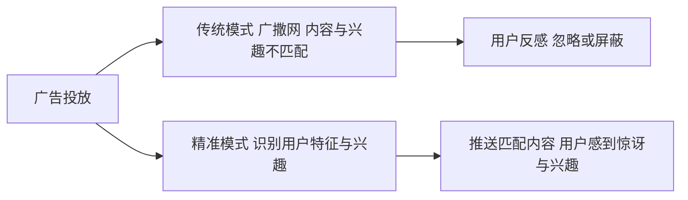

# 什么是推荐系统：从信息过载到个性化推荐

打开一个电商页面，banner 位、侧边栏、弹窗全是广告；手机短信里的营销内容十条有九条与自己无关。用户反感这些内容，不是因为它是广告，而是因为它推的东西与自己的兴趣不匹配。把这件事反过来想，就得到了推荐系统的定义：在你没有主动表达需求的时候，替你找到你感兴趣的东西。这节课把推荐系统的来龙去脉讲清楚，它解决什么问题、与搜索有什么分工、在探花交友里以什么形态落地。

## 先给结论

- 推荐系统要解决两个问题：信息过载与用户无明确需求；在海量信息中找到用户感兴趣的物品，就是个性化推荐系统。
- 解决信息过载已有两个经典方案：分类目录与搜索引擎，但它们只能服务主动查找的用户，需求模糊时无能为力。
- 搜索与推荐的本质差异：搜索是用户主动表达需求、系统被动响应；推荐是系统主动分析用户历史行为、为兴趣建模后推送。
- 电商是推荐系统的先行者，最早实践个性化推荐的电商巨头靠它带来了可观的销售额增长，基于物品的协同过滤算法也是由它最早提出。
- 推荐已渗透各个行业：好友推荐、视频推荐、图书与餐饮推荐；探花交友里推荐的对象是人，今日佳人与好友推荐正是推荐系统的落地形态。

## 一、从广告说起：精准是广告的未来

广告无处不在，报纸、电视、网站、短信、邮件里都能见到它的身影：电商页面中间的横幅位、右侧的推广栏，短信里的优惠促销，还有体验最差的弹窗广告。用户对广告已经普遍抱有反感情绪，原因值得咬准：不是反感广告这种形式本身，而是它展现的内容与个人的兴趣爱好、关注度不匹配。

未来的广告必然往精准推荐的方向发展。设想一个广告位通过摄像头做人脸识别，识别出你是一个 20 到 30 岁的男性用户，就推汽车广告；换一位女性用户过来，就推化妆品广告。此时用户不会反感，反而会感到惊讶：原来广告是按照我的喜好来推的。广告只要做到精准，广告就不再是广告了，这是广告的未来，也是推荐思维最直观的一次亮相。

两种模式的差别如图：



图里两条路径的分岔点在于是否了解用户：不了解用户就只能广撒网，转化靠运气；了解用户之后，每一次展现都带着判断，广告位从打扰变成了服务。

## 二、推荐系统要解决的两个问题

现在可以给出定义。推荐系统解决的是信息过载与用户无明确需求这两个问题：互联网上的内容与商品远超任何一个人能浏览的量，这是信息过载；而用户很多时候连自己要什么都说不清楚，这是需求不明确。在用户没有明确表达需求的前提下，系统主动找到用户感兴趣的物品，这就是个性化推荐系统。

解决信息过载其实已经有代表性的方案，就是分类目录与搜索引擎。分类目录把网站按类目罗列，用户顺着目录点进去；搜索引擎靠关键词检索，一次查询直达结果。它们把信息过载的问题解决得不错，但都有一个共同的前提：用户得知道自己要找什么。

需求不明确时它们就无能为力了。有一段非常经典的对话：你想吃什么？随便。体现的正是需求不明确，而且这种「随便」的用户偏偏又得罪不起，只能去分析他的行为、为他的兴趣建模，推给他符合需求的内容。不知道女友想吃什么，可以问问她的闺蜜，了解她平时喜欢吃什么，再据此去点餐；问闺蜜这个动作，本质就是收集用户的历史行为，从而推断她的兴趣与需求。推荐系统做的正是这件事，只是把「闺蜜」换成了算法。

## 三、搜索与推荐：分工与边界

把两种信息获取方式放到一张表里对比，边界就清楚了：

| 维度 | 搜索引擎 | 推荐系统 |
| --- | --- | --- |
| 需求表达 | 用户主动输入查询词 | 用户不表达，系统从行为中挖掘 |
| 系统输入 | 明确的关键词 | 浏览、点击、下单等历史行为 |
| 典型场景 | 知道要找什么 | 不知道要什么，或闲逛 |
| 结果特征 | 与查询词匹配 | 与用户兴趣匹配 |

两者是互补关系而不是替代关系：用户带着明确需求来，搜索效率最高；用户没有需求甚至意识不到自己有需求，推荐才有价值。大多数成熟平台两者并存，首页的信息流交给推荐，搜索框留给主动查找。

落到工程上，推荐系统的原料是一张行为数据矩阵：行为越多、越新，推断越准。一张简化的示意矩阵如下，数字代表兴趣强度，0 表示没有任何互动：

```text
          对象1  对象2  对象3  对象4
用户甲       2      0      1      0
用户乙       2      0      0      0
用户丙       0      3      1      0
```

推荐系统的工作，就是从这样的矩阵里找出每个用户最可能感兴趣、却还没有发生互动的对象。矩阵的一行可以看成一个用户的偏好向量，这与 MLlib 里的向量与矩阵类型一脉相承，前面的数据类型铺垫正是在为这一步做准备。

## 四、电商先行：各家平台都在怎么推

电子商务是推荐系统的先行者，推荐系统最先在电商网站上实践并取得了非常好的成绩。行业里流传最广的数据来自最早使用个性化推荐的那家电商巨头：个性化推荐为它带来了至少 30% 的销售额增长；它也最早提出了基于物品的协同过滤算法，至今仍是推荐领域的基石。

具体的推荐形态各家都有代表作品。电商平台上，把一部手机加入购物车，下方立刻出现「购买了该商品的用户还购买了」，列出来的是手机贴膜、保护套这类配件。仔细想想这有多智能：买手机的人，需求通常不是再买另一部手机，而是配件，推荐恰好猜中了这层需求。另一家平台按浏览记录猜你喜欢，搜索过某款手机，首页就推荐这款手机，用户感兴趣就点击购买，销量随之提升。图书平台上，「浏览此商品的顾客也同时浏览了」把买书人的相关兴趣串起来。

推荐系统远不止在电商。社交产品里的好友推荐，把「朋友的朋友」推给你认识；微博类产品里「你可能感兴趣的人」也是同样思路；视频网站根据观影历史推断你喜欢哪一类电影，然后持续推送；图书社区的图书推荐、点评类平台的餐饮推荐，形式各异，内核相同。推荐系统在如今的各行各业中都已是不可缺少的系统。

回到探花交友，推荐的对象不是商品而是人。首页的今日佳人，是把与你的画像、行为最匹配的用户推到你面前；好友推荐，是把「和你相似的用户认识的人」介绍给你。数据形态从「用户对商品的行为」换成了「用户对用户的行为」，业务上还叠加了距离、年龄、标签等交友特有的条件，但行为收集、兴趣建模、结果排序这套骨架完全一致。

一条探花场景下的用户行为日志示意如下，字段结构为按本课写法补全的示例：

```json
{
  "userId": 1001,
  "targetUserId": 2002,
  "action": "visit_home",
  "staySeconds": 36,
  "ts": 1698752400000
}
```

userId 是行为发起人，targetUserId 是行为对象，action 记录行为类型（浏览主页），staySeconds 是停留时长，ts 是发生时间。这类日志持续积累，就构成了上一段所说行为矩阵的原始来源。

## 常见误区

- **把推荐系统等同于广告投放。** 错例：以为推荐系统就是电商页面的广告位。正解：广告只是推荐的一种应用形态，好友推荐、内容推荐、商品推荐同属推荐系统，核心都是行为数据加兴趣建模。
- **认为有了搜索就不需要推荐。** 错例：用户要什么搜什么就行，推荐是可有可无的花瓶。正解：搜索只能解决用户主动查找的需求，需求模糊或根本没有需求时只有推荐能补位，两者互补。
- **认为必须等用户明确表达才能推荐。** 错例：用户没点过评分、没写过评论，就没有数据可用。正解：行为即表达，浏览、停留、点击、收藏都可以折算成兴趣信号，而且大多数场景根本没有显式评分。
- **把精准推荐理解成每次都推得完全准确。** 错例：推荐结果不中就断定系统没用。正解：推荐是概率性的预测，靠行为闭环不断修正，数据积累越多准确率越高。

## 面试可能被问到的问题

1. 面试官追问：「推荐系统解决的是什么问题？」
   答：两个问题，信息过载与用户无明确需求。互联网内容远超个人可浏览的量，而用户很多时候说不清自己要什么；推荐系统在用户不主动表达的前提下，通过分析历史行为建立兴趣模型，主动找到用户感兴趣的物品。
2. 面试官追问：「搜索引擎和推荐系统的区别是什么？」
   答：搜索是用户主动表达需求、系统被动响应，输入是明确的查询词，结果与查询词匹配；推荐是系统主动分析用户历史行为，输入是行为数据，结果与用户兴趣匹配。搜索解决有明确需求的查找，推荐解决无明确需求的发现，两者互补。
3. 面试官追问：「举几个推荐系统的实际应用？」
   答：电商的场景化推荐，如购物车页面的相关购买推荐；社交产品的好友推荐与可能认识的人；视频网站按观影历史的电影推荐；图书与本地生活平台的商品、餐饮推荐。最早的实践来自电商，个性化推荐带来了可观的销售额增长。
4. 面试官追问：「为什么说精准是广告的未来？」
   答：用户反感的不是广告形式而是内容与兴趣不匹配；广告如果能基于用户特征与兴趣做精准投放，就从打扰变成有价值的信息，用户接受度与转化率同时提升，所以精准化是广告必然的演进方向。
5. 面试官追问：「探花交友里的推荐系统推荐的是什么，与电商推荐有什么异同？」
   答：推荐对象是人，今日佳人与好友推荐是典型场景。相同点是骨架一致，都要收集用户行为、建立兴趣模型、计算匹配并排序输出；不同点是数据形态变成用户对用户的行为，业务上还要叠加距离、年龄、标签等交友维度的过滤条件。

## 配套资料

- 学习目标：`materials/code/07/day07 探花交友-SparkMLlib推荐系统快速入门/day07/学习目标.md`，其中「了解什么是推荐系统」对应本课内容。
- 数据集目录：`materials/code/07/day07 探花交友-SparkMLlib推荐系统快速入门/day07/资料/ml-100k/`，经典推荐研究数据集所在目录，后续 ALS 实战会用到，其评分矩阵形态可作为本课行为矩阵的对照。
- 说明：day07 资料包无本课源码，行为日志 JSON 与兴趣矩阵为按本课写法补全的示例，各行业推荐案例按课程画面整理。
