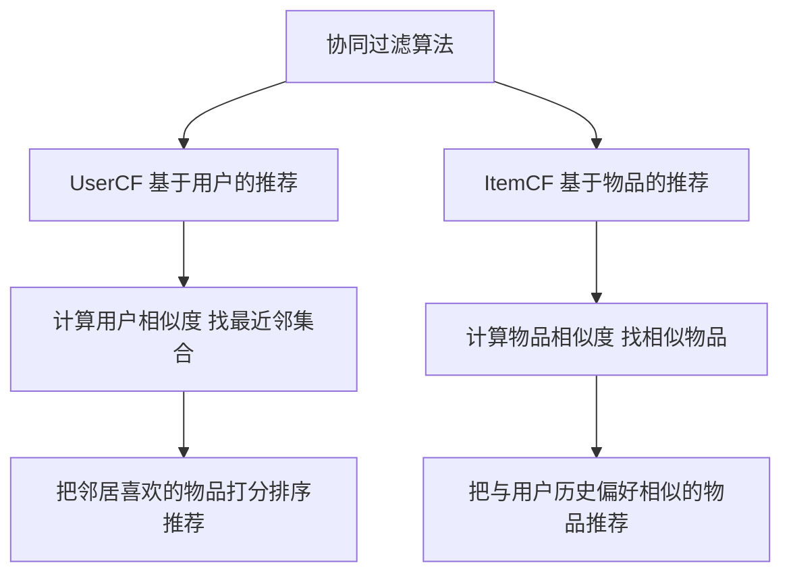

# 协同过滤算法 UserCF：找到和你相似的人，推荐他喜欢的

推荐算法的家族很庞大，但要说迄今为止在个性化推荐领域最成功的技术，答案是协同过滤。国内外的各大网站都拿它来搭建推荐系统，探花交友的好友推荐走的也是这条路线。它的名字听起来玄，内核却是一个朴素的常识：想知道一样东西好不好、适不适合你，去问和你品位相似的人。这节课把协同过滤的核心思想、UserCF 的推演过程、相似度怎么算、优缺点在哪，一次讲清。

## 先给结论

- 协同过滤的核心思想：在海量用户中发掘出一小部分和你品位类似的人，算法称之为邻居，把他们喜欢的东西推荐给你。
- 实现协同过滤要解决两个问题：如何定义邻居，也就是怎么计算用户相似度；如何把邻居们的喜好组织成一个有排序的推荐目录。
- 协同过滤有两个流派：基于用户的 UserCF 与基于物品的 ItemCF；UserCF 先算人与人之间的相似度，把邻居喜欢而目标用户没接触过的物品推给他。
- 相似度计算的数据形态就是前面各课铺垫的向量与矩阵：把每个用户的历史行为整理成偏好向量，再用余弦相似度、欧氏距离、皮尔逊相关系数等公式衡量两个向量的接近程度。
- UserCF 偏社会化推荐，能带来惊喜；代价是用户量大时相似度矩阵计算与存储开销巨大，且新用户没有行为时无法推荐。

## 一、核心思想与两个待解问题

协同过滤的英文是 Collaborative Filtering，过滤的对象是海量信息，依据是群体的协同判断。把它写成一句话：在海量用户中发掘出一小部分和你品位比较类似的人，在协同过滤中这些用户被称为邻居，然后根据他们喜欢的其他东西，生成一个有排序的目录作为推荐。说白了，先找到和你相似的用户，再根据他们的喜好猜测你可能也喜欢什么。

这句话里藏着两个必须解决的问题。第一，如何确定一个用户和你有相似的品位，也就是依据什么定义邻居，这是相似度计算问题。第二，如何将邻居们的喜好组织成一个有排序的目录，这是候选物品汇总与打分排序问题。把这两个问题解决掉，协同过滤算法也就落地了。

协同过滤有两个流派，划分的依据是「跟谁比相似」：



UserCF 回答的是「和你相似的人还喜欢什么」，ItemCF 回答的是「和你喜欢的东西相似的东西还有什么」。本课展开 UserCF，ItemCF 留给下一课。

## 二、生活化示例：买披萨的人

先看一个生活化的例子。有两个人，一个骑自行车的、一个步行的，前者买了披萨和扬州炒饭，后者也买了披萨和扬州炒饭。两个人之前都买了相同的东西，就有理由认为他们俩的喜好比较类似。这时发现骑车的哥们还买了一瓶可乐，那么就可以把可乐推荐给另一个人：既然你们如此相似，他喜欢的东西你大概率也会喜欢。

把例子翻译成表格，就是一张用户与物品的对照表，勾选代表买过或喜欢过：

| 用户/物品 | 披萨 | 扬州炒饭 | 可乐 |
| --- | --- | --- | --- |
| 用户甲 | √ | √ | √ |
| 用户乙 | √ | √ | |

用户乙缺的那一格，就是推荐位。协同过滤的全部魔法都发生在这张表的空格里：找到与目标用户最相似的其他用户，看他们的表格里还有什么目标用户没有的东西。

## 三、标准推演：从矩阵到推荐

把上面的直觉规范化。三个用户、四件物品的行为矩阵如下：

| 用户/物品 | 物品A | 物品B | 物品C | 物品D |
| --- | --- | --- | --- | --- |
| 用户A | √ | | √ | 推荐 |
| 用户B | | √ | | |
| 用户C | √ | | √ | √ |

推演步骤：用户A 购买了物品A 和物品C，用户C 购买了物品A、物品C 和物品D，两人购买行为的重合度最高，因此用户A 与用户C 更相似；用户B 只买了物品B，与谁都不相似。给用户A 做推荐时，看看与他最相似的用户C 还买了什么：物品D。于是把物品D 推荐给用户A。用户B 找不到邻居，从这张矩阵里推不出任何东西。

UserCF 的完整流程如图：


流程中的关键词是最近邻：与你相似的用户不止一个，所以邻居是一个集合，专业说法是先找到最近邻、算出邻居集合，该集合中的用户与目标用户有相似的喜好，算法根据邻居的偏好对目标用户进行预测。注意汇总打分这一步要按相似度加权：相似度高的邻居意见权重大，这样推荐目录才不是简单的人数统计。UserCF 的本质始终没变：先找到相似的用户，再根据其他用户的历史行为给这个用户做推荐。

## 四、相似度怎么算：给向量的接近程度定个尺

「品位相似」在数学上就是两个偏好向量的距离或夹角。把矩阵的每一行取出来，勾选写成 1、未写写成 0，就得到了每个用户的偏好向量：

```text
用户A  物品A=1  物品B=0  物品C=1  物品D=0
用户B  物品A=0  物品B=1  物品C=0  物品D=0
用户C  物品A=1  物品B=0  物品C=1  物品D=1
```

常用的尺子有四把：余弦相似度看两个向量的夹角，越接近 1 越相似；欧氏距离看空间直线距离，越小越相似；皮尔逊相关系数看两组打分的相关性，能消除打分习惯的影响；Jaccard 系数看两个集合的交并比，适合只有「买过/没买过」这种 0/1 数据的场景。

以余弦相似度为例，两向量夹角余弦等于点积除以模长乘积：

```java
//示例：余弦相似度计算，按本课写法与主流写法补全
public static double cosine(double[] a, double[] b) {
    double dot = 0, normA = 0, normB = 0;
    for (int i = 0; i < a.length; i++) {
        dot += a[i] * b[i];       //对应位置相乘累加
        normA += a[i] * a[i];     //a 向量各分量平方和
        normB += b[i] * b[i];     //b 向量各分量平方和
    }
    return dot / (Math.sqrt(normA) * Math.sqrt(normB));
}
```

代入上面的向量验证推演结果：用户A 与用户C 的点积为 2，模长乘积为根号 2 乘根号 3，相似度约为 0.82，明显相似；用户A 与用户B 的点积为 0，相似度为 0，毫无交集。数值与第三节「A 和 C 更相似」的结论完全吻合。这套计算放大的工程现实是：用户规模达到百万级时，两两相似度是上万亿级别的配对，所以相似度计算要靠 Spark 这类分布式平台完成，矩阵形态的数据正好交给前面学过的分布式矩阵与后续的 ALS 算法处理。

## 五、优缺点与适用场景

UserCF 的优点有三条。第一，无需领域知识，完全靠群体行为驱动，不需要理解物品的内容属性。第二，推荐带惊喜度，邻居的兴趣可能覆盖你尚未接触的领域，能帮你发现意料之外的内容。第三，结果好解释，「和你相似的人也在买」是用户一听就懂的理由，社会化色彩强。

缺点同样明显。用户规模巨大时，两两相似度的计算与存储开销随用户数平方级增长，必须分布式化；新用户没有任何行为时找不到邻居，冷启动无从下手；用户兴趣漂移后，旧的相似度会失真，需要周期性重算；行为矩阵稀疏时，两个用户交集太少，相似度不可靠。

适用场景随之清晰：用户规模适中、强调社会化与个性化发现的平台适合 UserCF；物品规模远大于用户规模、内容属性强的场景往往 ItemCF 更合适。探花交友的场景里，推荐对象是人，行为是浏览主页、点赞、关注，「和你相似的用户喜欢的对象」正是 UserCF 的形状；当用户规模上来后，课程会用矩阵分解的思路做改进，把人降维到隐因子空间再算相似，ALS 实战在后续课程展开。

## 常见误区

- **把「相似的人」理解成人口属性相似。** 错例：按同城市、同年龄、同性别圈邻居，这不是协同过滤。正解：协同过滤的相似来自行为相似，人口属性只能做辅助过滤条件。
- **只找一个最像的人当邻居。** 错例：只取相似度第一的用户，把他喜欢的东西直接推。正解：邻居是集合，要取 Top-N 并按相似度加权汇总，单一邻居会放大偶然行为。
- **把 UserCF 与 ItemCF 混为一谈。** 错例：以为两者只是名字不同，计算对象随便选。正解：UserCF 算用户相似度、推邻居喜欢的物品，ItemCF 算物品相似度、推与历史偏好相似的物品，视角与适用场景都不同。
- **忽视冷启动问题。** 错例：新注册用户一进来就指望 UserCF 给出个性化推荐。正解：新用户无行为时 UserCF 失效，要配热门推荐、画像召回等兜底策略，等行为积累后再切换。

## 面试可能被问到的问题

1. 面试官追问：「协同过滤算法的核心思想是什么？」
   答：在海量用户中发掘出一小部分与你品位类似的人，称为邻居，然后根据邻居喜欢的其他东西生成一个有排序的目录作为推荐。它要解决两个问题：如何定义邻居即计算相似度，如何把邻居的喜好组织成有序的推荐目录。
2. 面试官追问：「UserCF 的实现步骤是什么？」
   答：收集用户行为数据构造成用户与物品的矩阵；计算用户两两之间的相似度；为目标用户选出相似度最高的 Top-N 最近邻集合；汇总邻居的偏好并对候选物品按相似度加权打分；排序后生成推荐目录。
3. 面试官追问：「常见的相似度算法有哪些，各适合什么数据？」
   答：余弦相似度衡量向量夹角，适合评分与偏好向量；欧氏距离衡量空间距离，适合稠密数值特征；皮尔逊相关系数衡量打分相关性，能消除用户打分习惯差异；Jaccard 系数衡量集合交并比，适合只有是否交互过的 0/1 数据。
4. 面试官追问：「UserCF 和 ItemCF 有什么区别，分别适合什么场景？」
   答：UserCF 先算用户相似度，把邻居喜欢的物品推荐给目标用户，偏社会化、惊喜度高，适合用户规模适中、兴趣发现强的场景；ItemCF 先算物品相似度，推与用户历史偏好相似的物品，稳定性好、可解释为「买了又买」，适合物品规模相对稳定、内容属性强的电商场景。
5. 面试官追问：「UserCF 有什么缺点，怎么缓解？」
   答：用户量大时两两相似度计算与存储是平方级开销，可用分布式平台计算并只保留 Top-K 相似度；新用户无行为无法推荐，需要热门推荐等冷启动兜底；兴趣漂移与行为稀疏会失真，要周期性重算并叠加隐式行为折算。规模进一步变大时，可改用矩阵分解把用户映射到隐因子空间再算相似。
6. 面试官追问：「为什么说协同过滤是推荐领域最成功的技术？」
   答：它不需要领域知识与内容标注，只靠群体行为就能工作；原理直观、结果可解释；在大型网站经受了规模与效果的长期验证，基于用户的和基于物品的两个流派都衍生出成熟工程方案，是绝大多数推荐系统的起点。

## 配套资料

- 学习目标：`materials/code/07/day07 探花交友-SparkMLlib推荐系统快速入门/day07/学习目标.md`，其中「掌握基于用户的协同过滤算法」对应本课内容，相邻条目「掌握基于商品的协同过滤算法」为下一课内容。
- 说明：day07 资料包无本课源码，余弦相似度计算示例为按本课写法与主流写法补全，用户与物品对照表按课程画面整理。
