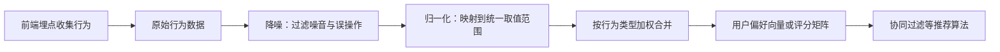

# 用户偏好数据收集：推荐系统的燃料从哪里来、怎么处理

协同过滤的整套推导都建立在一个前提上：系统知道每个用户对每个物品的偏好有多大。可翻遍数据库找不到一个字段直接叫「偏好」，它藏在一堆行为里：一次评分、一个赞、一段停留时长。这一课讨论两个问题：哪些行为值得收集，收集到的原始行为能不能直接用。在推荐系统的业务流程里，偏好数据是最基础的一层，也是最重要的一层，这一层薄了，后面的算法再精巧也转不动。

## 先给结论

- 用户与物品的关系最终要通过行为数据来体现，偏好数据是推荐系统最基础也最重要的数据。
- 行为分显式与隐式两类：评分、投票、转发、保存书签、标记标签、评论是显式；点击流、页面停留时长是隐式。
- 显式行为能精确或经分析得到偏好，隐式行为需要推理分析，两者的覆盖面互补。
- 原始行为不能直接喂给算法：先降噪过滤噪音与误操作，再归一化把不同量纲的数据拉进统一取值范围。
- 收集哪些行为由应用场景决定；探花交友这类社交产品可从浏览、点赞、评论、关注、发消息里取信号。

## 一、一张表看全：用户行为和用户偏好

课程用一张表把常见行为归了类，也就是画面上的「表 1 用户行为和用户偏好」：

| 用户行为 | 类型 | 特征 | 作用 |
| --- | --- | --- | --- |
| 评分 | 显式 | 整数量化的偏好，取值 `[0, n]`，n 一般取 5 或 10 | 通过用户对物品的评分，可以精确得到用户的偏好 |
| 投票 | 显式 | 布尔量化的偏好，取值 0 或 1 | 通过用户对物品的投票，可以精确得到用户的偏好 |
| 转发 | 显式 | 布尔量化的偏好，取值 0 或 1 | 精确得到偏好；站内转发还可以推理得到被转发人的偏好 |
| 保存书签 | 显式 | 布尔量化的偏好，取值 0 或 1 | 精确得到用户的偏好 |
| 标记标签 | 显式 | 一串单词，需要对单词进行分析得到偏好 | 通过标签得到用户对物品的理解，还能分析出用户情绪，喜欢还是讨厌 |
| 评论 | 显式 | 一段文字，需要文本分析得到偏好 | 通过评论得到用户的情感，喜欢还是讨厌 |
| 点击流（查看） | 隐式 | 一组用户的点击，需要分析得到偏好 | 点击在一定程度上反映了用户的注意力与兴趣 |

逐行说重点。评分是最典型的显式行为：买了一个手机打了五星好评，说明喜好度高；买了个鼠标觉得不好用，只给一星，喜好度显然低一截。投票、保存书签这类行为是布尔量化，只有 0 和 1 两个取值，但同样能精确表达偏好。转发多一层信息：把内容转发给某人，一定是对它感兴趣，如果是站内转发，还能顺带推理出被转发人的偏好。标记标签与评论是文本，要做文本分析才能读出偏好，顺带还能分析用户的情绪。点击流属于隐式行为，一组点击记录需要分析才能得到偏好。

表之外课程还补充了两个信号。页面停留时长：喜好度高的商品浏览时间就长，喜好度低的停留就短，时长本身携带偏好信息。购买动作：喜好度不高绝不会购买，它是强度最高的信号之一。

显式与隐式的分工可以这样概括：**显式是用户主动举手告诉你他喜欢什么，准确但稀疏；隐式是用户的行为在替他说话，量大但需要翻译。** 实际系统两条腿都要，缺了显式少了准头，缺了隐式少了覆盖。

## 二、探花交友里收集什么、怎么落库

以探花交友为例，可以照上面两张网各收一遍：隐式信号有查看他人主页、浏览动态、视频播放的停留时长；显式信号有点赞、评论、关注、发消息，以及问卷里选择的偏好项。落库的常见做法分三层：行为发生时写入行为流水表留底；Redis 计数器做实时聚合与去重，撑住高频读取；定时任务把流水汇总成用户偏好向量，供推荐计算使用。

行为流水表的建表示例（资料包无本课源码，示例为按本课写法补全）：

```sql
-- 用户行为流水表，示例为按本课写法补全
CREATE TABLE `user_action` (
  `id` bigint NOT NULL AUTO_INCREMENT COMMENT '主键',
  `user_id` bigint NOT NULL COMMENT '用户id',
  `target_id` bigint NOT NULL COMMENT '被操作对象id，如动态、用户、视频',
  `action_type` tinyint NOT NULL COMMENT '行为类型：1浏览 2点赞 3评论 4关注 5发消息',
  `weight` double NOT NULL DEFAULT '1' COMMENT '行为权重，如浏览1、点赞3、关注5',
  `created_at` datetime NOT NULL COMMENT '行为发生时间',
  PRIMARY KEY (`id`),
  KEY `idx_user_target` (`user_id`,`target_id`)
) ENGINE=InnoDB DEFAULT CHARSET=utf8mb4 COMMENT='用户行为流水表';
```

字段设计有两个要点：行为类型单独成列，方便按行为类别加权；时间列必须保留，兴趣会随时间衰减，汇总偏好时旧行为要降权。

## 三、预处理：降噪与归一化



这张图讲的是从埋点到算法入口之间的预处理链路，降噪与归一化两道工序缺一不可。

降噪针对的是数据质量。用户行为数据是在用户使用过程中产生的，里面混着大量噪音与误操作：比如搜索手机时机型打错了、多一个字或少一个字，这些误操作要过滤掉。做法是用数据挖掘中的经典算法过滤噪音数据，让后续分析更准确。

归一化针对的是数据可比性。汇总偏好时会对不同行为加权，但各类数据的取值范围差异很大：评分可能是 1 到 5，转发只有 0 到 1。不做处理直接加权，量纲大的数据会淹没量纲小的。归一化把各类数据换算到统一的数值范围内：用每类数据除以该类中的最大值，取值就落进 0 到 1，各行为在同一个尺度上公平参与加权。

```java
package com.study.tanhua.spark.preference;

import java.util.LinkedHashMap;
import java.util.Map;

/**
 * 偏好归一化示例，示例为按本课写法补全
 * 每类行为除以该类最大值，映射到 0 到 1
 */
public class NormalizeDemo {

    //actions：行为类型 -> 原始分值；maxOf：行为类型 -> 该类最大值
    public static Map<String, Double> normalize(Map<String, Double> actions,
                                                Map<String, Double> maxOf) {
        Map<String, Double> result = new LinkedHashMap<>();
        for (Map.Entry<String, Double> e : actions.entrySet()) {
            result.put(e.getKey(), e.getValue() / maxOf.get(e.getKey()));
        }
        return result;
    }

    public static void main(String[] args) {
        Map<String, Double> actions = new LinkedHashMap<>();
        actions.put("rating", 4.0);   //评分 4 分
        actions.put("browse", 120.0); //停留 120 秒
        Map<String, Double> maxOf = new LinkedHashMap<>();
        maxOf.put("rating", 5.0);
        maxOf.put("browse", 300.0);
        System.out.println(normalize(actions, maxOf));
        //评分 4.0 归一化为 0.8，停留 120 秒归一化为 0.4
    }
}
```

两句话记住这一课的落点：收集完用户数据千万不能直接使用，必须先做前置性的预处理；降噪负责让数据干净，归一化负责让数据可比。

## 常见误区

- **只收显式，不要隐式。** 错例：只记评分与点赞，结果大部分用户没有可用数据。正解：显式精确但稀疏，点击流与停留时长这类隐式数据覆盖广，两者互补着用。
- **不同量纲直接相加。** 错例：评分 4 加转发 1 加停留 120 秒，停留时长一家独大。正解：先按类别归一化到 0 到 1，再按行为重要性加权合并。
- **跳过降噪。** 错例：把误点击、打错的搜索词当真实兴趣喂给算法。正解：预处理阶段过滤噪音与误操作，再进推荐链路。
- **只存行为，不存时间。** 错例：三年前的兴趣和昨天的兴趣同权重参与汇总。正解：行为表保留时间字段，汇总偏好时按时间衰减给旧行为降权。

## 面试可能被问到的问题

1. 面试官追问：「显式反馈和隐式反馈有什么区别？」
   答：显式反馈是用户主动表达的偏好，如评分、投票、转发、评论，能精确或经文本分析得到偏好，但数据稀疏；隐式反馈是用户被动产生的行为，如点击流、页面停留时长，量大且覆盖广，只反映注意力与兴趣，需要分析推理才能转化为偏好。
2. 面试官追问：「行为数据采集之后为什么不能直接用？」
   答：原始数据混有噪音与误操作，且不同行为取值范围差异大，比如评分 1 到 5、转发 0 到 1。必须先降噪过滤误操作，再归一化把各类数据拉进统一取值范围，之后的加权合并才有意义。
3. 面试官追问：「归一化一般怎么做？」
   答：常用做法是每类数据除以该类中的最大值，把取值映射到 0 到 1；也可以用最小最大缩放或均值方差标准化。目的都是消除量纲差异，让不同行为在加权时公平。
4. 面试官追问：「推荐系统里你会收集哪些用户行为？」
   答：按业务场景定。以社交产品为例：浏览与停留时长作为隐式信号，点赞、评论、关注、发消息作为显式信号，每类行为配一个权重，降噪归一化后汇总成偏好向量供协同过滤使用，行为流水落库留底便于回溯。

## 配套资料

- 学习目标：`materials/code/07/day07 探花交友-SparkMLlib推荐系统快速入门/day07/学习目标.md`，其中「了解用户偏好数据的收集」对应本课内容。
- 说明：day07 资料包无本课源码，行为流水表结构与归一化示例为按本课画面与主流写法补全。
